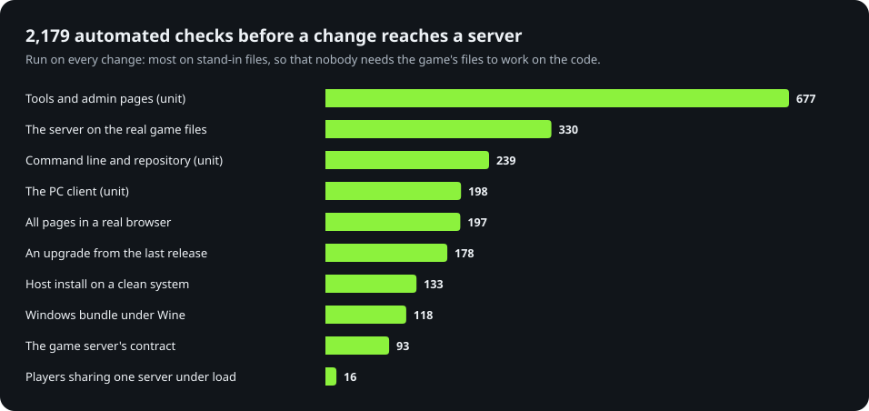

# Contributing to OpenDMTQ

Bug reports, fixes, translations and new features are all welcome. This guide shows where the code is, how to run it
and its tests on your PC, and how a change goes in. **You do not need the game's files for most of it:** the tests make
stand-in files of their own.

| You know | A good place to start |
|---|---|
| The game, or running a server | [Report what did not work](https://github.com/kanggu12/openDMTQ/issues/new/choose), improve a [guide](docs/README.md) |
| Another language | The site's and the admin pages' words: [Changing the pages](#changing-the-pages) |
| HTML, CSS, PHP | The players' site, `server/portal/` |
| Python | The admin pages and the tools, `tools/opendmtq_tools/`; the PC client, `client/` |
| Kubernetes or Docker | `deploy/helm/`, `compose.yaml` |
| C++ and Android | The runtime for newer phones, `arm32/` |

## Before you start

- **No game files, anywhere.** Do not attach or commit the game's APK, songs, charts, images or tables, and do not
  link to where they can be downloaded. Logs and screenshots of OpenDMTQ's own pages are fine. The tests run on
  stand-in files made by `tests/ui/make_content.php`, so most work needs none of the game's files.
- **Security problems** go to [SECURITY.md](.github/SECURITY.md), not to an issue.
- Be kind: see the [code of conduct](.github/CODE_OF_CONDUCT.md).

## Where the code is

<p align="center">
  
</p>

| Path | What it is | Start reading at |
|---|---|---|
| `server/game/` | The game server: every request of the game and of its platform SDK | `index.php`, then `src/rpc.php` (`odq_methods`) |
| `server/portal/` | The players' site: rankings, songs, players, the app download, the live broadcasts | `lib.php`, then the page you change |
| `server/apache/` | Apache's configuration: its listeners, and which path goes to which file or program | `site.conf` |
| `server/edge/` | The edge proxy (nginx) with Docker Compose: one public port for plain HTTP and HTTPS | `nginx.conf` |
| `server/entrypoint.sh` | The server image's start: the database, the settings, then Apache | the file, top to bottom |
| `tools/opendmtq_tools/` | The tools, plain Python: the import (`importer.py`), the app builder and patcher (`builder.py`, `patch_apk.py`), the song list (`songs.py`), the ready-made runtime for newer phones (`runtime.py`) | the tool you change |
| `tools/opendmtq_tools/admin/` | The admin pages, a module per page: `status.py`, `apps.py`, `song_pages.py`, `players.py`, `accounts.py`, `recordings.py`, `backups.py`, `logs.py`, `setup.py`. What they share is in `core.py` (settings, language, database) and `auth.py` (sign-in). Their API is `api.py`, its routes in `api_routes.py` ([docs/api.md](docs/api.md)) | the page you change, then `core.py` |
| `opendmtq`, `cli/` | `./opendmtq` with Docker Compose: setup, import, deploy, checks, backups. `install.sh` puts it on the PATH and, with `--service`, starts the server at boot; `firewall.ps1` lets phones reach a server in WSL | `opendmtq_cli/app.py` (`main`) |
| `host/` | The same server without containers: `get.sh` and `install.sh` for Linux and macOS, `windows/` for the Windows bundle, and the program itself, a package in layers (`paths`, `settings`, `apache`, `server`, `commands`, `setup`) | `opendmtq_host/server.py` (`Server`) |
| `arm32/` | The runtime that runs the 32-bit game on 64-bit-only phones, and the live broadcast's capture | [arm32/README.md](arm32/README.md) |
| `client/` | The PC client for Windows: the launcher (Python and Tk), its installer and their tests. The player it starts is in `arm32/desktop/` | [client/README.md](client/README.md) |
| `deploy/helm/` | The Helm chart for Kubernetes | `values.yaml` |
| `tests/` | The tests beyond unit tests: the contract, the pages, an upgrade, the live server, the host install, the Windows bundle | [docs/testing.md](docs/testing.md) |

A request finds its way like this:

<p align="center">
  
</p>

[docs/architecture.md](docs/architecture.md) explains how the parts work together, and the quirks of the client the
replies depend on. Apache listens on more than one port. The guides call each one a door (the public one, and with
Docker Compose two that only the edge proxy reaches).

## Your first change

```sh
git clone https://github.com/kanggu12/openDMTQ.git && cd openDMTQ
KEEP=1 ONLY=full tests/ui/run.sh       # a whole server on stand-in files, with made-up players: some minutes
```

Open http://127.0.0.1:18801/ (site account `dmtq`, password `smoke-pass`). Change a word in `server/portal/strings.php`, in
both languages, and run the line again: the images are built from your tree, and the page shows it. Before you send it:

```sh
(cd cli && python3 -m unittest discover -s tests -t .)      # the repository's own checks, in a second or two
tests/ui/run.sh                                             # every page, at five widths, in both languages: about 15 minutes
```

## Run it on your PC

With Docker, from a clone: `./opendmtq setup --from <folder with your game files>`. Without the game's files, run the
server on stand-in files and keep it running to look at:

```sh
KEEP=1 tests/ui/run.sh         # the site at http://127.0.0.1:18801/ (site account dmtq), the admin pages at
                               # http://127.0.0.1:18802/opendmtq/admin/ (admin), both with the password smoke-pass
KEEP=1 tests/game/protocol.sh  # the game server alone, at http://127.0.0.1:18701/
```

They need Docker on Linux (or Docker Engine in WSL 2), Python 3, `curl` and GNU coreutils (on a Mac: `brew install
coreutils`). The first run builds both images and pulls a headless Chromium and ffmpeg: some minutes.

## Run the tests

<p align="center">
  
</p>

You do not have to run them all: pick the line for what you changed, and CI runs the rest on your pull request.

| You changed | Run | Needs |
|---|---|---|
| anything | `(cd cli && python3 -m unittest discover -s tests -t .)`: the command line's tests, and the repository's own checks (every unit test file of the tools, the command line and the PC client is in docs/test-cases.md, every pointer there still finds its text, every CSS class has a style, line endings) | Python 3.9 |
| `server/game/` | `tests/game/protocol.sh`, and PHP's syntax: `docker run --rm -v "$PWD/server:/s:ro" php:8.3-cli sh -c 'for f in $(find /s -name "*.php"); do php -l "$f" >/dev/null \|\| exit 1; done'` | Docker |
| `server/portal/`, `server/game/pages/`, `tools/opendmtq_tools/admin/` | `tests/ui/run.sh` | Docker on Linux |
| the database, or what is kept in `data/` | `tests/upgrade/run.sh`: the last release's images used as people use them, then this tree's on the same data | Docker, Python 3, and the last release's images (pulled, or loaded with `docker load`) |
| `tools/` | `docker build -t opendmtq-tools:local tools`, then `docker run --rm -v "$PWD/tools:/t:ro" -v "$PWD/server/portal:/server/portal:ro" -v "$PWD/arm32:/arm32:ro" --entrypoint sh opendmtq-tools:local -c 'cd /t && python3 -m unittest discover -s tests -t .'` | Docker |
| `client/` | `docker build -t opendmtq-client-ui:local client/tests/ui`, then `docker run --rm --network none -v "$PWD:/src:ro" -w /src/client opendmtq-client-ui:local python -m unittest discover -s tests -t .`, and `client/tests/ui/run.sh <folder>` (every page and dialog on a virtual screen, in both languages at three window sizes) | Docker |
| `host/`, `tools/opendmtq_tools/admin/setup.py` | `tests/host/run.sh` (`DISTRO=debian:12` for Debian; it goes through the setup in the browser) | Docker on Linux (it uses the host's network) |
| `host/windows/` | `tests/windows/wine.sh` (builds the bundle and runs it under Wine) | Docker |
| how a server gets its programs | `tests/closed/run.sh` does [Without internet](docs/closed-network.md) step by step, all but the PC client's installer, on a network with no way out | Docker on Linux; kind, Helm and root for Kubernetes |
| `arm32/` | `arm32/build.sh arm64-v8a`, then `arm32/test.sh` on a device (see [arm32/README.md](arm32/README.md)) | Docker, git, adb and a phone or an emulator of the same ABI |
| `arm32/desktop/`, the player for Windows | `arm32/build.sh`, then `arm32/build_windows.sh arm32run jvmtest audiotest mediatest settingstest player` and `arm32/test_windows.sh` (its tests under Wine) | Docker, git |
| `deploy/helm/` | `helm lint deploy/helm/opendmtq -f deploy/kind/values.yaml --set publicHost=10.0.0.5` | Helm |
| a shell script | `shellcheck <the script>`; for `arm32/*.sh`, `shellcheck --severity=warning -x -P arm32 <the script>` | ShellCheck |

CI runs all of these on every pull request, without the game's files, except `tests/closed/run.sh` and `arm32/test.sh`
(for the runtime, CI builds it). What needs the game's files runs in `tests/qa.sh` on a maintainer's machine: the server
on the real songs, the app built from the real client, and the patcher's tests on it. A change to the patcher
(`patch_apk.py`, `il2cpp.py`, `axml.py`) passes CI without ever meeting the real client, so say in the pull request that
it needs that run. [docs/testing.md](docs/testing.md) has the whole picture, and [docs/test-cases.md](docs/test-cases.md)
every case with the check that covers it.

<p align="center">
  
</p>

## Changing the game server

A request from the game reaches `game/index.php`, which hands the batch to `src/rpc.php`. To answer a new method:

1. Add it to `odq_methods()` in `src/rpc.php`, by its lowercase name, with the function that answers it.
2. Write that function in the file for its kind (`game.php`, `shop.php`, `user.php`, `ranking.php`,
   `achievement.php`). Answer with exactly the shape clients 1.3.5 and 1.3.4 read: a field one expects and does not
   find, or an empty list where it wants an entry, can close the game.
3. Add a check to `tests/game/protocol.py` that names the client behaviour it protects, and a row to
   `docs/test-cases.md` (the CLI tests fail until the row is there).

A method the server does not know gets the error SVC.05008, which the client handles without a popup. A batch with a
`shop.` method or `game.saveplayresult` must carry the game's signature (the `Fp` header), or the whole batch is
refused with 403: `protocol.py` signs its requests the way the client does.

## Changing the pages

The site and the admin pages come in English and Korean. The site's text is in the `STRINGS` table of
`server/portal/strings.php`, the admin pages' in `tools/opendmtq_tools/strings.py`: a new text goes into both languages
of its table, and `tools/tests/test_strings.py` checks them (and the spacing of Korean particles). The PC client's words
are in the `TEXT` table of `client/opendmtq_client/i18n.py`, both languages side by side, and `client/tests/test_words.py`
checks them. A few Korean texts live elsewhere: the in-game notices in `server/game/live/state.php`, the help page in
`server/game/pages/help.php`, the menu, notice card and error messages of the player for Windows in
`arm32/desktop/overlay_win32.cpp` and `arm32/desktop/own_folder.cpp`, the error messages of the Windows bundle's
`host/windows/launcher.c`, the dates and the language switch in
`server/portal/lib.php`, and one word each in `server/portal/player.php`, `tools/opendmtq_tools/admin/static/admin.css`,
`admin/templates/base.html` and `client/opendmtq_client/pages.py`. `tests/ui/run.sh` checks every page at five widths in
both languages, empty and full, and fails on text that is cut off or runs over another box. `client/tests/ui/run.sh` does
the same for the PC client's pages and dialogs at three window sizes.

## Adding an admin page

1. A module of its own in `tools/opendmtq_tools/admin/`, with `from .core import BASE, app, t` and its address under
   `@app.route(BASE + "/name")`. Add the module to the import in `admin/__init__.py`.
2. A template in `admin/templates/` that extends `base.html`, and a link in the menu there.
3. Its words in both languages of `tools/opendmtq_tools/strings.py`.
4. A test in `tools/tests/` through the test client (`Install` in `test_admin.py` gives a signed-in one on a temporary
   server), the page in `tests/ui/audit.js` so that its layout is checked at every width, and a row in
   `docs/test-cases.md`.

## Adding a tool to the server

The tools are plain Python, run the same way in the tools image, on a host install and in the Windows bundle
(`python -m opendmtq_tools.<name>`). They read their folders from the environment (`OPENDMTQ_APK`, `OPENDMTQ_DB`...), never
from a fixed path, and print one line per step: the admin pages show those lines as they come (`admin/jobs.py`).

## Style

- Comments in English, on most lines, saying why the line is there.
- Text on the pages: short and plain, one fact and what to do about it.
- `cli/` uses Python's standard library only (Python 3.9 and newer); the server code runs on PHP 8.1 and newer.
- Shell scripts pass ShellCheck.
- Nothing secret in logs or error messages: no passwords, keys or tokens.

## Commits and pull requests

- One change per pull request, with its tests and the docs it changes.
- The first line of a commit message says what changed; the lines below say why, when that is not plain.
- CI has to pass. A maintainer runs `tests/qa.sh` on the real game files before a release.

## Releases

Versions follow [Semantic Versioning](https://semver.org/): a release that adds something raises the minor number, one
that only fixes raises the patch number. A change notes itself under `## [Unreleased]` in [CHANGELOG.md](CHANGELOG.md)
([Keep a Changelog](https://keepachangelog.com/en/1.1.0/): Added, Changed, Fixed, Removed).

A release, by a maintainer:

1. Move the `[Unreleased]` notes under `## [1.2.3] - YYYY-MM-DD`, and set `version` and `appVersion` in
   `deploy/helm/opendmtq/Chart.yaml` to `1.2.3`.
2. Run `tests/qa.sh` on that commit, on a machine with the game's files: it marks the commit when everything passes.
   `CLIENTS=<folder>` checks the patcher against every APK in that folder too: the game's other version, a copy
   changed for another server.
3. Push the tag `v1.2.3`. `.github/workflows/release.yml` checks that the tag, the chart and the changelog name one
   version (`.github/release_notes.py`), runs CI again, checks the mark, and publishes the images, the Helm chart, the
   runtime for newer phones, the player for Windows, the Windows bundle, the PC client (its installer, `OpenDMTQ-Setup.exe`, and the packages installed clients update
   themselves from) and a GitHub release whose notes are that version's section of the changelog. Without the mark it
   stops: run `tests/qa.sh`, then run the release again (`gh run rerun`).

A release names itself by its number (`0.2.0`): the Windows bundle, the one-command install and the Helm chart. A copy
from a clone names itself by the date and commit of its code (`2026.11.07-62ce933`). The site shows it beside its logo,
and the admin pages on their Status page.
