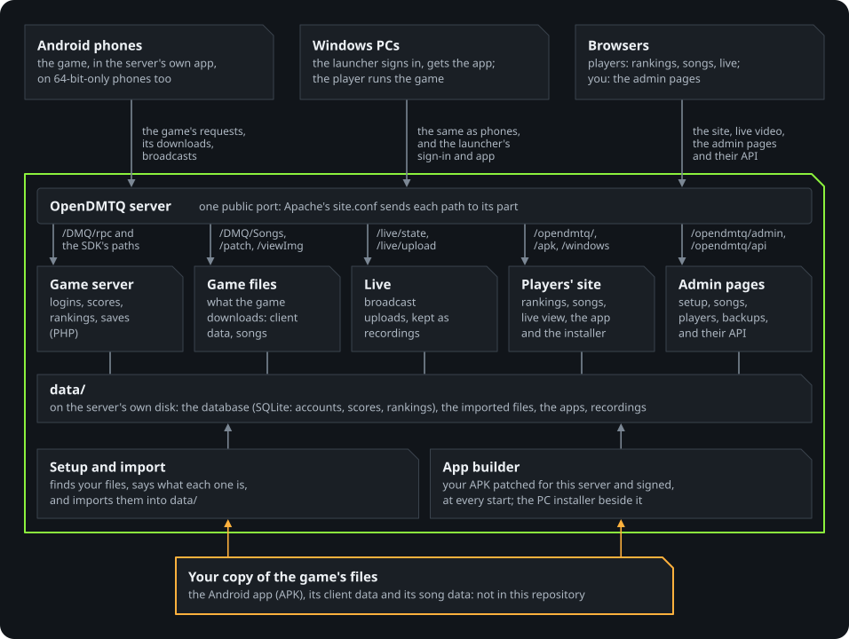
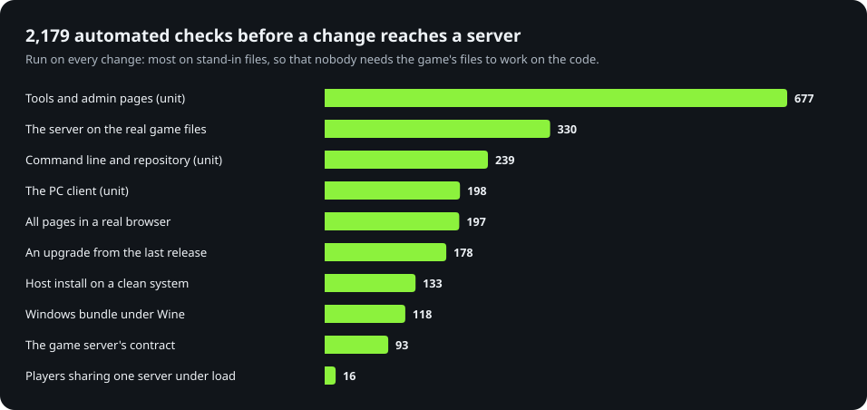

# Contributing to OpenDMTQ

Bug reports, fixes, translations and new features are all welcome. This guide shows where the code is, how to run it
and its tests on your PC, and how a change goes in. **You do not need the game's files for most of it:** the tests make
stand-in files of their own.

| You know | A good place to start |
|---|---|
| The game, or running a server | [Report what did not work](https://github.com/kanggu12/openDMTQ/issues/new/choose), improve a [guide](docs/README.md) |
| Another language | The site's and the admin pages' words: [Changing the pages](#changing-the-pages) |
| HTML, CSS, PHP | The players' site, `server/portal/` |
| Python | The admin pages and the tools, `tools/opendmtq_tools/`; the PC client, `client/` |
| Kubernetes or Docker | `deploy/helm/`, `compose.yaml` |
| C++ and Android | The runtime for newer phones, `arm32/` |
| C++ and Windows | The player for Windows, its picture and its overlay, `arm32/desktop/` |

## Before you start

- **No game files, anywhere.** Do not attach or commit the game's APK, songs, charts, images or tables, and do not
  link to where they can be downloaded. Logs and screenshots of OpenDMTQ's own pages are fine. The tests run on
  stand-in files made by `tests/ui/make_content.php`, so most work needs none of the game's files.
- **Security problems** go to [SECURITY.md](.github/SECURITY.md), not to an issue.
- Be kind: see the [code of conduct](.github/CODE_OF_CONDUCT.md).

## Where the code is

OpenDMTQ is a server for the game (Apache with PHP), a players' site, admin pages and tools in plain Python, an app
patcher, a runtime that runs the game's 32-bit code on 64-bit-only phones, and a PC client for Windows:

<p align="center">
  
</p>

[The parts](docs/architecture.md#the-parts) in the architecture guide name each part's code, where to start reading
and what checks it; the rest of that guide says how the parts work together, and the quirks of the client the replies
depend on. The folders, and the way a request takes through them:

<p align="center">
  
</p>

Apache listens on more than one port, and the guides call each one a door: on a host install the server's one port;
with Docker Compose two that only the edge proxy reaches (8081 for plain HTTP, 8443 for the HTTPS it has decrypted), and
8080, which the Helm chart's router and the services inside use. The admin pages and their API go through the same
doors to the admin service, which has no port that anybody opens.

## Your first change

```sh
git clone https://github.com/kanggu12/openDMTQ.git && cd openDMTQ
KEEP=1 ONLY=full tests/ui/run.sh       # a whole server on stand-in files, with made-up players: some minutes
```

Open http://127.0.0.1:18801/ (site account `dmtq`, or the owner's `admin`, password `smoke-pass`). Change a word in
`server/portal/strings.php`, in both languages, and run the line again: the images are built from your tree, and the
page shows it. Before you send it:

```sh
(cd cli && python3 -m unittest discover -s tests -t .)      # the repository's own checks, in a second or two
tests/ui/run.sh                                             # every page, at five widths, in both languages: about 15 minutes
```

## Run it on your PC

With Docker, from a clone: `./opendmtq setup --from <folder with your game files>`. Without the game's files, run the
server on stand-in files and keep it running to look at:

```sh
KEEP=1 tests/ui/run.sh         # the site at http://127.0.0.1:18801/ (site account dmtq), the admin pages at
                               # http://127.0.0.1:18801/opendmtq/admin/ (admin), both with the password smoke-pass
KEEP=1 tests/game/protocol.sh  # the game server alone, at http://127.0.0.1:18701/
```

They need Docker on Linux (or Docker Engine in WSL 2), Python 3, `curl` and GNU coreutils (on a Mac:
`brew install coreutils`). The first run builds both images and pulls a headless Chromium and ffmpeg: some minutes.

## Run the tests

<p align="center">
  
</p>

You do not have to run them all: pick the line for what you changed, and CI runs most of the rest on your pull request
(below).

| You changed | Run | Needs |
|---|---|---|
| anything | `(cd cli && python3 -m unittest discover -s tests -t .)`: the command line's tests, and the repository's own checks (every unit test file of the tools, the command line and the PC client is in docs/test-cases.md, every pointer there still finds its text, every CSS class has a style, line endings) | Python 3.9 |
| `server/game/` | `tests/game/protocol.sh`, and PHP's syntax: `docker run --rm -v "$PWD/server:/s:ro" php:8.3-cli sh -c 'for f in $(find /s -name "*.php"); do php -l "$f" >/dev/null \|\| exit 1; done'` | Docker |
| `server/portal/`, `server/game/pages/`, `tools/opendmtq_tools/admin/` | `tests/ui/run.sh` | Docker on Linux |
| the database, or what is kept in `data/` | `tests/upgrade/run.sh`: the last release's images used as people use them, then this tree's on the same data | Docker, Python 3, and the last release's images (pulled, or loaded with `docker load`) |
| who reaches the admin pages (`server/entrypoint.sh`, `host/opendmtq_host/apache.py`) | `tests/access/run.sh`: the server PC's own visit, one through a proxy on it and one from elsewhere, under Docker's settings and a host install's | Docker |
| how a server starts or updates (`cli/`, `host/`, the port) | `tests/upgrade/compose.sh`, `tests/host/update.sh`, `tests/windows/update.sh`: a server of the last release updated as its owner does it, with Docker Compose, as a host install and as the Windows bundle | Docker with Compose, git |
| the Server page's commands (`repair`, `delete-data`, `uninstall`) | `tests/lifecycle/compose.sh` | Docker with Compose |
| `tools/` | `docker build -t opendmtq-tools:local tools`, then `docker run --rm -v "$PWD/tools:/t:ro" -v "$PWD/server/portal:/server/portal:ro" -v "$PWD/server/game:/server/game:ro" -v "$PWD/arm32:/arm32:ro" --entrypoint sh opendmtq-tools:local -c 'cd /t && python3 -m unittest discover -s tests -t .'` | Docker |
| `client/` | `docker build -t opendmtq-client-ui:local client/tests/ui`, then `docker run --rm --network none -v "$PWD:/src:ro" -w /src/client opendmtq-client-ui:local python -m unittest discover -s tests -t .`, and `client/tests/ui/run.sh <folder>` (every page and dialog on a virtual screen, in both languages at three window sizes and at 200 %, with the spacing measured; the keyboard alone; a setting's change filmed for flicker; the notices; the sound kept after a game; the installer's window; its checks side by side, `JOBS` at once, the flicker film first and alone) | Docker |
| the PC client's updates or a release's files (`client/opendmtq_client/updates.py`, `signing.py`, `.github/release_assets.py`) | `(cd cli && python3 -m unittest tests.test_release)`, then `tests/release/update_signed.sh` and `tests/release/update.sh` under Wine on a build of the PC client (each says what it needs at its top) | Docker |
| Play on this PC, the connection test or the report | `tests/windows/play_here.sh` on a Windows bundle with the PC client's installer in it | Docker |
| `host/`, `tools/opendmtq_tools/admin/setup.py` | `tests/host/run.sh` (`DISTRO=debian:12` for Debian; it goes through the setup in the browser) | Docker on Linux (it uses the host's network) |
| `host/windows/` | `tests/windows/wine.sh` (builds the bundle and runs it under Wine) | Docker |
| how a server gets its programs | `tests/closed/run.sh` does [Without internet](docs/closed-network.md) step by step, all but the PC client's installer and its updates, on a network with no way out | Docker on Linux; kind, Helm and root for Kubernetes |
| `arm32/` | `arm32/build.sh arm64-v8a`, then `arm32/test.sh` on a device (see [arm32/README.md](arm32/README.md)) | Docker, git, adb and a phone or an emulator of the same ABI |
| `arm32/desktop/`, the player for Windows | `arm32/build.sh`, then `arm32/build_windows.sh arm32run jvmtest audiotest mediatest settingstest livenettest glasstest player` and `arm32/test_windows.sh` (its tests under Wine) | Docker, git |
| `deploy/helm/` | `helm lint deploy/helm/opendmtq -f deploy/kind/values.yaml --set publicHost=10.0.0.5` | Helm |
| a shell script | `shellcheck <the script>`; for `arm32/*.sh`, `shellcheck --severity=warning -x -P arm32 <the script>` | ShellCheck |

CI runs most of these on every pull request, without the game's files: not `tests/closed/run.sh` and `arm32/test.sh`
(for the runtime, CI builds it), nor the updates of a server or of the PC client, the Server page's commands and Play on
this PC, which run by hand when a change touches them ([what runs where](docs/testing.md#what-runs-where)). What needs
the game's files runs in `tests/qa.sh` on a maintainer's machine: the server on the real songs, the app built from the
real client, and the patcher's tests on it. A change to the patcher (`patch_apk.py`, `il2cpp.py`, `axml.py`) passes CI
without ever meeting the real client, so say in the pull request that it needs that run. [docs/testing.md](docs/testing.md) has the whole picture, and [docs/test-cases.md](docs/test-cases.md)
every case with the check that covers it.

<p align="center">
  
</p>

## Changing the game server

A request from the game reaches `game/index.php`, which hands the batch to `src/rpc.php`. To answer a new method:

1. Add it to `odq_methods()` in `src/rpc.php`, by its lowercase name, with the function that answers it.
2. Write that function in the file for its kind (`game.php`, `shop.php`, `user.php`, `ranking.php`,
   `achievement.php`). Answer with exactly the shape clients 1.3.5 and 1.3.4 read: a field one expects and does not
   find, or an empty list where it wants an entry, can close the game.
3. Add a check to `tests/game/protocol.py` that names the client behaviour it protects, and a row to
   `docs/test-cases.md` (the CLI tests fail until the row is there).

A method the server does not know gets the error SVC.05008, which the client handles without a popup. A batch with a
`shop.` method, `game.getpreviewplayinfo` or `game.saveplayresult` for a player must carry that player's game's signature
(the `Fp` header, made with the key the player's own sign-in got), or the whole batch is refused with 403: `protocol.py`
signs in and signs its requests the way the client does.

## Changing the pages

The site and the admin pages come in English and Korean. The site's text is in the `STRINGS` table of
`server/portal/strings.php`, the admin pages' in `tools/opendmtq_tools/strings.py`: a new text goes into both languages
of its table, and `tools/tests/test_strings.py` checks them (and the spacing of Korean particles). The PC client's words
are in the `TEXT` table of `client/opendmtq_client/i18n.py`, both languages side by side, and `client/tests/test_words.py`
checks them. A few Korean texts live elsewhere: the in-game notices in `server/game/live/state.php`, the help page in
`server/game/pages/help.php`, the bar, the sound panel, the question before quitting and the notice card of the player
for Windows in `arm32/desktop/overlay_win32.cpp`, its own notices of a server that stops and starts answering in
`arm32/desktop/live_notice.h` (as UTF-8 bytes), its error messages in `arm32/desktop/own_folder.cpp`, the error
messages of the Windows bundle's `host/windows/launcher.c`, the dates and the language switch in `server/portal/lib.php`
and `ranking_lib.php`, a month in a chat's message in `tools/opendmtq_tools/admin/webhooks.py`, the words typed to
confirm a deletion or an uninstall in `admin/lifecycle.py`, and one word each in `server/portal/player.php`,
`server/portal/me_lib.php`, `tools/opendmtq_tools/admin/static/admin.css`, `admin/templates/base.html` and
`client/opendmtq_client/pages.py`. `tests/ui/run.sh` checks every page at five widths in both languages, empty and
full, and fails on text that is cut off or runs over another box. `client/tests/ui/run.sh` does the same for the PC
client's pages and dialogs at three window sizes and at 200 %.

## Adding an admin page

1. A module of its own in `tools/opendmtq_tools/admin/`, with `from .core import BASE, app, t` and its address under
   `@app.route(BASE + "/name")`. Add the module to the import in `admin/__init__.py`.
2. A template in `admin/templates/` that extends `base.html`, and a link in the menu there.
3. Its words in both languages of `tools/opendmtq_tools/strings.py`.
4. A test in `tools/tests/` through the test client (`Install` in `test_admin.py` gives a signed-in one on a temporary
   server), the page in `tests/ui/audit.js` so that its layout is checked at every width, and a row in
   `docs/test-cases.md`.

## Adding a tool to the server

The tools are plain Python, run the same way in the tools image, on a host install and in the Windows bundle
(`python -m opendmtq_tools.<name>`). They read their folders from the environment (`OPENDMTQ_APK`, `OPENDMTQ_DB`...), never
from a fixed path, and print one line per step: the admin pages show those lines as they come (`admin/jobs.py`).

## Style

- Comments in English, on most lines, saying why the line is there.
- Text on the pages: short and plain, one fact and what to do about it.
- `cli/` uses Python's standard library only (Python 3.9 and newer); the server code runs on PHP 8.1 and newer.
- Shell scripts pass ShellCheck.
- Nothing secret in logs or error messages: no passwords, keys or tokens.

## Commits and pull requests

- One change per pull request, with its tests and the docs it changes.
- The first line of a commit message says what changed; the lines below say why, when that is not plain.
- CI has to pass. Before a push to `main`, run CI's jobs on your computer: `python3 .github/ci_local.py` runs them the way
  GitHub does, each in a container standing in for GitHub's runner, as a user who is not root, on a fresh clone of the
  commit (Docker, git and Python 3 with PyYAML; the jobs for a Windows runner run on GitHub only). A maintainer runs
  `tests/qa.sh` on the real game files before a release.

## Releases

Versions follow [Semantic Versioning](https://semver.org/): a release with a new feature raises the minor number, one
of fixes, changes and smaller additions raises the patch number. A change notes itself under `## [Unreleased]` in
[CHANGELOG.md](CHANGELOG.md) ([Keep a Changelog](https://keepachangelog.com/en/1.1.0/): Added, Changed, Fixed,
Removed).

A release, by a maintainer:

1. Move the `[Unreleased]` notes under `## [1.2.3] - YYYY-MM-DD`, and set `version` and `appVersion` in
   `deploy/helm/opendmtq/Chart.yaml` to `1.2.3`. Then `python3 .github/doc_versions.py --write` puts `1.2.3` in the
   README's quick start and the guides' download lines, which fetch the release's files by their names (a test, and
   the release's gates, refuse a tree whose lines name another release than the chart's). Commit, run CI's jobs here
   (`python3 .github/ci_local.py`), push to `main`, and let CI pass on GitHub.
2. Run `tests/qa.sh` on that commit, on a machine with the game's files: it marks the commit when everything passes.
   `CLIENTS=<folder>` checks the patcher against every APK in that folder too: the game's other version, a copy
   changed for another server.
3. Rehearse it: `.github/release.sh --dry-run 1.2.3` makes every file of the release (the runtime for newer phones, the
   player for Windows, the PC client's installer and its update packages, the Windows bundle, the chart, the images for
   both platforms), lays them out under their names, checks them, and runs the release's own checks (the Windows bundle
   under Wine, a host install on Debian 12, the last release's PC client updating to these files), publishing nothing.
   `APK=<the game's client>` also builds the phone app in the checks that can.
4. Tag it (`git tag -a v1.2.3`), and publish from the machine that holds the project's signing key:
   `OPENDMTQ_SIGNING_KEY=<the key's file> .github/release.sh 1.2.3`. It checks the gates first (the tag is the commit's,
   the chart and the changelog name one version with notes, the guides' download lines name it, CI and the mark passed),
   makes and checks everything again, and only then pushes `main` and the tag, the images and the chart to GHCR, and the
   GitHub release with that version's section of the changelog as its notes. The release's checksums are signed with the
   key, and every server and PC client checks a release's files against that signature
   (`tools/opendmtq_tools/signing.py`). The key never enters the repository or GitHub: `OPENDMTQ_SIGNING_KEY` names its
   file, and `.github/release_assets.py layout` signs with it and refuses to lay a release out without it (a dry run
   without it lays out an unsigned rehearsal). `OPENDMTQ_PREVIOUS_RELEASE` names a folder with the last release's files,
   which the delta package and the update check start from; without it they come from the latest release on GitHub. On
   GitHub, release.yml checks the same gates and stops before it builds anything, as it has no key: the script holds it
   while the tag goes up.

What a release publishes:

| What | Where |
| :--- | :--- |
| The server and tools images | `ghcr.io/kanggu12/opendmtq-server` and `opendmtq-tools`, tagged `1.2.3` and `latest` |
| The PC client's installer, for players | `opendmtq-pc-client-1.2.3-windows-x64-setup.exe` |
| The server for Windows | `opendmtq-server-1.2.3-windows-x64.zip` |
| The Helm chart | `opendmtq-server-1.2.3-helm-chart.tgz`, and `oci://ghcr.io/kanggu12/charts/opendmtq` |
| The runtime for newer phones, for the server's app builder | `opendmtq-phone-runtime-1.2.3-android-arm64-armv7.zip` |
| The PC client's update feed and packages, which installed clients update from | `releases.win.json` (Velopack's name, which installed clients look for), `opendmtq.client-1.2.3-full.nupkg` and `opendmtq.client-1.2.3-delta.nupkg` (from the release before; the feed names both) |
| The checksums of all of them, and their signature | `opendmtq-1.2.3-sha256sums.txt` and `opendmtq-1.2.3-sha256sums.txt.sig` |

`.github/release_assets.py` gives the files these names and checks them before anything is pushed: exactly these, in
lower case, the version in each name, the programs for Windows built for x64, the update feed naming the packages beside
it and the files the full package holds, the packages' own manifests the PC client's id, the launcher taking no test's
key, and the checksums signed by the project's key. The delta package is made from the previous release's full package,
which the PC client's build is given (`OPENDMTQ_PREVIOUS_RELEASE`, its file as that release has it) and keeps beside the
new one; without it, no delta package is made. The release's notes are that version's section of the changelog alone
(`.github/release_notes.py`): what each file is and whom it is for is in [the install guide](docs/install.md) and
[the PC client's guide](docs/windows-player.md).

A release names itself by its number (`0.2.0`): the Windows bundle, the one-command install and the Helm chart. A copy
from a clone names itself the same at a release's tag, and past it by that release and its commit (`0.9.3-d5e201c`),
with Docker and without. The site shows it beside its logo, and the admin pages on their Status page.
