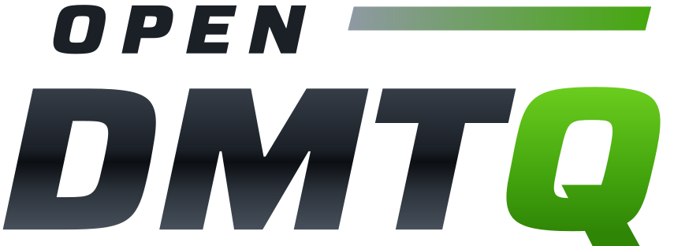
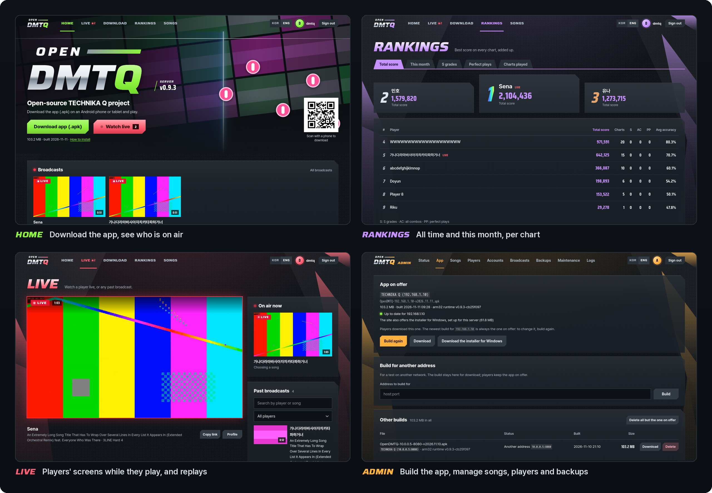
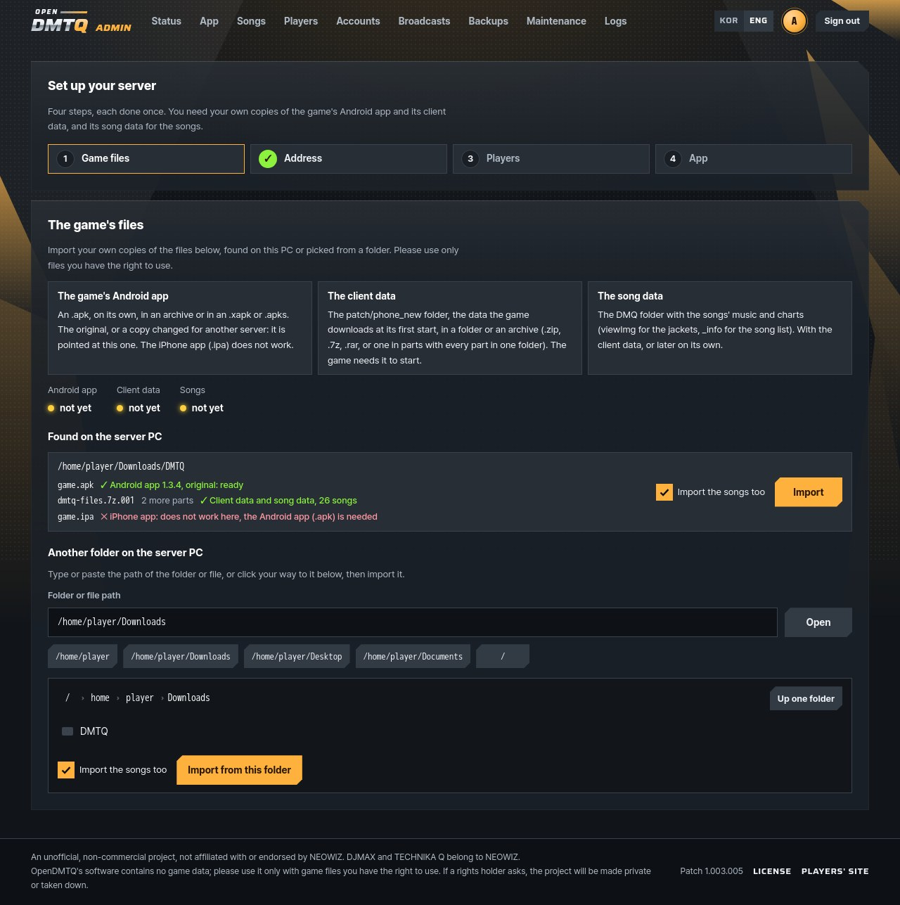
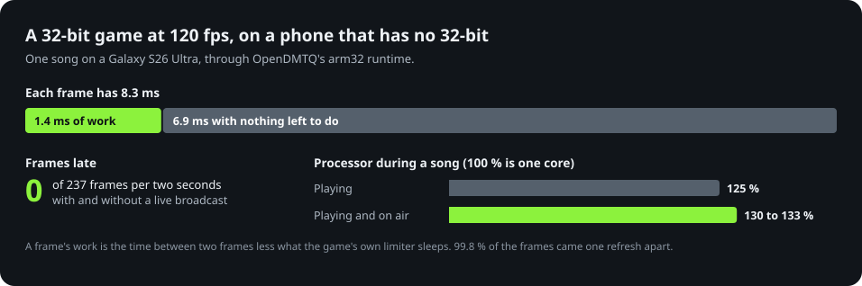
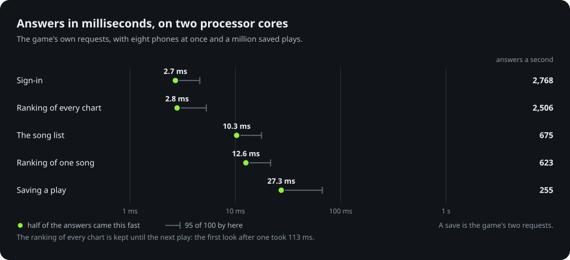
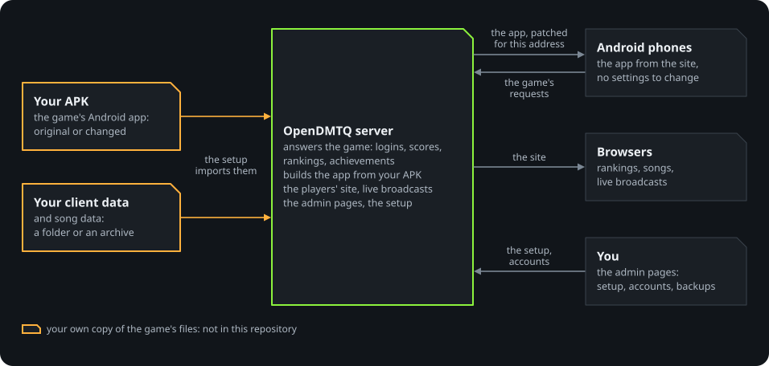

<p align="center">
  <picture>
    <source media="(prefers-color-scheme: dark)" srcset="docs/images/logo-dark.svg">
    
  </picture>
</p>

<p align="center">
  <b>An open-source server for DJMAX Technika Q, on your own computer.</b><br>
  Logins, scores, rankings and live broadcasts for you and your friends, with nothing to set on a phone.
</p>

<p align="center">
  <a href="https://github.com/kanggu12/openDMTQ/actions/workflows/ci.yml"></a>
  <a href="https://github.com/kanggu12/openDMTQ/releases/latest"></a>
  <a href="LICENSE"></a>
  <a href="#quick-start"></a>
</p>

<p align="center">
  <a href="#quick-start">Quick start</a> &nbsp;|&nbsp;
  <a href="#features">Features</a> &nbsp;|&nbsp;
  <a href="#guides">Guides</a> &nbsp;|&nbsp;
  <a href="#open-source">Open source</a>
</p>

<p align="center">
  
</p>

The official service of **DJMAX Technika Q**, the Android rhythm game, ended in 2019. OpenDMTQ is an open-source
project that brings its online side back on a computer of your own. The server builds a copy of your APK that talks to
it, and your friends install that copy from the server's web page.

> [!IMPORTANT]
> **No game files are included.** You need your own copy of the game's Android app and its client data, and its song
> data for the songs. Please use only files you have the right to use. OpenDMTQ is an unofficial, non-commercial
> project, not affiliated with or endorsed by NEOWIZ.

## Quick start

You need your own copy of the game's Android app (`.apk`) and its client data, and its song data for the songs:
[what each has to be](docs/game-files.md).
Phones play on Android, on the same Wi-Fi as the server or [over the internet](docs/internet.md);
[iPhones cannot](docs/game-files.md#iphones). The setup says what each file is before it imports anything.

<p align="center">
  
</p>

**Windows 10 or 11**, in Windows PowerShell:

```powershell
cd ~
curl.exe -LO https://github.com/kanggu12/openDMTQ/releases/latest/download/OpenDMTQ-windows.zip
tar.exe -xf OpenDMTQ-windows.zip
start .\OpenDMTQ\OpenDMTQ.exe
```

The server runs while its window is open. When Windows Firewall asks, allow it on private networks, and set your Wi-Fi
to Private if it is public.

**Debian, Ubuntu or macOS (Homebrew):**

```sh
curl -fsSL https://raw.githubusercontent.com/kanggu12/openDMTQ/main/host/get.sh | sh
```

**Docker:**

```sh
git clone https://github.com/kanggu12/openDMTQ.git
cd openDMTQ
./opendmtq setup
```

**Kubernetes:** the Helm chart, with a volume for the game files and S3 storage:
[install on a cluster](docs/kubernetes.md#install-on-a-cluster).

The setup takes you through your files, the address, an account for each player and the app: in the browser on
Windows, Linux and macOS, in the terminal with Docker. On each Android phone, open the address it shows, sign in and
install the app; on a Windows PC, download the installer from the same page.

[Installing, step by step](docs/install.md).

### What it runs on

| | Minimum | Recommended |
| :--- | :--- | :--- |
| **Server** | 64-bit Windows 10 or 11, Debian 12, Ubuntu 24.04, macOS, or Docker; 2 GB of memory | 2 cores, 4 GB |
| **Disk** | 1 GB without the songs | 7 GB with every song |
| **Phones** | Android 5.0 | Android 8 or newer to broadcast |
| **PCs** | The PC client: 64-bit Windows 10 or 11 on an x64 processor (Intel or AMD), Direct3D 11, 390 MB of disk | A touch screen, for several fingers at once |

## Features

- **Nothing to set on a phone.** No hosts file, proxy app or certificate: one app from the server's page.
- **The game's online side.** Accounts, scores, the monthly and per-song rankings, achievements and the maintenance
  notice.
- **A site for players.** Rankings, songs, profiles, and live broadcasts of players in a song with their recordings
  (off until you turn them on), in English and Korean.
- **Admin pages.** A setup in the browser, the app, songs, players, accounts, broadcasts and their recordings, backups.
- **Your own songs.** Add songs as packages or hide others; phones get what changed at their next start.
- **Newer phones too.** Phones without 32-bit support run the game through OpenDMTQ's runtime
  ([below](#newer-phones-too)).
- **On a PC too.** The site offers an installer for Windows set up for the server: its launcher signs in, downloads the
  game and keeps it up to date, and sets the picture and the sound up for the PC, from VSync to the sound device
  ([the PC client](docs/windows-player.md)).
- **No internet needed** once the files are in ([without internet](docs/closed-network.md)).

### Newer phones too

The game has only 32-bit code, which newer phones (Pixel 7 and later, Galaxy S24 and later) cannot install. OpenDMTQ
puts its own runtime in the app: it translates the game's code as it runs, and keeps the panel's full refresh rate.

<p align="center">
  
</p>

### Fast on little hardware

Plain PHP on SQLite, with no database server to look after. Two cores answer hundreds of the game's requests a second
([how it was measured](docs/testing.md#measurements)).

<p align="center">
  
</p>

## How it works

<p align="center">
  
</p>

The app sends the game's four official hosts to one address, where a single server answers the game, its login, its
downloads and the website. The game server is OpenDMTQ's own code ([architecture](docs/architecture.md)). Accounts,
scores and recordings stay in `data/` on your computer ([privacy](docs/faq.md#privacy)).

## Guides

| Guide | What it covers |
|---|---|
| [Installing](docs/install.md) | Each system step by step, the phones, everyday use, what it runs on |
| [The game's files](docs/game-files.md) | What the app, the client data and the song data have to be |
| [Questions and answers](docs/faq.md) | What it needs, which phones, playing with friends, privacy |
| [The site and the admin pages](docs/admin.md) | The setup, the app, songs, players, backups |
| [The API](docs/api.md) | All the admin pages show and do, and what the players' site shows, as JSON |
| [The PC client](docs/windows-player.md) | Playing on a Windows PC: the installer, the launcher, the picture and the sound |
| [Songs](docs/songs.md) | Importing songs, adding your own |
| [Playing from outside your home](docs/internet.md) | A host name, one forwarded port, HTTPS |
| [Live broadcasts](docs/live.md) | Watching players in a song, recordings |
| [Kubernetes](docs/kubernetes.md) | The Helm chart, failover, backups to S3 |
| [Without internet](docs/closed-network.md) | A server and phones on a closed network |
| [Troubleshooting](docs/troubleshooting.md) | When something does not work |
| [Architecture](docs/architecture.md) · [Testing](docs/testing.md) | How it is built and checked |

## Open source

OpenDMTQ is MIT licensed and built in the open: its own game server, site, app patcher and runtime, with every change
checked by the tests in this repository before it reaches a server.

- **Report a bug or ask for a feature** in [Issues](https://github.com/kanggu12/openDMTQ/issues/new/choose).
- **Change the code.** None of the game's files are needed: the tests make stand-ins of their own.
  [CONTRIBUTING.md](CONTRIBUTING.md) has a map of the code and how a change goes in.
- **See what changed** in [CHANGELOG.md](CHANGELOG.md), and report security problems through
  [SECURITY.md](.github/SECURITY.md).

## Credits and license

Earlier DMTQ servers showed what the game asks for. The web pages follow the look of the DJMAX Technika "Platinum Crew"
site with original artwork and fonts cut down from Saira and Pretendard; live video plays with hls.js; the runtime is
built on Dynarmic.

OpenDMTQ's own code and documentation are under the MIT License ([LICENSE](LICENSE)); the parts it brings with it are
listed in [the notice](docs/notice.md#license). The license does not cover the game or its files, which are not in this
repository. DJMAX and TECHNIKA Q are trademarks of NEOWIZ. If a rights holder asks through the issues, the repository
will promptly be made private or taken down, in whole or in part ([notice](docs/notice.md)).
