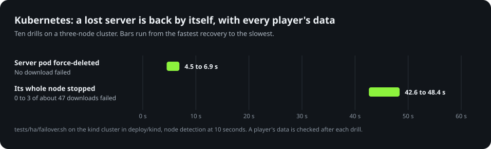

<p align="center">
  <picture>
    <source media="(prefers-color-scheme: dark)" srcset="docs/images/logo-dark.svg">
    
  </picture>
</p>

<p align="center">
  <b>The online side of DJMAX Technika Q, on your own computer.</b><br>
  Logins, scores, rankings and live broadcasts for you and your friends, with nothing to set on a phone.
</p>

<p align="center">
  <a href="https://github.com/kanggu12/openDMTQ/actions/workflows/ci.yml"></a>
  <a href="https://github.com/kanggu12/openDMTQ/releases/latest"></a>
  <a href="LICENSE"></a>
  <a href="#quick-start"></a>
  <a href="#with-docker"></a>
  <a href="docs/kubernetes.md"></a>
  <a href="#newer-phones-too"></a>
</p>

<p align="center">
  <a href="#quick-start">Quick start</a> &nbsp;|&nbsp;
  <a href="#why-opendmtq">Why OpenDMTQ</a> &nbsp;|&nbsp;
  <a href="#how-it-works">How it works</a> &nbsp;|&nbsp;
  <a href="docs/README.md">Guides</a> &nbsp;|&nbsp;
  <a href="CONTRIBUTING.md">Contributing</a>
</p>

<p align="center">
  
</p>

The official service of **DJMAX Technika Q**, the Android rhythm game, ended in 2019. OpenDMTQ runs its online side on a
computer of your own: accounts, scores, the monthly rankings, achievements, a website with rankings and live broadcasts,
and pages to run it all. The server builds a copy of your APK that talks to it, and your friends install that copy from
the server's web page. Their phones need no settings.

> [!IMPORTANT]
> **No game files are included.** You need your own copy of the game's Android app (APK) and its server files.
> Version 1.3.4 of the app gets every fix. Other versions play the same, with a few screens as the game had them. The
> songs are optional: without them the game starts with an empty song list. Please use only files you have the right
> to use. OpenDMTQ is an unofficial, non-commercial project, not affiliated with or endorsed by NEOWIZ. If a rights
> holder asks, the repository will be made private or taken down.

## Quick start

| Your computer | What to do | What you install |
|---|---|---|
| **Windows 10 or 11** | [Download, unzip, double-click](#windows) | Nothing |
| **Debian, Ubuntu or macOS** | [One command](#linux-or-macos) | It installs what it needs |
| **Any computer with Docker** | [`./opendmtq setup`](#with-docker) | Docker |
| **A Kubernetes cluster** | [`helm install`](#kubernetes) | The chart |

All four run the same server. The phones need to be on the same network as the server, or the server [reachable over the
internet](docs/internet.md). Not sure? On a Windows PC, use Windows.

<p align="center">
  
</p>

### What you need

| File | What it is |
|---|---|
| **Your APK** | Your copy of the game's Android app, an `.apk` under any file name: the original, or a copy changed for another server (the build points it at yours). On its own, in an archive, or in an `.xapk` or `.apks`. Every phone's app is built from it. Phones play on Android; [iPhones cannot](docs/game-files.md#iphones). |
| **Your server files** | Your copy of the game's server files: a folder or an archive (`.zip`, `.7z`, `.rar`, also one in parts) with the game's `patch/phone_new` folder somewhere in it. They hold what the game needs to start (data tables, screen images, fonts), which is always imported. The songs are imported only if you choose. A song list is optional. |

[The game's files](docs/game-files.md) lists every form the import accepts. The setup says what each file is before it
imports anything, and so does `./opendmtq import --check <folder>`.

<details>
<summary>What the server files look like, as a folder or inside an archive</summary>

```text
your folder/
    game.apk                            the Android app (any name)
    dmtq/                               (any name; an archive may hold it)
        _info/songList.json             a song list (optional)
        game host folder/               (any name)
            patch/phone_new/...         what the game needs to start: its tables, screens, fonts
            DMQ/Songs/, DMQ/Patterns/   the songs: music and charts
            viewImg/                    jackets and pictures
```

OpenDMTQ takes only the game's data files from what you give it: never programs, databases or notes. What it imported
stays in `data/` on your PC.
</details>

### What it runs on

| | Needs | Recommended |
|---|---|---|
| **The server's computer** | Windows 10 or 11 (64-bit), Debian 12, Ubuntu 24.04, macOS with Homebrew, or any computer with Docker; a 64-bit Intel or AMD processor; 2 GB of memory | 2 processor cores or more and 4 GB of memory. At rest the server takes about 170 MB; building the phones' app takes up to 1.6 GB for about half a minute |
| **Its disk** | About 1 GB: OpenDMTQ, and the game's files without the songs (about 60 MB) | Room for the songs you import (all of the game's take about 4.5 GB), the last 10 app builds (about 110 MB each) and broadcast recordings (20 GB at most by default) |
| **Phones and tablets** | Android 5.0 or newer, on the same Wi-Fi as the server or [over the internet](docs/internet.md) | A phone from the last few years. Phones without 32-bit support run the game through OpenDMTQ's runtime, which needs more processor time: a Galaxy S26 Ultra keeps 120 frames a second with room to spare. Broadcasting needs Android 8 or newer |
| **Phone storage** | About 110 MB for the app | Room for the songs the game downloads as they are played, up to the size of the server's songs |

Tested on: Windows Server 2022 and Wine (the Windows bundle), Debian 12 and Ubuntu 24.04 (the one command), Docker on
Linux, a three-node Kubernetes cluster; phones: a Galaxy S26 Ultra (Android 17, no 32-bit support) and the Android 11
emulator.

### Windows

1. Download `OpenDMTQ-windows.zip` from [Releases](https://github.com/kanggu12/openDMTQ/releases/latest) and unpack it
   outside OneDrive and Program Files. The zip holds one folder, `OpenDMTQ`: unpacked to `C:\`, it is `C:\OpenDMTQ`.
2. Start `OpenDMTQ.exe`. If Windows says it protected your PC, click **More info**, then **Run anyway**: the program is
   not signed by a publisher Windows knows.
3. The setup opens in your browser. It looks for your files in Downloads, on the Desktop and in Documents. If they are
   elsewhere, paste their path or open their folder. Then it takes you through the address phones use, an account for
   each player, and the app.
4. When Windows asks whether Apache may use the network, allow it on private networks. If your Wi-Fi is set as a public
   network, phones cannot connect: in Settings, Network & internet, open your Wi-Fi and choose **Private**.

The server runs while its window is open. To stop it, close the window, or on the admin pages open **Maintenance**
and press **Stop the server**.

To check the download: each release has `OpenDMTQ-windows.zip.sha256` beside the zip. In PowerShell, run
`Get-FileHash OpenDMTQ-windows.zip` and compare the hash with the one in the `.sha256` file (capital letters do not
matter); on Linux, run `sha256sum -c OpenDMTQ-windows.zip.sha256` in the download folder.

### Linux or macOS

```sh
curl -fsSL https://raw.githubusercontent.com/kanggu12/openDMTQ/main/host/get.sh | sh
```

It works on Debian, Ubuntu, or a Mac with [Homebrew](https://brew.sh), and asks for your password (sudo) to install
packages. It downloads OpenDMTQ into `~/openDMTQ`, installs Apache, PHP, Java and Python from the system's packages,
starts the server and opens the setup in the browser, as on Windows. On a computer without a screen it prints the
setup's address instead. The same command later updates it. Its commands run in that folder, for example
`./opendmtq status`. On another Linux, use Docker. The Mac is not in the automated tests yet: if something goes wrong
there, please say so in an issue.

### With Docker

Needs [Docker](https://docs.docker.com/get-docker/) 23 or newer with the Compose plugin, and Python 3.9 or newer. On
Linux, macOS or WSL 2:

```sh
git clone https://github.com/kanggu12/openDMTQ.git && cd openDMTQ
./opendmtq setup
```

`setup` finds the game files in Downloads or on the Desktop, by a name with `dmtq`, `djmax` or `technika` in it or an
unpacked folder of them (for any other name, pass `--from <folder>`). It picks the address phones use, starts the
server, builds the app and checks everything end to end, and ends with a QR code for phones. It prints the admin pages'
address: sign in as `admin` with `ADMIN_PASSWORD` from `.env`, and make an account for each player.

### Kubernetes

```sh
helm install opendmtq oci://ghcr.io/kanggu12/charts/opendmtq --set publicHost=game.example.com:8790
```

The game files go on the chart's volume first. See [docs/kubernetes.md](docs/kubernetes.md).

### On each Android phone

Each player needs an account to sign in and download the app. Make them in the setup, or later on the admin pages'
**Accounts** page. Then, on each phone:

1. Open the server's address exactly as the setup shows it (for example `http://192.168.0.10/`) in Chrome or Samsung
   Internet, not inside a messenger app, or scan its QR code.
2. Sign in with the player's account, tap **Download app (.apk)** and install it. Allow installs from the browser when
   Android asks.
3. Start the game. On its first start, allow storage access when it asks; it then downloads its data from the server.


<details>
<summary>Everyday use: starting, stopping, songs</summary>

| To | Windows | Linux or macOS | Docker |
|---|---|---|---|
| Start the server | start `OpenDMTQ.exe` | `./opendmtq start` | `./opendmtq up` |
| Stop it | close its window, or admin pages, **Maintenance**, **Stop the server** | `./opendmtq stop`, or admin pages, **Maintenance**, **Stop the server** | `./opendmtq down` |
| See the address and the state | the window shows them | `./opendmtq status` | `./opendmtq status` |
| Start it with the computer | a shortcut in `shell:startup` | `./opendmtq service` | `RESTART=unless-stopped` in `.env` |
| Import songs | admin pages, **Songs**, **Choose the folder** | admin pages, **Songs**, **Choose the folder** | `./opendmtq import --songs <folder>` |

The admin pages do the rest: the app, single songs, players, accounts, recordings and backups.
</details>

## Why OpenDMTQ

Private servers for mobile games are often made for people who can already run one. OpenDMTQ is made for the person who
has the old APK, and for friends who only want to play.

| | OpenDMTQ | Many private servers for other mobile games |
|---|---|---|
| **A player's phone** | Install one app from the server's page | A proxy app, a certificate, or client files edited by hand |
| **Running the server** | A setup in the browser; on Windows nothing to install | The command line, a language runtime, configuration files |
| **Phones without 32-bit support** | The game runs (120 fps on a Galaxy S26 Ultra) | A 32-bit game does not install |
| **A site for players** | Rankings, profiles and songs, included | A separate project, or none |
| **Watching players** | Live broadcasts and recordings, in the browser | No |
| **When a machine fails** | A Helm chart with failover | One process on one machine |
| **The code** | MIT licensed, our own game server, more than a thousand automated checks | Varies |

### Newer phones too

The game has only 32-bit code, and newer phones (Pixel 7 and later, Galaxy S24 and later) cannot run 32-bit apps: the
download completes and the install fails. OpenDMTQ puts its own arm32 runtime in the app, on every way of running the
server. It translates the game's code as it runs, and on a Galaxy S26 Ultra that leaves room to spare at the panel's full
refresh rate.

<p align="center">
  
</p>

### Fast on little hardware

The game server is plain PHP on SQLite, without a database server to look after. At rest the whole server takes about
170 MB of memory. Below, two cores of a Ryzen 9 9950X ([how it was measured](docs/testing.md#measurements)).

<p align="center">
  
</p>

### Tuned where people wait

Every number below is the same request on the same made-up server, before and after a round of tuning: an index on the
play log, a log read that continues where it stopped, added songs left out of gzip, one look at each folder
([how it was measured](docs/testing.md#measurements)).

<p align="center">
  
</p>

### Back by itself

Most people run one PC, and that is fine. For those who want more, the Helm chart runs the site and the game's files on
several machines, keeps a copy of the database in S3-compatible storage, and starts the game server again by itself.

<p align="center">
  
</p>

## Features

- **Nothing to set on a phone.** No hosts file, DNS, proxy app or certificate. The server patches your APK for its own
  address and offers it for download, with a QR code.
- **The game's online features.** An account per phone, scores, the monthly and per-song rankings, MY PAGE achievements
  with the dates they were earned, and the in-game maintenance notice.
- **A website for players.** Rankings (all time and this month, for every chart), songs, player profiles, and live
  broadcasts of players in a song, with their recordings. In English and Korean.
- **Admin pages.** A setup in the browser, the app, songs, players and sign-in accounts, recordings, backups and the
  maintenance notice.
- **Your own songs.** Add songs as packages, hide others, and phones get what changed at their next start.
- **Several ways to run it.** A Windows bundle that needs nothing installed; Linux or macOS with one command; Docker
  Compose; and Kubernetes with Helm, with failover.
- **No internet needed once it is in.** The server, the setup, the app's build and the game stay on your network
  ([Without internet](docs/closed-network.md)).

## How it works

<p align="center">
  
</p>

The game talked to four official hosts. OpenDMTQ's app sends all of them to one address, where a single server answers:
the game's requests, the platform's login, the files the game downloads, and the website. Its game server is OpenDMTQ's
own code, written from the requests the client makes and the replies it expects
([docs/architecture.md](docs/architecture.md)).

## Privacy

Accounts, scores, recordings and backups stay on the server's computer, in `data/`; phones talk to the server alone.
The server itself asks the internet for one thing: the runtime for newer phones, from this repository's latest release,
when it builds the app without one (the Windows bundle carries its own, and a zip put in `data/apk` by hand needs
nothing). `./opendmtq check` on a server reachable from the internet asks check-host.net to open its page from outside,
which tells that site the server's address. The game's own app, and Android, also look up a few Google and ad addresses;
the game plays the same without them ([without internet](docs/closed-network.md)).

## Guides

| Guide | For |
|---|---|
| [The game's files](docs/game-files.md) | What the app and the server files have to be, the forms they come in, how to check them |
| [Questions and answers](docs/faq.md) | What it needs, which phones, playing with friends |
| [The site and the admin pages](docs/admin.md) | The setup, building the app, songs, players, accounts, backups |
| [Songs](docs/songs.md) | Importing songs, adding your own, the song list |
| [Playing from outside your home](docs/internet.md) | A host name, one forwarded port, HTTPS |
| [Live broadcasts](docs/live.md) | Watching players in a song, recordings |
| [Kubernetes and high availability](docs/kubernetes.md) | The Helm chart, failover, backups to S3 |
| [Without internet](docs/closed-network.md) | A server and phones on a network with no way out |
| [Troubleshooting](docs/troubleshooting.md) | What to do when something does not work |
| [Architecture](docs/architecture.md) | How the parts fit together |
| [Testing](docs/testing.md) | What runs before a change reaches a server |

## Contributing

Bug reports, fixes and new features are welcome, and you do not need the game's files to work on the code: the tests make
stand-in files of their own. [CONTRIBUTING.md](CONTRIBUTING.md) has a map of the code, how to run it on your PC, recipes
for the usual changes, and how a change goes in. Security problems go to [SECURITY.md](.github/SECURITY.md) instead of an
issue.

```sh
(cd cli && python3 -m unittest discover -s tests -t .)   # the repository's own checks, in a second or two
tests/ui/run.sh                                         # the game server's contract and every page, on stand-in files (Docker)
```

## Credits

Earlier DMTQ servers showed what the game asks for. The web pages follow the look of the DJMAX Technika "Platinum Crew"
site with original artwork; their fonts are cut down from Saira and Pretendard (SIL Open Font License,
`server/portal/fonts/README.md`). Live video plays with hls.js (Apache License 2.0). The arm32 runtime is built on
Dynarmic, and runs the game on Android's own open-source 32-bit system libraries.

## License and notice

OpenDMTQ's own code and documentation are under the MIT License ([LICENSE](LICENSE)). The parts it brings with it, and
the programs it runs, are listed with their licenses in [the notice](docs/notice.md#license); a running server shows the
ones players receive at `/opendmtq/licenses.php`. The license does not cover the game or its files (client, songs,
charts, images, videos), which are not in this repository.

DJMAX and TECHNIKA Q are trademarks of NEOWIZ. OpenDMTQ is an unofficial, non-commercial project; please use it with
game files you have the right to use. If a rights holder asks through the repository's issues, the repository will
promptly be made private or taken down, in whole or in the part concerned. The full notice is in
[docs/notice.md](docs/notice.md).
