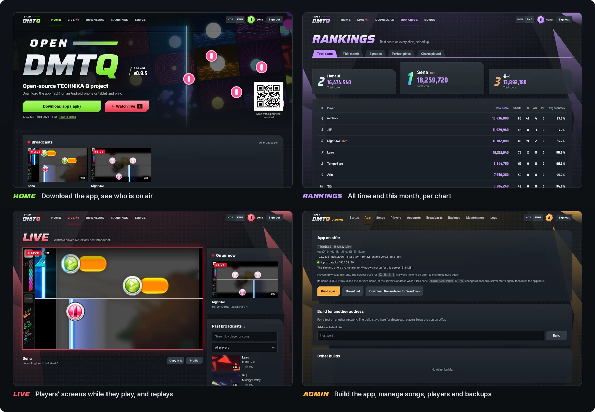
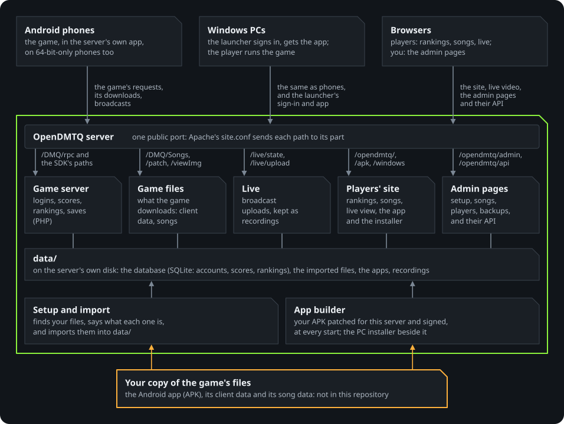

<p align="center">
  <picture>
    <source media="(prefers-color-scheme: dark)" srcset="docs/images/logo-dark.svg">
    
  </picture>
</p>

<p align="center">
  <b>An open-source server for DJMAX Technika Q, on your own computer.</b><br>
  Logins, scores, rankings and live broadcasts, with nothing to set on a phone.
</p>

<p align="center">
  <a href="https://github.com/kanggu12/openDMTQ/actions/workflows/ci.yml"></a>
  <a href="https://github.com/kanggu12/openDMTQ/releases/latest"></a>
  <a href="LICENSE"></a>
  <a href="#quick-start"></a>
</p>

<p align="center">
  <a href="#quick-start">Quick start</a> &nbsp;|&nbsp;
  <a href="#what-it-does">What it does</a> &nbsp;|&nbsp;
  <a href="#how-it-works">How it works</a> &nbsp;|&nbsp;
  <a href="#guides">Guides</a>
</p>

<p align="center">
  
</p>

The official online service of **DJMAX Technika Q**, the Android rhythm game, ended in 2019. OpenDMTQ is an open-source
project that brings its online features back, on a server you run yourself. The server patches your copy of the game's
Android app (APK) to connect to it: phones install the patched app from the server's web page, and Windows PCs run the
same app in the OpenDMTQ PC client.

> [!IMPORTANT]
> **No game files are included.** You need your own copy of the game's Android app and its client data, and its song
> data for the songs. Please use only files you have the right to use. OpenDMTQ is an unofficial, non-commercial
> project, not affiliated with or endorsed by NEOWIZ.

## Quick start

<table>
<tr>
<th width="50%" align="left">Play</th>
<th width="50%" align="left">Host a server</th>
</tr>
<tr>
<td valign="top">

With the account the server's owner made for you:

1. On an **Android phone**, open the server's address (or scan its QR code) and sign in.
2. Tap **Download app (.apk)** and install it: the game, connected to that server. 64-bit-only phones play too;
   [iPhones cannot](docs/game-files.md#iphones).
3. On a **Windows PC**, take the installer from the same page. Its launcher signs in and keeps the game up to date.

**[The players' guide](docs/play.md)**

</td>
<td valign="top">

With your own copy of the game's Android app, its client data and its song data ([what they are](docs/game-files.md)):

1. Start the server with the commands below.
2. The setup opens in the browser. It finds your files, asks for the address phones use and an account for each
   player, and builds the app.
3. Send each player the message the setup makes, with the address and their account.

**[The server guide](docs/install.md)**

</td>
</tr>
</table>

**Windows 10 or 11**, in PowerShell (the server runs while its window is open):

```powershell
cd ~
curl.exe -LO https://github.com/kanggu12/openDMTQ/releases/latest/download/OpenDMTQ-windows.zip
tar.exe -xf OpenDMTQ-windows.zip
start .\OpenDMTQ\OpenDMTQ.exe
```

**Debian, Ubuntu, or a Mac with Homebrew**, as your own user, not root:

```sh
curl -fsSL https://raw.githubusercontent.com/kanggu12/openDMTQ/main/host/get.sh | sh
```

**Docker**, with Docker 23 or newer and Compose, Python 3.9 or newer and git (or **Kubernetes**, with
[the Helm chart](docs/kubernetes.md#install-on-a-cluster)):

```sh
git clone https://github.com/kanggu12/openDMTQ.git
cd openDMTQ
./opendmtq setup
```

<p align="center">
  
</p>

## What it does

- **Nothing to set on a phone.** No hosts file, proxy app or certificate: one app from the server's page.
- **The game's online features.** Accounts, scores, monthly and per-song rankings, achievements and maintenance
  notices.
- **Your own songs.** Add songs as packages or hide others; phones get what changed at their next start.
- **Admin pages and an HTTP API.** The setup, the app, songs, players, accounts, broadcasts and backups in the browser,
  all also as JSON ([the API](docs/api.md)).
- **No internet needed** once the files are in ([without internet](docs/closed-network.md)).
- **Tested before every release** on the real game files, on Windows, Debian, Ubuntu and Docker, and the PC client
  under Wine and on Windows itself ([testing](docs/testing.md)).

### The players' site

Rankings, songs, player profiles and live broadcasts with recordings, in English and Korean. On a phone, it is where
players sign in and get the app.

<p align="center">
  
</p>

### The PC client

A Windows installer from the server's site, set up for that server. Its launcher signs in and keeps the game up to
date; the game runs at the display's refresh rate (up to 240 Hz), with an overlay bar for minimise, full screen and
quit ([the PC client](docs/windows-player.md)).

<p align="center">
  
</p>

### Newer phones

The game has only 32-bit code, which newer phones (Pixel 7 and later, Galaxy S24 and later) cannot install. OpenDMTQ
adds its own runtime to the app, which translates the game's code as it runs, at the display's full refresh rate.

<p align="center">
  
</p>

### Fast on little hardware

Plain PHP and SQLite, with no database server to run. Two CPU cores answer hundreds of game requests a second
([how it was measured](docs/testing.md#measurements)).

<p align="center">
  
</p>

## How it works

<p align="center">
  
</p>

The patched app points the game's four official hosts at your server, which answers the game, its login, its downloads
and the website from one address. The game server is OpenDMTQ's own code ([architecture](docs/architecture.md)).
Accounts, scores and recordings stay in `data/` on your computer ([privacy](docs/faq.md#privacy)).

## What it runs on

- **The server:** 64-bit Windows 10 or 11, Debian 12, Ubuntu 24.04, macOS, or Docker, with 2 GB of memory (2 cores and
  4 GB recommended) and 1 GB of disk, 7 GB with every song.
- **Phones:** Android 5.0 or newer, 8 or newer to broadcast.
- **PCs:** the PC client on 64-bit Windows 10 or 11 with an x64 processor (Intel or AMD), a graphics card with
  Direct3D 11, 1 GB of free memory and 390 MB of disk; a touch screen plays with several fingers at once.

## Guides

- **For players:** [playing on a server](docs/play.md) · [the PC client](docs/windows-player.md) ·
  [troubleshooting](docs/troubleshooting.md#for-players)
- **For server owners:** [installing](docs/install.md) · [the game's files](docs/game-files.md) ·
  [the site and the admin pages](docs/admin.md) · [songs](docs/songs.md) · [playing from outside your home](docs/internet.md) ·
  [live broadcasts](docs/live.md) · [Kubernetes](docs/kubernetes.md) · [without internet](docs/closed-network.md) ·
  [the API](docs/api.md) · [troubleshooting](docs/troubleshooting.md#for-server-owners) · [questions and answers](docs/faq.md)
- **For contributors:** [contributing](CONTRIBUTING.md) · [architecture](docs/architecture.md) ·
  [testing](docs/testing.md) · [test cases](docs/test-cases.md)

Report a bug or ask for a feature in [Issues](https://github.com/kanggu12/openDMTQ/issues/new/choose); see what changed
in [CHANGELOG.md](CHANGELOG.md), and report security problems through [SECURITY.md](.github/SECURITY.md).

## Credits and license

Earlier DMTQ servers documented what the game requests. The web pages follow the look of the DJMAX Technika "Platinum Crew"
site with original artwork and fonts cut down from Saira and Pretendard; live video plays with hls.js; the runtime is
built on Dynarmic.

OpenDMTQ's own code and documentation are under the MIT License ([LICENSE](LICENSE)); the parts it brings with it are
listed in [the notice](docs/notice.md#license). The license does not cover the game or its files, which are not in this
repository. DJMAX and TECHNIKA Q are trademarks of NEOWIZ. If a rights holder asks through the issues, the repository
will promptly be made private or taken down, in whole or in part ([notice](docs/notice.md)).
