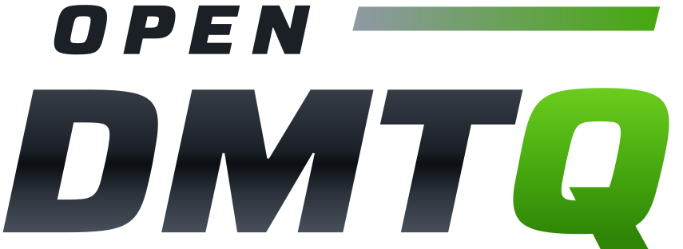
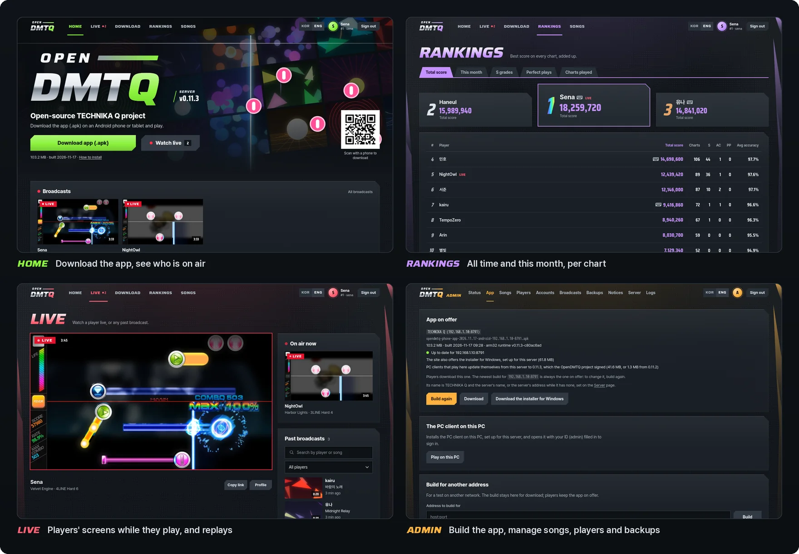
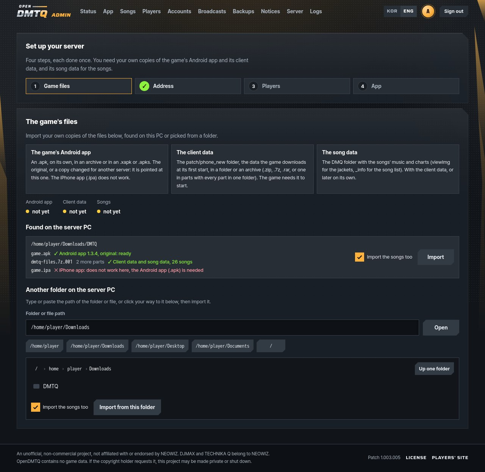
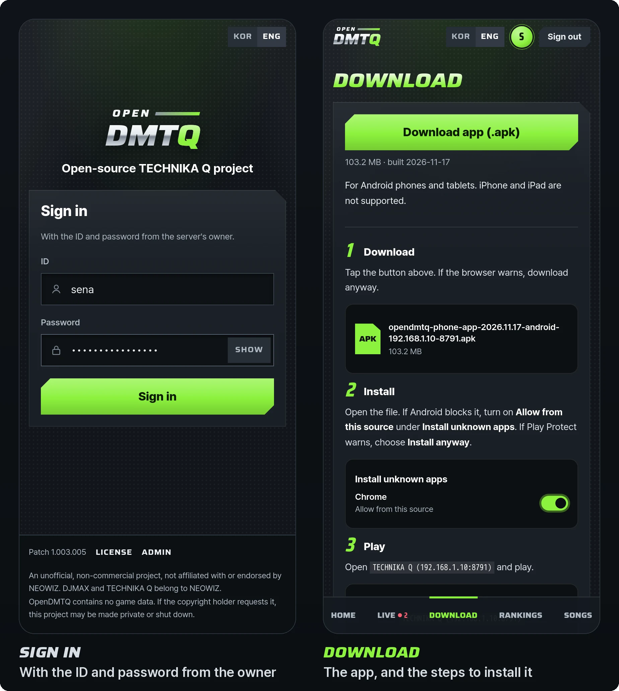
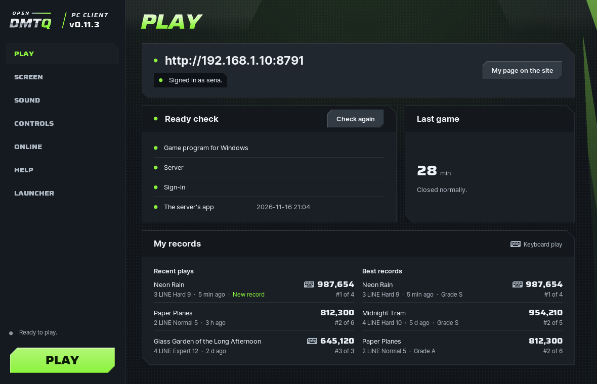
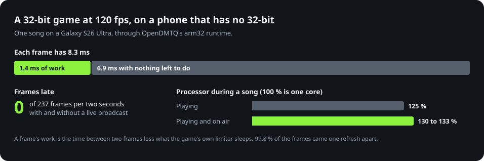
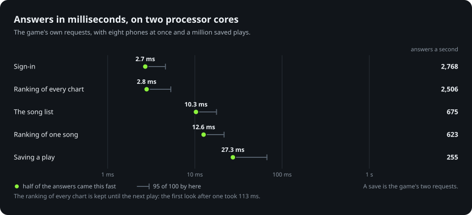
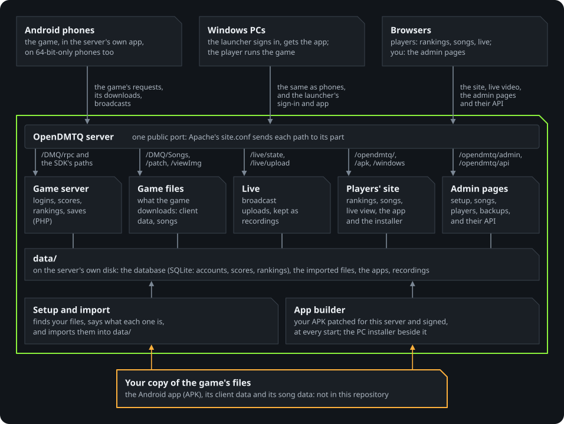

<p align="center">
  <picture>
    <source media="(prefers-color-scheme: dark)" srcset="docs/images/logo-dark.svg">
    
  </picture>
</p>

<p align="center">
  <b>An open-source server for DJMAX Technika Q, on your own computer.</b><br>
  Logins, scores, rankings and live broadcasts, with nothing to set on a phone.
</p>

<p align="center">
  <a href="https://github.com/kanggu12/openDMTQ/actions/workflows/ci.yml"></a>
  <a href="https://github.com/kanggu12/openDMTQ/releases/latest"></a>
  <a href="LICENSE"></a>
  <a href="#quick-start"></a>
</p>

<p align="center">
  <a href="#quick-start">Quick start</a> &nbsp;|&nbsp;
  <a href="#what-it-does">What it does</a> &nbsp;|&nbsp;
  <a href="#how-it-works">How it works</a> &nbsp;|&nbsp;
  <a href="#guides">Guides</a> &nbsp;|&nbsp;
  <a href="#contributing">Contributing</a>
</p>

<p align="center">
  
</p>

The official online service of **DJMAX Technika Q**, the Android rhythm game, ended in 2019. OpenDMTQ is an open-source
project that brings its online features back, on a server you run yourself. The server patches your copy of the game's
Android app (APK) to connect to it: phones install the patched app from the server's web page, and Windows PCs run the
same app in the OpenDMTQ PC client.

> [!IMPORTANT]
> **No game files are included.** You need your own copy of the game's Android app and its client data, and its song
> data for the songs. Please use only files you have the right to use. OpenDMTQ is an unofficial, non-commercial
> project, not affiliated with or endorsed by NEOWIZ.

## Quick start

### Play

With the ID and password the server's owner gives you:

1. On an **Android phone**, open the server's address (or scan its QR code), sign in, tap **Download app (.apk)** and
   install it: the game, connected to that server. [iPhones cannot play](docs/game-files.md#iphones).
2. On a **Windows PC**, take the PC client's installer from the same page. Its launcher signs in and keeps the game up
   to date.

The rest is in [playing on a server](docs/play.md) and [the PC client](docs/windows-player.md).

### Run a server

With your own copy of the game's Android app, its client data and its song data ([what they are](docs/game-files.md)).
On **Windows 10 or 11**, in PowerShell (the server then runs while its window is open):

```powershell
cd ~
curl.exe -fLO https://github.com/kanggu12/openDMTQ/releases/download/v0.11.3/opendmtq-server-0.11.3-windows-x64.zip
tar.exe -xf opendmtq-server-0.11.3-windows-x64.zip
start .\OpenDMTQ\OpenDMTQ.exe
```

On **Debian or Ubuntu**, or a **Mac** with Homebrew, as your own user:

```sh
curl -fsSL https://raw.githubusercontent.com/kanggu12/openDMTQ/v0.11.3/host/get.sh | sh
```

With **Docker** (Compose, Python 3 and git):

```sh
git clone --branch v0.11.3 --depth 1 https://github.com/kanggu12/openDMTQ.git && cd openDMTQ
./opendmtq setup
```

The setup opens in your browser: it finds your files, asks for the address phones use and an account for each player,
builds the app and gives you the message to send each player. With Docker it runs in the terminal, and the accounts
are made on the admin pages. [The server guide](docs/install.md) has each way step by step, Kubernetes, updates and
the server's one port.

<p align="center">
  
</p>

## What it does

- **Nothing to set on a phone.** No hosts file, proxy app or certificate: one app from the server's page.
- **The game's online features.** Accounts, scores, monthly and per-song rankings, achievements and maintenance
  notices.
- **Your own songs.** Add songs as packages or hide others; phones get what changed at their next start.
- **Your players, in the game and around it.** Each player's currency, level, items and a ban the game itself shows, on
  the admin pages; a notice on the site, maintenance in the game, and messages to Discord or Slack when someone goes
  live or takes a chart's #1.
- **Admin pages and an HTTP API.** The setup, the app, songs, players, accounts, broadcasts, backups and the server
  itself (restart, repair, its port, uninstall) in the browser, all also as JSON ([the API](docs/api.md)).
- **No internet needed** once the files are in ([without internet](docs/closed-network.md)).
- **Tested before every release** on the real game files, on Windows, Debian, Ubuntu and Docker, and the PC client
  under Wine and on Windows itself ([testing](docs/testing.md)).

### The players' site

Rankings, songs, player profiles and live broadcasts with recordings, in English and Korean, and MY PAGE, each player's
own page with their plays, records and account. On a phone, it is where players sign in and get the app.

<p align="center">
  
</p>

### The PC client

A Windows installer from the server's site, set up for that server, which runs on Linux under Wine too. Its launcher
signs in, tests the way to the server step by step, and keeps the game and itself up to date from the server, with
releases the project signed. The game runs at the display's full refresh rate, 160 and 180 Hz laptop panels included
(up to 1000 frames a second with VSync off), and plays with a touch screen, the mouse or the keyboard (the keys you
choose for each lane); a bar over the game has its sound, minimise, full screen and quit
([the PC client](docs/windows-player.md)).

<p align="center">
  
</p>

### Newer phones

The game has only 32-bit code, which newer phones (Pixel 7 and later, Galaxy S24 and later) cannot install. OpenDMTQ
adds its own runtime to the app, which translates the game's code as it runs, at the display's full refresh rate.

<p align="center">
  
</p>

### Fast on little hardware

Plain PHP and SQLite, with no database server to run. Two CPU cores answer hundreds of game requests a second
([how it was measured](docs/testing.md#measurements)).

<p align="center">
  
</p>

## How it works

<p align="center">
  
</p>

The patched app points the game's four official hosts at your server, which answers the game, its login, its downloads
and the website from one address and port. The game server is OpenDMTQ's own code
([architecture](docs/architecture.md)). Accounts, scores and recordings stay in `data/` on your computer
([privacy](docs/faq.md#privacy)).

## What it runs on

- **The server:** 64-bit Windows 10 or 11, Debian 12, Ubuntu 24.04, macOS, or Docker, with 2 GB of memory (the app's
  build takes up to 1.6 GB of it for half a minute) and 1 GB of disk, 7 GB with every song.
- **Phones:** Android 5.0 or newer, 8 or newer to broadcast.
- **PCs:** the PC client on 64-bit Windows 10 or 11, or Linux with Wine 11, with an x64 processor (Intel or AMD), a
  graphics card with Direct3D 11, 1 GB of free memory and 390 MB of disk; the keyboard plays the lanes, and a touch
  screen plays with several fingers at once.

## Guides

- **For players:** [playing on a server](docs/play.md) · [the PC client](docs/windows-player.md) ·
  [troubleshooting](docs/troubleshooting.md#for-players)
- **For server owners:** [installing](docs/install.md) · [the game's files](docs/game-files.md) · [the site and the
  admin pages](docs/admin.md) · [songs](docs/songs.md) · [playing from outside your home](docs/internet.md) · [live
  broadcasts](docs/live.md) · [Kubernetes](docs/kubernetes.md) · [without internet](docs/closed-network.md) · [the
  API](docs/api.md) · [troubleshooting](docs/troubleshooting.md#for-server-owners) · [questions and
  answers](docs/faq.md)

## Contributing

[CONTRIBUTING.md](CONTRIBUTING.md) has how the pieces fit, how to build and test them without the game's files, and what
a change needs; [the architecture](docs/architecture.md), [testing](docs/testing.md) and
[the test cases](docs/test-cases.md) go further. Report a bug or ask for a feature in
[Issues](https://github.com/kanggu12/openDMTQ/issues/new/choose); see what changed in [CHANGELOG.md](CHANGELOG.md), and
report security problems as [SECURITY.md](.github/SECURITY.md) says.

## License

OpenDMTQ's own code and documentation are under the MIT License ([LICENSE](LICENSE)). The libraries, fonts and programs
it brings with it are listed with their licenses in [THIRD_PARTY_NOTICES.md](docs/THIRD_PARTY_NOTICES.md).

The license does not cover the game, and DJMAX and TECHNIKA Q are trademarks of NEOWIZ. OpenDMTQ contains no game data.
If the copyright holder requests it, this project may be made private or shut down ([notice](docs/notice.md)).
