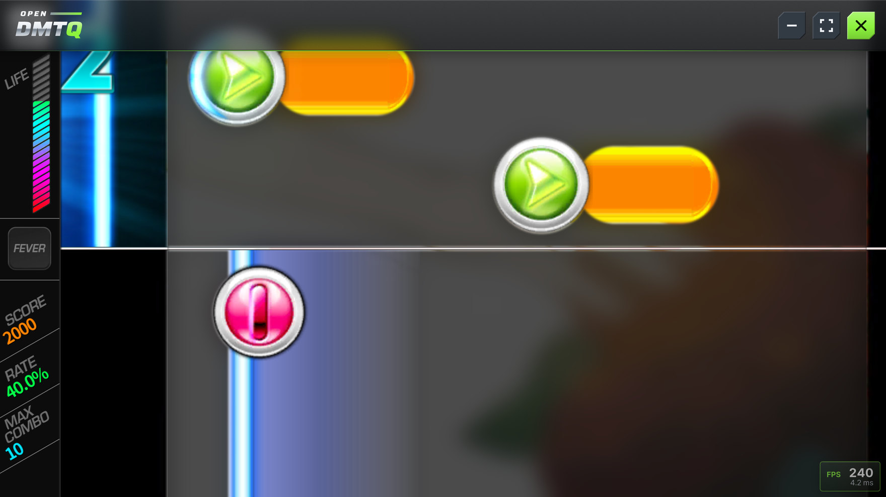
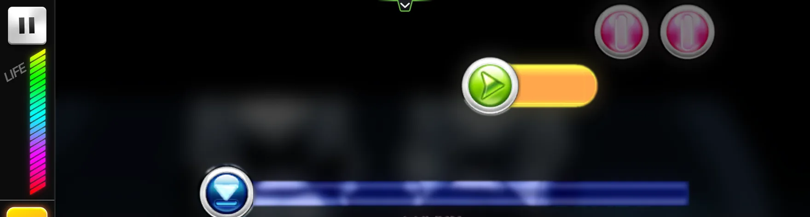
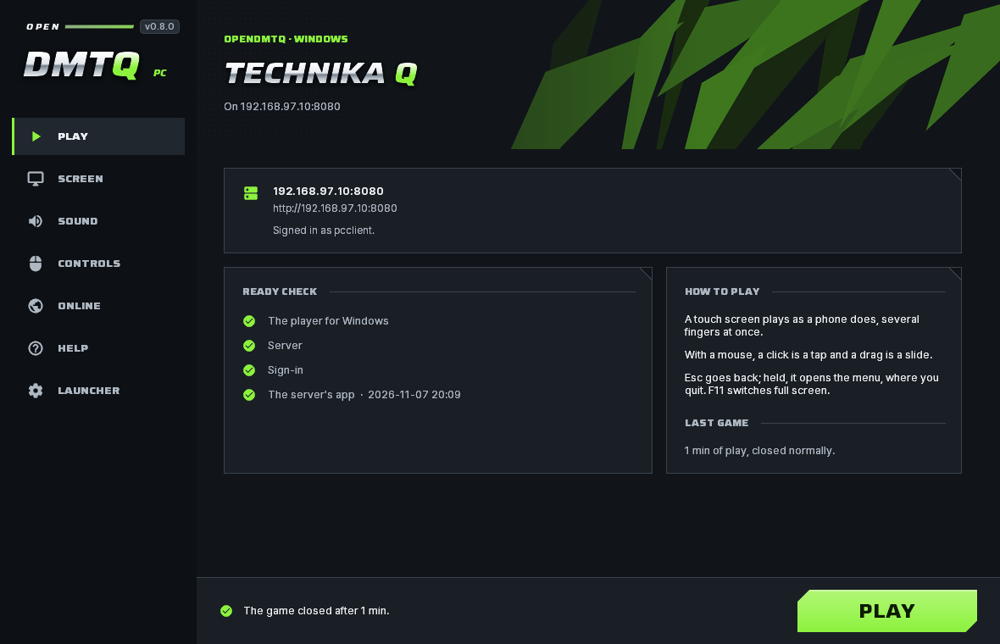
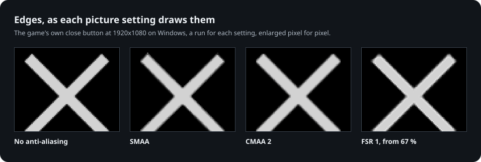

<p align="center">
  <picture>
    <source media="(prefers-color-scheme: dark)" srcset="docs/images/logo-dark.svg">
    
  </picture>
</p>

<p align="center">
  <b>An open-source server for DJMAX Technika Q, on your own computer.</b><br>
  Logins, scores, rankings and live broadcasts, with nothing to set on a phone.
</p>

<p align="center">
  <a href="https://github.com/kanggu12/openDMTQ/actions/workflows/ci.yml"></a>
  <a href="https://github.com/kanggu12/openDMTQ/releases/latest"></a>
  <a href="LICENSE"></a>
  <a href="#quick-start"></a>
</p>

<p align="center">
  <a href="#quick-start">Quick start</a> &nbsp;|&nbsp;
  <a href="#how-it-works">How it works</a> &nbsp;|&nbsp;
  <a href="#features">Features</a> &nbsp;|&nbsp;
  <a href="#guides">Guides</a> &nbsp;|&nbsp;
  <a href="#contribute">Contribute</a>
</p>

<p align="center">
  
  <br><sub>The game on a PC through OpenDMTQ's player, with its glass bar and FPS counter. The song's video is blurred here.</sub>
</p>

The official service of **DJMAX Technika Q**, the Android rhythm game, ended in 2019. OpenDMTQ is an open-source
project that brings its online side back on a computer of your own. The server builds a copy of your APK that talks to
it: phones install that copy from the server's web page, and Windows PCs play the same app through OpenDMTQ's PC client.

> [!IMPORTANT]
> **No game files are included.** You need your own copy of the game's Android app and its client data, and its song
> data for the songs. Please use only files you have the right to use. OpenDMTQ is an unofficial, non-commercial
> project, not affiliated with or endorsed by NEOWIZ.

| Play | Host a server | Contribute |
| :--- | :--- | :--- |
| Phones install the app from the server's page, 64-bit-only ones too; Windows PCs, the PC client. [Playing on a server](docs/play.md) | Your own copy of the game's files, then one download or one command. [Quick start](#quick-start) | No game files needed: the tests make their own. [Where to start](#contribute) |

## How it works

<p align="center">
  
</p>

The app sends the game's four official hosts to one address, where a single server answers the game, its login, its
downloads and the website. The game server is OpenDMTQ's own code ([architecture](docs/architecture.md)). Accounts,
scores and recordings stay in `data/` on your computer ([privacy](docs/faq.md#privacy)).

## Quick start

### Host a server

You need your own copy of the game's Android app (`.apk`) and its client data, and its song data for the songs
([what each has to be](docs/game-files.md)). The setup finds them in Downloads or on the Desktop by a name with `dmtq`,
`djmax` or `technika` in it, or in a folder you pick, and says what each one is before it imports anything.

<p align="center">
  
</p>

**Windows 10 or 11**, in Windows PowerShell:

```powershell
cd ~
curl.exe -LO https://github.com/kanggu12/openDMTQ/releases/latest/download/OpenDMTQ-windows.zip
tar.exe -xf OpenDMTQ-windows.zip
start .\OpenDMTQ\OpenDMTQ.exe
```

The server starts, and the setup opens in the browser once it answers. The server runs while its window is open. When
Windows Firewall asks, allow it on private networks, and set your Wi-Fi to Private if it is public.

**Debian, Ubuntu, or a Mac with Homebrew**, as your own user, not root (it asks for your password to install packages):

```sh
curl -fsSL https://raw.githubusercontent.com/kanggu12/openDMTQ/main/host/get.sh | sh
```

It installs into `~/openDMTQ` and opens the setup in the browser; without a screen it prints the setup's address.

**Docker** on Linux, macOS, or Windows with WSL, with Docker 23 or newer and Compose, Python 3.9 or newer and git:

```sh
git clone https://github.com/kanggu12/openDMTQ.git
cd openDMTQ
./opendmtq setup
```

Files in another place: `./opendmtq setup --from <folder>`. It ends with the admin pages' address (`./opendmtq status`
shows it again), where each player's account is made, under **Accounts**.

**Kubernetes:** the Helm chart, with a volume for the game files and S3 storage:
[install on a cluster](docs/kubernetes.md#install-on-a-cluster).

The setup then asks for the address phones use and an account for each player, and builds the app.
[Installing, step by step](docs/install.md).

### Play

On a server someone runs, with the account its owner made for you ([playing on a server](docs/play.md)):

- **Android phone:** open the address the owner gives you, sign in and install the app. On the same Wi-Fi as the server,
  or [over the internet](docs/internet.md) when the owner sets that up; [iPhones cannot](docs/game-files.md#iphones).
- **Windows PC:** on the same page, download the installer for Windows. Its launcher signs in and keeps the game up to
  date ([the PC client](docs/windows-player.md)).

### What it runs on

| Server | Minimum | Recommended |
| :--- | :--- | :--- |
| **Computer** | 64-bit Windows 10 or 11, Debian 12, Ubuntu 24.04, macOS, or Docker; 2 GB of memory | 2 cores, 4 GB |
| **Disk** | 1 GB without the songs | 7 GB with every song |

| Clients | Minimum | Recommended |
| :--- | :--- | :--- |
| **Phones** | Android 5.0 | Android 8 or newer to broadcast |
| **PCs** | The PC client: 64-bit Windows 10 or 11 on an x64 processor (Intel or AMD), a graphics card with Direct3D 11, 1 GB of free memory, 390 MB of disk | A touch screen, for several fingers at once |

## Features

- **Nothing to set on a phone.** No hosts file, proxy app or certificate: one app from the server's page.
- **The game's online side.** Accounts, scores, the monthly and per-song rankings, achievements and the maintenance
  notice.
- **Your own songs.** Add songs as packages or hide others; phones get what changed at their next start.
- **Admin pages and an API.** A setup in the browser, the app, songs, players, accounts, broadcasts and their
  recordings, backups; all of it as JSON too ([the API](docs/api.md)).
- **No internet needed** once the files are in ([without internet](docs/closed-network.md)).

### On a PC too

The site offers an installer for Windows set up for the server. Its launcher signs in and keeps the game up to date;
its player runs the game through OpenDMTQ's runtime on Direct3D 11, each frame on a refresh of the display (240 a
second at 240 Hz, none late in 480), with AMD FSR 1 or NVIDIA NIS upscaling, CMAA 2 or SMAA, and a bar of frosted glass
that slides down from the top edge ([the PC client](docs/windows-player.md)).

<p align="center">
  
</p>

<p align="center">
  
</p>

<p align="center">
  
</p>

### Newer phones too

The game has only 32-bit code, which newer phones (Pixel 7 and later, Galaxy S24 and later) cannot install. OpenDMTQ
puts its own runtime in the app: it translates the game's code as it runs, and keeps the panel's full refresh rate.

<p align="center">
  
</p>

### A site for players

Rankings, songs, profiles, and live broadcasts of players in a song with their recordings (off until you turn them
on), in English and Korean; and the admin pages beside it.

<p align="center">
  
</p>

### Fast on little hardware

Plain PHP on SQLite, with no database server to look after. Two cores answer hundreds of the game's requests a second
([how it was measured](docs/testing.md#measurements)).

<p align="center">
  
</p>

## Guides

| Guide | What it covers |
|---|---|
| **Playing** | |
| [Playing on a server](docs/play.md) | The app on Android phones and tablets: signing in, installing, updates, broadcasting, which devices |
| [The PC client](docs/windows-player.md) | Playing on a Windows PC: the installer, the launcher, the picture and the sound |
| **Running a server** | |
| [Installing](docs/install.md) | Each system step by step, everyday use, updates and backups, what it runs on |
| [The game's files](docs/game-files.md) | What the app, the client data and the song data have to be |
| [The site and the admin pages](docs/admin.md) | The setup, the app, songs, players, backups |
| [Songs](docs/songs.md) | Importing songs, adding your own |
| [Playing from outside your home](docs/internet.md) | A host name, one forwarded port, HTTPS |
| [Live broadcasts](docs/live.md) | Broadcasts of players in a song, recordings |
| [Kubernetes](docs/kubernetes.md) | The Helm chart, failover, backups to S3 |
| [Without internet](docs/closed-network.md) | A server and phones on a closed network |
| [The API](docs/api.md) | All the admin pages show and do, and what the players' site shows, as JSON |
| [Troubleshooting](docs/troubleshooting.md) | When something does not work, for players and for the server |
| [Questions and answers](docs/faq.md) | What it needs, which phones, players outside the home, privacy |
| **Working on the code** | |
| [Architecture](docs/architecture.md) · [Testing](docs/testing.md) | How it is built and checked |

## Contribute

OpenDMTQ is MIT licensed and built in the open: its own game server, site, app patcher, runtime and PC client, with
every change checked by the tests in this repository before it reaches a server.

- **Report a bug or ask for a feature** in [Issues](https://github.com/kanggu12/openDMTQ/issues/new/choose).
- **Change the code.** None of the game's files are needed: the tests make stand-ins of their own.
  [CONTRIBUTING.md](CONTRIBUTING.md) has each part, its code and its tests; [the architecture](docs/architecture.md),
  how they work together.
- **See what changed** in [CHANGELOG.md](CHANGELOG.md), and report security problems through
  [SECURITY.md](.github/SECURITY.md).

## Credits and license

Earlier DMTQ servers showed what the game asks for. The web pages follow the look of the DJMAX Technika "Platinum Crew"
site with original artwork and fonts cut down from Saira and Pretendard; live video plays with hls.js; the runtime is
built on Dynarmic.

OpenDMTQ's own code and documentation are under the MIT License ([LICENSE](LICENSE)); the parts it brings with it are
listed in [the notice](docs/notice.md#license). The license does not cover the game or its files, which are not in this
repository. DJMAX and TECHNIKA Q are trademarks of NEOWIZ. If a rights holder asks through the issues, the repository
will promptly be made private or taken down, in whole or in part ([notice](docs/notice.md)).
