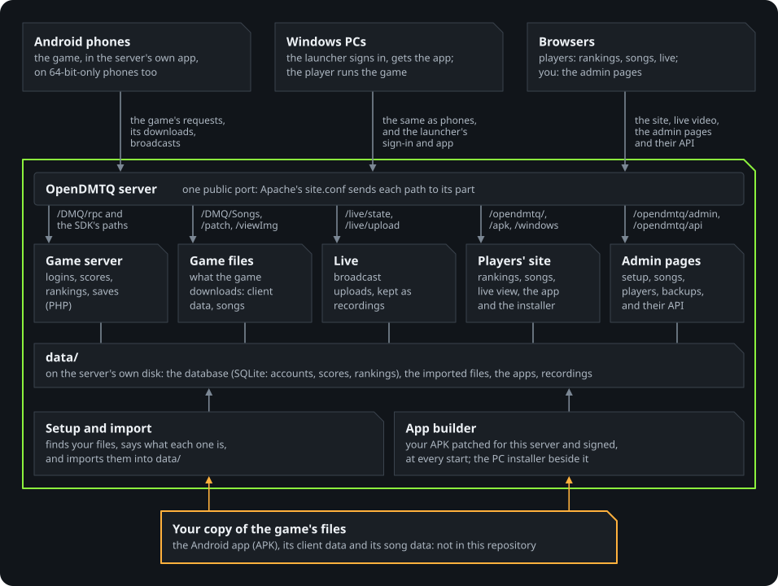

  

# Guides

OpenDMTQ is a server, which its owner runs, and the clients its players play on: the Android app the server builds, and
the PC client for Windows. Each has its own guides below. New here? The [README's quick start](../README.md#quick-start)
has the two ways to begin, playing on a server and running one, and [Questions and answers](faq.md) covers what people
ask first.

## For players

| Guide | For |
| :--- | :--- |
| [Playing on a server](play.md) | Players: the app from the server's site on an Android phone or tablet, signing in, MY PAGE with your records and account, updates and a server that moved, broadcasting, which devices, what to tell the server's owner |
| [The PC client](windows-player.md) | Playing on a Windows PC, or on Linux under Wine: the installer from the site, the launcher and its pages, your records, the connection test and a report, signed updates from the server, keyboard play and the other controls, the bar over the game and its sound panel, the picture and the sound settings, broadcasting, what it needs and keeps |
| [Troubleshooting for players](troubleshooting.md#for-players) | What a phone or a PC can check when the site, the app or the game does not work |

## For server owners

| Guide | For |
| :--- | :--- |
| [Installing](install.md) | The four ways side by side, each step by step (Windows, Linux or macOS, Docker, Kubernetes), the players' accounts, everyday use, updates, the server's one port and moving it, backups and moving to another computer, the `.env` settings, a release's files and their signature, what it runs on |
| [The game's files](game-files.md) | What your APK, client data and song data have to be, the forms they come in, how to check them |
| [The site and the admin pages](admin.md) | The setup in the browser, the players' site and MY PAGE, building the app, players and each player's game, accounts, recordings, backups, the Notices page (the site's notice, maintenance, Discord and Slack), the Server page (restart, repair, the port, the data, uninstall), the PC client's installer and its updates, Play on this PC |
| [Songs](songs.md) | Importing the songs, hiding them, adding your own as song packages |
| [Playing from outside your home](internet.md) | What it needs (a host name, one forwarded port), `expose`, checking it from outside, what is open, HTTPS |
| [Live broadcasts](live.md) | Turning broadcasts on for the server and its players, recordings, their limits |
| [Kubernetes](kubernetes.md) | Installing the Helm chart, its values, trying it on this computer, how it is built, failover and the database replica, broadcasts, what was measured |
| [Without internet](closed-network.md) | A server and phones on a network with no way out: what to carry in for each way of running it |
| [The API](api.md) | All the admin pages show and do, and what the players' site shows, as JSON |
| [Troubleshooting](troubleshooting.md#for-server-owners) | When a phone cannot connect, the app does not install or build, or the server does not start |
| [Questions and answers](faq.md) | What it needs, which way to run it, which phones, which port, playing from outside your home, updates, what leaves your computer |
| [License and notice](notice.md) | What the project is, its license, what it asks of whoever runs a server |
| [Third-party notices](THIRD_PARTY_NOTICES.md) | The libraries, fonts and programs OpenDMTQ brings with it, and their licenses |

## For contributors

| Guide | For |
| :--- | :--- |
| [Architecture](architecture.md) | How the parts fit together: the server and its one port, the game server's code and each player's game state, the content, the app patch, the PC client and its updates (how the player paces and draws the picture, mixes the sound, lays its pieces over the game out and was measured), the database, the security model, releases and their signature |
| [Testing](testing.md) | What runs before a change reaches a server, and how to run it |
| [Test cases](test-cases.md) | Every case, one table per area, with what checks it |
| [The arm32 runtime](../arm32/README.md) | How the 32-bit game runs on phones without 32-bit support |
