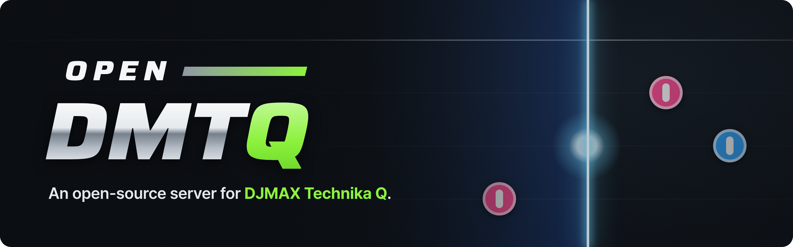

  

# Guides

OpenDMTQ is an open-source project. New here? The [README](../README.md#quick-start) has the quick start for each way
to run a server, and [Questions and answers](faq.md) covers what people ask first.

## Running a server

| Guide | For |
| :--- | :--- |
| [Installing](install.md) | Each system step by step, the phones and PCs, everyday use, updates, backups and moving to another computer, the `.env` settings |
| [Questions and answers](faq.md) | What it needs, which phones, playing from outside your home, what leaves your computer |
| [The game's files](game-files.md) | What your APK, client data and song data have to be, the forms they come in, how to check them |
| [The site and the admin pages](admin.md) | The setup in the browser, the players' site, building the app, players, accounts, recordings, backups, the maintenance notice |
| [The API](api.md) | All the admin pages show and do, and what the players' site shows, as JSON |
| [The PC client](windows-player.md) | Playing on a Windows PC: the installer from the site, the launcher, the controls and the bar over the game, the picture and the sound settings, broadcasting, what it needs and keeps, where the server gets the installer |
| [Songs](songs.md) | Importing the songs, hiding them, adding your own as song packages |
| [Playing from outside your home](internet.md) | A host name, one forwarded port, HTTPS |
| [Live broadcasts](live.md) | Watching players in a song, recordings, their limits |
| [Kubernetes](kubernetes.md) | The Helm chart, failover, the database replica |
| [Without internet](closed-network.md) | A server and phones on a network with no way out: what to carry in for each way of running it |
| [Troubleshooting](troubleshooting.md) | When a phone cannot connect, the app does not install, a PC does not play, or the server does not start |
| [License and notice](notice.md) | What the project is, its license, the third-party parts |

## Working on the code

| Guide | For |
| :--- | :--- |
| [Architecture](architecture.md) | How the parts fit together: the server, the game server's code, the content, the app patch, the database |
| [Testing](testing.md) | What runs before a change reaches a server, and how to run it |
| [Test cases](test-cases.md) | Every case, one table per area, with what checks it |
| [The arm32 runtime](../arm32/README.md) | How the 32-bit game runs on phones without 32-bit support |
