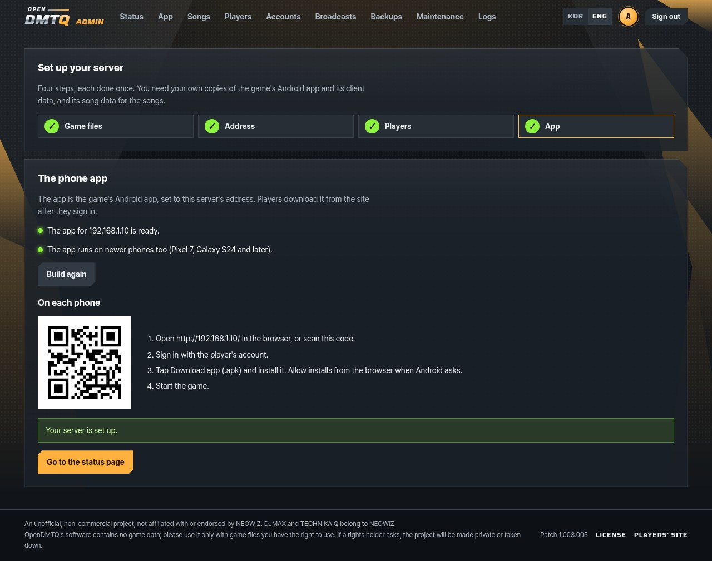
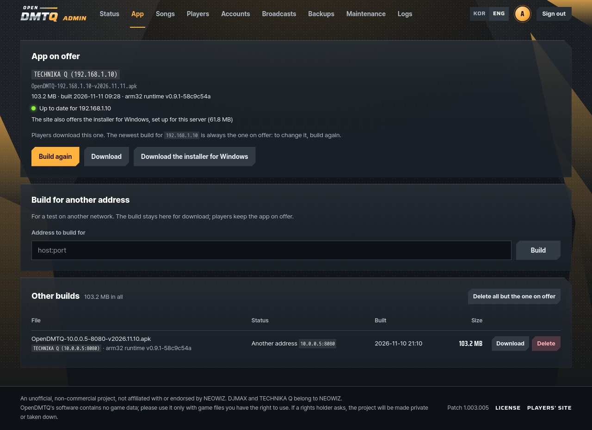

# The site and the admin pages

Every server has two sets of pages: the players' site, for everyone with an account, and the admin pages, where the
owner sets up and runs the server.

## The players' site

`http://<server>/` is the players' site:

- **Home:** the server's version beside the logo, the way to the download page, what is on the server, top players,
  newest records.
- **Download:** the app (.apk) and its QR code, the three steps after it, and help. Android only, as it says before
  anyone signs in.
- **Rankings:** the first three on a podium, then the others who have played, by total best score (best score per
  chart, summed), or by S grades, perfect plays, charts played. Players with nothing in a category are not listed in
  it. Average accuracy is the game's own figure.
- **Songs:** every song with its jacket; search by title, artist or genre.
- **Song:** one leaderboard per chart (2, 3 or 4 lines; Easy on a few songs, Normal, Hard, Expert).
- **Player:** totals, rank, grade spread, the last twelve weeks day by day, records by mode, recent plays with new
  records marked, best records.
- **Live:** live broadcasts of players in a song, and past broadcasts. In the menu of every page. See
  [live.md](live.md).

The game's own table keeps only each player's best result per chart. The game server also writes every saved play to
a `PlayLog` table (score, grade and accuracy of that play, and whether it beat the player's best), for "recent plays"
and "new records". A year is kept.

The whole site is behind a sign-in with an account: an ID and a password made on the Accounts page of the admin pages,
and nowhere else (nobody makes their own). Whatever page a visitor asks for, the sign-in page comes first, then the page
asked for. Before sign-in, no page content shows: no menu, no count of who is on air, no notice. These pages stay open
without sign-in: the sign-in page with its language switch, the licenses, the health check, and the game's own paths. A
browser stays signed in for 30 days; a new password, or the account disabled or deleted, ends its sign-ins at the next
page.

## The setup

The admin pages start with a setup of four steps. On a host install and in the Windows bundle, the server opens it in
the browser the first time, signed in by a one-time link (it works once, from the server PC, within an hour). Later it
is at `/opendmtq/admin/setup`, and the status page leads there until every step is done.

1. **Game files.** The game's Android app and the server files, found in Downloads, on the Desktop and in Documents
   (OneDrive's too), or anywhere else on the PC: type or paste the path of the folder, archive or file, or click your
   way to it. Each file found or listed says what it is (the app and its version, a copy changed for another server,
   server files and their songs, the game data or the songs alone, the iPhone app, a part of an archive, one that
   cannot be read), and one of no use cannot be imported ([the forms each may come in](game-files.md)). The import takes
   the app and the game data, the songs too when their box is ticked, each from where it is, then makes the song list.
   The songs can also come later, on their own. Its output shows as it goes.
2. **Address.** The address phones use, which goes into the app: this PC's address on its network. A PC with several
   (wired and Wi-Fi) offers each. A new one is written to `.env`, and the server starts again for it.
3. **Players.** An account for each player, its password shown once with the message to send.
4. **App.** The app, built for that address; then what to do on each phone, with the QR code.

With Docker Compose the pages run in a container and cannot see the PC's folders, so the first two steps name the
commands instead (`./opendmtq import --songs <folder>`, `./opendmtq host <address>`). The players and the app are the
same everywhere.

## The admin pages

What each page works on:

  

Where they are:

| Install | Address |
|---|---|
| Docker Compose, on the server PC | `http://localhost:8791/opendmtq/admin/` (`ADMIN_PORT` and `ADMIN_BIND` in `.env` change it) |
| Docker Compose, from the local network | `https://<server>:<port>/opendmtq/admin/` (a plain-HTTP visit is sent there; with port 80 that is `https://<server>:80/opendmtq/admin/`) |
| Docker Compose, exposed to the internet | Only on the server PC, unless `./opendmtq expose --admin-public`: then over HTTPS from anywhere |
| Host install and Windows | `http://localhost:8791/opendmtq/admin/` on the server PC (another port when 8791 was taken: `./opendmtq status` shows it, and on Windows the window), and `http://<server>:<port>/opendmtq/admin/` from the local network (without `:<port>` when it is 80) |
| Kubernetes | Through the router when `admin.onPublicPort` allows it, else `kubectl port-forward` ([kubernetes.md](kubernetes.md)) |

HTTPS uses the server's own certificate, which browsers warn about once ([internet.md](internet.md#https)). The site's
footer has an ADMIN link to the pages whenever they are on the public port. Until 2026-11 the pages were at `/admin/`:
that address leads to the same page at the new one (a permanent redirect, which also keeps a form's POST).

Sign in with an ID and a password: the owner's account, `ADMIN_USER` (`admin` unless set) and `ADMIN_PASSWORD` from
`.env` (made by `setup`), which works even with the database damaged, or an account made on the Accounts page with
admin rights.

Wrong passwords are slowed down. After five failures in ten minutes from one address, that address must wait. Visits
through the server also count together, and after thirty failures in ten minutes they all wait. The admin pages' own
address on the PC (`http://localhost:8791/opendmtq/admin/`) is never locked out that way. The address counted is the
connection's own, never a header the client sent. Forms carry a CSRF token, and the session cookie is HttpOnly,
SameSite=Lax, and Secure when it comes over HTTPS. Signing out ends that sign-in on the server too, so a copied cookie
stops working; restarting the admin pages signs everyone out. Until a visitor has signed in, the pages read at most 16
KB of any request. On the PC's own address the password travels without TLS, but only within this PC (unless
`ADMIN_BIND` opens that address to the network). On a host install the address on the local network has no TLS either.
Keep the password unique and change it if in doubt: edit `.env`, then restart the server.

| Page | What it does |
|---|---|
| Setup | The four steps above: the game's files, the address, the players and the app. Reached from the status page while a step is left, and from the Songs page to import songs. |
| Status | Things to look at first when there are any (no app, no backup, little disk, a failed build). Game server health, players, plays in the last 24 hours, players broadcasting now, disk space, current app, last backup, maintenance. A message to send a friend with where to get the app and how to sign in, and its QR code. Plays over the last 30 days, when people play by weekday and hour, who plays most, the most played songs, what takes the disk, best records by grade, recent plays. |
| App | The app's name on phones, TECHNIKA Q (<name>): SERVER_NAME, or the address in PUBLIC_HOST when it is unset. Build the app (about 20 seconds, output shown live), download any build, delete one, or all the old ones at once. A build for another address is kept for download and does not replace the one the site offers. |
| Songs | Add a song package, remove added songs, hide or show any song. Each song's plays over the last 30 days, against the most played, and when it was last played. Says so when the server has no game data or no songs yet. See [songs.md](songs.md). |
| Players | Search by name, sort by any column, when each last played, and a row of 14 small cells, one per day of the last two weeks, darker on days with more plays. A spreadsheet of them all. A name leads to the player's page on the site. On each row whether their broadcast is on, with its switch; under More: rename, reset scores, delete (those two ask first and make a backup first, and take the player's achievements with their scores) ([live.md](live.md)). |
| Accounts | The site's accounts, the only way into it: make one (an ID, a password typed or made, whom it is for, the game player it is, admin rights to these pages too), and its password shows once with the message to send; a new password, disable or enable, delete. Each with when it was made and last signed in. |
| Recordings | Every broadcast, kept (players see them as past broadcasts): watch, download as one file, hide from players, delete one, selected or all of a player's. Disk used against the two limits (20 GB and 30 days by default), which are set here, and about how many hours of broadcast still fit. See [live.md](live.md#recordings). |
| Backups | Back up now, download, upload, restore (the server keeps running; the current state is saved first), delete, each with its date and kind. A daily backup when turned on: one a day while something has changed, the latest seven kept. The page shows those seven as seven slots, the newest on the right, and when the next one comes. |
| Maintenance | Turn the in-game maintenance notice on or off, with a message, typed or one of a few ready ones. The site shows it too. On the server PC's own install (the Windows bundle, Linux, macOS), **Stop the server** stops every part of it. With Docker Compose the page names the command instead, `./opendmtq down`, which also makes a backup. |
| Logs | Three tabs. **Requests:** the last 24 hours as a chart, what was asked for most, by which devices and addresses, then the newest requests with filters by text, result and kind, a click on an address to filter by it, keep updating, and the log as a file. **Plays:** every play, a page at a time, narrowed by a word, a player and days, with what the filter leaves added up over it (plays, new records, average accuracy, plays per day or week, grades); it also comes as a CSV file. **Changes:** what was done on these pages, sign-ins and failed sign-ins too, when and on whom, in words (at most a few hundred kilobytes are kept). |

The pages are in English until the visitor picks another language, whatever the browser prefers: the KOR / ENG buttons
at the top of every page, for the site and the admin pages alike, and a cookie remembers it. The texts are in
`tools/opendmtq_tools/strings.py`, the site's in `server/portal/strings.php`.

Backups hold neither live video nor recordings, so they stay small. Download any recording you want to keep.

On a host install and in the Windows bundle, the setup imports the game's files and changes the address. With Docker
Compose those stay on the command line (`./opendmtq import`, `./opendmtq host`, `./opendmtq expose`), because they
restart the containers. The ports and the passwords are in `.env`; change them there, then restart the server.

## Where it runs

The admin pages are a small Flask application in the tools package (`tools/opendmtq_tools/admin`), next to the app
builder they start. Docker Compose runs them as the `admin` service, on gunicorn; the game server passes
`/opendmtq/admin` (and the old `/admin`) to them. In Kubernetes they are a sidecar of the api pod, because they work on
the database in that pod. A host install runs them on waitress, on this PC's loopback address.

## Notice

What the project is, and what it asks of whoever runs a server: [notice.md](notice.md).
