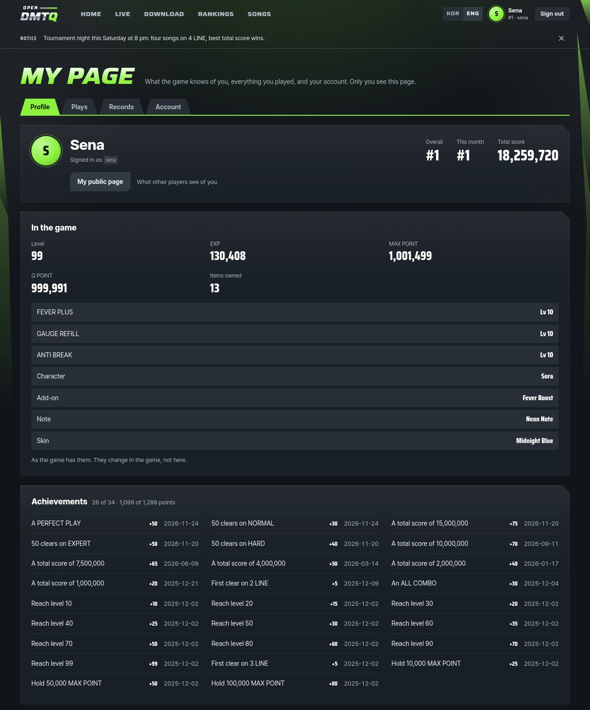
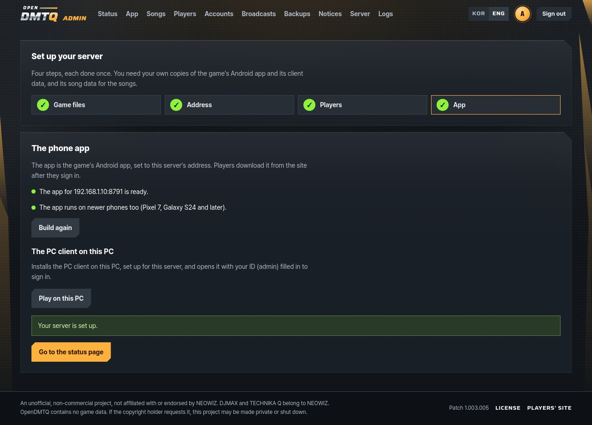
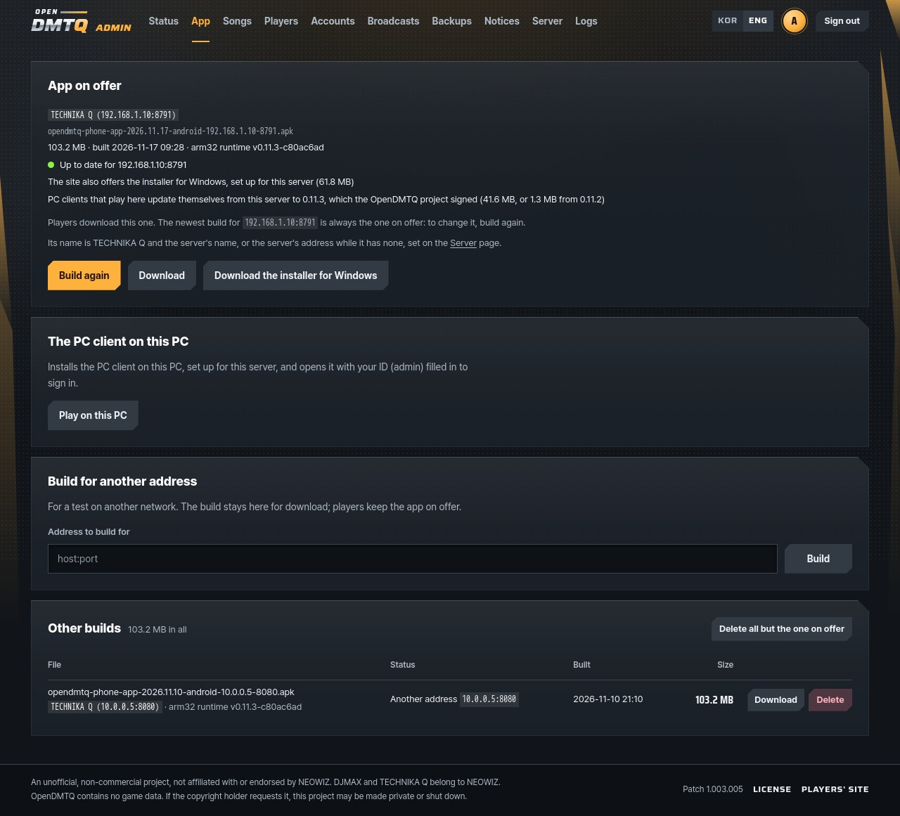
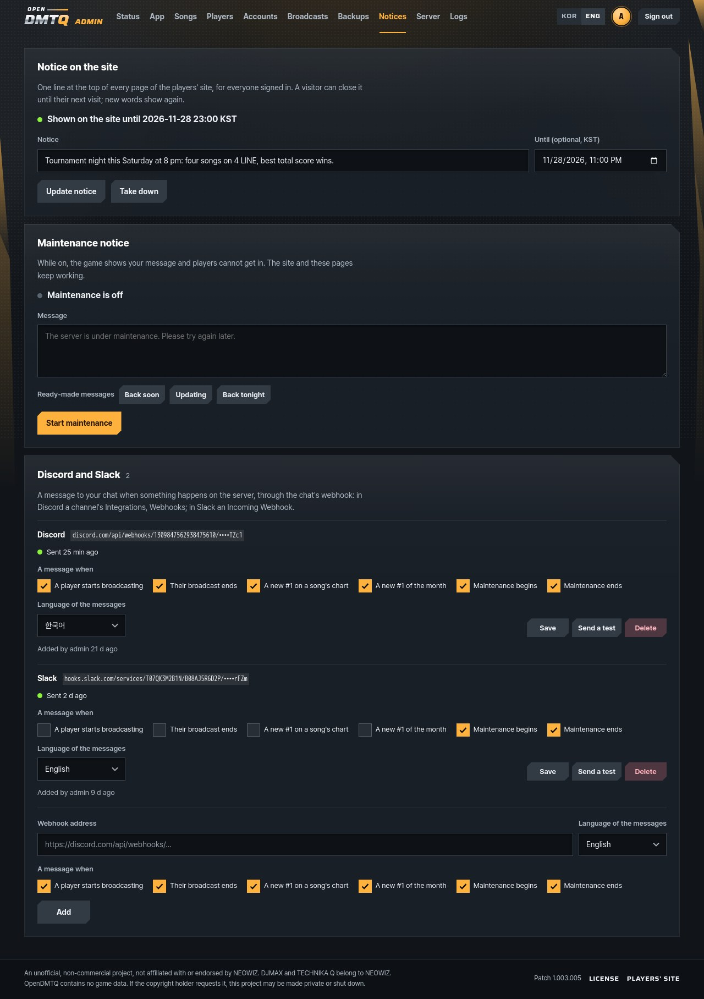
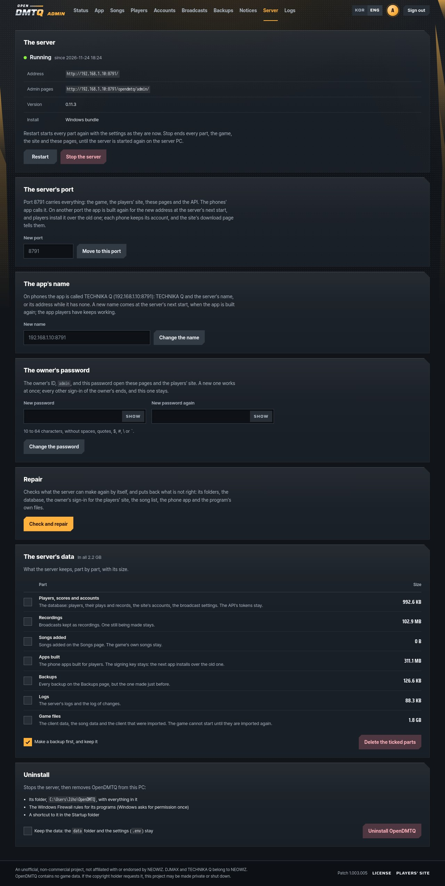
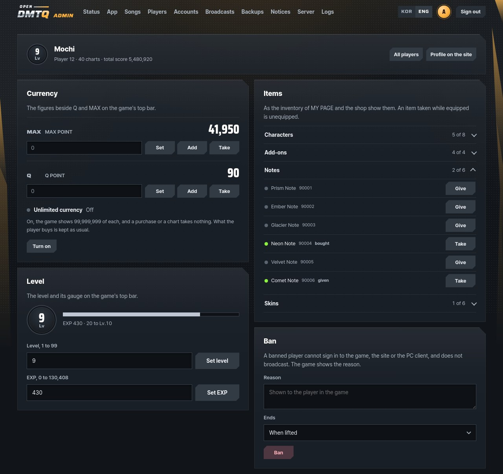

# The site and the admin pages

For the server's owner: every server has two sets of pages on its one port, the players' site, for everyone with an
account, and the admin pages, where the owner sets up and runs the server. What players do on the site:
[playing on a server](play.md).

## The players' site

`http://<server>:8791/` is the players' site, on the server's one port (8791 unless it was moved; `status` and the
server's window show the address):

- **Home:** the server's version beside the logo, the way to the download page (drawn waiting, with why, while there
  is no app for this server and none is being made), what is on the server, top players, newest records. For a month
  after the server moved, a line under the download says so, with the way to the download page.
- **Download:** for Android, the app (.apk) with its QR code and the three steps to install it, and on a local network
  that the device must be on the server's Wi-Fi; and the PC client's installer for Windows, set up for this server, when
  the server has it, with what it runs on ([the PC client's installer](#the-pc-clients-installer)). For a month after
  the server moved to another address or port, it says so: phones and tablets install the app built for the new address
  over the old one, and a Windows PC runs the installer from the page again. How the app and the game go on afterwards,
  and what to do when one does not install, is [playing on a server](play.md) and
  [troubleshooting](troubleshooting.md#for-players), not the page.
- **Rankings:** the first three on a podium, then the others who have played, by total best score (best score per
  chart, summed), this month's as the game ranks them, or by S grades, perfect plays, charts played. Players with
  nothing in a category are not listed in it. Average accuracy is the game's own figure.
- **Songs:** every song with its jacket; search by title, artist or genre.
- **Song:** one leaderboard per chart (2, 3 or 4 lines; Easy on a few songs, Normal, Hard, Expert).
- **Player:** totals, rank, grade spread, the last twelve weeks day by day, records by mode, recent plays with new
  records marked, best records.
- **Live:** live broadcasts of players in a song, and past broadcasts. In the menu of every page while broadcasts are on
  for the server (off until the owner turns them on); with them off, the site shows nothing of them. See
  [live.md](live.md).
- **MY PAGE:** the signed-in player's own page, from their name and badge at the top of every page: their profile as the
  game shows it (shown only), their achievements and places, every play and best record a page at a time, their
  broadcasts, and their account, where they change their password and ID and sign out everywhere else
  ([playing](play.md#my-page)). Nobody else sees it.

  

The owner's notice, set on the [Notices page](#the-notices-page), is one line at the top of every page for everyone
signed in.

A score played with the PC client's keyboard has a small keyboard mark wherever the site shows it: on a song's
leaderboards, a player's recent plays and best records, and the home page's newest records. Its words (Keyboard play)
come with a tap, the keyboard or the pointer resting on it. On a best record the mark is the score's: the play that set
that score was played with the keyboard. The grade, the accuracy and the AC and PP marks beside it follow their own
rules (the best accuracy, and a mark once any play earned it), whichever way those plays were made. A total on the
rankings and on the home page, and a month's score, that counts such best scores has the same mark, whose words say how
many (on the podium of the Total score and This month tabs it follows the name), and a player's page counts them beside
the grades. The rankings are one for touch and keys.

The game's own table keeps only each player's best result per chart. The game server also writes every saved play to
a `PlayLog` table (score, grade and accuracy of that play, whether it beat the player's best, and whether it was played
with the keyboard), for "recent plays" and "new records". A year is kept.

The whole site is behind a sign-in with an account: an ID and a password made on the Accounts page of the admin pages,
and nowhere else (nobody makes their own). Whatever page a visitor asks for, the sign-in page comes first, then the page
asked for. Before sign-in, no page content shows: no menu, no count of who is on air, no notice. These pages stay open
without sign-in: the sign-in page with its language switch, the licenses, the health check, and the game's own paths. A
browser stays signed in for 30 days; a new password, a new ID, or the account disabled, deleted or its player banned,
ends its sign-ins at the next page. A player changes their own password and ID, and signs out everywhere else, on MY
PAGE, with their current password and under the sign-in's limit on wrong ones; the account's game player, its note and
its admin rights stay the owner's to set. Each such change is in the log of changes, by the account. The PC client makes
one link itself: at its first PLAY, an account that has no game player is linked to the PC's game player when that
player has no account either (never the owner's account or a banned player), in the log of changes too. For an account that
also opens the admin pages, each of the three ends its sign-ins there too. The owner's account, whose ID and password
are the server's, has Sign out everywhere else there, and the way to the Server page for its password.

## The setup

The admin pages start with a setup of four steps. On a host install and in the Windows bundle, the server opens it in
the browser the first time, signed in by a one-time link (it works once, from the server PC, within an hour). Later it
is at `/opendmtq/admin/setup`, and the status page leads there until every step is done.

1. **Game files.** The game's Android app, the client data and the song data, found in your home folder, Downloads, the
   Desktop and Documents (OneDrive's too), one folder down in each, or anywhere else on the PC: type or paste the path
   of the folder, archive or file, or click your way to it. Each file found or listed says what it is (the app and its
   version, a copy changed for another server, the client data and the song data with how many songs, the client data or
   the song data alone, the iPhone app, a part of an archive, one that cannot be read), and one of no use cannot be
   imported ([the forms each may come in](game-files.md)). The import takes the app and the client data, the songs too
   when their box is ticked, each from where it is, then makes the song list. The songs can also come later, on their
   own. Its output shows as it goes.
2. **Address.** The address phones use, which goes into the app: this PC's address on its network, with the server's
   port. A PC with several (wired and Wi-Fi) offers each. A new one is written to `.env`, and the server starts again
   for it.
3. **Players.** An account for each player, its password shown once with the message to send.
4. **App.** The app, built for that address, and [**Play on this PC**](#play-on-this-pc) when the setup is open on the
   Windows bundle's server PC itself. Players install the app as [playing on a server](play.md) says; the status page's
   **Add a player** card has the code that downloads it.

With Docker Compose the pages run in a container and cannot see the PC's folders, so the first two steps name the
commands instead (`./opendmtq import --songs <folder>`, `./opendmtq host <address>`), which restart the containers. The
players and the app are the same everywhere.

## The admin pages

The menu at the top: **Status, App, Songs, Players, Accounts, Broadcasts, Backups, Notices, Server, Logs**. What each
page works on:

  

### Where they are

On the server's one port, under `/opendmtq/admin/`:

| Install | Address |
|---|---|
| Docker Compose, on the server PC | The address `./opendmtq setup` ends with, which `./opendmtq up` and `./opendmtq status` show too: the server's address with `/opendmtq/admin/`. `http://localhost:<port>/opendmtq/admin/` stays on plain HTTP |
| Docker Compose, from the local network | `https://<server>:<port>/opendmtq/admin/` (a plain-HTTP visit is sent there) |
| Docker Compose, exposed to the internet | Only on the server PC, at `http://localhost:<port>/opendmtq/admin/`, unless `./opendmtq expose --admin-public`: then over HTTPS from anywhere |
| Host install and Windows | The address `./opendmtq status` shows, and on Windows the server's window: `http://<server>:<port>/opendmtq/admin/`; exposed to the internet, on the server PC only, at `http://localhost:<port>/opendmtq/admin/` |
| Kubernetes | Through the router when `admin.onPublicPort` allows it, else `kubectl port-forward` ([kubernetes.md](kubernetes.md)) |

Their API is at the same addresses, under `/opendmtq/api/v1/`, for scripts and other programs ([api.md](api.md)).

"On the server PC only" means a visit from the PC itself that came through no proxy: a visit that carries a proxy's
forwarding headers counts as one from elsewhere, also from a proxy on the same PC. With rootless Docker, as with Docker
Desktop, the server cannot tell the server PC's visits apart, so an exposed server's admin pages are off unless
`--admin-public` puts them on HTTPS ([internet.md](internet.md)).

HTTPS uses the server's own certificate, which browsers warn about once ([internet.md](internet.md#https)). The site's
footer has an ADMIN link to the pages whenever they are on the public port. Until 2026-11 the pages were at `/admin/`:
that address leads to the same page at the new one (a permanent redirect, which also keeps a form's POST).

### Signing in

Sign in with an ID and a password: the owner's account, `ADMIN_USER` (`admin` unless set) and `ADMIN_PASSWORD` from
`.env` (made by `setup`), which works even with the database damaged, or an account made on the Accounts page with
admin rights. The owner's ID and password sign in to the players' site too: the admin pages keep a copy of the
password there as the accounts' table keeps one (`data/state/owner.pass`, readable by the server's user only), made
again when `.env` changes. An account without admin rights is told it is for the players' site. The owner changes the
owner's password on the [Server page](#the-server-page), or on the command line, the way in when it is lost:
`./opendmtq password` (on Windows `OpenDMTQ.exe password`), which asks for it twice or makes one; on Kubernetes the
chart's Secret.

Wrong passwords are slowed down. After five failures in ten minutes from one address, that address must wait. Visits
through the server also count together, and after thirty failures in ten minutes they all wait; only a visit on the
admin service's own port, as `kubectl port-forward` makes on Kubernetes, is outside that count. The address counted is
the connection's own, and no header a visit brings exempts it. A refused sign-in is in the log of changes whatever the
reason: a wrong password, too many tries, or an account without admin rights.

A sign-in lasts 12 hours and outlives a restart of the server: the cookie's key and the open sign-ins are kept beside
the database (`data/state/admin-session.key` and `admin-sessions.json`, readable by the server's user only). Signing out
ends that sign-in on the server too, so a copied cookie stops working. Forms carry a CSRF token, and the session cookie
is HttpOnly, SameSite=Lax, and Secure when it comes over HTTPS. No page can show these pages in a frame
(`X-Frame-Options: DENY`), a browser takes each file as the type it is sent as (`X-Content-Type-Options: nosniff`), and
a link to another site carries no address of these pages (`Referrer-Policy: same-origin`); the API's answers carry the
same. Until a visitor has signed in, the pages read at most 16 KB of any request. At `localhost` on the server PC the
password travels without TLS, but only within this PC; on a host install the address on the local network has no TLS
either.

While the game server is not answering, every page says so: OFFLINE at the end of the bar and a sentence above the page.
A page left open looks again every half minute, and the two come and go with the server by themselves; so do the status
page's things to look at first.

The pages are in English until the visitor picks another language, whatever the browser prefers: the KOR / ENG buttons
at the top of every page, for the site and the admin pages alike, and a cookie remembers it. The texts are in
`tools/opendmtq_tools/strings.py`, the site's in `server/portal/strings.php`.

### The pages

  

| Page | What it does |
| :--- | :--- |
| Setup | The four steps above: the game's files, the address, the players and the app. Reached from the status page while a step is left, and from the Songs page to import songs. |
| Status | Things to look at first when there are any (no app, no backup, little disk, a failed build, a chat that does not take its messages). Game server health, players, plays in the last 24 hours, players broadcasting now (or that broadcasts are off), disk space, current app, last backup, maintenance. An "Add a player" card that leads to the Accounts page, where each account comes with the message to send its player, and the code that downloads the app. Plays over the last 30 days, when people play by weekday and hour, who plays most, the most played songs, what takes the disk, best records by grade, recent plays (one played with the keyboard marked as on the site). Resources: this machine's processors, uptime, memory, swap, disk and load, with CPU, memory in use and the game server's answers over the last 24 hours. |
| App | The app's name on phones, `TECHNIKA Q (<name>)`: the server's name, set on the Server page, or its address while it has none. Build the app (about 20 seconds, output shown live), download any build, delete one, or all the old ones at once. A build for another address is kept for download and does not replace the one the site offers. The PC client's installer for Windows, its size and its own download, set up for this server, and to which version the server updates the PC clients that play on it ([the PC client's installer](#the-pc-clients-installer)); an installer or updates the server did not take, each with why. Opened on the Windows bundle's server PC itself, [**Play on this PC**](#play-on-this-pc). |
| Songs | Add a song package, remove added songs, hide or show any song; what takes more than a few seconds shows its progress until it ends. Each song's plays over the last 30 days, against the most played, and when it was last played. Says so when the server has no client data or no songs yet. See [songs.md](songs.md). |
| Players | Search by name, sort by any column, when each last played, and a row of 14 small cells, one per day of the last two weeks, darker on days with more plays. A spreadsheet of them all. A name leads to [the player's own page](#a-players-page), a banned player's marked. On each row whether their broadcast is on, with its switch (while broadcasts are off for the server, the page says so and a switch that is on is held for then); under More: rename, reset scores, delete (those two ask first and make a backup first, and take the player's achievements with their scores; a deletion takes their game state, ban and game sign-ins too, and their number is never handed out again) ([live.md](live.md)). Under the list, while anyone is banned, the banned players with the reason, the end and the way to lift each ban; then the game for every player: unlimited currency for all of them, and what a new player starts with. |
| Accounts | The site's accounts, the only way into it: make one (an ID, a password typed or made, whom it is for, the game player it is, admin rights to these pages too), and its password shows once with the message to send; a new password, disable or enable, delete. Each with when it was made and last signed in. Under them the API's tokens: make one (a name and a scope, read or write), shown once; each with whose it is, when it was last used and whether it works; revoke ([api.md](api.md)). |
| Broadcasts | At the top, broadcasts for the whole server: on or off (off until turned on; turning them off while someone is on air asks first), how many players are switched on and on air, what new players start with (off, or on from their first play), and the stream's quality, one of four with what an hour of it takes and what each viewer's connection needs. Under it every broadcast, kept (players see them as past broadcasts): watch, download as one file, hide from players, delete one, selected or all of a player's. Disk used against the two limits (20 GB and 30 days by default), which are set here, and about how many hours of broadcast still fit at the quality chosen. See [live.md](live.md). |
| Backups | Back up now, download, upload, restore (the server keeps running; the current state is saved first; the accounts, the API's tokens and the Discord and Slack webhooks stay as they are now, a server with no account yet takes the backup's accounts, and one with no webhook, account or player yet the backup's webhooks), delete, each with its date and kind. A backup or a restore that takes more than a few seconds shows its progress until it ends. A daily backup, on unless turned off: one a day while something has changed, the latest seven kept. The page shows the ones kept, each with its day and size, the newest on the right, and when the next one comes. Backups hold neither live video nor recordings, so they stay small. |
| Notices | The owner's notice on the site, the game's maintenance notice, and messages to Discord and Slack ([the Notices page](#the-notices-page)). |
| Server | The server's state and its one address; restart, stop, repair, the port, the app's name, the owner's password, the data part by part, uninstall ([the Server page](#the-server-page)). |
| Logs | Three tabs. **Requests:** the last 24 hours as a chart, what was asked for most, by which devices and addresses, then the newest requests with filters by text, result and kind, a click on an address to filter by it, keep updating, and the log as a file. **Plays:** every play, a page at a time, narrowed by a word, a player and days, with what the filter leaves added up over it (plays, new records, average accuracy, plays per day or week, grades), a play made with the keyboard marked as on the site; it also comes as a CSV file, whose last column, `keys`, is 1 for such a play. **Changes:** what was done on these pages and through the API, sign-ins and failed sign-ins too, and what players changed of their own accounts on MY PAGE (a password, an ID, a sign-out everywhere else), when, by whom and on what, in words (at most a few hundred kilobytes are kept). |

## The Notices page

What the server tells people, a card each. The menu names it Notices; it keeps the address the Maintenance page had,
`/opendmtq/admin/maintenance`.

  

**Notice on the site.** One line of up to 200 characters at the top of every page of the players' site, for everyone
signed in, from **Show notice** until **Take down** or until the end you set (in the server's own time, whose zone the
card names). A visitor can close it until their next visit, and new words show again. Pages left open (the home page,
LIVE) take it up, change it and drop it by themselves. The notice is the site's alone: the game shows no news.

**Maintenance.** The game's maintenance notice on or off, with a message of up to 200 characters, typed or one of a few
ready ones. The site shows it too. Players already in the game are told between songs when it begins, at each new
message and when it ends.

**Discord and Slack.** A message to a chat through its webhook (in Discord, a channel's Integrations, Webhooks; in
Slack, an Incoming Webhook):

- when a player starts broadcasting and, if ticked, when the broadcast ends (a minute after the phone's last upload, so
  a short drop is no end);
- when someone takes a song's chart's #1 from another player, as the site's leaderboard orders them (not a first clear,
  a tie or a player beating their own record, and nothing of a song the owner hid);
- when this month's #1 changes, the month's first #1 too;
- when maintenance begins and ends.

Each webhook has its own language and its own choice of these, and **Send a test** sends one at once and says how it
went. A message names the player as the site does, the song and the chart as the server's song list does, and the score,
and links to that page of the site. Discord's are embeds and Slack's blocks, and nobody is called by what a name holds
(@everyone, @here, a role or a user). A Discord address ending in `/slack` gets Slack's format.

The address is kept in the database and shown masked everywhere, in the API and the log of changes too (Discord's
token, the secret at the end of Slack's, the whole path of another chat's); a backup holds it whole, as
it holds the app's signing key. An address of the server itself or of its network link's own (loopback, link-local such
as a cloud's metadata, this machine's own on any of its networks, the game server's) is refused, by its numbers when added and by where its name leads when a message goes, which is
where the message then goes; a chat on the local network is fine. A message a chat does not take is tried again after a wait, the chat's own when it asks for
one, and given up after half an hour; the card says the last failure in red with why, how many wait and how many were
given up, and the status page lists it among the things to look at. A restore keeps today's webhooks and sends nothing
of the restored data; a server with no webhook, account or player of its own yet (a new PC) takes the backup's.

## The Server page

The server's own life in one place, a card each:

  

- **The server:** its state, its one address (the site, with these pages under `/opendmtq/admin/`), where these pages
  open, its version and how it is installed. On the server PC's own install (the Windows bundle, Linux, macOS),
  **Restart** (every part again, with `.env` as it is now) and **Stop the server**, each asking first. The page after a
  stop says when the server has stopped, how to start it again, and when it runs again.
- **The server's port:** its own port, what it carries, and **Move to this port**: from the server's next start it answers
  there, the app is built again for the new address, and the site's download page says so for a month. Where the
  phones' app calls another port that is forwarded to it (a router's, `PUBLIC_HOST=<name>:8443` beside
  `LISTEN_PORT=8791`), the line under it says so. A port another program
  holds is refused, and so is a port below 1024 that the computer keeps from the server's user.
- **The app's name:** what phones call it, `TECHNIKA Q (<name>)`, and **Change the name**: from the server's next start
  the app is built again with it (Restart above does it now). The app players have keeps working, as it calls the same
  address; empty, the address names the app. A name with a quote, `$`, `#`, a backslash or a backquote, or over 80
  characters, is refused.
- **The owner's password:** by the owner alone, typed twice: written to `.env` and taken at once, for these pages and
  the players' site; the owner's other sign-ins end, this one stays.
- **Repair**, **Check and repair:** the folders, the database's integrity, the owner's sign-in for the players' site,
  the song list, the site's look kept here, the phone app (built again when it is missing or built for another address),
  and the program's own files against the install's list of them, put back from its release where it can be.
- **The server's data,** part by part with its size (players, scores and accounts; recordings; songs added; apps built;
  backups; logs; game files): the parts ticked are deleted once the word *delete* is typed, after a backup (ticked as
  the page comes, and kept). A part the page cannot delete (with Docker Compose, the game files) names the command that
  does it on the server PC, as `./opendmtq delete-data game`.
- **Uninstall:** what it takes away on this install (its folder, or all but `data` and `.env` with **Keep the data**,
  the start with the computer, the command on the PATH, and on Windows the firewall rules for its programs and its
  shortcut in the Startup folder), once the word *uninstall* is typed.

Neither a repair nor a deletion runs beside a restore. With Docker Compose and Kubernetes the page names the commands
instead: `./opendmtq down`, `restart`, `repair`, `delete-data`, `uninstall`, `port`, `name` and `password`, or `kubectl`
and `helm`; on the server PC's own install, where these pages were started without its program's run folder or `.env`
(by hand), the install's own (`opendmtq stop`, `OpenDMTQ.exe uninstall`). Every card has its command ([everyday use](install.md#everyday-use)) and its route in the [API](api.md).

## A player's page

A name on the Players page opens that player's own page: what the game keeps of them besides their scores, each part
with the way to change it. A change shows in the game at its next look at the player: after a song, a purchase, or the
game's next start.

  

- **Currency.** The two the game's top bar shows: MAX POINT beside MAX and Q POINT beside Q, each set to a figure, or
  added to or taken from, from 0 to 99,999,999 (the most the bar shows whole). A song played adds 150 MAX POINT; the
  shop takes what its tables price a skin, a note, a character, an add-on or a pack of MAX POINT at, and some 4 LINE
  charts take 200 to 500 MAX POINT a play (Q, for a chart priced in it), as their song's page shows. **Unlimited
  currency**, the player's own switch (and one for every player on the Players page; both off until turned on): the game
  is told 99,999,999 of each, and a purchase or a chart takes nothing, while the purchase is kept as usual (the item is
  the player's, and the purchase is listed with nothing paid). The player's own balance stays as it was underneath, and
  shows again once unlimited is off.
- **Level.** The level and its gauge as the top bar draws them, from the game's own table of experience: a level from 1
  to 99 (its experience goes to that level's start), or the experience itself, 0 to 130,408 (the level follows it). A
  song played adds 10 EXP; past a level's end the game shows its level-up after the song.
- **Items.** The items a player equips, kind by kind as MY PAGE's inventory has them (characters, add-ons, notes,
  skins), each by the name the game shows it by in the page's language and with its number, given or taken. Every player
  has every item but the notes from the start; a note bought in the shop stays theirs. An item taken while equipped is
  unequipped, and the game shows its own default in its place.
- **Ban.** A reason (up to 200 characters, which the player sees) and an end: in 1, 3, 7 or 30 days, or until lifted.
  The game stops the player's sign-in, and any request of a game already in, at its own "Network connection error."
  (RETRY tries again, CLOSE ends the game), with OpenDMTQ's notice over it saying "You cannot play on this server" and
  the reason, with the end where the ban has one: it comes as the ban is made (within seconds, in a song too) and at
  each request the game makes after; the PC client's overlay keeps it up for as long as the ban lasts and, once the ban
  is over, says the player can play again; the phones show it each time. The site and the PC client's launcher refuse
  the accounts linked to the player with the same reason, a browser signed in to one is signed out at its next page,
  and the player's broadcast ends (their own switch is kept for after the ban). A ban whose end has passed ends by
  itself. Lift the ban here or on the Players page.
- **Purchases.** What the player bought in the game, with its price and what was paid.
- **Changes.** Every change of this player's made on these pages or through the API: when, what, from what to what, and
  who; the Logs page's Changes tab has them too.
- **Name, and the game state's reset.** The name, as the Players page's More renames; and the game state back to what a
  new player starts with (currency, level, items, purchases), the scores, achievements, name and ban as they are, a
  backup first.

What a new player starts with, on the Players page: the MAX POINT, the Q POINT and the level, 999,999, 999,999 and 99
until set otherwise (what every player had before these were kept). Players already on the server keep what they have
when the values change. Every one of these has its route in the API ([api.md](api.md)).

## The PC client's installer

The site's **Download** page offers the PC client's installer to signed-in players, with the server's address and name
added to its end as it is handed out, under a name that says so
(`opendmtq-pc-client-<version>-windows-x64-setup-<address>.exe`): the installer reads them and sets the launcher up for
the server ([the PC client](windows-player.md)). The file is the same for every server, so the server builds nothing
for it; the **App** page offers the same installer. The launcher downloads the app the site offers phones, signed in
with the player's site account (`client.php` answers it), with the same limit on wrong passwords as the site. The
`OpenDMTQ.exe` of the server's Windows bundle, which runs the server, and the PC client's `OpenDMTQ.exe`, the launcher,
are two different programs.

Where the server gets the installer, the first that has one:

- **Beside the server's code:** a release's tools image and the Windows bundle bring it.
- **`data/apk`:** put there by hand, for a server without internet, or fetched there before.
- **The release of the server's own version**, else the latest release: fetched into `data/apk` when there is none, as
  Docker Compose from the source and a host install on Linux or macOS do.

A copy in `data/apk` gives way to that release's once it is a week old, and stays when that fetch fails. After a fetch
that failed, the builder waits a day before it tries again: a server without internet does not wait for an answer at
every start. Without internet, put the release's `opendmtq-pc-client-<version>-windows-x64-setup.exe` in `data/apk`
([without internet](closed-network.md)): the builder keeps it as `OpenDMTQ-Setup.exe`, with the version from its name.
Without an installer the site shows no Windows button, and everything else works as before.

What the builder fetches from a release comes with the release's checksums and the OpenDMTQ project's signature over
them ([a release's files](install.md#a-releases-files)), and it takes the file only when it is the one they sum: the
installer, and the runtime for newer phones. A copy put in `data/apk` by hand is checked the same way when the release's
`opendmtq-<version>-sha256sums.txt` and its `.sig` are beside it. A file that does not match is refused, and the **App**
page (the installer) or the setup (the runtime) says which.

The site also hands the PC clients that play on it their updates, those of the installer's version, at `/updates/` on
the server's one port, with no sign-in: the update feed, its packages and the release's signed checksums, which the
launcher checks before it takes any ([the PC client](windows-player.md#updates)). The builder keeps them beside the
installer, from the first place that has them: beside the server's code (a release's tools image),
`data/apk/pc-client-updates` (a host install's kit, or put there by hand), or the release, fetched. The **App** page
says to which version they update and how much a PC downloads; `GET /app/windows/updates` in the [API](api.md) gives the
same, file by file. A server that hands out none leaves its PC clients to GitHub's releases, up to its own version.

A server reached over HTTPS hands out installers that use it, with the port named (HTTPS answers on the game's port).
Where the server has its own certificate authority (Docker Compose makes one), the installer carries it, and the
launcher trusts it for that server alone, beside Windows' own authorities.

## Play on this PC

An owner who plays on the server PC needs no download and no address typed: the App page and the setup's last step,
opened in a browser on the server PC itself, have **Play on this PC**.

- **The Windows bundle:** the installer this server keeps for the site, set up for this server with the ID of whoever
  presses it on its end (the owner's own, which the players' site takes too; never a password), runs with `--silent`
  for the Windows user the server runs as. It installs the PC client and opens its launcher, the server in place and
  the ID filled in on the sign-in: only the password is left to type. With the PC client installed already, the
  launcher opens the same way, and an open launcher takes the server and comes to the front. The page follows the
  install until it is done and says what came of it; a game open on the PC holds it until the game closes. The
  installer is the site's copy once the app is built, and before that the one the bundle brings.
- **Linux and macOS:** the PC client is a Windows program, and the pages show nothing for it: a Windows PC plays as
  [on a Windows PC](play.md#on-a-windows-pc) says, its installer from the site's download page, set up for this server.
  A press through the API is refused with those words, and nothing runs on the server for it. Docker Compose on Linux is
  the same.

A visit from another PC never sees it, and is refused it: what it runs, it runs on the server PC. The server PC is a
visit from loopback (`http://localhost:<port>/`), from one of the PC's own addresses, or, with Docker Engine on Linux,
one that reaches the server from the stack network's gateway, as the server takes the server PC's own visits to an
exposed server's admin pages. A visit that another proxy passed on (`Forwarded`, `Via`, or another hop in
`X-Forwarded-For` before the server's own) is one from elsewhere, whatever address it comes from. Through the API it is
`POST /app/play-here`, from the server PC too ([api.md](api.md)).

The owner's account is the server's own and no game player: MY PAGE says so, and the PC client's My records has nothing
to list for it.

## One-time sign-in links

The PC client's **My page on the site** opens MY PAGE in the PC's browser, signed in already: the server makes a link
for the launcher's sign-in that signs a browser in to the same account once, within a minute
(`/opendmtq/login.php?once=...`), then opens the page; one used already, or older, leads to the sign-in page, which says
so. The links are kept beside the database (`data/state/signin-links`), each named by the hash of its token. The API
makes one for its token's admin: `POST /site/link` ([api.md](api.md)).

## Where it runs

The admin pages are a small Flask application in the tools package (`tools/opendmtq_tools/admin`), next to the app
builder they start. Docker Compose runs them as the `admin` service, on gunicorn, with no port of its own on the PC: the
game server passes `/opendmtq/admin` (and the old `/admin`) and `/opendmtq/api`, their API, to it on the one port. In
Kubernetes they are a sidecar of the api pod, because they work on the database in that pod. A host install and the
Windows bundle run them on waitress, on this PC's loopback address at a port chosen at each start (18791, or the next
free one), and Apache passes them on the same way. The API ([api.md](api.md)) is part of the same application: each of
its routes calls the same function as the page's form.

The messages to Discord and Slack go from there too: a loop of the admin service looks at the database every few seconds
(the play log, the best scores, who is on air, the maintenance notice), so the game's saves never wait on a chat. Each
event is queued once and each message claimed before it is sent, in the database itself, so two admin services on one
database (one starting while the other ends) never send one twice.

## Notice

What the project is, and what it asks of whoever runs a server: [notice.md](notice.md).
