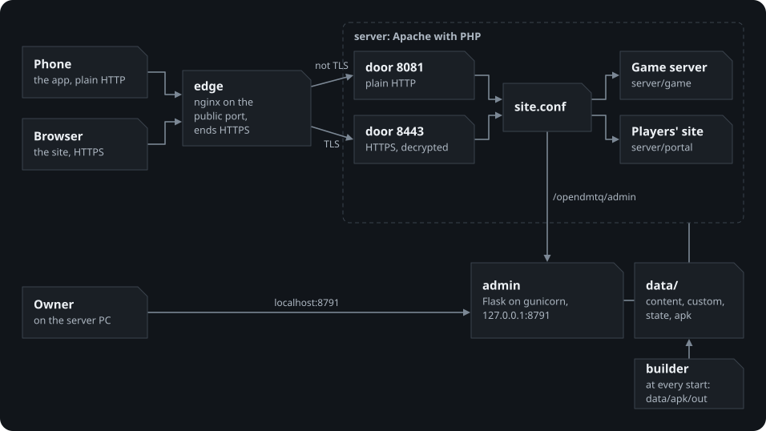
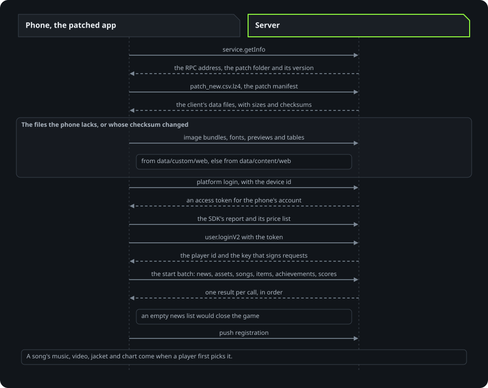
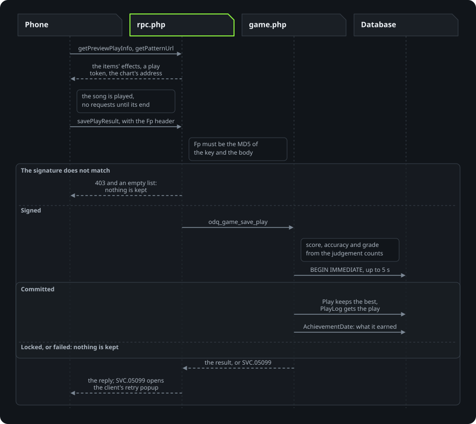
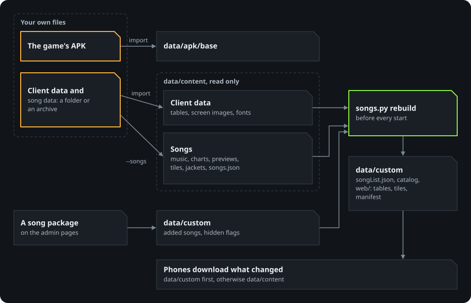
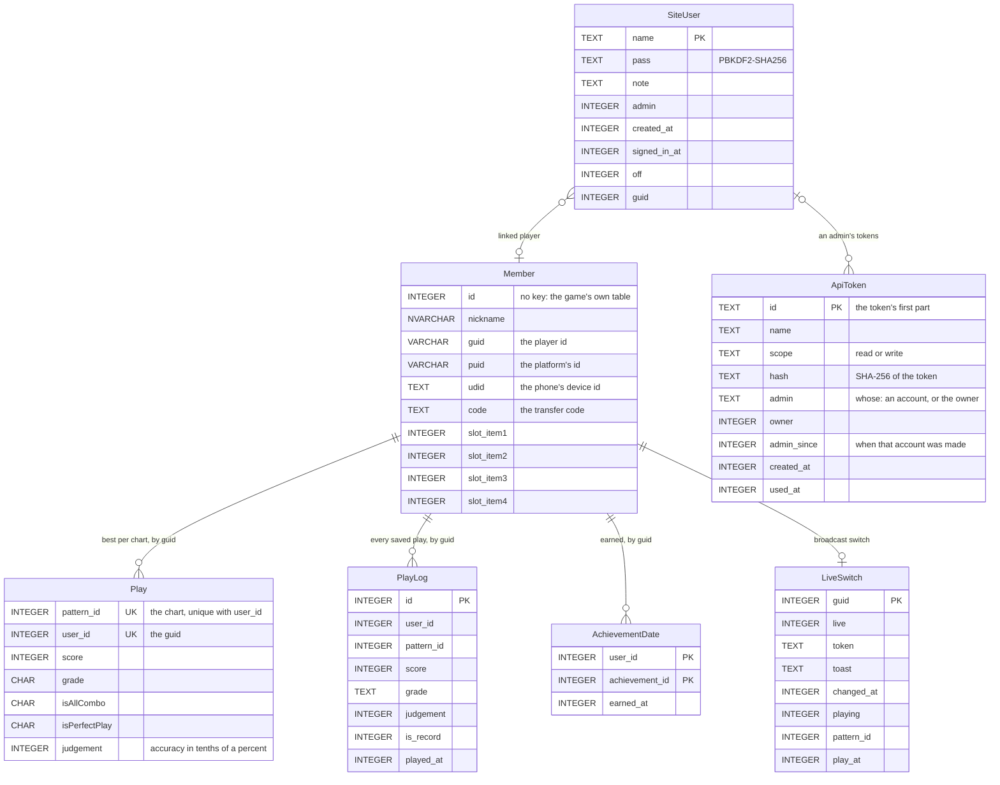
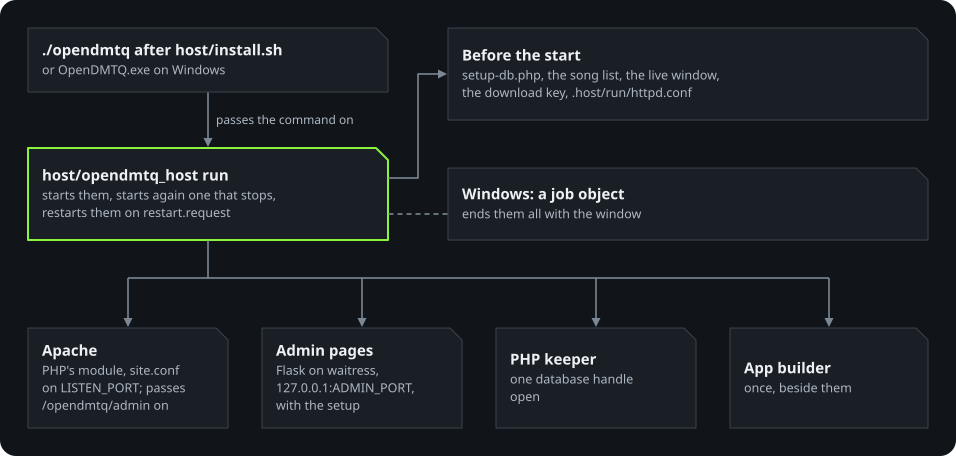

# Architecture

How the parts of OpenDMTQ fit together, for anyone who wants to change them. The guides for running a server are in
[README.md](README.md).

## The parts

With Docker Compose:

  

| Part | What it does | Code | With Docker Compose | Without containers |
|---|---|---|---|---|
| Edge | The one public port: plain HTTP for the game, HTTPS for browsers | `server/edge` | `edge` (nginx) | none: Apache holds the port, plain HTTP only |
| Server | The game server, the platform's login, the players' site, live broadcasts, the files the game downloads | `server/game`, `server/portal`, `server/apache` | `server` (Apache with PHP) | Apache with PHP's module, started by `host/opendmtq_host` |
| Admin pages | The setup, app builds, songs, players, accounts, recordings, backups, the maintenance notice, and their API ([api.md](api.md)) | `tools/opendmtq_tools/admin` | `admin` (Flask on gunicorn) | Flask on waitress |
| App builder | Patches the owner's APK for this server's address | `tools/opendmtq_tools/builder.py`, `patch_apk.py` | `builder`, at every start | run at every start |
| Import | Takes the game's data files from the owner's folder or archive | `tools/opendmtq_tools/importer.py` | `importer`, one-shot | plain Python |
| Song list | The song list and the client's tables, from what was imported and added | `tools/opendmtq_tools/songs.py` | `tools`, before every start | before every start |
| arm32 runtime | Runs the 32-bit game on phones without 32-bit support | `arm32/`; handed out by `tools/opendmtq_tools/runtime.py` | ready-made from a release into `data/apk/arm32`, added to the app by the app builder | the same |
| Command line | Setup, start and stop, checks, backups | `opendmtq`, `cli/opendmtq_cli`, `host/opendmtq_host` | `./opendmtq` | `./opendmtq`, passed on to `host/opendmtq_host`; `OpenDMTQ.exe` on Windows |

The Helm chart runs the same images with a router in front ([kubernetes.md](kubernetes.md)).

## One address for four hosts

The game was written for four hosts. The patched app sends all of them to one address, where their paths do not
collide:

| Original host | Paths | Purpose |
|---|---|---|
| `dmqglb.mb.pmang.com` | `/DMQ/rpc`, `/DMQ/Songs`, `/DMQ/Patterns`, `/patch`, `/viewImg`, `/static`, `/score` | The game's requests and files |
| `www.neonapi.com` | `/api/...` | The platform's login and reports |
| `pmangplus.com` | `/accounts`, `/apps`, `/members`, `/product` | The platform SDK |
| `static.pmangplus.com` | `/inspection` | The maintenance notice |

OpenDMTQ adds `/` (sends a visitor to the site), `/opendmtq/` (the site and `health.php`), `/thumbs` (small jackets for
the site), `/apk` (the newest app), `/ca.crt` (the server's own certificate authority), `/live/` (the phones' live
view uploads), `/opendmtq/admin/` (passed to the admin pages; the old `/admin/` leads there) and `/opendmtq/api/` (their
API, passed on with them).

## How a request is answered

`server/apache/site.conf` is the whole site. Each of the server's doors includes it (`server/apache/opendmtq.conf`), and
a host install includes it in the Apache configuration it writes. Its folders come from environment variables
(`OPENDMTQ_APP`, `OPENDMTQ_CONTENT`, `OPENDMTQ_CUSTOM` and the others), so one file serves every kind of install.

  

A request for one of the game's files (`/DMQ/Songs`, `/DMQ/Patterns`, `/viewImg`, `/patch`, `/static`) is looked up in
this order:

1. `data/custom/web`, the admin pages' overlay: added songs, the client's rebuilt tables, the maintenance notice
   (`/inspection` too).
2. `data/content/web`, what the owner imported, served as it is.
3. Otherwise a 404, Apache's short one: the game reads only the status.

Every other path of the game, its SDK and its window goes to the game server's one door, `server/game/index.php`. The
live broadcasts' three endpoints (`/live/state`, `/live/upload`, `/live/end`) have doors of their own in `site.conf`, with
their own size limits. `/opendmtq/` is the site (`server/portal`). Apache denies notes, backups and databases
wherever one is left in a served folder (`*.txt`, `*.bak`, `*.db3`, `*.log`, `*.md`).

## The game server

OpenDMTQ's own code, written from the requests client 1.3.4 makes and the replies it reads. Client 1.3.5 asks for one
more, its FREE PASS, and goes on without it (`rpc.php`). It needs PHP 8.1 or newer with SQLite and mbstring.

| File | What it answers |
|---|---|
| `server/game/index.php` | The door: sends each path to the part below |
| `src/rpc.php` | `POST /DMQ/rpc`: the list of calls in, a list of results out; `odq_methods()` names every method and its handler |
| `src/game.php` | The `game.*` methods: assets, song and chart addresses, saving a play |
| `src/ranking.php` | The in-game rankings, this month's |
| `src/achievement.php` | MY PAGE's achievements and the dates they were earned |
| `src/shop.php` | The `shop.*` methods: everything is owned, nothing is sold |
| `src/user.php` | The `user.*` methods, the news, the mail and `service.getInfo` |
| `src/platform.php` | The platform SDK: its login (one account per phone), push registration, price list, reports |
| `src/live.php` | Who is in a song, for the live view (watches the game's own calls) |
| `src/content.php` | The song list and the facts of the client's tables (`data/custom/songList.json`, `catalog.json`) |
| `src/config.php`, `src/db.php`, `src/util.php` | Folders and addresses from the environment, the database handle, number rules |
| `pages/score.php`, `pages/help.php` | The game's window (the player's page of the site) and the customer centre page |
| `live/*.php` | The live view's endpoints ([live.md](live.md)) |
| `bin/setup-db.php` | Prepares the database before the server starts (below) |

A call is `{"id", "method", "params"}` and its result `{"result", "error", "id"}`, in the same order. To add a method,
write its handler and name it in `odq_methods()`; the name is matched in lower case. `tests/game/protocol.py` checks
the replies the client depends on.

What the replies rely on, as the client behaves:

- **Errors.** `SVC.05008` the client treats as handled: no popup, the screen goes on. Any other code opens its "retry?"
  popup, whose other button quits the game; `SVC.05099` is sent when the database could not take a save, and the retry
  sends the result again. `SVC.001` means "update required" and makes the client quit: never sent. A method the server
  does not have gets `SVC.05008`.
- **Lists.** The client reads a missing list as null and stops, and turns some lists into arrays of entries: an empty
  news list closes the game, so `board.getNoticeList` always has one plain entry.
- **The signature.** The game signs every request: an `Fp` header with MD5 of the key its login reply gave and the body.
  A batch with a save or a shop call needs it (`403` otherwise). That stops anything that merely posts to the address.
  Someone who has read the app can still sign requests.
- **Saving a play.** The score, the accuracy and the grade are worked out from the counts of each judgement, as the
  official server did. The best row (`Play`) and the log row (`PlayLog`) go in one transaction; a save the database did
  not take answers `SVC.05099`. Scores are kept within what the client reads (32-bit) and accuracies within 100 %.
- **Everyone has everything.** Level 99, 999,999 MAX POINT, every song from 1 to the highest id, every item. No quests,
  no coupons (every code is invalid, in the client's own popup), no terms popup.

The in-game rankings are this month's: each player's best score per chart since the first of the month at midnight UTC
(09:00 in Korea), from the log of every play. The game's ranking screens count down to that moment, so the boards start
anew then. TOTAL sums every chart, the 2/3/4 LINE tabs the charts of that line, a song's ranking the song's charts on
that line (all difficulties). A player's own best (MAX SCORE, NEW RECORD) and the web rankings keep every month. Ties
go to the older account, and the server's own check account is never ranked.

The achievements on MY PAGE come from what the server knows (level 99 and 999,999 MAX POINT for every player, the best
scores, the play log), and each keeps the date it was earned on: the save that earns one stores it in
`AchievementDate`, and its reply names it. A stored achievement stays listed whatever the records give later (the play
log keeps a year). Only a player's reset or deletion on the admin pages removes their rows.

### A phone's first start

The order a real phone's first start takes, from the server's request log. The app's own data comes first, then the
logins and the start batch.

  

### A play is saved

  

## The content

OpenDMTQ ships none of the game's files. `./opendmtq import` takes them from the owner's
folder or archive, a copy of the game host's folder with its `patch/phone_new` in it (under any folder name, with or
without a song list: [the forms](game-files.md#the-client-data-and-the-song-data)), in two parts that can each come on
their own, from the same files or from two places (the patch folder alone, the `DMQ` folder alone). Each replaces only
what it has:

| Part | What | Into `data/content` |
|---|---|---|
| Client data | The client's patch folder (its tables, the image bundles of its screens, its fonts, every song's preview and tile), the news images, the pictures of HOW TO PLAY | `web/patch`, `web/static`, `web/viewImg` |
| Song data (`--songs`) | Music, videos, charts, jackets, the song list | `web/DMQ`, `web/viewImg/eye`, `songs.json` |

  

Only those files are taken: never programs, databases or notes (`TAKE` in `importer.py`). An archive is opened with
7-Zip; files on the same disk are hard-linked instead of copied. A new import is built next to `data/content` and moved
in entry by entry, so a running server keeps a valid folder.

Before every start `songs.py` rebuilds `data/custom` from the content and the admin pages' changes:

- `songList.json`, the list the game server offers: the imported songs, the added ones, the hidden flags;
- `catalog.json`, facts of the client's tables some replies need (charts that cost MAX POINT, the items everyone owns,
  the unlock product);
- the overlay `web/`: the client's tables with the rows of the songs the server has, the song list's tiles of added
  songs, and the patch manifest (`patch_new.csv.lz4`) with their sizes and checksums. Phones download what changed at
  their next start.

With the client data and no songs, the tables lose every song's row and the game starts with an empty song list. The
chart table keeps its rows: the client refuses an empty one. Without the client data the game cannot start at all (it
fetches the images of its screens from the server), so the server reports itself unhealthy until it is imported.

## The app patch

`tools/opendmtq_tools/patch_apk.py`, run by the builder.

- **Which client** (`inspect`): from its contents, never its name. The original has the official game RPC literal. A
  copy changed for another server has the same literal with another host; every literal and SDK string on that host
  is pointed at this server (`address_edits`, `redirect_smali`), and an SDK edit it already has counts as made. An app
  this patcher built has its hook class and is refused, as is anything without the game's RPC.
- **IL2CPP metadata** (`assets/bin/Data/Managed/Metadata/global-metadata.dat`, version 23). Four string literals are
  rewritten: the game RPC URL (live and `-dq`), the platform API base and the platform web base. Literal data has no
  terminators; a table of (length, offset) entries delimits it. A replacement that fits is written over the old bytes
  and its length shrunk. A longer one is appended to the literal data, and every later section's header offset is
  shifted by the padded growth. Tests cover both, and that neighbouring literals and later sections stay
  byte-identical.
- **pmangplus SDK** (smali): the SDK's API hosts, its log endpoints and customer-centre links, and the scheme
  selection, which is forced to HTTP. The game keeps to plain HTTP although the server's port also answers HTTPS: that
  HTTPS is for browsers, with a certificate from the server's own authority, which the app would not trust. The
  manifest and the network security config allow cleartext HTTP (`patch_target`: the target is raised from Android 8.1
  to 9, so that Android 14 and later no longer show a notice at its start, and it asks for the Apache HTTP classes its
  SDK uses). Login goes straight to the guest login instead of trying Google Play Games first (`PPImpl`): that sign-in
  cannot succeed for a re-signed app.
- **SDK screens with no use here** (smali): after OPTION > Google Play log out, the SDK no longer opens Google's Play
  Games screens (`PPImpl$19`). It no longer asks Google Play for the local prices of the paid items at every start
  (`PPImpl`, `getPriceLocalization`). The clipboard is left alone (`ExternalSDK`, `GetClipboard` and `SetClipboard`):
  at every sign-in the game read it for a token the old Kakao edition left there, then emptied it.
- **Game code** (`lib/armeabi-v7a/libil2cpp.so`, `IL2CPP_EDITS`, with the bytes of clients 1.3.5 and 1.3.4): the
  main menu goes past the event notice popup. The question before the first start's data download answers itself. The
  shop opens on its MAX tab, as its Q tab is gone. A menu left alone keeps its frame rate instead of stepping down to
  18 fps. The game draws at the panel's own resolution. In a client of another version an edit whose bytes differ is
  left out whole, with the screen edits that go with it (`ASSET_NEEDS`: the shop keeps its Q tab while it opens on it).
- **Project settings** (`assets/bin/Data/globalgamemanagers`, `SETTING_EDITS`): a 32-bit screen in place of a 16-bit
  one, and textures at full size in place of half, each found in its object (PlayerSettings, QualitySettings) wherever
  the file has it.
- **Screens** (Unity asset files under `assets/bin/Data`, `ASSET_EDITS`, by `unity_assets.py`): what leads nowhere on
  this server is taken off the screen by clearing its object's active flag, and what stays closes up by moving it.
  Neither changes a byte's position. Gone: More Games on every screen; Play for Free, Music Shop, Package and Quest in
  the lobby; the social links and Message in the menu; the account rows and Contact Us in the options; the shop's Q
  tab, which is real money through Google Play. The server does its share in its replies: no coupons in
  `service.getInfo` (`src/user.php`), and a price list of one product that is not on sale (`src/platform.php`).
- **arm32 runtime:** when the server has a runtime bundle (`data/apk/arm32`: a release's, which the builder gets by itself
  through `runtime.py`, or one `arm32/bundle.sh` made here),
  `pack_arm64.py` keeps `lib/armeabi-v7a` and adds `lib/arm64-v8a` with the runtime, a proxy under each 32-bit
  library's name, the 32-bit libraries and the guest system, plus a tweaks file that sets the game's frame cap to the
  runtime's frame rate. The manifest gets `multiArch` and `use32bitAbi`, so phones that run 32-bit apps (Android 7 and
  later) keep running the game natively. See [arm32/README.md](../arm32/README.md).
- **The shim** (`arm32/shim`): phones that run the game's own 32-bit libraries get `lib/armeabi-v7a/libopendmtq.so`
  and a small Java class, `com.opendmtq.Hook`, for the live view and the frame rate.
- **The app's package** (`axml.py`): `com.neowizinternet.game.technikaq_g_a.s<first ten hex digits of the signing
  key's hash>`, so that apps of different servers and the original game can sit side by side on a device. It follows
  the signing key: a change of address keeps it, and a key restored from a backup brings it back.
- **The app's name** (`axml.py`): `TECHNIKA Q (<server name>)`. The name is the whole address, port included, unless
  `SERVER_NAME` (`./opendmtq name`) says otherwise.
- **Signing:** v1+v2+v3 with a key made at the first build in `data/apk/keystore/` and reused, so later builds install
  over earlier ones. Once an app has been signed, a missing key stops the build instead of being replaced by a new one
  (phones could not install that over theirs).

Every metadata, smali and screen edit must match an exact count: a different client build stops the patcher instead
of producing a half-patched app. The code edits are applied only where the bytes match. The builder skips the work
when the newest build already matches the address, the base APK, the patcher version, the signing key and the runtime
bundle (and its file is the size its manifest records). A new build takes the place of the old file whole, and only
one build runs at a time. Each run leaves its outcome in `data/apk/out/build.json`, which the site, the admin pages
and `./opendmtq doctor` read.

## Start-up

`server/entrypoint.sh` (the image) and `host/opendmtq_host` (a host install) do the same before Apache starts:

- `server/game/bin/setup-db.php` prepares the database: a new one gets the game's two tables (`Member`, `Play`); every
  start adds what later versions need (`PlayLog`, `AchievementDate`, `LiveSwitch`, `SiteUser`, the indexes), merges a
  player's duplicate score rows on one chart (the best of each), caps scores a forged result left out of range, and
  deletes plays older than a year. It picks the journal mode the disk allows.
- The live broadcasts' window (`data/state/live`) starts empty; the recordings stay.
- The key that signs the site's sign-in cookie (`data/state/download.key`) is made once.
- A small process keeps one database handle open while the server runs, so that closing a request's handle does not fold
  the write-ahead log back in each time.

The image's start script also writes Apache's door settings for this install: whether the edge's doors are there,
the admin pages on the public port (proxied on a local network address, sent to HTTPS where it works, refused in
clear on an internet one), and the time zone PHP's dates follow.

## The database

One SQLite file, `data/state/dmtq.db3`, shared by the game server, the site and the admin pages. The tables and
their columns, as `server/game/bin/setup-db.php` and the admin pages create them:

| Table | Holds |
|---|---|
| `Member` | One row per account and phone: the player's ids, the phone's device id, the name, the equipped items |
| `Play` | Each player's best on each chart (one row, `Play_one` keeps it so) |
| `PlayLog` | Every saved play, a year of them: the monthly rankings, the site's recent plays and new records |
| `AchievementDate` | When each player earned each achievement |
| `LiveSwitch` | The live view's switch per player, the upload token, who is in a song |
| `SiteUser` | The site's accounts, made on the admin pages |
| `ApiToken` | The API's tokens, made on the admin pages: a hash of each, and the admin it belongs to |

`Member` and `Play` keep the names and types of the tables earlier DMTQ servers used, so their databases open
unchanged. The
database runs in SQLite's write-ahead mode where the disk allows it, tried first on a scratch file in the same folder:
a disk that cannot do it (a Windows drive under WSL, some network disks) stays in the older mode, which is slower.
`dmtq.db3-wal` and `dmtq.db3-shm` belong to it: copy the database with `./opendmtq backup` or the admin pages, never by
hand.

## Security model

- Containers run as the invoking user's uid (33, www-data, when that is root), with no capabilities,
  `no-new-privileges` and a read-only root filesystem. The content is mounted read-only. Apache and PHP do not announce
  their versions.
- The stack publishes one port: `LISTEN_PORT`, 80 by default, on every interface (`BIND_ADDRESS` narrows it), held by
  the edge. It carries plain HTTP and HTTPS; HTTPS ends in the edge, whose certificate is signed by an authority the
  server makes for itself, limited to the server's own names ([internet.md](internet.md#https)). Only the edge holds
  the certificate's key, and no running container holds the authority's.
- The import opens the owner's archives with 7-Zip in a container of its own, which sees the folder it imports from,
  `data/content` and `data/apk/base`; the keys, the backups, the database and what phones download are hidden from it
  (compose service `importer`).
- The admin pages are published on `127.0.0.1:8791` only (`ADMIN_BIND`, `ADMIN_PORT`). The server also passes
  `/opendmtq/admin` to them unless `ADMIN_ON_PUBLIC_PORT=no`; once HTTPS is set up a plain-HTTP visit is sent to
  HTTPS.
- Their API (`/opendmtq/api`) is passed on where they are, with a token on each request. Once HTTPS is set up, a
  plain-HTTP request to it is refused (`403 use_https`) and passed on nowhere: its token has gone out in clear already.
  The database keeps a SHA-256 of each token, compared in constant time; a token that works is never throttled, and
  wrong ones count with the sign-in throttle; a token works while its admin can open the pages ([api.md](api.md)).
- The game's own protocol has no real authentication: the platform login trusts the phone's device id, and the game
  login the player id in its token. Anyone who reaches the port can make accounts and act as any player. Open the
  server to the internet only through `./opendmtq expose` ([internet.md](internet.md)), for people you trust.
- The signing key's password is random per install and kept next to the key in `data/` (never tracked).

## Without containers

A host install (`host/install.sh`, then `./opendmtq setup`) and the Windows bundle run the same code with the same
`.env` and `data/`:

  

- `host/install.sh` leaves a marker, `.host/installed`; from then on the repository's `./opendmtq` passes every command
  to `host/opendmtq_host`. Its commands are `setup`, `start`, `stop`, `restart`, `status`, `run`, `import`, `apk`,
  `host`, `check`, `runtime` and `service`; the others (`expose`, `firewall`, `deploy` and the rest) are for Docker
  Compose only. On Windows the same commands are `OpenDMTQ.exe <command>` in a terminal, and a double click on
  `OpenDMTQ.exe` runs `setup`, then the server.
- `host/opendmtq_host` writes Apache's configuration at every start (`.host/run/httpd.conf`): the modules, the
  logs, one door on `LISTEN_PORT` with `server/apache/site.conf`, and the admin pages behind it. The folder variables
  point into `data/`.
- Apache runs with the system's PHP module (Homebrew's on macOS, the bundle's on Windows); the admin pages run on
  waitress at `127.0.0.1:<ADMIN_PORT>`; the database keeper, the song list and the app builder are the same as in the
  image. If a program stops by itself, it is started again.
- There is no edge, so no HTTPS: the admin pages and their API are on the public port only for a local network
  address, and on this PC at `http://localhost:<ADMIN_PORT>/opendmtq/admin/` always.
- The setup pages (`tools/opendmtq_tools/admin/setup.py`) know they run on the server PC from `OPENDMTQ_HOST_INSTALL`,
  which the host program sets. They then look in the owner's folders, run the import as a job, and change the
  address: they write `PUBLIC_HOST` to `.env` and leave `.host/run/restart.request`, and the host program's watch loop
  starts every program again with the new settings (a build for the old address is stopped first; the builder then
  builds for the new one). The browser comes in by a one-time key: the host program writes `.host/run/signin.token`
  and opens `/opendmtq/admin/setup/start?key=...`, and the pages take it once, from loopback, within an hour.
- The logs are in `data/state/logs`: `access.log` (requests), `server.log` (Apache and PHP), `programs.log` (the
  other programs) and `host.log` (the host program's own, when it runs in the background), each kept to 3 files of
  10 MB.
- `host/install.sh` puts a Python environment and the pinned tools (apktool, uber-apk-signer, 7-Zip) in `.host/`,
  checked against the hashes of the copies that were tested.

## Data

| Path | Contents | Backed up |
|---|---|---|
| `data/content/` | What was imported: the client data and the song data, read only | No (import again) |
| `data/state/dmtq.db3` (and its `-wal`, `-shm`) | Accounts and scores | Yes |
| `data/state/live/` | The live view's window: the last segments of each broadcast. Cleared at start | No |
| `data/state/live-rec/` | Recordings of broadcasts, up to the limits on the admin Recordings page | No |
| `data/state/logs/` | The request log the admin Logs page reads (three files of 10 MB), and a host install's other logs | No |
| `data/state/admin-cache/` | The admin pages' copies of the site's stylesheet, fonts and icon | No (fetched again) |
| `data/apk/base/` | The owner's APK | No (import again) |
| `data/apk/out/` | Patched apps with a manifest each, `latest.json` (the one the site offers), `build.json` (the builder's last run), the QR code | No (rebuilt) |
| `data/apk/keystore/` | The signing key and its password | Yes |
| `data/apk/arm32/` | The arm32 runtime bundle | No (the app builder brings it back) |
| `data/custom/` | Added songs (`songs/`, `ids.json`) and hidden flags (`hidden.json`); the song list, `catalog.json`, the overlay and the site's jackets made from them | The songs and flags; the rest is rebuilt |
| `data/https/` | The server's certificate authority and certificate, with their keys (Docker Compose) | No (`./opendmtq up` makes a new authority) |
| `.env` | Address, ports, passwords | By `./opendmtq backup`, for reference: a restore does not put it back |
| `data/backups/` | Backup archives, the newest 30 kept, readable by their owner only | |

hls.js, the live and recording pages' video player, is in `server/portal/hls/` (version 1.5.17 as published, Apache
License 2.0), served by the site (`server/portal`), and by the admin pages from a copy they keep. Video therefore works on a server
without internet.
