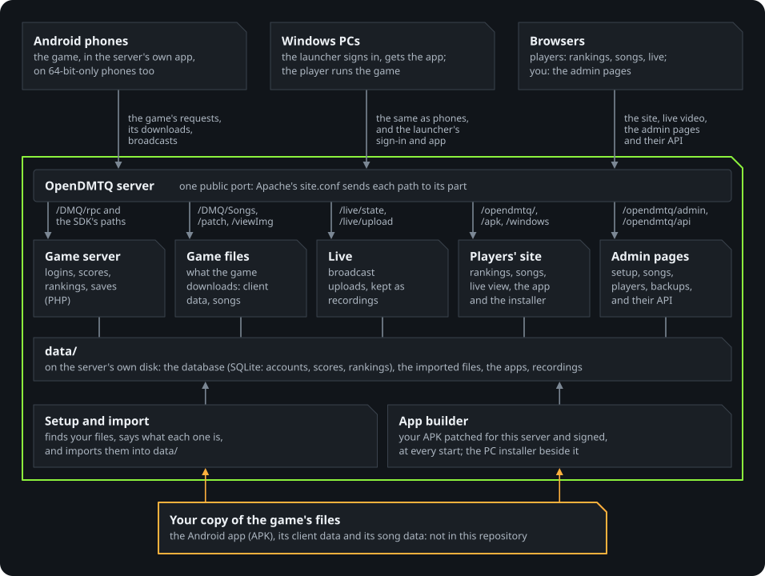
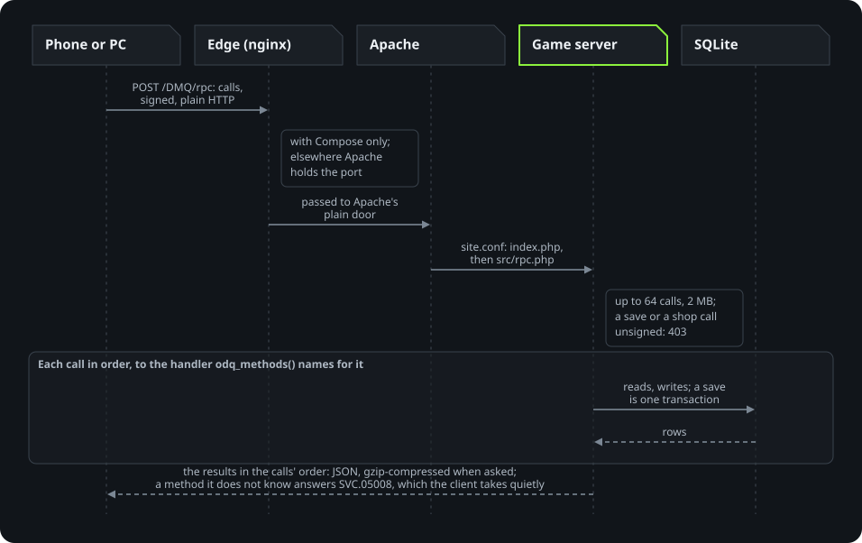
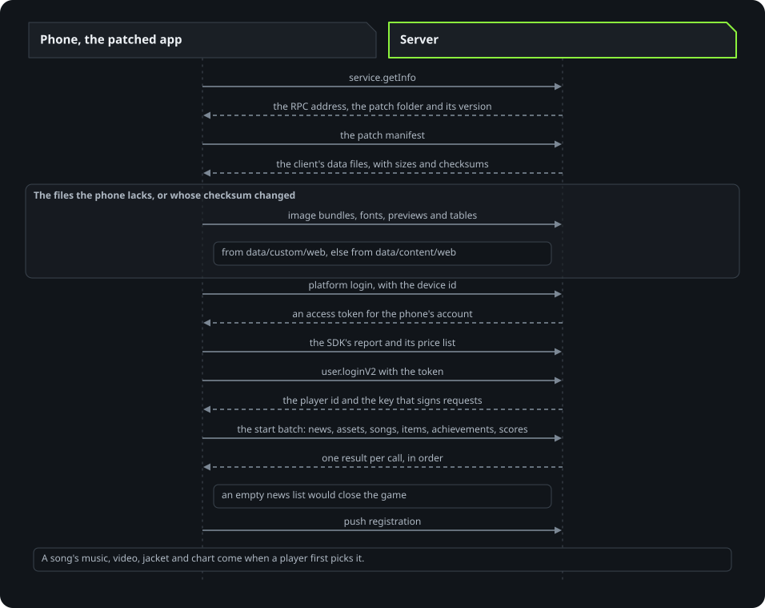
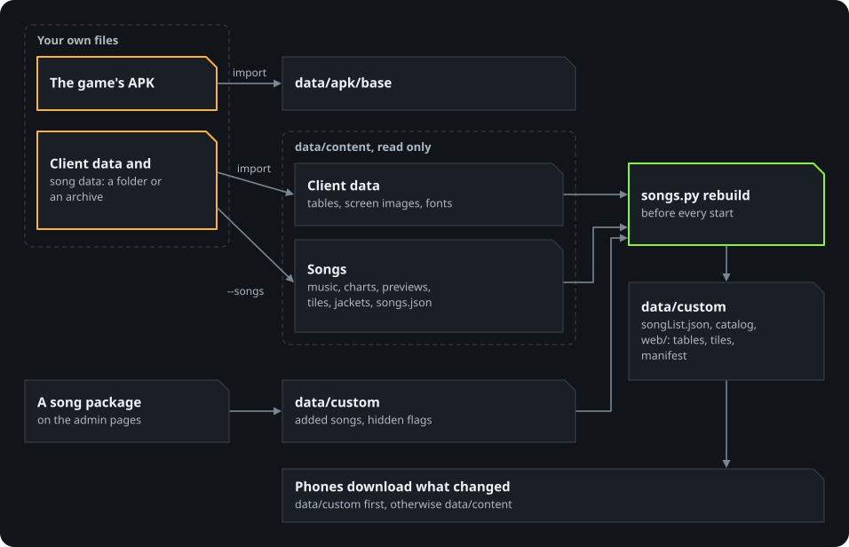
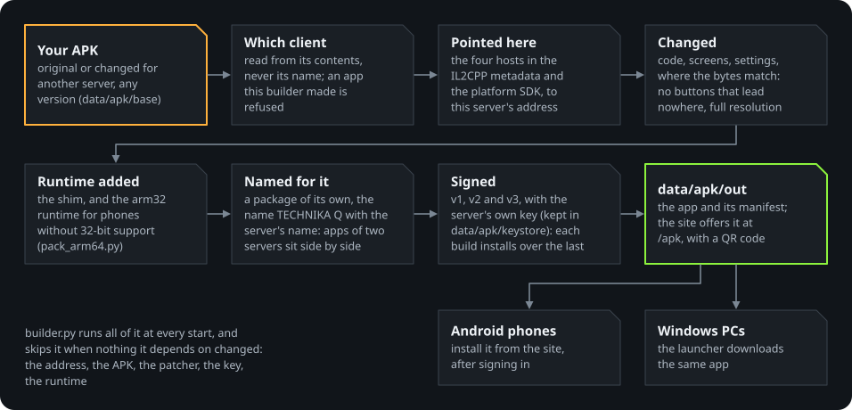

# Architecture

How the parts of OpenDMTQ fit together, for anyone who wants to change them. The guides for playing and for running a
server are in [README.md](README.md).

  

## The parts

Each part, where its code starts, and what checks it: CI on every push and pull request, `qa.sh` on a machine with the
game's files, or a run by hand ([testing](testing.md)).

| Part | What it does | Code, and where to start | Checked by |
| :--- | :--- | :--- | :--- |
| Edge | The server's one port with Docker Compose (`LISTEN_PORT`, 8791 on a new install): plain HTTP for the game and the PC client, HTTPS for browsers | `server/edge` (`nginx.conf`) | its two configurations (CI) |
| Game server | Every request of the game and of its platform SDK, and each player's game state (currencies, level, items, bans) | `server/game`: `index.php`, then `src/rpc.php` (`odq_methods`); the game state in `src/player.php` | `tests/game/protocol.sh` (CI); `tests/live/run.sh` and `tests/load/run.sh` on the real files (`qa.sh`) |
| Server's start | The server image's start: the database, the settings, the admin pages' place on the one port, then Apache | `server/entrypoint.sh`, top to bottom | the images' start without game files (CI), `tests/access/run.sh` (CI) |
| Routing | Which path goes to which part, for every kind of install | `server/apache/site.conf` | the contract and the pages (CI) |
| Players' site | Rankings, songs, players, the app's download, live broadcasts, MY PAGE, the owner's notice, and what the PC client asks of the site (`client.php`, `updates.php`) | `server/portal`: `lib.php`, then the page (MY PAGE: `me.php`, `me_lib.php`) | `tests/ui/run.sh`, every page at five widths in both languages (CI) |
| Live broadcasts | The uploads of phones and PCs, the live window, recordings | `server/game/live`, `server/portal/live.php` | `tests/live/run.sh` (`qa.sh`), the transport stream writer (CI) |
| Admin pages and API | The setup, app builds and Play on this PC, songs, players and their game state, accounts, recordings, backups, the Notices page (the site's notice, maintenance, Discord and Slack), the Server page (restart, stop, repair, the data, uninstall, the owner's password) ([api.md](api.md)) | `tools/opendmtq_tools/admin`, a module per page (`status.py`, `apps.py` with `this_pc.py`, `song_pages.py`, `players.py` with `game.py` for a player's own page, `accounts.py` with `tokens.py`, `recordings.py`, `backups.py`, `logs.py`, `setup.py`, `lifecycle.py` for the Server page; the Notices page's frame `notices.py` and its cards `notice.py`, `song_pages.py`, `webhooks.py`, whose loop sends the chats' messages); what they share in `core.py` (settings, language, database) and `auth.py` (sign-in); the API in `api.py`, its routes in `api_routes.py`. Start at the page's module, then `core.py` | `tools/tests` (`test_admin.py`, `test_api.py`, `test_setup.py`, and a file for each newer page: `test_lifecycle.py`, `test_game.py`, `test_notice.py`, `test_webhooks.py`, `test_this_pc.py`), the pages, `tests/access/run.sh`, `tests/upgrade/run.sh` (CI); `tests/lifecycle/compose.sh` (by hand) |
| App builder | Patches the owner's APK for this server's address, and puts the PC client's installer and its updates beside the app | `tools/opendmtq_tools/builder.py`, `patch_apk.py`; `windows_client.py` and `client_updates.py` for the PC client's files (the tools are plain Python, the one you change is where to start) | `tools/tests` (CI); `test_real_client.py` on the real clients (`qa.sh`); `tests/game/tour.sh` on an emulator (by hand) |
| Import | Takes the game's data files from the owner's folder or archive | `tools/opendmtq_tools/importer.py` | `tools/tests/test_importer.py` (CI), `tests/host/run.sh` |
| Song list | The song list and the client's tables, from what was imported and added | `tools/opendmtq_tools/songs.py` | `tools/tests/test_songs.py`, `test_song_files.py` (CI) |
| arm32 runtime | Runs the 32-bit game on phones without 32-bit support | `arm32/` ([its guide](../arm32/README.md)); handed out by `tools/opendmtq_tools/runtime.py` | built in CI; `arm32/test.sh` on a device (by hand) |
| PC client | The installer, the launcher and their updates, for Windows PCs | `client/` ([its guide](../client/README.md)): start at `client/opendmtq_client/main.py`; the window in `app.py` and its pages in `pages.py`, the server's calls in `server.py`, the updates in `updates.py`, the connection test in `connection.py`, the report in `report.py` | `client/tests` and its screens (CI), the installer on Windows (CI), `client/tests/windows/e2e.sh` and `setup_e2e.sh`, `tests/release/update.sh` and `update_signed.sh` under Wine (by hand) |
| Player for Windows | Runs the server's app on Windows: the arm32 runtime on a layer for Windows, a Java VM of its own, ANGLE, WASAPI, Media Foundation, the game's sound mixed as on a phone, the overlay with its sound panel | `arm32/desktop`, `arm32/jvm`, `arm32/src/win`; the installer handed out by `tools/opendmtq_tools/windows_client.py` | `arm32/test_windows.sh` under Wine and `arm32/test_windows.ps1` on Windows, `arm32/tests/host` (CI) |
| Command line | Setup, import, start and stop, the port, the owner's password, repair, the data, uninstall, deploy, checks, backups | `./opendmtq` with `cli/`: start at `cli/opendmtq_cli/app.py` (`main`); `cli/install.sh` puts it on the PATH and, with `--service`, starts the server at boot; `cli/firewall.ps1` lets phones reach a server in WSL | `cli/tests` (CI); `tests/upgrade/compose.sh` and `tests/lifecycle/compose.sh` (by hand) |
| Host install | The same server without containers, and the Windows bundle | `host/`: `get.sh` and `install.sh` for Linux and macOS, `windows/` for the Windows bundle, and the program itself, a package in layers (`paths`, `settings`, `apache`, `server`, `commands`, `setup`): start at `opendmtq_host/server.py` (`Server`) | `tests/host/run.sh`, `tests/windows/wine.sh`, `tests/windows/run.ps1` (CI); `tests/host/update.sh`, `tests/windows/update.sh`, `tests/windows/play_here.sh` (by hand) |
| Helm chart | The same images on Kubernetes, with a router in front ([kubernetes.md](kubernetes.md)) | `deploy/helm` (`values.yaml`) | the chart against Kubernetes' schemas (CI), `tests/ha/failover.sh` (by hand) |
| Database | One SQLite file shared by the game server, the site and the admin pages ([below](#the-database)) | `server/game/bin/setup-db.php` | `tests/upgrade/run.sh` (CI) |
| Releases | The release's files under their names, their checksums and the project's signature over them ([below](#releases-and-their-signature)) | `.github/release.sh` (a release made, checked and published), `.github/release_assets.py` (`layout`, `check`), `.github/release_notes.py`, `.github/doc_versions.py` (the guides' download lines), `.github/workflows/release.yml`; the signature in `tools/opendmtq_tools/signing.py` | `cli/tests/test_release.py` (CI); `tests/release/update.sh` and `update_signed.sh` under Wine (by hand) |
| The tests | The tests beyond unit tests: the contract, the pages, who reaches the admin pages, an upgrade, the live server, the host install, the Windows bundle, the updates of each kind of install and of the PC client | `tests/` ([testing.md](testing.md)) | [what runs where](testing.md#what-runs-where) |

How each part runs, with Docker Compose and without containers:

| Part | With Docker Compose | Without containers |
| :--- | :--- | :--- |
| Edge | `edge` (nginx), on the one port | none: Apache holds the port, plain HTTP only |
| Server: the game server, the platform's login, the players' site, live broadcasts, the files the game downloads | `server` (Apache with PHP) | Apache with PHP's module, started by `host/opendmtq_host` |
| Admin pages and their API | `admin` (Flask on gunicorn) at `admin:8000`, which the server passes `/opendmtq/admin` and `/opendmtq/api` to; no port of its own on the computer | Flask on waitress, on a loopback port the host program picks at each start, which Apache passes them to |
| App builder | `builder`, at every start | run at every start |
| Import | `importer`, one-shot | plain Python |
| Song list | `tools`, before every start | before every start |
| arm32 runtime | ready-made from a release into `data/apk/arm32`, added to the app by the app builder | the same |
| PC client's installer and its updates | in a release's tools image, which the Helm chart runs too; images built from the source have none, and the app builder fetches the release of the server's own version (else the latest) into `data/apk` | the Windows bundle has the installer and fetches the updates of its version; a host install takes both from its kit or fetches them the same way |
| Command line | `./opendmtq` | `./opendmtq`, passed on to `host/opendmtq_host`; `OpenDMTQ.exe` on Windows |

  

## One address for four hosts

The game was written for four hosts, each with a role of its own. The patched app sends all of them to one address,
where their paths do not collide:

- **The game's requests and files:** `/DMQ/rpc`, `/DMQ/Songs`, `/DMQ/Patterns`, `/patch`, `/viewImg`, `/static`,
  `/score`.
- **The platform's login and reports:** `/api/...`.
- **The platform SDK:** `/accounts`, `/apps`, `/members`, `/product`.
- **The maintenance notice:** `/inspection`.

OpenDMTQ adds `/` (sends a visitor to the site), `/opendmtq/` (the site and `health.php`), `/thumbs` (small jackets for
the site), `/apk` (the newest app), `/windows` (the PC client's installer, set up for this server; both go on from where
a broken download stopped), `/updates/` (the PC client's updates this server hands out), `/ca.crt` (the server's own
certificate authority), `/live/` (the live view's uploads from phones and PCs), `/opendmtq/admin/` (passed to the admin
pages; the old `/admin/` leads there) and `/opendmtq/api/` (their API, passed on with them). All of it is on the
server's one port.

The PC client talks to the site through `/opendmtq/client.php`: `?about` says whether the address is an OpenDMTQ server
(its version, name and address, and whether its app is built; no sign-in), `?signin` signs in with a site ID and
password as the sign-in page does (the same throttle, and the site's cookie back; a banned player's accounts are refused
with the reason, and an account switched off is told so once its password is right, a try that counts as no failure),
and `?app` describes the app on offer to a signed-in player, which the client then downloads from
`/apk`. With that sign-in, `?link` gives a one-time link that signs a browser in to the same account once, within a
minute, and opens MY PAGE (`/opendmtq/login.php?once=...`, kept beside the database in `signin-links/` by the SHA-256 of
its token, which is written nowhere; the admin API makes the same for its token's admin, `POST /site/link`), and
`?records` the account's player's latest plays and best records, each with its place on its chart. At the launcher's
first PLAY, `?claim` links an account that has no player to the PC's game player, named by the id the PC's game signs
in by, when that player has no account either (never the owner's account or a banned player; one statement checks
both and links, and the link goes in the change log). Its updates are under [The PC client](#the-pc-client).

## How a request is answered

A game request on its way to the database and back:

  

`server/apache/site.conf` is the whole site. Each of the server's doors includes it (`server/apache/opendmtq.conf`), and
a host install includes it in the Apache configuration it writes. Its folders come from environment variables
(`OPENDMTQ_APP`, `OPENDMTQ_CONTENT`, `OPENDMTQ_CUSTOM` and the others), so one file serves every kind of install.

The admin pages and their API are passed on beside it, on the same doors: the image's start (`server/entrypoint.sh`)
writes the proxy to `ADMIN_URL` (the compose service `admin:8000`, or the Helm chart's sidecar on the pod's loopback),
and a host install's program writes it to the admin service's loopback port (`host/opendmtq_host/apache.py`), each with
the rule of who may use them ([Security model](#security-model)).

  

A request for one of the game's files (`/DMQ/Songs`, `/DMQ/Patterns`, `/viewImg`, `/patch`, `/static`) is looked up in
this order:

1. `data/custom/web`, the admin pages' overlay: added songs, the client's rebuilt tables, the maintenance notice
   (`/inspection` too).
2. `data/content/web`, what the owner imported, served as it is.
3. Otherwise a 404, Apache's short one: the game reads only the status.

Every other path of the game, its SDK and its window goes to the game server's one door, `server/game/index.php`. The
live broadcasts' three endpoints (`/live/state`, `/live/upload`, `/live/end`) have doors of their own in `site.conf`, with
their own size limits. `/opendmtq/` is the site (`server/portal`), and `/updates/<file>` goes to its `updates.php`.
Apache denies notes, backups and databases wherever one is left in a served folder (`*.txt`, `*.bak`, `*.db3`, `*.log`,
`*.md`), but for the site's `robots.txt` and a release's checksums among the PC client's updates.

Text answers go out gzip-compressed to a client that asks for it: the game's JSON and HTML, and the site's pages,
stylesheets and scripts. Phones ask for it, and so does the player for Windows, whose song list comes in 17 KB instead
of 145 KB. The game's files (songs, charts, pictures) go as they are, and keep in clients' caches.

## The game server

OpenDMTQ's own code, written from the requests client 1.3.4 makes and the replies it reads. Client 1.3.5 asks for one
more, its FREE PASS, and goes on without it (`rpc.php`). It needs PHP 8.1 or newer with SQLite and mbstring.

| File | What it answers |
|---|---|
| `server/game/index.php` | The door: sends each path to the part below |
| `src/rpc.php` | `POST /DMQ/rpc`: the list of calls in, a list of results out; `odq_methods()` names every method and its handler; a banned player's calls refused |
| `src/game.php` | The `game.*` methods: assets, song and chart addresses, saving a play |
| `src/ranking.php` | The in-game rankings, this month's, and the monthly board the site's months read too |
| `src/achievement.php` | MY PAGE's achievements and the dates they were earned |
| `src/player.php` | A player's game state: the two currencies, the experience the level comes from, the items, unlimited currency, a ban, and the server's game settings |
| `src/shop.php` | The `shop.*` methods: what the shop still sells, paid for with MAX POINT or Q and kept |
| `src/user.php` | The `user.*` methods, the news, the mail and `service.getInfo` |
| `src/platform.php` | The platform SDK: its login (one account per phone), push registration, price list, reports |
| `src/account.php` | What an account gets: its number, never handed out again, and its random transfer code |
| `src/live.php` | Who is in a song, for the live view (watches the game's own calls) |
| `src/content.php` | The song list and the facts of the client's tables (`data/custom/songList.json`, `catalog.json`) |
| `src/config.php`, `src/db.php`, `src/util.php` | Folders and addresses from the environment, the database handle, number rules and where a month's rankings begin (the site's months too) |
| `pages/score.php`, `pages/help.php` | The game's window (the player's page of the site) and the customer centre page |
| `live/*.php` | The live view's endpoints ([live.md](live.md)) |
| `bin/setup-db.php` | Prepares the database before the server starts (below) |

A call is `{"id", "method", "params"}` and its result `{"result", "error", "id"}`, in the same order. To add a method,
write its handler and name it in `odq_methods()`; the name is matched in lower case. `tests/game/protocol.py` checks
the replies the client depends on.

What the replies rely on, as the client behaves:

- **Errors.** `SVC.05008` the client treats as handled: no popup, the screen goes on. Any other code opens its "retry?"
  popup, whose other button quits the game; `SVC.05099` is sent when the database could not take a save, and the retry
  sends the result again. `SVC.001` means "update required" and makes the client quit: never sent. A method the server
  does not have gets `SVC.05008`.
- **Lists.** The client reads a missing list as null and stops, and turns some lists into arrays of entries: an empty
  news list closes the game, so `board.getNoticeList` always has one plain entry.
- **Text.** Every reply is UTF-8. A player's name that is not (another program can have written one into an older
  server's database) goes out with U+FFFD in place of each bad byte rather than emptying the reply, and the next start
  stores it as UTF-8.
- **The signature and the sign-in** (`src/signin.php`). The game signs every request: an `Fp` header with MD5 of the key
  its login reply gave and the body (before its login, of the body alone). Each sign-in has a key of its own: the platform
  login notes the access token it hands out (`SignIn`, its SHA-256), the game's login (`user.loginV2`) takes only such a
  token, for the account it names, and gives a random key, the same at a second login with that token (the game logs in
  twice at its start; two logins at the same moment get the one key the sign-in keeps); another token, or one whose
  account is gone, is refused with `SVC.05401`, a code the client does not know (its own popup, whose CLOSE ends the
  game; the next start signs in anew). A batch with a chart's start (`game.getPreviewPlayInfo`, which takes the chart's
  price), a save, a shop call, the items equipped (`game.setSlotItem`), the name (`user.setNickname`) or one of the
  transfer code's two calls (`user.getConnectUuid`, `user.setConnectUuid`) that names a player is taken only signed
  with the key of a sign-in of that player (`403` otherwise); such a call that names nobody runs as any call. The game
  also sends the key and an API token in headers named with an underscore (`SECRET_KEY`, `API_TOKEN`), which nothing
  reads: a proxy drops such headers. An account keeps its newest eight sign-ins (a phone signs in at every start), and a
  restore keeps the sign-ins of now. With the data disk full the platform login still answers an existing account, its
  token not noted, so that the game's own login refuses it with the game's own popup (no answer left the game waiting on
  its first screen); a new phone's account cannot be kept then, and gets `503`.
- **Accounts** (`src/account.php`). Each phone's account gets a number, its player id and the platform's account id at
  first: one past the highest ever handed out (`MemberNumber`), so a deleted player's number never comes back to another
  phone; the Players page's Delete takes the player's sign-ins too. Its transfer code (the game's OPTION shows it) is ten
  random hex digits; typed on another phone (OPTION, the transfer code's input), it moves that phone's account onto the
  player, with the player's name, and the game restarts as them. Codes made from a player's number, as servers before
  0.11.3 made every code, are replaced at a start, and the transfer code's calls never show or take one.
- **Size.** A request holds at most 64 calls (the game's largest batch, right after its login, has 14) and a body of at
  most 2 MB, as the Helm chart's router lets through: a larger one is refused whole (`413`) before any call runs.
- **Saving a play.** The score, the accuracy and the grade are worked out from the counts of each judgement, as the
  official server did. The best row (`Play`) and the log row (`PlayLog`) go in one transaction; a save the database did
  not take answers `SVC.05099`. Scores are kept within what the client reads (32-bit) and accuracies within 100 %. A
  result no play gives (a count of notes below 0, above 10,000 or not a whole number, no notes at all, a player id
  without an account, a chart no song of the server has) answers `SVC.05008` and is not stored. A hidden song's charts
  are the server's: a play finished while the owner hid its song is kept. A save earns once, for the play its sign-in
  started last: `getPreviewPlayInfo` gives each play a random `game_token`, which the save sends back as its last
  parameter; a save of no play started, or of one paid for already (the same save again), is kept and earns nothing.
- **The keyboard's mark.** The PC client's player adds the header `X-OpenDMTQ-Keys: 1` to a save when a lane key was
  pressed during that song, and nothing otherwise; a phone never sends it. Such a play is marked: `keys` is 1 on its
  `PlayLog` row, and on the player's `Play` row when the play sets the best score there. A new best by touch sets it back
  to 0, and a worse play or a tie leaves it as the play that set the best left it. Only the value 1 marks a play. On
  `Play` the mark is the best score's: it says how the play that set the score was made. The rest of that row follows its
  own rules, whichever way their plays were made: the grade and the accuracy follow the best accuracy, and the AC and PP
  marks stay once any play earned them. The game's replies and its rankings are the same with or without the header: the
  site and the admin pages show the mark, and the rankings are one for touch and keys.
- **A player's game state** (`src/player.php`, the admin pages' `game.py`). The two currencies the top bar shows (MAX
  POINT, `mpoint`; Q POINT, `amt_total` as text) and the experience the level comes from, kept in `PlayerState`, and
  the items a player has beyond or short of what everyone has, in `PlayerItem` (the ones equipped stay in `Member`'s
  slots). The level is worked out of the experience with the client's own table, so that the top bar's gauge (the
  share of the way from the level's start to the next one's) is always right. A player the server has kept nothing of
  has what a new player starts with (`GameSetting`: 999,999 of each and level 99 until the owner sets others). A play
  started and saved adds 150 MAX POINT and 10 experience, once; `getPreviewPlayInfo` takes a chart's price as its play starts (MAX POINT,
  or Q for a chart priced in it); the shop takes a product's price from the client's own tables (`catalog.json`'s
  `products`), keeps the item and notes the purchase in `PlayerPurchase`: a MAX POINT price through
  `shop.buyFreeProduct` (the client's call for its free currency), a Q price through `shop.buyProductByQPoint`, the
  currency the product's whichever call it comes by. The client asks for the balance and the items in the same request
  and shows them. Unlimited currency (the player's own switch or the server's) tells the game 99,999,999 of each and
  takes nothing, the purchase kept as usual; a pack of MAX POINT then gives nothing either, so the player's own balance
  stays as it was. `game.setSlotItem` equips only the player's own items, and leaves the slot of any other id empty
  (null in its reply). Every song from 1 to the highest id is owned, and every item of the
  client's tables but the note items and the partners a coupon gave (`NOT_OWNED` in `tools/opendmtq_tools/songs.py`;
  the shop sells the notes); no quests, no coupons (every code is invalid, in the client's own popup), no terms popup.
- **A ban** (`PlayerBan`, with a reason and an end). The client shows only words of its own for a refused sign-in: a
  platform login refused leaves it waiting with nothing on the screen, and RPC codes it knows are silent. So the game's
  login (`user.loginV2`) and every call of the player's are answered with a code it does not know (`SVC.05403`), which
  opens its own "Network connection error." with RETRY and CLOSE (CLOSE ends the game), and each refused login leaves a
  notice for `/live/state` (`toast_kind` `ban`), which the PC client's overlay and the phones show over the game with the
  owner's reason and the end. The site's sign-in and `client.php` refuse the accounts linked to the player, and
  `/live/state` and `/live/upload` keep the player off the air.

The in-game rankings are this month's: each player's best score per chart since the first of the month at midnight UTC
(09:00 in Korea), from the log of every play. The game's ranking screens count down to that moment, so the boards start
anew then. TOTAL sums every chart, the 2/3/4 LINE tabs the charts of that line, a song's ranking the song's charts on
that line (all difficulties). A player's own best (MAX SCORE, NEW RECORD) and the web rankings keep every month, but
for the site's This month tab and the months before it, which are the game's own board of each month
(`odq_month_board()`, with the site's read-only database handle). Ties go to the older account, and the server's own
check account is never ranked. A month's board (TOTAL and the LINE tabs) and the site's totals are worked out once and
kept in the server's run folder with the number of `BoardStamp`, which triggers raise at every change of `PlayLog`, `Play`
and `Member`, whoever makes it; while the number stays, a look at a ranking reads what was kept (on a million plays,
1 ms against 100), and the first look after a change works it out again. The site's keyboard counts beside a total and a
month's score are kept the same way. The count beside a total comes from the index of the bests a keyboard play set
alone (`Play_keys`). The count beside a month's score starts with one look at the index of the keyboard's plays
(`PlayLog_keys`), and a month nobody played with the keyboard ends there; otherwise it reads that month's plays of the
players the page shows (the board's, or the first three of a month before) once, through the board's own index
(`PlayLog_board`). A restore on the admin pages, which the server runs through, moves the number past every one the live
database had used, so that nothing kept before it is taken for the restored data's. What saves and rankings need of the
song list (each chart's line and difficulty, the charts of a line and of a song) is kept the same way, as a PHP file named
after the list's file and made from that very file, so that only the song list's own request decodes its 200 KB.

The achievements on MY PAGE come from what the server knows (each player's level and MAX POINT as the game is told them,
the best scores, the play log), and each keeps the date it was earned on: the save that earns one stores it in
`AchievementDate`, and its reply names it. A stored achievement stays listed whatever the records give later (the play
log keeps a year). Only a player's reset or deletion on the admin pages removes their rows.

### A phone's first start

The order a real phone's first start takes, from the server's request log. The app's own data comes first, then the
logins and the start batch.

  

### A play is saved

  

## The content

OpenDMTQ ships none of the game's files. `./opendmtq import` takes them from the owner's
folder or archive, a copy of the game host's folder with its `patch/phone_new` in it (under any folder name, with or
without a song list: [the forms](game-files.md#the-client-data-and-the-song-data)), in two parts that can each come on
their own, from the same files or from two places (the patch folder alone, the `DMQ` folder alone). Each replaces only
what it has:

| Part | What | Into `data/content` |
|---|---|---|
| Client data | The client's patch folder (its tables, the image bundles of its screens, its fonts, every song's preview and tile), the news images, the pictures of HOW TO PLAY | `web/patch`, `web/static`, `web/viewImg` |
| Song data (`--songs`) | Music, videos, charts, jackets, the song list | `web/DMQ`, `web/viewImg/eye`, `songs.json` |

  

Only those files are taken: never programs, databases or notes (`TAKE` in `importer.py`). An archive is opened with
7-Zip; files on the same disk are hard-linked instead of copied. A new import is built next to `data/content` and moved
in entry by entry, so a running server keeps a valid folder.

Before every start `songs.py` rebuilds `data/custom` from the content and the admin pages' changes:

- `songList.json`, the list the game server offers: the imported songs, the added ones, the hidden flags;
- `catalog.json`, facts of the client's tables some replies need (charts that cost MAX POINT, the items everyone owns,
  the unlock product);
- the overlay `web/`: the client's tables with the rows of the songs the server has, the song list's tiles of added
  songs, and the patch manifest with their sizes and checksums. Phones download what changed at their next start.

With the client data and no songs, the tables lose every song's row and the game starts with an empty song list. The
chart table keeps its rows: the client refuses an empty one. Without the client data the game cannot start at all (it
fetches the images of its screens from the server), so the server reports itself unhealthy until it is imported.

## The app patch

`tools/opendmtq_tools/patch_apk.py`, run by the builder.

  

- **The client's names** (`client_marks.py`): the original client's addresses and package, the SDK's and the screens'
  edits, the runtime's tweaks, the bundle of its data that added songs' tiles are made from (`songs.py`) and the names
  the runtime and the player look up in the game's code are one table there, compressed and encoded, read by what each
  is for; the runtime's and the player's are written from it into `arm32/src/client_names.h`
  (`python3 -m opendmtq_tools.client_marks --cpp`), and a repository test checks that the two agree. The rest of the
  code, its log, its comments and its tests say what each is for.
- **Which client** (`inspect`): from its contents, never its name. The original has the official game RPC literal. A
  copy changed for another server has the same literal with another host; every literal and SDK string on that host
  is pointed at this server (`address_edits`, `redirect_smali`), and an SDK edit it already has counts as made. An app
  this patcher built has its hook class and is refused, as is anything without the game's RPC.
- **IL2CPP metadata** (`assets/bin/Data/Managed/Metadata/global-metadata.dat`, version 23). Four string literals are
  rewritten: the game RPC URL (the live one and a second of the same form), the platform API base and the platform web
  base. Literal data has no terminators; a table of (length, offset) entries delimits it. A replacement that fits is
  written over the old bytes and its length shrunk. A longer one is appended to the literal data, and every later
  section's header offset is shifted by the padded growth. Tests cover both, and that neighbouring literals and later
  sections stay byte-identical.
- **The platform SDK** (smali): the SDK's API hosts, its log endpoints and customer-centre links, and the scheme
  selection, which is forced to HTTP. The game keeps to plain HTTP although the server's port also answers HTTPS: that
  HTTPS is for browsers, with a certificate from the server's own authority, which the app would not trust. The
  manifest and the network security config allow cleartext HTTP (`patch_target`: the target is raised from Android 8.1
  to 9, so that Android 14 and later no longer show a notice at its start, and it asks for the Apache HTTP classes its
  SDK uses). Login goes straight to the guest login instead of trying Google Play Games first, in the SDK's own sign-in:
  that sign-in cannot succeed for a re-signed app.
- **SDK screens with no use here** (smali): after OPTION > Google Play log out, the SDK no longer opens Google's Play
  Games screens. It no longer asks Google Play for the local prices of the paid items at every start. The clipboard is
  left alone: at every sign-in the game read it for a token an older edition of the game left there, then emptied it.
- **Game code** (`lib/armeabi-v7a/libil2cpp.so`, `IL2CPP_EDITS`, with the bytes of clients 1.3.5 and 1.3.4): the main
  menu goes past the event notice popup. The question before the first start's data download answers itself. The shop
  opens on its MAX tab, as its Q tab is gone. A menu left alone keeps its frame rate instead of stepping down to 18 fps.
  The game draws at the panel's own resolution. After songs are downloaded from the music list, the list stays at the
  page it was on: 1.3.4 built it again at that page, then turned it to its first page; 1.3.5 keeps the page in its own
  code, which its part only checks. In a client of another version an edit whose bytes differ is left out whole, with
  the screen edits that go with it (`ASSET_NEEDS`: the shop keeps its Q tab while it opens on it).
- **Project settings** (`assets/bin/Data/globalgamemanagers`, `SETTING_EDITS`): a 32-bit screen in place of a 16-bit
  one, and textures at full size in place of half, each found in its object (PlayerSettings, QualitySettings) wherever
  the file has it.
- **Screens** (Unity asset files under `assets/bin/Data`, `ASSET_EDITS`, by `unity_assets.py`): what leads nowhere on
  this server is taken off the screen by clearing its object's active flag, and what stays closes up by moving it.
  Neither changes a byte's position. Gone: More Games on every screen; Play for Free, Music Shop, Package and Quest in
  the lobby; the social links and Message in the menu; the account rows and Contact Us in the options; the shop's Q
  tab, which is real money through Google Play. The server does its share in its replies: no coupons in
  `service.getInfo` (`src/user.php`), and a price list of one product that is not on sale (`src/platform.php`).
- **Words** (`patch_words`): two of the tips the loading screens show said that MAX Point comes from quests too, and
  this server has none; they carry the words of the game's own tip on where MAX Point comes from, in every language.
  Found by their words in the game's tables of words, not by their keys; the rows stay, so that a tip the game picks by
  its number still has words.
- **arm32 runtime:** when the server has a runtime bundle (`data/apk/arm32`: a release's, which the builder gets by itself
  through `runtime.py`, or one `arm32/bundle.sh` made here),
  `pack_arm64.py` keeps `lib/armeabi-v7a` and adds `lib/arm64-v8a` with the runtime, a proxy under each 32-bit
  library's name, the 32-bit libraries and the guest system, plus a tweaks file that sets the game's frame cap to the
  runtime's frame rate. The manifest gets `multiArch` and `use32bitAbi`, so phones that run 32-bit apps (Android 7 and
  later) keep running the game natively. See [arm32/README.md](../arm32/README.md).
- **The shim** (`arm32/shim`): phones that run the game's own 32-bit libraries get `lib/armeabi-v7a/libopendmtq.so`
  and a small Java class, `com.opendmtq.Hook`, for the live view and the frame rate.
- **The app's package** (`axml.py`): the game's own package name with `.s<first ten hex digits of the signing key's
  hash>` after it, so that apps of different servers and the original game can sit side by side on a device. It follows
  the signing key: a change of address keeps it, and a key restored from a backup brings it back.
- **The app's name** (`axml.py`): `TECHNIKA Q (<server name>)`. The name is the whole address, port included, unless
  `SERVER_NAME` (`./opendmtq name`, the admin pages' Server page) says otherwise.
- **Signing:** v1+v2+v3 with a key made at the first build in `data/apk/keystore/` and reused, so later builds install
  over earlier ones. Once an app has been signed, a missing key stops the build instead of being replaced by a new one
  (phones could not install that over theirs).

Every metadata, smali and screen edit must match an exact count: a different client build stops the patcher instead
of producing a half-patched app. The code edits are applied only where the bytes match. The builder skips the work
when the newest build already matches the address, the base APK, the patcher version, the signing key and the runtime
bundle (and its file is the size its manifest records). A new build takes the place of the old file whole, together
with its manifest and `latest.json`, which are written beside them first: a stop that comes then (docker stop, Ctrl-C)
waits until all three are in place. Only one build runs at a time. Each run leaves its outcome in
`data/apk/out/build.json`, which the site, the admin pages and `./opendmtq doctor` read.

## The PC client

  

The installer (`client/packaging/windows`, Velopack) puts the launcher and the player for Windows in the user's folder.
Run again, it offers to open, repair, update or uninstall the PC client, and Windows' Apps opens the same uninstall
(`setup_window.py`, `removal.py`). The launcher (`client/opendmtq_client`) is the person's side: it talks to the site
through `client.php` and `/apk` (above), keeps each server's app, and writes the player's settings into a file it starts
the player with. Each of its answers, and each update package it fetches, comes whole within its own time however a
server trickles it in (`server.within`: every read waits only for what is left of that time, the TLS handshake and the
headers too). Its pages run down a menu column on the left; each setting changes its own row only. The player
(`arm32/desktop`) is the game's side: the server's app on the arm32 runtime, its picture, sound, video, overlay and
broadcasts; its requests reach the server as a phone's do. What each does for a player is in [the PC
client](windows-player.md); how each works is below.

A setting changed on a page changes its own row and the rows that follow from it, in place, and an answer (a server
connected, a sign-in, a download that ended) changes its own card: the page is never drawn again whole. A drop-down
opens the launcher's own list under its box (over it near the screen's foot), its chosen row marked, a long list
scrolling by the wheel, the keys or a finger.

The two share two files beside the launcher's settings. `player-settings.txt` is the player's settings: the launcher
writes it at every change, and the player reads it at its start. The player's sound panel writes the sound's keys
back into it (only the keys it changed, in their places, as a new file renamed over the old), and the launcher takes them
back when the game ends and when its window comes to the front. `last-game-sound.txt` is what the player measured of the
game's sound (shared or exclusive, the device's period, the time to the device's output, any gaps), written every five
seconds and at the end: the Sound page's Last game's sound card and `--status` read it.

Three of the launcher's parts reach past its own pages:

- **The connection test** (`connection.py`; the Online page's Test connection, and `OpenDMTQ-cmd.exe --test-server`)
  follows the way to the server a step at a time: the address, the name's lookup, the port, the answer as an OpenDMTQ
  server (`client.php?about`) and its certificate over HTTPS, the version, the sign-in, the game server's health, the
  broadcast state, the downloads by their heads, and the round trip. When nothing answers on the port, or another
  program does, it looks for a server on 8791 and the ports after it (over HTTPS with the old address's own authority),
  where a server moved off its old port answers ([the server's port](install.md#the-servers-port)).
- **The report** (`report.py`; Help's Save a report, and `--report FILE`) puts the launcher's and the end of the
  player's logs, the settings, the displays, the sound devices, Windows, the graphics cards and the last connection
  test in one zip, with the Windows user's name, every site ID, every server's address and name (by their forms and
  where the launcher writes them, whether the settings know them or not), sign-ins, tokens, this PC's player id and
  the name a sound device is named after replaced by a word, and says what it left out.
- **My records and My page on the site** (`server.py`): the PLAY page's card asks `client.php?records` with the
  launcher's sign-in, and its button opens MY PAGE in the browser through a one-time link (`client.php?link`).

### Updates

A launcher installed by its installer updates itself, and its player with it (`client/opendmtq_client/updates.py`). It
asks the server it plays on first, at `/updates/`, then the project's releases on GitHub, and goes no further than the
version its server hands out (or, from a server older than 0.11.0 that hands out none, than the server's own version):
launchers stay matched to their server, on a network with no way out too. It takes an update only from a release whose
checksums carry the project's signature ([below](#releases-and-their-signature)), fetches it into a folder of its own,
and checks it there before anything goes into the program's folder: the delta package when the version installed is the
one the release's delta starts from (the installed `Update.exe` puts the new package together from it), else the whole
package. A package is checked by its bytes against the checksums, or, put together from a delta package, by the files
it holds against the feed's `FilesSHA256`. Velopack then puts it in once the launcher has ended.

The server keeps the PC client's update of the version it hands out, the same files as the project's release, at
`/updates/` on its one port. With no server the launcher takes GitHub's latest release, a server that does not answer
sends it nowhere else, and **Check for updates** says where an update comes from.

An update goes in only when the release's checksums carry the OpenDMTQ project's signature, by the key built into the
launcher (`8ead95551a5d5d216dca12de20138465d4cfbcec48ec2b2611c9e49fc47b77d7`,
[a release's files](install.md#a-releases-files)):

- `releases.win.json`, the update feed, names the version and its packages. It must be the file the signed checksums
  sum, or the launcher says the update is not signed by the OpenDMTQ project and installs nothing.
- `opendmtq.client-<version>-delta.nupkg`, what changed since the release before, is what a launcher of that release
  downloads: checked against the signed checksums, then the launcher's own updater puts the new version together from
  it, and the launcher checks that what it made holds the files the release signed.
- `opendmtq.client-<version>-full.nupkg`, the whole update, is what every other launcher downloads, and one whose delta
  did not give the files signed (it says *The whole update is downloading* on the command line). It must be the file the
  signed checksums sum.
- `opendmtq-<version>-sha256sums.txt` and its signature `opendmtq-<version>-sha256sums.txt.sig` come right after the
  feed, before any package: without them no package of the release is downloaded.

Everything is downloaded into a folder of the launcher's own in Windows' temporary folder and checked there, before
anything goes into the program's folder: a package that is not the one the release signed is refused, said in words,
and the program stays as it was. The launcher's log says each step.

A launcher of 0.10.0 or older checks no signature: it takes the update its address gives, the project's releases on
GitHub, over HTTPS, checking only the hash the update feed gives. So it updates to 0.11.0 from GitHub as before, and
trusts GitHub's answer for what it puts in; from 0.11.0 on, every update a launcher takes is one the project signed,
whoever hands it out.

The server hands out the updates of the version of the installer it hands out (`tools/opendmtq_tools/client_updates.py`,
`server/portal/updates.php`): its own release's, from beside its code in a release's tools image, from
`data/apk/pc-client-updates` (a host install's kit, or put there by hand), else fetched from that release. The app
builder checks them against the signed checksums and keeps them in `data/apk/out/updates`, described in
`data/apk/out/updates.json`; the site hands out only those files, without a sign-in.

### The player for Windows

The player runs the game's own 32-bit Android code, as the app does on phones that cannot run 32-bit apps: the
[arm32 runtime](../arm32/README.md) translates the game's ARM code (Dynarmic), and a small layer gives it Linux's system
calls on Windows. In place of Android's Java side, the player has its own stand-in for the classes the game calls. The
game draws with OpenGL ES, which ANGLE runs on Direct3D 11; on a computer with two GPUs (most gaming laptops) the
player asks NVIDIA's and AMD's drivers for the fast one, and its log names the GPU that draws the game at its first
frame. Its sound goes out through WASAPI, and its videos are decoded by Media Foundation. Its requests to the server go
out as a phone's do, asking for the server's answers compressed, which makes its lists of songs and scores many times
smaller on the way.

The launcher is Python with Tk, made into a Windows program with PyInstaller; Velopack installs it and updates it. The
launcher writes the player's settings into a file and starts the player with it (`--app` names the folder of the
server's app, `--settings` the file); the player writes the sound panel's changes back into the same file.

The launcher hands the language over in the settings file it writes before each start (`language=`).

**What a frame takes,** measured on a Ryzen 9 9950X with an RTX 4090 that stayed at its idle clock (225 to 590 MHz),
at 240 frames a second from 1920x1080 to 3840x2160: 0.2 to 1.0 ms of the graphics card (the most at 3840x2160 with
CMAA 2) and 1.5 to 3.4 ms of the game's main thread.

### The picture

The Screen page's settings, as the player carries them out (in short for players: [the
picture](windows-player.md#the-picture)):

- **Full screen or a window.** Full screen is a borderless window over the whole display, at the display's own pixels
  whatever its scaling. A window opens at three quarters of the display's height at 16:9, or at the size chosen. The
  game fills the window while its shape is between 4:3 and 21:9; a window of another shape, such as a display turned
  upright, has black around the game. Moved to a display with other scaling, the game draws at the new size. A window
  resized, or switched to full screen and back, has the game lay its screens out again for the new shape, as a start
  at that size does (the game takes its surface's size only as it starts; the player tells it the new one).
- **VSync on** (the default): each frame goes out on a refresh of the display the window is on, 60 Hz, 144 Hz, 240 Hz or
  another. A PC that is really behind, more than a quarter of its frames a refresh late through three checks of 2
  seconds in a row, takes every second refresh (120 frames a second on a 240 Hz display), then every third. It tries the
  faster rate again 5 seconds later, goes straight back when the try falls short, and waits twice as long before the
  next try, a minute at most. Some late frames, as the page before a song shows while the song loads (up to a tenth of
  them), and a pause of a tenth of a second or more, keep the display's rate.
- **A panel with a dynamic refresh rate.** Windows 11 runs a laptop's or tablet's panel set to its dynamic refresh rate
  ("Dynamic" in its advanced display settings: 60 Hz, or 120, 160, 165, 180 Hz and so on) at 60 Hz for every program
  that does not ask for more. The player asks Windows for the panel's boost while its window is shown, sees the panel's
  real refreshes (DXGI's v-blank virtualization off), and follows the rate they come at, measured every two seconds
  while they come steadily, so the game runs at the panel's full rate rather than 60. A display whose rate Windows gives
  exactly keeps it however late a busy computer wakes for its refreshes.
- **The frame limit:** the display's rate (the default), a number, or none. The page offers every rate up to the
  highest any connected display runs at: each display's highest rate among its modes at its current size, never only
  the rate it is in now, which Windows says is 60 for a dynamic panel while the desktop is still. The line under the
  display's rows names the rate the main display runs a game at, and the others'. The launcher's log says each
  display's rate now, its highest and whether its rate is dynamic, at each start. With VSync on, a limit that is a whole
  fraction of the display's rate, or within 10 % above one, keeps every frame the same length (60 or 120 on a 240 Hz
  display); another limit is held by the clock, with each frame still on a refresh (144 on a 240 Hz display).
- **VSync off:** frames go out as soon as they are drawn, evenly at the limit, which may be above the display's rate, or
  as fast as the PC draws without one. A little less delay, and the picture may tear.
- **The FPS counter**, off by default, is a small card of the overlay's glass, as the notice is: the frames a second as
  a figure in the launcher's wide face, FPS after them, and the mean frame time under them with ms after it, over the
  last second, twice a second. The two numbers stand right-aligned in one column and their units in the next, so that
  only digits change as they do. The figure is lime while the frames keep the display's rate (a frame for every refresh,
  give or take two in a hundred: from 235 at 240 Hz, from 59 at 60 Hz) and white below it or where the display's rate is
  not known; it turns lime once the frames have kept that rate for three seconds, and white again once they have fallen
  short of it for three seconds or at once when they drop clearly below it (by more than one in twenty), so that a rate
  at the edge keeps one colour. The rest is grey. In a song it stands in its corner, 8 pixels in at 720 lines, clear of
  the song's own controls: at the bottom right by default, over the play field's corner. **Position** moves it to
  another corner, kept while the counter is off: at the top left and the bottom left it stands 8 pixels right of the
  pause button and the column under it, at the top right under the row of the Q and MAX the song's pause screen shows
  there. In the menus it waits and shows in each song: every place near a corner of the menu screens holds something of
  the game's own on one screen or another (the player's name and level, the music list's tabs and grid button, a song's
  title and score, SELECT MUSIC, DOWNLOAD), and under the game's header at the right, the one place the music list, the
  downloads, a song's page and the result leave free, ALBUM's FAVORITE tab ends and the shop's panel begins just under
  it, measured on each of them at 16:9 and 4:3. With keyboard play off too: the hook on the game's input goes in all the
  same, with the same checks of the game's code, only to follow a song's start and end (it takes no key). Only where the
  game's code is not where the player expects it can the player not tell a song from the menus, and the counter stands
  at the right under the game's header throughout. The game stretches its screens to the window's shape (at 21:9 its
  buttons are wider than tall, at 4:3 narrower), and the counter keeps to its buttons' narrower side: in a window
  narrower than 16:9 it is a little smaller, so that it covers no more of them there than at 16:9. Its units and frame
  time are never set smaller than 10 pixels, so that in the smallest windows (a 960x540 window, or 640x360 at 150 %) its
  card is a little larger than its share. A top left set by a launcher before 0.9.3, which wrote it whether chosen or
  not, reads as the default; another corner set then stays. It counts the frames the player shows: a steady 60 reads 60,
  and only a whole second without a frame reads 0. It shows from the game's first frame and hides while the game holds
  still. Drawn apart from the game's picture, it costs the game nothing, and the broadcast does not show it.
- **The render scale** draws the game at a share of the window's pixels (100 % down to 50 %), stretched to fill it:
  lighter for the graphics card, and softer. The share keeps the window's shape exactly where its size has fine enough
  steps (1920x1080 is 120 steps of 16x9): 67 % of 1920x1080 is 1280x720, so the game lays itself out as it does at full
  size, its parts where they belong.
- **The upscaler**, below 100 %: how the smaller picture reaches the window's size. **AMD FSR 1** (FidelityFX Super
  Resolution 1, the default) enlarges it with its edge-adaptive filter (EASU) and sharpens the result (RCAS, at AMD's
  sample's 0.25 stops). **NVIDIA NIS** (Image Scaling) enlarges in one pass with its edge-adaptive filter, with no
  sharpening added: the SDK's default of 50 % drew rims around the game's text and lines. Both are spatial: they need
  only the finished picture. **Bilinear** is the plain stretch of the window's surface. At 100 % no upscaler is used,
  and the row is not shown. Measured against 100 % on the game's words in a 1280x720 window: bilinear keeps 0.93 of
  their sharpness at 85 %, 0.90 at 75 %, 0.81 at 50 %; FSR 1 and NIS keep them as sharp (1.02 to 1.07), NIS a little
  nearer to 100 % at 85 and 75 %, FSR 1 as near at 67 % and nearer at 50 %, where a slow graphics card needs it most.
  Each costs under 0.1 ms of an RTX 4090 a frame. A launcher before 0.11 kept Bilinear without being asked: it reads
  as FSR 1 unless Bilinear was chosen.
- **Anti-aliasing** smooths the jagged edges of the game's shapes. **CMAA 2** (Intel's Conservative Morphological
  Anti-Aliasing 2) smooths them over the finished picture and keeps text and thin lines sharp; it runs on compute
  shaders (OpenGL ES 3.1), and where the graphics card has none the player uses SMAA instead and says so in its log.
  **SMAA** (SMAA 1x, Ultra preset) smooths them with three light passes over the finished picture. The game's pictures
  are filtered images, soft at their own edges already, so either changes little: measured on the same frames of its
  music list, the frame as the game drew it against the frame shown, CMAA 2 changes a fifth to a third of the strong
  edges (1 to 5 % of the pixels), its words within 2 % of their sharpness, and SMAA 9 % of the pixels, three tenths of
  the edges, its words 5 % softer; the difference shows on the diagonal edges of the game's frames, arrows and cards. On
  an RTX 4090 at 1280x720 CMAA 2 takes 0.1 ms of the graphics card a frame in the menus (0.3 to 1.5 ms over a song's
  video), SMAA under 0.1 ms. Off is the default: the game's picture as it drew it, at no cost. With an upscaler,
  anti-aliasing comes first, at the size the game draws at. MSAA, which 0.9 offered, is gone: it left the game's picture
  as it was, and a setting of `msaa2`, `msaa4` or `msaa8` reads as CMAA 2. Temporal methods (DLSS, FSR 2 and 3, TAA,
  DLAA) need what a closed game does not hand over (its motion vectors and depth), and frame generation adds delay: none
  of them is offered.

Measured on a 240 Hz display (4K, RTX 4090): 240 frames a second with VSync, none late in 480, in full screen at 100 %
and at 50 %; a limit of 120, 120.0 frames a second, none late; VSync off, 240.6 frames a second, 95 % of the frames
within 4.5 ms of their time; no limit, 733 to 965. How the passes draw:

With an upscaler or anti-aliasing, the game draws into a framebuffer of the player's own, of the size it draws at, which
stands in for the window's own framebuffer in every call the game makes that names or reads it (binding, reading,
invalidating and the questions about it), and the window's surface keeps the window's size. At each swap the player's
passes draw that frame to the window, the game's GL state saved before and put back after. The broadcast takes the
picture after them: what players see. The log says once what is in use (`the game draws at 640x360, upscaled by AMD FSR
1 to 1280x720`, `anti-aliasing: SMAA`), and what the passes took on the render thread over the first 600 frames. With
the player's stats on (`ARM32_STATS=1`), every 5 seconds a `stats: picture` line gives each pass's mean time a frame on
the render thread and on the graphics card (by `EXT_disjoint_timer_query`, which ANGLE has; with its timestamps the
game's own time on the graphics card too), the swap's whole cost, and how often the game made its context current.
`PLAYER_OFFSCREEN=1` has the frames drawn offscreen with no pass at all (a plain copy), to measure the redirection by
itself.

### The sound

On the PC the game's sound goes the way a phone's does. The game's OpenAL Soft would mix at 22,050 Hz on the only
device it can open there (Android's AudioTrack, as Windows has no OpenSL ES), so the player gives the game's context the
44,100 Hz a phone mixes at (`soundmix.cpp`, `openal_rate.h`). It keeps the music apart from the effects without
changing any of the game's code, by calls of the game's own taken over by name: in the menus by OpenAL's sources (a
streaming one is music, one of a whole buffer an effect), in a song by the game's score player (its background tracks
are music, the tracks the player plays are effects), each at its share. The player's mixer then takes the master volume
and the equaliser's three bands, and hands the sound to WASAPI with the low buffer by default (`mixer.cpp`,
`output_wasapi.cpp`, `sound_mix.h`).

The launcher's **Sound** page and the game's [sound panel](windows-player.md#the-sound-panel) set the same settings: a
change in either is the other's next time it looks.

- **Master**, the volume of the game, 0 to 100. Windows' own volume still applies.
- **Music** and **Effects**, each a share of the master, 0 to 100: the music is a song's background, the game's menu
  music and a song's preview; the effects are the sounds of the notes the player plays, and the menus' and the
  judgement's sounds. In a song the player tells them apart by its tracks: each of a song's tracks plays either in the
  background or under the player's notes, and its volume takes the music's or the effects' share. Outside songs the
  game's streamed sounds are its music and the rest its effects.
- **The equaliser** on the game's whole sound: Flat (no filter), Bass (+6 dB at the low end), Vocal (+4 dB in the
  middle, -2 at the low end, +1 at the top), Treble (+6 dB at the top), or Custom, its three bands as chosen: a low
  shelf at 120 Hz, a peak at 1 kHz an octave and a half wide and a high shelf at 6 kHz, each -12 to +12 dB. A raised
  band takes the same off the whole first, so the sound never clips where it was full; it costs about a microsecond of
  the mixer's 5 ms periods.
- **The device:** Windows' default output, which the game follows when Windows changes it mid-game, or one chosen.
- **Shared or Exclusive.** Shared plays alongside other programs' sound. Exclusive (WASAPI's exclusive mode) takes the
  device for the game alone and has the least delay, with buffers of the device's own period (3 ms on a device that
  has it); other programs are silent meanwhile, and the sound is shared when Windows does not allow it.
- **The buffer:** low, the default (Windows' low-latency mode at the shortest period the device has; a device without
  one gets the shortest shared buffer Windows gives it, 22 ms on the device measured, as normal's), normal (20 ms) or
  safe (50 ms). Measured through whole songs on Windows with a 192 kHz device while the PC was busy with other work,
  the time from the game's sound to the device's output, by the device's own clock:

  | Mode | Low | Normal | Safe |
  | :--- | :--- | :--- | :--- |
  | Shared | 29 to 36 ms (a 7 ms period) | 37 to 43 ms (10 ms) | 73 to 78 ms (10 ms, 50 ms buffered) |
  | Exclusive | 10 ms (a 3 ms period) | 31 ms (10 ms) | 61 ms (20 ms) |

  Two whole songs each, with no gap in any of them, neither the device running dry nor the game's sound falling
  behind. Before that, the game's OpenAL mixes 20 ms at a time into a buffer of 20 ms, which adds 20 to 40 ms. Where
  the notes and their sounds do not meet, the game's own calibration in its options moves one against the other; the
  player adds no offset of its own.
- **Last game's sound**, under the output's choices: how the last game's sound went as the player measured it, how it
  had the device (shared, shared at Windows' shortest period, or exclusive), the device's period, the time from the
  game's sound to the device's output, and the gaps (the device running dry, or the game's own sound falling behind),
  with a lime light when there were none and a yellow ring when there were. The player writes it beside the settings
  file (`last-game-sound.txt`) every five seconds and when the game ends; `--status` prints the same line.

The game mixes its sound at 44.1 kHz, as on every phone. On a phone the game's OpenAL opens its OpenSL ES device, which
mixes at that rate. A PC has no OpenSL ES, and the game's other device would mix at 22.05 kHz, cutting everything above
11 kHz: the player asks it for 44.1 kHz instead. Measured on a song under Wine: from 11 to 17 kHz within 2 dB of the
song's own sample against its 1 to 4 kHz, where 0.10.0's was about 35 dB down.

### The overlay

- **Its size**: every piece is drawn at the game's own scale, as the game's words and buttons are (its area's height
  over 720 lines: 1.5 at 1080 lines, 3 at 4K), whatever Windows' scale is, so a small window gets small pieces and a
  display at 150 % has them cover no more of the game than at 100 %. They are never drawn below half their 720-line
  size at Windows' scale, so the bar's buttons stay large enough to hit; the smallest game area, 480x270 at Windows'
  scale, leaves them room. The game stretches its screens to its area's shape, across by its width over 1280 and down
  by its height over 720: the bar keeps the height's scale, as tall as the game's top row it covers; the handle and the
  FPS counter, which are never pressed and sit on the game's own corners, keep the narrower of the two, the handle in a
  window of any size and shape, the counter never below the others' floor. The pointer keeps Windows' own size.
- **Nothing of it is in the game's way**: the notice, the FPS counter and the handle let every click through to the
  game, and no piece takes the keyboard from the game's window (each is a window that never takes the focus; a click on
  the bar, the sound panel or the question gives the keyboard back to the game).
- **The glass**: the bar, the sound panel, the question, the broadcast notice and the FPS counter are frosted glass over
  the game, as Windows' own acrylic is made: the game's picture behind each, blurred and a little more saturated, under
  a charcoal tint, with a faint light at its top, a light edge and a soft shadow; in the game's own shapes, with its
  small corners, its bevel (a line of light along the top, of shade along the foot) and its green line along the bar's
  and the notice's foot. Their words keep 4.5:1 against the light behind them: where the game is light under the words,
  the tint deepens there. With none of them up, the glass costs the game nothing. The words are set in Pretendard
  (titles and buttons bold; the notice's second line, the FPS counter's units and frame time and the sound panel's
  levels and bands' frequencies semibold, the small grey ones never under 10 pixels) and the FPS counter's figure in the
  launcher's wide face, both of which the player carries in its
  `fonts` folder. The wordmark is a picture for each of the overlay's scales from 1 to 4, drawn by the launcher's own
  code (`arm32/desktop/assets/make_wordmark.py`) and carried in the player's `images` folder: at those scales it is
  drawn pixel for pixel, between them the next larger is drawn down, and below 1 the first one is.

The bar, its handle, the sound panel, the question before quitting, the notice, the FPS counter and the pointer are
drawn by the player over the game's window, each a window of its own whose picture a thread of the overlay's makes on
the CPU; the UI thread, which stamps the game's keys and clicks, only hands the finished pictures to Windows. For their
glass, the render thread reads the rectangles of the frame behind them as it goes to the window (after the passes), at
half and then a quarter of their size (each pixel the mean of 4 by 4 of the frame's), into a pixel buffer that a later
frame copies out once the graphics card is done, so nothing waits for it. It reads at most 20 times a second while a
piece is up, and once while the game holds still; a piece waits a moment for its first read, and where none comes it is
its plain tint, nearly solid. With the stats on, a `stats: glass` line every 5 seconds says what that took the render
thread a frame, and a `stats: overlay` line what the pictures took their thread and the UI thread.

A PC has no phone's buttons around the game, so a bar of frosted glass comes down across the top of the game:

- **How it comes:** when the pointer rests a moment at the game's very top edge, or on the handle with its button up;
  when a finger or a pen taps the handle, or holds still on it or at the top edge for half a second; or when a press of
  a finger, a pen or the mouse is drawn down from there. A press drawn down pulls the bar out with its foot at the press
  and, let go, the bar settles down when it is out at least half way or was flicked down, and goes back up otherwise.
  The press that brings the bar never reaches the game; a tap at the top edge beside the handle, a click of the mouse
  there or on the handle however long it is held, and a press that moves across or up are the game's after all, from
  where and when they came down.
- **In a song** none of this happens unless the game has had no click, touch or held note for a second and a half:
  every tap at the top of a song plays the song at once, and a pointer on its way to the window's title bar brings
  nothing.
- **By itself** it comes down for 3 seconds when the game's picture first shows (not during its black start) and after
  each switch between a window and full screen, so that a player sees where it is.
- **How it moves:** it slides down out of the game's top edge, its foot first, and back up into it, in about a fifth of
  a second each way and in step with the display's refreshes, never over the window's title bar; with Windows' animation
  effects switched off it comes and goes at once. It stays while the pointer is on it and goes up soon after the pointer
  leaves, so it never sits on the game's own controls at the top while they are used; a pointer that comes back while it
  goes up turns it back from where it is. In a song, the broadcast notice and an FPS counter at the top left move down
  with the bar's foot and back up with it; under the header of the game's menus, where they stand there, the bar never
  reaches them. It is tall enough to cover the game's own X at the top right of its song and music screens whole.
- **What is on it:** on its left the OpenDMTQ wordmark as the launcher's menu column draws it; on its right four buttons
  in the launcher's own shape and depth (two corners cut, raised, sunk while held): **Sound** (a speaker and the word),
  **minimise** and **full screen** (or back to a window) as secondary buttons, quiet metal with a lighter plate under
  the pointer, and the **X** that quits as the main button, in the launcher's lime from the start so that it is seen at
  once. A finger works every button as the mouse does. A button acts only when let go where it was pressed, as the bar
  stood when it was pressed: one pressed while the bar is still sliding down acts too. Minimise holds the game still,
  and the taskbar brings it back with the bar up.

**The handle** is the game's green line along its top edge at the centre, with a small tab of glass hanging from it in
the lean of the game's own tabs and a chevron pointing down in the tab: the bar comes down from here. With the pointer
on it the line and the chevron turn lime and the tab grows deeper. The pointer resting on it brings the bar down: on its
line, on its tab, or beside the tab within the room the header leaves there (12 pixels either side of the centre in a
1280x720 game, down to the deeper tab's foot); the handle goes down with the bar's foot and fades, and comes back up
with it. The handle and the place the pointer rests on are as large as the game's own header leaves room for at its top
centre (the handle 26 by 19 pixels in a 1280x720 game; both in proportion to that header in a game of any other size or
shape), so neither covers any of the game's words or buttons on any screen. It shows once the game's picture is up, and
goes while the bar is down, while the question or a notice in a song is up (in the menus a notice stands under the
game's header, well below it) and while the game holds still.

The bar's **Sound** button opens a card of glass under the bar at the game's right side: **Master**, **Music** and
**Effects** as sliders of 0 to 100 %, then the **Equaliser**'s presets (Flat, Bass, Vocal, Treble, Custom) and its three
bands, **Low** (120 Hz), **Mid** (1 kHz) and **High** (6 kHz), as sliders of -12 to +12 dB. A slider follows the mouse
or a finger from wherever its row is pressed, and every change is heard at once; moving a band makes the equaliser
Custom from the preset's bands. What it changes is written to the PC's settings when the slider is let go, only the
keys changed, so the launcher's **Sound** page shows it, and the next game keeps it. The bar stays down while the panel
is open; the Sound button again, a press on the game, minimising or the question close it. A broadcast notice shown
meanwhile stands beside it, and an FPS counter it would cover hides until it closes. The panel keeps within the game at
every window size and scale. [The sound](#the-sound) says what each control changes.

- **Quitting**: the X asks first, in a glass card over the game dimmed and blurred behind it: **Keep playing** as the
  launcher's main button, or **Quit the game** as its secondary, red under the pointer; so a click by mistake does not
  end a song. Its buttons too act only when let go where they were pressed; Left, Right and Tab move the choice (marked
  with the launcher's cyan keyboard ring), Enter takes it and Esc keeps playing. Asked mid-song (a song's first frame to
  its end, its own pause screen too), a line under the question says that quitting mid-song loses the song's record; in
  the menus, a song's loading screen among them, it asks without that line (where the game's code is not where the
  player expects it, the player cannot tell a song from the menus, and it asks without it; with keyboard play off it
  can). The card keeps within three quarters of the game's width and nine tenths of its height. The taskbar's Close
  window asks the same; on a minimised game it first brings the window back and lets the game draw itself again, so that
  the question stands over the game. The game holds still while it asks, as a phone's game does when its owner leaves it
  and as it does minimised: a song stops where it was, with the game's own pause screen after.
- **The window**: the game has a title bar to move it by and a frame to size it by, dark as the launcher's menu column
  (on Windows 11 in its very colours; Windows 10 dark where it can), and no buttons of its own: it is minimised, put in
  full screen and quit from the bar. A double click on the title bar does nothing.
- **The pointer** over the game is a dart in the logo's look: a chrome left face and a lime right face with a dark rim.
  While the button is down it is all lime and a little smaller. It is sized for Windows' scale, as Windows' own is.
- **A touch screen** is the player's first input, as a phone's screen is the game's. Windows' own touch feedback stays
  off the game (no circles under the fingers, no square for a press and hold, no right click for it), and in full screen
  a finger that comes in from the screen's edge stays the game's instead of opening Windows' panels. Each touch reaches
  the game as Windows takes it in.

**The broadcast notice**, and the others that come the same way: in the menus it stands under the game's header, where
it lies on none of the header's buttons and words, as the game's own windows stand clear of it; in a song at the top,
centred over the play field, clear of the pause button and of the Q and MAX of the song's pause screen.

### Keyboard play's presses

The game takes a touch screen's fingers once a frame, in its own input update, and judges the presses against its notes
in the same frame. [Keyboard play](windows-player.md#keyboard-play) takes that update's place in the game's table of
methods: the game's own update runs first, as always, then each lane key that is down gives the game one press, at the
place the game will judge the lane's next note (a repeat point at its group's first note, a drag along its curve), or
where the judgment line crosses the lane when no note is near. Three more of the game's methods say when a play starts
and when its song pauses or stops. The player first finds these methods and the fields it reads by their names and
checks each against the place it was written for; when one differs, keyboard play stays off and the log says which. With
keyboard play off (`keyboard=off`) the player puts the same hook in, with the same checks, only to follow when a play
starts and when its song stops or ends: the overlay knows a song from the menus by it (the FPS counter waits in the
menus, the notice and the question before quitting know a song). It then takes no key, reads no note and makes no press,
and the bar keeps the rule it has where nothing is known (a press at the top edge is the bar's only with the game
quiet), so that every press goes where it goes with no hook. With the stats on, a `stats: keyboard play` line every 5
seconds gives what the presses took a frame beside the game's own input update: on Windows 2 to 6 microseconds a frame
on average and 10 to 19 at the 99th percentile, the game's own update 2 to 3; under Wine 3 to 8 and 22 to 36.
`PLAYER_TRACE_KEYS=1` logs each press and the note it aims at, and at a song's end how the game judged its notes by
type.

## Start-up

`server/entrypoint.sh` (the image) and `host/opendmtq_host` (a host install) do the same before Apache starts:

- `server/game/bin/setup-db.php` prepares the database: a new one gets the game's two tables (`Member`, `Play`); every
  start adds what later versions need (`PlayLog`, `AchievementDate`, `LiveSwitch`, `LiveSetting`, `SiteUser`,
  `ApiToken`, the players' game state in `PlayerState`, `PlayerItem`, `PlayerUnlock`, `PlayerPurchase`, `PlayerBan` and
  `GameSetting`, the indexes, the keyboard's column `keys` on `Play` and `PlayLog` with 0 in every older row: where it
  or the game state cannot be added the server does not start, as every save would fail), merges a player's duplicate
  score rows on one chart (the best of each), caps scores a forged result left out of range, stores players' names that
  are no UTF-8 as UTF-8 (read as CP949 where they are that, else with U+FFFD in place of each bad byte), and deletes
  plays and purchases older than a year. It picks the journal mode the disk allows. Last, it notes the address this
  start serves (`address.json`): a start at another address than the last notes the move, and the site's download page
  tells players for a month to install the app built for the new one.
- The live broadcasts' window (`data/state/live`) starts empty; the recordings stay.
- The key that signs the site's sign-in cookie (`data/state/download.key`) is made once.
- A small process keeps one database handle open while the server runs, so that closing a request's handle does not fold
  the write-ahead log back in each time.

The image's start script also writes Apache's door settings for this install: whether the edge's doors are there, the
admin pages and their API on the one port (passed to `ADMIN_URL` from anywhere on a local network address, sent to
HTTPS where it works, and on an exposed server from the server PC only, [below](#security-model)), and the time zone
PHP's dates follow.

The admin pages, at their own start, write the owner's sign-in for the players' site beside the database (`owner.pass`,
the ID and password of `.env`), keep their sign-ins there (`admin-session.key`, `admin-sessions.json`), so that a restart
signs nobody out, and add their own tables when they first need them (the Notices page's `Webhook` and its queue).

Before any of this, the command line's `up` and a host install's start move a server set up on port 80 before 0.11.0
off it, as `port` moves a server, and note the move in `port-moved.json`, from which the start, `status` and the Server
page each say it once ([the server's port](install.md#the-servers-port) says where it goes and what changes with it).

## The database

One SQLite file, `data/state/dmtq.db3`, shared by the game server, the site and the admin pages. The tables and
their columns, as `server/game/bin/setup-db.php` and the admin pages create them:

```mermaid
erDiagram
  Member ||--o{ Play : "best per chart, by guid"
  Member ||--o{ PlayLog : "every saved play, by guid"
  Member ||--o{ AchievementDate : "earned, by guid"
  Member ||--o| LiveSwitch : "broadcast switch"
  SiteUser }o--o| Member : "linked player"
  SiteUser |o--o{ ApiToken : "an admin's tokens"
  Member ||--o| PlayerState : "currencies and experience"
  Member ||--o{ PlayerItem : "items given, taken, bought"
  Member ||--o{ PlayerUnlock : "products a level unlock opened"
  Member ||--o{ PlayerPurchase : "purchases"
  Member ||--o| PlayerBan : "a ban"
  Member ||--o{ SignIn : "the game's sign-ins, by puid"
  Webhook ||--o{ WebhookMessage : "its queued messages"
  Member {
    INTEGER id "no key: the game's own table"
    NVARCHAR nickname
    VARCHAR guid "the player id"
    VARCHAR puid "the platform's id"
    TEXT udid "the phone's device id"
    TEXT code "the transfer code"
    INTEGER slot_item1
    INTEGER slot_item2
    INTEGER slot_item3
    INTEGER slot_item4
  }
  Play {
    INTEGER pattern_id UK "the chart, unique with user_id"
    INTEGER user_id UK "the guid"
    INTEGER score
    CHAR grade
    CHAR isAllCombo
    CHAR isPerfectPlay
    INTEGER judgement "accuracy in tenths of a percent"
    INTEGER keys "1: the play that set the score used the keyboard"
  }
  PlayLog {
    INTEGER id PK
    INTEGER user_id
    INTEGER pattern_id
    INTEGER score
    TEXT grade
    INTEGER judgement
    INTEGER is_record
    INTEGER played_at
    INTEGER keys "1: played with the keyboard"
  }
  AchievementDate {
    INTEGER user_id PK
    INTEGER achievement_id PK
    INTEGER earned_at
  }
  LiveSwitch {
    INTEGER guid PK
    INTEGER live
    TEXT token
    TEXT toast
    INTEGER changed_at
    INTEGER playing
    INTEGER pattern_id
    INTEGER play_at
    INTEGER toast_id "the waiting notice's number"
    INTEGER maint_seen "the last maintenance change told in the game"
  }
  SiteUser {
    TEXT name PK
    TEXT pass "PBKDF2-SHA256"
    TEXT note
    INTEGER admin
    INTEGER created_at
    INTEGER signed_in_at
    INTEGER off
    INTEGER guid
    INTEGER signed_out_at "sign-ins made before it no longer count"
  }
  ApiToken {
    TEXT id PK "the token's first part"
    TEXT name
    TEXT scope "read or write"
    TEXT hash "SHA-256 of the token"
    TEXT admin "whose: an account, or the owner"
    INTEGER owner
    INTEGER admin_since "when that account was made"
    INTEGER created_at
    INTEGER used_at
  }
  PlayerState {
    INTEGER guid PK
    INTEGER mpoint "MAX POINT"
    INTEGER qpoint "Q POINT"
    INTEGER exp "the level comes from it"
    INTEGER unlimited "the player's own switch"
    INTEGER changed_at
  }
  PlayerItem {
    INTEGER guid PK
    INTEGER item_id PK
    INTEGER owned "1 has it, 0 taken"
    TEXT how "bought, given, taken"
    INTEGER at
  }
  PlayerPurchase {
    INTEGER id PK
    INTEGER guid
    INTEGER product_id
    INTEGER item_id
    TEXT currency "max, q or free"
    INTEGER price
    INTEGER paid "0 while unlimited"
    INTEGER at
  }
  PlayerBan {
    INTEGER guid PK
    TEXT reason "the game shows it"
    INTEGER since
    INTEGER until "null: until lifted"
    TEXT by
  }
  PlayerUnlock {
    INTEGER guid PK
    INTEGER product_id PK
    INTEGER at
  }
  GameSetting {
    TEXT name PK "unlimited, start_mpoint, start_qpoint, start_level"
    TEXT value
  }
  MemberNumber {
    INTEGER last "the highest player number handed out"
  }
  SignIn {
    TEXT access PK "SHA-256 of the access token the platform login handed out"
    TEXT puid "the account"
    INTEGER at "when the platform login made it"
    TEXT key "the key the game's login gave, which its game signs with"
    INTEGER guid "the player"
    TEXT play_token "the play its game started last, until a save pays for it"
    INTEGER play_pattern
    INTEGER play_at
  }
  Webhook {
    INTEGER id PK
    TEXT url "the chat's address, a secret"
    TEXT kind "discord or slack"
    TEXT lang
    TEXT events
    INTEGER ok_at
    INTEGER fail_at
    INTEGER gave_up
  }
  WebhookMessage {
    INTEGER id PK
    INTEGER hook
    TEXT key "one event, once per webhook"
    TEXT event
    REAL next_at
    INTEGER tries
    TEXT claim "the process sending it"
    TEXT state "waiting, sending, sent, failed, dropped"
  }
  WebhookState {
    TEXT name PK
    TEXT value "what the loop knew at its last look that found something"
  }
  WebhookTop {
    INTEGER pattern_id PK
    INTEGER user_id "each chart's #1, as last seen"
    INTEGER score
  }
```

| Table | Holds |
|---|---|
| `Member` | One row per account and phone: the player's ids, the phone's device id, the name, the equipped items |
| `Play` | Each player's best on each chart (one row, `Play_one` keeps it so), with the keyboard's mark of the play that set its score |
| `PlayLog` | Every saved play, a year of them: the monthly rankings, the site's recent plays and new records; whether each was played with the keyboard |
| `AchievementDate` | When each player earned each achievement |
| `BoardStamp` | The rankings' change number, one row: what the kept boards were worked out at |
| `LiveSwitch` | The live view's switch per player, the upload token, who is in a song, the notice waiting for the game and its number |
| `LiveSetting` | The owner's settings for broadcasts as a whole: whether there are any, what new players start with, the quality |
| `SiteUser` | The site's accounts, made on the admin pages; when an account last signed out everywhere else |
| `ApiToken` | The API's tokens, made on the admin pages: a hash of each, and the admin it belongs to |
| `PlayerState`, `PlayerItem`, `PlayerUnlock`, `PlayerPurchase`, `PlayerBan` | Each player's game state beyond their scores: the currencies, the experience, their own unlimited switch, the items given, taken and bought, what a level unlock opened, a year of purchases, a ban |
| `GameSetting` | The server's game settings: unlimited currency for everyone, and what a new player starts with |
| `SignIn` | The game's sign-ins, each account's newest eight: the SHA-256 of the access token the platform login handed out, the key the game's login gave for it, the player, and the play that game started last |
| `MemberNumber` | The highest player number handed out, one row: a new account takes the one after it, never a deleted player's |
| `Webhook`, `WebhookMessage`, `WebhookState`, `WebhookTop` | The Notices page's Discord and Slack webhooks, the queue of their messages, and what the sending loop knew at its last look that found something new (each chart's #1 among it): a look that finds nothing writes nothing |

`Member` and `Play` keep the names and types of the tables earlier DMTQ servers used, so their databases open
unchanged; `Play`'s one column more, `keys`, comes last, with 0 for every row that was there. The
database runs in SQLite's write-ahead mode where the disk allows it, tried first on a scratch file in the same folder:
a disk that cannot do it (a Windows drive under WSL, some network disks) stays in the older mode, which is slower.
`dmtq.db3-wal` and `dmtq.db3-shm` belong to it: `./opendmtq backup` and the admin pages copy the database with SQLite's
own backup, which takes in what they hold, where a copy of `dmtq.db3` alone, made while the server runs, can lack it.

## Security model

- Containers run as the invoking user's uid (33, www-data, when that is root), with no capabilities,
  `no-new-privileges` and a read-only root filesystem. The content is mounted read-only. Apache and PHP do not announce
  their versions.
- The stack publishes one port: `LISTEN_PORT`, 8791 on a new install or the first free port after it, on every interface
  (`BIND_ADDRESS` narrows it), held by the edge. It carries plain HTTP and HTTPS; HTTPS ends in the edge, whose
  certificate is signed by an authority the server makes for itself, limited to the server's own names
  ([internet.md](internet.md#https)). Only the edge holds the certificate's key, and no running container holds the
  authority's.
- The import opens the owner's archives with 7-Zip in a container of its own, which sees the folder it imports from,
  `data/content` and `data/apk/base`; the keys, the backups, the database and what phones download are hidden from it,
  and it has no network (compose service `importer`).
- The admin pages and their API have no port of their own: the server passes `/opendmtq/admin` and `/opendmtq/api` to
  the admin service on its one port. On a local network address they are open to the network. On an exposed server
  (`ADMIN_ON_PUBLIC_PORT=no`, which `./opendmtq expose` writes unless `--admin-public`) only the server PC's own visits
  are passed on: with Docker those that reach the server from the stack network's gateway, which Docker Engine uses for
  a visit to localhost (`ADMIN_LOCAL=gateway`, which the command line sets; under Docker Desktop and rootless Docker,
  which pass every visit that way, none, so that there an exposed server's admin pages are off without
  `--admin-public`), and on a host install loopback, which is all it allows for an internet address. Either way only a
  visit that carries none of the headers a proxy adds to say whom it passes on (`X-Forwarded-For`, `Forwarded`,
  `X-Real-IP`, `X-Forwarded-Host`, `X-Forwarded-Proto`, `Via`) counts as the server PC's: a reverse proxy on the server
  PC passes on visits from elsewhere. No header a visit brings exempts it from the sign-in throttle, and the server drops
  any `X-Server-PC` a visitor sends. Once HTTPS is set up a plain-HTTP visit from elsewhere is sent to HTTPS; one to
  localhost stays on plain HTTP.
- What the server can and cannot tell apart there. With Docker Engine the stack network's gateway is where every visit
  that reaches the server's published port from the server PC itself comes from: a browser on it that opens
  `localhost`, a container of the same machine on any Docker network that opens the PC's own address or its network's
  gateway (Docker passes those on from the gateway too), and a TCP tunnel or stream proxy running on the PC (frpc, an
  nginx `stream` block), which adds no header and passes the internet's visits on from there. Each of them counts as the
  server PC's own visit, for the admin pages of an exposed server and for Play on this PC; a container that opens the
  server's own container directly comes from its own address, and a browser on the PC that opens its LAN address from
  that address, neither from the gateway. What keeps the admin pages to the server PC then is what runs on it: a visit
  from elsewhere reaches them only when a program on the PC passes it on, and the sign-in (the owner's ID and password or
  an account's, throttled per address and overall) stands before every page and every API call either way. A host
  install takes loopback alone for the server PC, where only a program on the PC itself comes from, a tunnel among them.
- Their API (`/opendmtq/api`) is passed on where they are, with a token on each request. Once HTTPS is set up, a
  plain-HTTP request to it is refused (`403 use_https`) and passed on nowhere: its token has gone out in clear already.
  The database keeps a SHA-256 of each token, compared in constant time; a token that works is never throttled, and
  wrong ones count with the sign-in throttle; a token works while its admin can open the pages ([api.md](api.md)).
- Sign-ins. The admin pages keep theirs beside the database (`admin-sessions.json`, the cookie signed with
  `admin-session.key`, both readable by the server's user only), so a restart signs nobody out and a sign-out ends one
  for good. A new owner's password, on the Server page or the command line, ends the owner's other sign-ins; MY PAGE's
  new password, new ID and Sign out everywhere else end the account's other sign-ins on the site and the admin pages
  (`SiteUser.signed_out_at`). A one-time sign-in link works once, within a minute, and the server keeps only the SHA-256
  of its token. A banned player's accounts are refused at the site's and the PC client's sign-in, and a one-time link
  of one signs nobody in; an account switched off is told so at the site's and the PC client's sign-in, once its
  password is right.
- A webhook's address is a secret, as whoever has it can post to the chat: it stays in the database and leaves it only
  for the chat, and the pages, the API and the log of changes show it masked. One that leads to the server itself or its
  network link's own addresses (loopback, link-local such as a cloud's metadata address, the unspecified one, this
  machine's own on any of its networks, the game server's) is refused when it is added, and not sent to when its name leads there later: the name is looked up once for each message, and the
  message goes to the address that look found, so that a second answer cannot lead it elsewhere (through a proxy the
  system names, the proxy connects by the name).
- What comes from the project's releases is checked against the release's checksums, which carry the project's Ed25519
  signature ([below](#releases-and-their-signature)): the runtime for newer phones, the PC client's installer and its
  updates on the server before it uses or hands out any, and each update in the PC client before anything goes into the
  program's folder. A file that does not check out is refused, in words on the admin pages or the launcher, and what was
  there stays.
- The game's own protocol carries one thing per device, its device id, which the platform login trusts: whoever has a
  phone's device id signs in as its player, and anyone who reaches the port can make accounts. What follows a sign-in is
  that game's own ([the signature and the sign-in](#the-game-server)): the game's login takes only an access token the
  platform login handed out, its key is the sign-in's own, a chart's start, a save or a purchase is taken only signed with
  the key of a sign-in of the player it names, and a save earns once for the play its sign-in started. What the server
  cannot tell apart: a player's own game from a program that has their device id or reads their game's requests (the game
  speaks plain HTTP, and the login's reply carries the key), and a play their game made from a result made up and sent
  with their key; what anyone may read (rankings, a player's assets, a song list) stays open. `./opendmtq expose` puts the
  server on the internet ([internet.md](internet.md)).
- The signing key's password is random per install and kept next to the key in `data/` (never tracked). keytool reads
  it from its environment, and the signer from a Java argument file only the server's user can read: neither has it on
  its command line, which every user of the machine can see.

## Releases and their signature

A release is laid out, checked and signed by `.github/release_assets.py` on the machine that holds the project's
signing key (`OPENDMTQ_SIGNING_KEY` names its file; it never enters the repository or GitHub), and made, checked and
published there by `.github/release.sh`, with `release.yml`'s steps ([CONTRIBUTING.md](../CONTRIBUTING.md#releases)). Its files carry what each is, the version, the
system and the architecture in lower case, and `opendmtq-<version>-sha256sums.txt` lists the SHA-256 of every other
file, the PC client's update feed and its packages among them. `opendmtq-<version>-sha256sums.txt.sig` is the project's
signature over that file's bytes: 64 bytes of Ed25519 as RFC 8032 defines it (`signing.py`, plain Python, the same
file in `tools/opendmtq_tools` and `client/opendmtq_client`, with the public key built in). Whoever hands a release's file
on, a server over plain HTTP, a mirror or a disk carried to a closed network, can change the file and the checksums
beside it, but not the signature.

The update feed (`releases.win.json`) gives the full package's `FilesSHA256` too, the SHA-256 of each file it holds by
name: a package Velopack puts together from a delta package holds the same files zipped again, so it is checked by its
files. The delta package (`opendmtq.client-<version>-delta.nupkg`) is made from the previous release's full package,
which the PC client's build is given (`OPENDMTQ_PREVIOUS_RELEASE`). A PC client of 0.10.0 or older checks no
signature: it updates from GitHub over HTTPS as it always did, and every update after that is checked.

The README's quick start and the install guide download a release's files from that release's own address
(`releases/download/v<version>/`, under the names above) and take the one-line install's script at its tag, so that a
line copied from them fetches what it says. `.github/doc_versions.py` reads every such line in the README,
CONTRIBUTING.md and the guides against the chart's version, and the files each names against the release's names and
the tree; the release commit runs it with `--write`, and the repository checks and the release's gates refuse a tree
whose lines name another release.

## Without containers

A host install (`host/install.sh`, then `./opendmtq setup`) and the Windows bundle run the same code with the same
`.env` and `data/`:

  

- `host/install.sh` leaves a marker, `.host/installed`; from then on the repository's `./opendmtq` passes every command
  to `host/opendmtq_host`. Its commands are `setup`, `run`, `start`, `stop`, `restart`, `status`, `import`, `apk`,
  `runtime`, `password`, `name`, `port`, `host`, `check`, `repair`, `delete-data`, `uninstall` and `service`; the others
  (`up`, `down`, `deploy`, `backup`, `restore`, `expose`, `firewall` and the rest) are for Docker Compose only. On
  Windows the same commands are `OpenDMTQ.exe <command>` in a terminal, and a double click on `OpenDMTQ.exe` runs
  `setup`, then the server.
- `host/opendmtq_host` writes Apache's configuration at every start (`.host/run/httpd.conf`): the modules, the
  logs, one door on `LISTEN_PORT` with `server/apache/site.conf`, and the admin pages behind it. The folder variables
  point into `data/`.
- Apache runs with the system's PHP module (Homebrew's on macOS, the bundle's on Windows); the admin pages run on
  waitress on a loopback port of its own, which this program picks at every start (18791 or the next free one, never
  the server's own) and keeps in `.host/run/admin.port`, and which nobody opens (an `ADMIN_PORT` an earlier version wrote
  to `.env` is taken out at the start); the database keeper, the song list and the app builder are the same as in the
  image. If a program stops by itself, it is started again.
- There is no edge, so no HTTPS: the admin pages and their API are on the server's one port from anywhere for a local
  network address, and for an internet one from the server PC only, at `http://localhost:<port>/opendmtq/admin/`.
- The Server page's Restart, Stop and Uninstall leave `restart.request`, `stop.request` or `uninstall.request` in
  `.host/run`, which the host program's watch loop acts on (the uninstall once every program has stopped, keeping
  `data/` and `.env` when asked: `host/opendmtq_host/remove.py`). Its repair checks the program's own files against the
  install's list of them, `app/MANIFEST.sha256` in the Windows bundle (written when the bundle is made) and
  `.host/manifest.sha256` in a host install (written by `host/get.sh`), and puts back each it can from the install's
  release (`tools/opendmtq_tools/manifest.py`, `repair.py`). With Docker Compose and Kubernetes the page names the
  commands that do these instead.
- The setup pages (`tools/opendmtq_tools/admin/setup.py`) know they run on the server PC from `OPENDMTQ_HOST_INSTALL`,
  which the host program sets. They then look in the owner's folders, run the import as a job, and change the
  address: they write `PUBLIC_HOST` to `.env` and leave `.host/run/restart.request`, and the host program's watch loop
  starts every program again with the new settings (a build for the old address is stopped first; the builder then
  builds for the new one). The browser comes in by a one-time key: the host program writes `.host/run/signin.token`
  and opens `/opendmtq/admin/setup/start?key=...`, and the pages take it once, from loopback, within an hour.
- The logs are in `data/state/logs`: `access.log` (requests), `server.log` (Apache and PHP), `programs.log` (the
  other programs) and `host.log` (the host program's own, when it runs in the background), each kept to 3 files of
  10 MB.
- `host/install.sh` puts a Python environment and the pinned tools (apktool, uber-apk-signer, 7-Zip) in `.host/`,
  checked against the hashes of the copies that were tested.

## Data

| Path | Contents | Backed up |
| :--- | :--- | :--- |
| `data/content/` | What was imported: the client data and the song data, read only | No (import again) |
| `data/state/dmtq.db3` (and its `-wal`, `-shm`) | Accounts and scores; the players' game state (currencies, levels, items, purchases, bans); the players' broadcast switches and the server's broadcast settings (the admin Broadcasts page); the Notices page's webhooks and their queue | Yes (a restore keeps today's accounts, API tokens and webhooks, and on the admin pages today's switches and settings; a server with nothing of its own yet, a new PC, takes the backup's accounts and webhooks) |
| `data/state/live/` | The live view's window: the last segments of each broadcast. Cleared at start | No |
| `data/state/live-rec/` | Recordings of broadcasts, up to the limits on the admin Broadcasts page | No |
| `data/state/logs/` | The request log the admin Logs page reads (three files of 10 MB), and a host install's other logs | No |
| `data/state/admin-cache/` | The admin pages' copies of the site's stylesheet, fonts and icon | No (fetched again) |
| `data/state/` beside the database | The site's notice (`notice.json`); the owner's sign-in for the site (`owner.pass`); the admin pages' sign-ins (`admin-sessions.json`, `admin-session.key`); the key of the site's sign-in cookie (`download.key`); one-time sign-in links (`signin-links/`); the address the last start served and a move off port 80 (`address.json`, `port-moved.json`) | No |
| `data/apk/base/` | The owner's APK | No (import again) |
| `data/apk/out/` | Patched apps (`opendmtq-phone-app-<date>-android-<address>.apk`) with a manifest each, `latest.json` (the one the site offers), `build.json` (the builder's last run), the QR code, the PC client's installer (`OpenDMTQ-Setup.exe`, described in `windows.json`, handed out as `opendmtq-pc-client-<version>-windows-x64-setup-<address>.exe`), and its updates (`updates/`, described in `updates.json`) | No (rebuilt) |
| `data/apk/OpenDMTQ-Setup.exe` | The PC client's installer, where a server without one beside its code keeps it, with `OpenDMTQ-Setup.exe.version`: fetched from the release of the server's version (else the latest), or put there by hand | No (the app builder fetches it again) |
| `data/apk/pc-client-updates/` | The PC client's updates of a release with its signed checksums, put there by a host install's kit or by hand for a server without internet | No |
| `data/apk/keystore/` | The signing key and its password | Yes |
| `data/apk/arm32/` | The arm32 runtime bundle | No (the app builder brings it back) |
| `data/custom/` | Added songs (`songs/`, `ids.json`) and hidden flags (`hidden.json`); the song list, `catalog.json`, the overlay and the site's jackets made from them | The songs and flags; the rest is rebuilt |
| `data/https/` | The server's certificate authority and certificate, with their keys (Docker Compose) | No (`./opendmtq up` makes a new authority) |
| `.env` | Address, the one port, passwords | By `./opendmtq backup`, for reference: a restore does not put it back |
| `data/backups/` | Backup archives (`opendmtq-server-backup-<time>-<why>.tar.gz`; backups named before still count), the newest 30 kept, readable by their owner only | |

hls.js, the live and recording pages' video player, is in `server/portal/hls/` (version 1.5.17 as published, Apache
License 2.0), served by the site (`server/portal`), and by the admin pages from a copy they keep. Video therefore works on a server
without internet.

The site's pages name its stylesheet, scripts and icon with their versions (`style.css?v=<the file's time>`), and its
fonts and hls.js have theirs in their names: browsers keep all of them for a year without asking again, and an
upgrade's pages come with the new files' addresses. Asked for without a version, as the admin pages ask for the
stylesheet, they are checked at every page.
