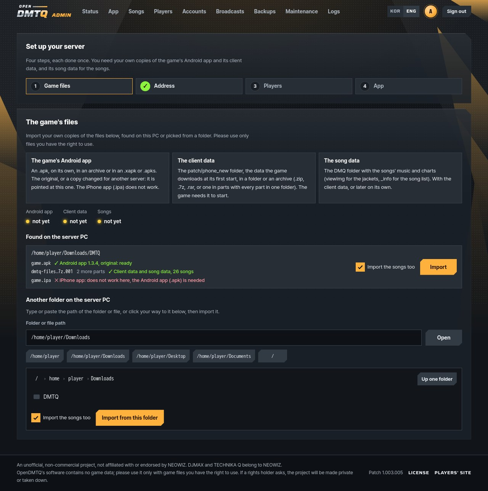

# Installing

Each way to run OpenDMTQ, step by step. The [quick start](../README.md#quick-start) has the short version of each.

All four run the same server. Phones join over the same Wi-Fi, or over the internet once the server is
[reachable from outside](internet.md).

## What you need

- **The game's Android app** (`.apk`, any file name). Version 1.3.5 or 1.3.4, original or changed for another server,
  gets every fix; other versions play the same, with a few screens as the game had them. It may be in an archive, an
  `.xapk` or an `.apks`. Phones play on Android; [iPhones cannot](game-files.md#iphones).
- **The client data**: the `patch/phone_new` folder, the data the game downloads at its first start, in a folder or an
  archive (`.zip`, `.7z`, `.rar`, also in parts).
- **The song data**, if you want the songs: the `DMQ` folder with their music and charts, and `viewImg` for the
  jackets. It can come with the client data or later on its own.

The setup finds them in Downloads or on the Desktop by their names: an archive or an app with `dmtq`, `djmax` or
`technika` in its name, and a folder by what is in it. Files of other names, or in another place: pick their folder in
the setup's picker, or `./opendmtq setup --from <folder>` with Docker. The setup says what each file is before it imports
anything. [The game's files](game-files.md) has every form it accepts.

<p align="center">
  
</p>

## Windows

Windows 10 or 11. Paste into **Windows PowerShell**:

```powershell
cd ~
curl.exe -LO https://github.com/kanggu12/openDMTQ/releases/latest/download/OpenDMTQ-windows.zip
tar.exe -xf OpenDMTQ-windows.zip
start .\OpenDMTQ\OpenDMTQ.exe
```

It unpacks to `C:\Users\<you>\OpenDMTQ` and starts the server, and the setup opens in your browser. It finds your
files in Downloads, on the Desktop or in Documents, or takes the path you paste. It then asks for the address phones
use and an account for each player, and builds the app.

- **Windows Firewall** asks about Apache: allow it on private networks. If your Wi-Fi is a public network, set it to
  **Private** in Settings, or phones cannot connect.
- **The server runs while its window is open.** To stop it, close the window, or press **Stop the server** under
  **Maintenance** on the admin pages. To start it again, `start ~\OpenDMTQ\OpenDMTQ.exe`, or double-click it.
- **To update**, close its window and run the same four lines again. The new files replace the program's; your `data`
  folder and `.env` stay.

<details>
<summary>Without PowerShell</summary>

Download `OpenDMTQ-windows.zip` from [Releases](https://github.com/kanggu12/openDMTQ/releases/latest) and unpack it
outside OneDrive and Program Files, for example to `C:\OpenDMTQ`. Start `OpenDMTQ.exe`. If Windows says it protected
your PC, click **More info**, then **Run anyway**: OpenDMTQ.exe is not signed by a publisher Windows knows.

Each release has `OpenDMTQ-windows.zip.sha256` beside the zip. In PowerShell, compare `Get-FileHash
OpenDMTQ-windows.zip` with it; on Linux, run `sha256sum -c OpenDMTQ-windows.zip.sha256`.
</details>

## Linux or macOS

Debian, Ubuntu, or a Mac with [Homebrew](https://brew.sh); on another Linux, use Docker:

```sh
curl -fsSL https://raw.githubusercontent.com/kanggu12/openDMTQ/main/host/get.sh | sh
```

It downloads OpenDMTQ into `~/openDMTQ` (`OPENDMTQ_DIR=<folder>` before `sh` chooses another), installs Apache, PHP, Java and Python from the system's packages, starts the
server and opens the same setup in the browser. It asks for your password (sudo) to install packages; without a screen
it prints the setup's address instead. Running it again updates OpenDMTQ.

```sh
cd ~/openDMTQ
./opendmtq status     # the address and how the server is
./opendmtq stop
./opendmtq start
./opendmtq service    # start with the computer
```

## Docker

Docker 23 or newer with Compose, and Python 3.9 or newer:

```sh
git clone https://github.com/kanggu12/openDMTQ.git
cd openDMTQ
./opendmtq setup
```

It finds the game files in Downloads or on the Desktop by a name with `dmtq`, `djmax` or `technika` in it, starts the
server, builds the app, checks it all and ends with a QR code for phones. Files of another name or in another place:

```sh
./opendmtq setup --from ~/games/dmtq
```

Sign in to the admin pages at the address the setup ends with (`./opendmtq status` shows it again, on this PC
`http://localhost:8791/opendmtq/admin/` unless port 8791 was taken), as `admin` with `ADMIN_PASSWORD` from `.env`, and make
an account for each player. To update, `git pull`, then `./opendmtq up`.

## Kubernetes

The Helm chart needs a volume with the game files and S3-compatible storage for the database first:
[install on a cluster](kubernetes.md#install-on-a-cluster) has the commands.

## On each Android phone

Each player needs an account: make them in the setup, or later on the admin pages' **Accounts** page.

1. In Chrome or Samsung Internet, open the server's address exactly as the setup shows it, or scan its QR code. Not
   inside a messenger app.
2. Sign in with the player's account, tap **Download app (.apk)** and install it. Allow installs from the browser when
   Android asks.
3. Start the game and allow storage access. It downloads its data from the server on the first start.

## On a Windows PC

The same accounts play on a PC ([the PC client](windows-player.md)).

1. On the server's site, sign in and open **Download**. Under **On a computer (Windows)**, download the installer.
2. Run it and choose **Install**: no administrator rights, set up for the server. If Windows says it protected your
   PC: **More info**, then **Run anyway**.
3. The launcher signs in with the player's account, downloads the game, and asks about the picture and the sound once.
   Then **PLAY**.

## Everyday use

| To | Windows | Linux or macOS | Docker |
|---|---|---|---|
| Start | `OpenDMTQ.exe` | `./opendmtq start` | `./opendmtq up` |
| Stop | close the window | `./opendmtq stop` | `./opendmtq down` |
| See the address | the window shows it | `./opendmtq status` | `./opendmtq status` |
| Update | close the window, then run the [four lines](#windows) again | run the `curl` line again | `git pull`, then `./opendmtq up` |
| Start with the computer | a shortcut in `shell:startup` | `./opendmtq service` | `RESTART=unless-stopped` in `.env`, or `cli/install.sh --service` |
| Import songs | admin pages, **Songs**, or a folder dropped on `OpenDMTQ.exe` (the game's files in it too) | admin pages, **Songs** | `./opendmtq import --songs <folder>` |
| Name the app (`TECHNIKA Q (<name>)`) | `SERVER_NAME=<name>` in `.env`, restart, then build the app (admin pages, **App**) | the same | `./opendmtq name <name>` |
| Remove it | close the window, then delete the folder | `./opendmtq stop`, `./opendmtq service --remove`, `host/install.sh --uninstall`, then delete the folder | `./opendmtq down`, `./opendmtq firewall --remove` under WSL, `docker image rm opendmtq-server:local opendmtq-tools:local` (the two images it built; with `COMPOSE_PROJECT_NAME` in `.env`, that name in place of `opendmtq`), then delete the folder |

Everything else is on the admin pages: the app, songs, players, accounts, recordings and backups.

An update keeps `data` and `.env`. Phones get a newer app on the site when the update brings one, and PCs update the
launcher on its **Launcher** page ([the PC client](windows-player.md#the-launcher)).

## Backups and a new computer

The server makes a backup a day while something changed, and keeps the latest seven, in `data/backups`. A backup holds
the database (accounts, scores, players, settings), the app's signing key and the added songs; recordings and live
video stay out of it. The admin pages' **Backups** page makes one at any time, downloads, uploads and restores them
([the admin pages](admin.md#the-admin-pages)). With Docker Compose the command line does the same: `./opendmtq backup`,
`./opendmtq backups` and `./opendmtq restore <name>`, and `./opendmtq down` backs up as it stops
([restoring](troubleshooting.md#restoring)).

To move a server to another computer, stop it, copy its `data` folder and `.env` into a new install of the same kind,
and start it there. The signing key comes along in `data/apk/keystore`, so phones update their app over the old one.
Give the new computer's address with `./opendmtq host <address>` (`OpenDMTQ.exe host <address>` on Windows) when it
differs, and phones install the app it builds.

## Settings

The setup writes `.env` beside `opendmtq`. These are the lines it may hold; edit by hand only for what no command sets,
then restart.

| Line | What it is | Set by |
|---|---|---|
| `PUBLIC_HOST` | The address the app uses: a LAN IPv4 address (`host:port` for another port than 80), or `host:port` when exposed | the setup, `./opendmtq host`, `./opendmtq expose` |
| `SERVER_NAME` | The name after the game's title on phones, `TECHNIKA Q (<name>)`; empty: the whole address | `./opendmtq name` |
| `LISTEN_PORT` | The port the server listens on (80 when unset): the port in a LAN `PUBLIC_HOST`, or the forwarded one | the setup, `./opendmtq host`, `./opendmtq expose` |
| `BASE_APK` | The client to patch when `data/apk/base` holds several (a file name there) | `./opendmtq apk --base` |
| `ADMIN_PASSWORD` | The owner's password on the admin pages | the setup |
| `ADMIN_USER` | The owner's ID (`admin` when unset) | by hand |
| `ADMIN_ON_PUBLIC_PORT` | `yes`: admin pages on the main port at `/opendmtq/admin/`; `no`: only at their own address | `./opendmtq expose` (unless `--admin-public`) |
| `ADMIN_BIND`, `ADMIN_PORT` | The admin pages' own address (`127.0.0.1` and `8791` when unset: this PC only) | by hand; `ADMIN_PORT` also by `./opendmtq up` when 8791 is taken |
| `LIVE_DEFAULT` | `on`: a new player's broadcast starts on until the Broadcasts page says otherwise ([broadcasts](live.md)); `off` when unset | by hand |
| `RESTART` | `unless-stopped`: the server starts again with Docker | by hand |
| `BIND_ADDRESS` | The interface the server's port is published on (all when unset) | by hand |
| `COMPOSE_PROJECT_NAME` | What this server's containers are called; a second copy of the repository gets its own by itself | `./opendmtq`, for a second copy |
| `OPENDMTQ_SERVER_IMAGE`, `OPENDMTQ_TOOLS_IMAGE` | A release's images to run instead of building them here ([without internet](closed-network.md)) | by hand |

## What it runs on

| | Minimum | Recommended |
|---|---|---|
| **Server** | 64-bit Windows 10 or 11, Debian 12, Ubuntu 24.04, macOS, or Docker; 2 GB of memory | 2 cores, 4 GB |
| **Disk** | 1 GB without the songs | 7 GB with every song |
| **Phones** | Android 5.0 | Android 8 or newer to broadcast |
| **PCs** | 64-bit Windows 10 or 11 on an x64 processor, Direct3D 11, 390 MB of disk | A touch screen |

At rest the server takes about 170 MB of memory, and up to 1.6 GB for half a minute while it builds the app. The client
data takes about 120 MB and the song data 4.5 GB; each app build about 110 MB, the last ten kept. Broadcast recordings
take up to 20 GB more.

Tested on Windows Server 2022 and Wine, Debian 12, Ubuntu 24.04, Docker on Linux and a three-node Kubernetes cluster,
with a Galaxy S26 Ultra (Android 17, no 32-bit support) and the Android 11 emulator.
