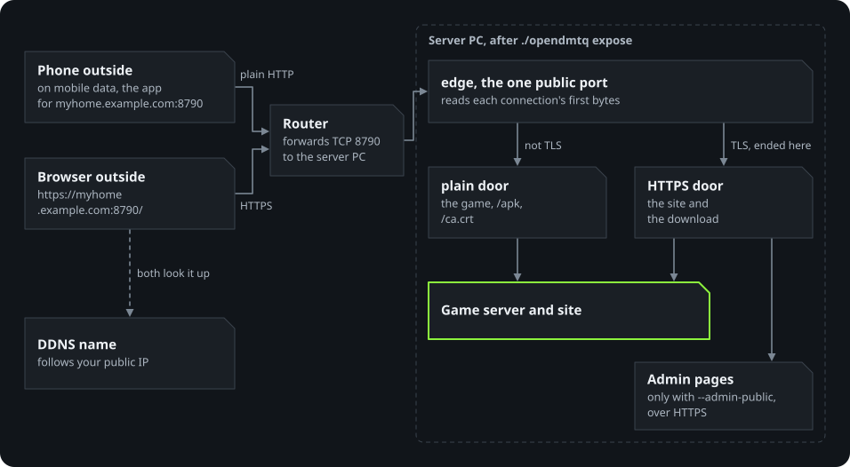

# Playing from outside your home

By default the server is reachable on your local network only. To play anywhere, give it a host
name that points at your public IP and forward one TCP port to it.

This guide is for Docker Compose, which brings the HTTPS the site's sign-in needs on the internet. A host install
and the Windows bundle have no HTTPS. Their `host` command takes a host name too (`./opendmtq host
myhome.example.com:8790` on a host install), but passwords would then cross the internet in clear, so use them on a
local network.

How a phone on mobile data reaches the server PC:

<p align="center">
  
</p>

```sh
./opendmtq expose myhome.example.com            # port 8790 by default; --port to change
```

This sets `PUBLIC_HOST=myhome.example.com:8790` and `LISTEN_PORT=8790`, takes the admin pages off
the public port (`--admin-public` keeps them there),
rebuilds the app for that address, and (under WSL) opens the Windows firewall for the port from
anywhere. Phones install the new app over the old one.

With Docker Compose, `./opendmtq host` takes LAN addresses only, the addresses of your home network (a host install's
`host` also takes a name). To change the name or the port, run `expose` again. If the server PC's LAN address
changes, the app stays the same: point the router's port forward at the new address.

## What you need

- **A host name.** Most routers offer free dynamic DNS (ASUS: `*.asuscomm.com`, ipTIME:
  `*.iptime.org`, others: DuckDNS, No-IP). It follows your public IP when it changes; a bare
  public IP would break the app the first time it changes.
- **A port forward.** On the router, forward TCP 8790 to the server's LAN address. With chained
  routers (an ISP modem-router in front of your own, for example), every router in the chain needs
  the rule, each pointing at the next one's WAN address (the address the router in front gave it).
- **NAT loopback (hairpinning).** Phones at home also use the public name, so the router must send those connections
  back inside. Most routers do; if yours does not, phones at home cannot connect while phones outside can.

## Checking

`./opendmtq doctor` asks [check-host.net](https://check-host.net) to fetch
`http://<name>:<port>/opendmtq/health.php` from several countries and reports how many succeeded.
A test from inside your network does not prove the forward works.

## What is exposed

| Path | Access |
|---|---|
| Game endpoints (`/DMQ`, `/api`, `/accounts`, ...) | Open to anyone, because the app has no way to sign in to the site. The game's own protocol does not authenticate players either: the player id travels in clear in its token and is trusted as it is, so anyone who reaches the port can create accounts and act as any player. The site's sign-in does not change that; expose the server to people you trust. |
| The site (`/opendmtq/`: home, broadcasts, download, rankings, songs, players) and the app download (`/apk`) | Sign-in page first, whatever page is asked for, then that page: an account's ID and password, made on the admin pages' Accounts page (nobody makes their own). Repeated wrong passwords are slowed down. Open without it: the sign-in page, its language switch, the licenses and the health check. The game's own score viewer (`/djmaxQ`, `/score`), which the game opens in its window, is behind the same sign-in. |
| Admin pages (`/opendmtq/admin/`) | With `expose --admin-public` (or `ADMIN_ON_PUBLIC_PORT=yes`): `https://<address>/opendmtq/admin/` from anywhere, over HTTPS only (a plain-HTTP visit is sent there), and the site's footer links to it. Without it they are not on the public port. On the server PC itself, `http://localhost:8791/opendmtq/admin/` always works. |
| `/opendmtq/health.php` | Open (no personal data). |
| `/ca.crt` | The server's own certificate authority (see HTTPS below). |

## HTTPS

A browser that asks for one of the site's pages over plain HTTP at a public address is sent to HTTPS, at the address it
asked for. A player who only gets a link then sees the certificate warning (below), unless the phone trusts the server's
authority. What stays on plain HTTP is what cannot go there: the game itself, `/apk` and `/ca.crt` (how a phone comes to
trust HTTPS at all), the health check, a browser inside an app such as KakaoTalk (it may offer no way past the warning),
and visits on a local network address, where HTTPS would only put the certificate warning in front of a new player (the
admin pages still go to HTTPS there). `/apk` answers on plain HTTP, but a browser that has not signed in goes through
the sign-in page, which is on HTTPS. While the edge proxy (below) runs without a certificate, nothing is redirected.
`doctor` checks the HTTPS door on the server PC.

The same port also answers HTTPS: `https://myhome.example.com:8790/` opens the site and the download encrypted (the
admin pages too, with `--admin-public`), while the game keeps talking plain HTTP on that port (on the local network with
port 80 that is `https://<address>:80/`). The edge proxy, a small program in front of the server that holds the public
port (`server/edge/nginx.conf`), looks at the first bytes of each connection: a TLS handshake is decrypted there and
passed on to the server's HTTPS door, everything else goes to its plain door, each with the visitor's address. Only the
edge holds the certificate's key, never the server and its PHP code. Nothing else needs to be forwarded on the router.

The certificate comes from an authority the server makes for itself (`data/https`, made and renewed
by `./opendmtq up`): public authorities such as Let's Encrypt only vouch for a server that answers on
port 80 or 443. Browsers therefore warn on the first visit ("Your connection is not private"); the
visit can continue from there (Advanced, then Proceed). To make a phone trust the server without
the warning:

1. Open `http://myhome.example.com:8790/ca.crt` on the phone; it downloads `ca.crt`.
2. Settings, Security and privacy, More security settings, Install from device storage (or
   Encryption and credentials, Install a certificate), then CA certificate; pick `ca.crt`. The
   wording differs a little between phones.
3. Check it is the server's: under Trusted credentials (or View security certificates), User, open
   it and compare its SHA-256 fingerprint with the one `./opendmtq doctor` prints on the server PC.
   The download is plain HTTP, so on a network you do not trust, someone could hand you another
   certificate in its place; remove any that does not match.

The authority is limited to the server's own names (its host name, names under it, and
localhost), may not sign e-mail or URI names and only vouches for web servers. Browsers that honour
these limits trust it for this server and nothing else, even if its key ever leaked. Every change
of address makes a new authority (`expose` with another name, `expose --off`, `./opendmtq host` on
the local network), which phones that installed the old one install again. `up` renews
the server certificate before it runs out (it lasts 825 days) and restarts the edge to use it;
`doctor` warns 30 days ahead.

The containers run unprivileged with a read-only root filesystem, and only the edge holds the certificate's key. The
game's protocol stays open as described above, so treat the machine accordingly: keep it updated and do not expose
anything else from it.

## Going back

```sh
./opendmtq expose --off
```

Returns to the local address on port 80, puts the admin pages back
on the main port, limits the Windows firewall rule to the local network (under WSL) and rebuilds
the app. Remove the port forward from the router(s). The address is detected as `setup` detects
it; give it with `--host` when that fails, as it does with Docker Desktop while WSL runs in NAT
mode: `./opendmtq expose --off --host 192.168.x.y` with the PC's Windows LAN address (`ipconfig`
shows it). Nothing changes until an address is found.
