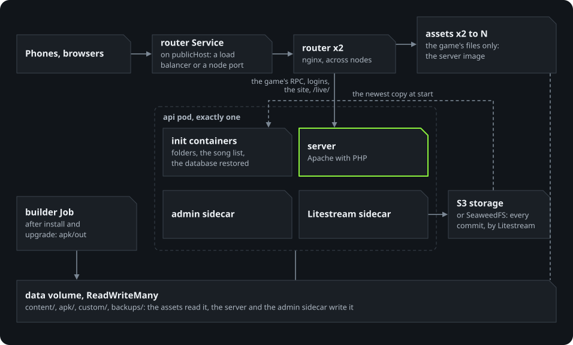

# Kubernetes and high availability

The Helm chart in `deploy/helm/opendmtq` splits the server by what each part needs.

<p align="center">
  
</p>

## Design

- **Router.** Two nginx replicas behind one Service. It sends the static paths to the asset tier
  and everything else to the api. Asset pods are reached individually through a headless Service
  that is re-resolved every 5 seconds, with a 1 second connect timeout and up to three attempts per
  request, so a dead asset pod costs one retry and the download still succeeds.
- **Assets.** About 95 % of the bytes (songs, patterns, patches, jackets) are read-only. Any number
  of replicas serve them from the shared game-files volume. A rolling update never drops below the
  current count.
- **API.** The game keeps its state in SQLite, which allows one writer, so there is exactly one api
  pod (`Recreate` updates, never two at once). Its database lives in an `emptyDir`; on start an init
  container restores the newest copy from object storage, and a Litestream sidecar streams every
  commit back (about one second behind). Because no node-bound volume is involved, the
  replacement pod can start on any node. If the object store is unreachable at start, the restore
  fails and the pod retries; it never starts on an empty database by mistake.
- **Fast eviction.** The api pod tolerates an unreachable node for `api.failoverSeconds` (20)
  instead of the default 300 seconds.
- **HTTPS.** With `router.tls.secretName` (a `kubernetes.io/tls` Secret, from cert-manager or
  `kubectl create secret tls`) the router ends HTTPS on its own port, next to the game's plain HTTP, the way
  compose's edge does. Browsers are sent to HTTPS, and a renewed certificate is picked up within minutes.
- **Admin pages.** A sidecar of the api pod (it works on that pod's database). The router serves `/opendmtq/admin/`
  only when `admin.onPublicPort` allows it: by default over HTTPS with `router.tls`, and otherwise only for
  a private IPv4 `publicHost`, where the password crosses the LAN in clear. Otherwise use
  `kubectl port-forward` (the release notes print the command). Password from
  `admin.existingSecret`, or generated into `<release>-opendmtq-admin`. An init container creates the
  shared folders as uid 33 first.
- **Broadcasts.** `live.default` is `LIVE_DEFAULT` of the compose setup: `on` starts each player's switch on
  ([live.md](live.md)).
- **Time zone and base APK.** `timeZone` sets the servers' zone (the in-game daily ranking's date);
  `baseApk` names the client in the base folder when it holds more than one.
- **Locked down.** Every pod runs unprivileged with a read-only root filesystem, no capabilities and
  the RuntimeDefault seccomp profile. Service account tokens are not mounted.

What this gives and what it does not:

| Failure | Effect |
|---|---|
| Asset or router pod dies | No visible effect: requests retry on another pod. |
| API pod dies | Game RPC unavailable for a few seconds while the pod restarts. |
| Node dies | Downloads keep working (minus requests already sent to that node); game RPC unavailable until the api moves, about node detection time + `failoverSeconds` + start-up. |
| Object store dies | The server keeps working; changes queue in the api pod and replicate when it returns. A restart of the api pod during the outage waits for the store. |
| Network partition of the api node | Two api pods can briefly coexist; the older one's writes after the partition are lost. Acceptable for a game, but it is the reason the api is not active-active. |

## Measured

`tests/ha/failover.sh` on the kind cluster in `deploy/kind` (three nodes, node detection tuned to
10 seconds) downloads one chart file (`/DMQ/Patterns/1`) and sends one game RPC every 0.5 seconds while it fails
things.
Latest figures, ten runs:

| Drill | API recovery | Failed downloads | Data |
|---|---|---|---|
| API pod force-deleted | 4.5 to 6.9 s | 0 in every run | Player intact |
| Worker node running the api stopped | 42.6 to 48.4 s | 0 to 3 of 45-49 probes | Player intact |

Earlier figures, four runs on the first version of the Helm chart: 3.1 to 5.0 s; 41.4 to 47.4 s with 0 to 6 of 43-62
failed. The game RPC fails for the whole outage in both drills, as nothing else can answer it.

The failed downloads in the node drill went through the stopped node's router before Kubernetes
marked the node not ready (about 10 seconds); with a LoadBalancer and its health checks that window
is shorter. With the default 50 second node detection, the node drill took 72.6 seconds.

After a stopped node returned, its router used to answer about half of all requests with an instant
502 for up to 21 seconds (6 and 11 of about 120 logins, one per second): nginx was up before it could
resolve its upstreams, and its readiness probe is local. A start-up probe through the asset tier
and three readiness passes keep it out of the Service until then: 0 of about 120 in the last runs.
The readiness probe stays local on purpose, so routers keep serving downloads while the api is down.

A recordings claim tied to one node (kind's local-path, say) stops the node drill: the replacement
pod stayed Pending on the volume's node affinity, and the api did not return within the drill's 180
seconds. See [Live broadcasts](#live-broadcasts).

An earlier version spread the router only on a best-effort basis, and after a rollout both router
pods could share a node; stopping that node took the entry point down. The spread is now enforced
per revision (`DoNotSchedule`, `matchLabelKeys: [pod-template-hash]`).

## Live broadcasts

The phone's uploads, the site's pages and the media all go to the one api pod: the router has
`/live/` and `/opendmtq/live-media.php/` routes for them, and asset pods never see them. **The chart
supports live broadcasts with one api pod, and only one.** `replicas: 1` is fixed for the database's sake
and live broadcasts depend on it too: the live window (`/data/live`) and any open recording are that
pod's own files, the switch-off and the cleanup act on them directly, and several pods would need
shared storage and locks across pods that neither the code nor the chart provides. Do not raise the
replica count or route by guid; there is no such option.

What happens when the api pod is replaced (measured on kind):

| | Recordings on the pod's `emptyDir` (default) | With `live.recordings.persistence` |
|---|---|---|
| Live window | Gone; the next uploads rebuild it | The same |
| Switch and upload token (database) | Kept; the phone's uploads go on with no new sign-in | The same |
| Recordings | **Lost** | Kept |

Without a claim, recordings count against the node's disk, and no limit of the pod applies, so the 20 GB default cap is
checked against the node's free space. The `state` volume has no `sizeLimit` for that reason; if you add one, keep it
above the cap (Recordings page), or the kubelet may evict the pod.

With a claim, recordings stay when the pod goes, and the server copies segments into it rather than
linking them. Make it ReadWriteMany (the default), or storage that reattaches quickly: a claim tied
to one node ties the api to that node, and failover stops working (see Measured). Keep `size` above
the cap, as the limit in force is the smaller of the two on storage that enforces its size. The
claim survives `helm uninstall`; delete it yourself when you want the recordings gone.

Requests under `/live/` are left out of the router's logs except for critical errors, as the device ids are in their
addresses. The media requests are left out of its access log too.

## Install on a cluster

Requirements:

- A ReadWriteMany volume (NFS, CephFS, Longhorn RWX, ...) or a host path present on every node,
  holding `content/` (the game data, and the songs if you have them) and `apk/base/` (a base APK). The
  layout matches the repository's `data/` folder, so `opendmtq import [--songs] <folder>` on any machine
  prepares it. What phones without 32-bit support need comes with the tools image: the builder job adds it.
- S3-compatible object storage for the database replica.
- A LoadBalancer implementation (MetalLB, k3s servicelb, a cloud provider) or a node port, and an
  address phones can reach: an IPv4 address or a host name, on the router Service's port (80 unless
  `router.service.port` says otherwise).

```sh
kubectl create namespace opendmtq
kubectl -n opendmtq create secret generic opendmtq-s3 \
  --from-literal=LITESTREAM_ACCESS_KEY_ID=... --from-literal=LITESTREAM_SECRET_ACCESS_KEY=...

helm install opendmtq oci://ghcr.io/kanggu12/charts/opendmtq -n opendmtq \
  --set publicHost=192.168.0.50 \
  --set router.service.loadBalancerIP=192.168.0.50 \
  --set data.existingClaim=opendmtq-data \
  --set litestream.s3.endpoint=https://s3.example.com \
  --set litestream.s3.bucket=opendmtq \
  --set litestream.s3.existingSecret=opendmtq-s3

helm test opendmtq -n opendmtq
```

Phones then open `http://192.168.0.50/` exactly as with Docker Compose. On a network with no way out, the images and the chart
are carried in: [Without internet](closed-network.md#kubernetes).

The chart and its own two images (`ghcr.io/kanggu12/opendmtq-server`, `opendmtq-tools`) are published with each
release. To run this checkout's code instead, build and push the images (`server/`, `tools/`), point
`image.server.repository` and `image.tools.repository` (and their `tag`) at them, and install from
`deploy/helm/opendmtq`.

HTTPS needs a certificate for the address, in a Secret. The game keeps to plain HTTP on the same port:

```sh
kubectl -n opendmtq create secret tls opendmtq-tls --cert=fullchain.pem --key=privkey.pem
helm upgrade opendmtq oci://ghcr.io/kanggu12/charts/opendmtq -n opendmtq --reuse-values --set router.tls.secretName=opendmtq-tls
```

Lower node detection time on the control plane (`--node-monitor-grace-period`) shortens API
recovery after a node failure; the kind configuration uses 10 seconds.

## Try it locally

```sh
./opendmtq setup            # builds the images and prepares data/
deploy/kind/up.sh           # three-node kind cluster, chart installed, http://127.0.0.1:18080/
./opendmtq check --url http://127.0.0.1:18080
tests/ha/failover.sh        # the drill above
kind delete cluster --name opendmtq
```

The cluster mounts this checkout's `data/`, the folder the Compose stack serves, so `deploy/kind/values.yaml`
turns off the builder and the song-list rebuild; songs and backups changed on this cluster's admin
pages still land there. `up.sh` passes `PUBLIC_HOST` from `.env`, so with an internet address `/opendmtq/admin` is
not on the router (`admin.onPublicPort`). Behind a NodePort, as here, the server sees the node's
address for every visitor, so the per-address sign-in limits are shared by everyone who comes in
through that node.

Known kind issue: after a node container is stopped and started, its kube-proxy can fail with
"too many open files" until the host's inotify limits are raised
(`sudo sysctl fs.inotify.max_user_instances=8192 fs.inotify.max_user_watches=524288`), as the kind
documentation recommends.

## Values

The main ones; see `values.yaml` for all.

| Value | Default | Meaning |
|---|---|---|
| `publicHost` | (required) | The IPv4 address or host name phones use, with `:port` when it is not 80; goes into server URLs and the app. |
| `data.existingClaim` / `data.hostPath` | (one required) | Game files volume. |
| `router.replicas` | 2 | |
| `router.service.type` | LoadBalancer | Or NodePort (`router.service.nodePort`). |
| `assets.replicas` | 2 | Or `assets.autoscaling.enabled=true`. |
| `api.failoverSeconds` | 20 | How long the api waits on an unreachable node. |
| `litestream.enabled` | true | Off means the database is lost when the api pod is replaced. |
| `litestream.s3.*` | | Endpoint, bucket, path, credentials secret. |
| `objectStore.enabled` | false | Bundled single-pod SeaweedFS, for evaluation only. |
| `builder.enabled` | true | Build the app after install and upgrade. |
| `admin.onPublicPort` | (automatic) | The admin pages through the router: yes with `router.tls` or for a private IPv4 `publicHost`, no otherwise. |
| `songs.rebuildOnStart` | true | Rebuild the song list before the api starts; off only where something else keeps `custom/` current. |
| `live.recordings.persistence.*` | off | A claim for recordings, see [Live broadcasts](#live-broadcasts). |
| `timeZone` | UTC | IANA zone for logs, the in-game ranking's day and app file names. |
| `baseApk` | | Which client in `apk/base` to patch when it holds several. |
