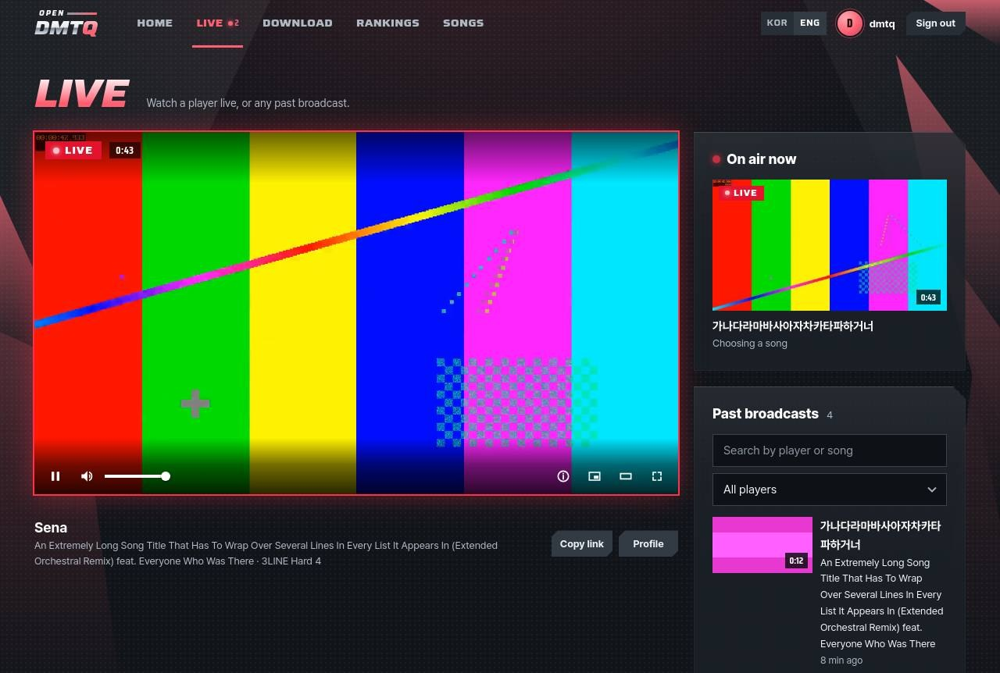
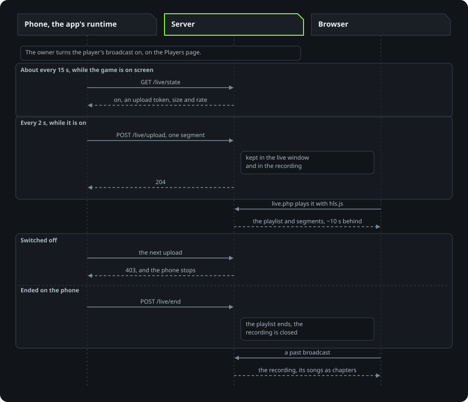

# Live broadcasts

A player's play can be shown on the site as a live broadcast. Broadcasts are off for the server until the owner turns
them on, on the admin pages' Broadcasts page. A server updated from a version without that switch keeps broadcasting
when it did: with a player switched on, or with `LIVE_DEFAULT=on`, it starts with them on. With them on, the owner turns
them on for each player on the Players page, or for every new player at once (a setting on the Broadcasts page). The
game then shows that player a short notice between songs, when their broadcast is turned on and when it is turned off,
with where it can be watched. Playing is not affected: the phone or the PC encodes and uploads on its own threads, and
drops video rather than hold the game up.

Broadcasting needs Android 8 or newer on a phone or a tablet, for its video encoder, or the player for Windows
([from a PC](#from-a-pc)). The app must include the arm32 bundle, which the server's app builder adds by itself. The
bundle also holds the shim used on phones that still run 32-bit apps. On an older device a switched-on player's row
stays at "Waiting"; they can still play and watch.

  

## Using it

While someone is on air the site's home page shows a card for each: a picture of the broadcast, how long it has run, who
and what they play. The browser takes the pictures from the stream itself, for those signed in to watch (one segment per
player, every half minute at most); others see the card without one. The live page's player has the LIVE mark and the
running time on the picture, and the player's name and profile under it.

- **Turn them on for the server:** admin pages, Broadcasts, Turn broadcasts on. The page says how many players are
  switched on and how many are on air. Until then nothing of broadcasts reaches a phone or the site
  ([Broadcasts off](#broadcasts-off)).
- **Turn it on for a player:** admin pages, Players, Turn on in the player's Broadcast column. The column then says
  "Waiting" until video arrives, and "On air" with a Watch link while it does. The Status page counts the players
  broadcasting now.
- **For every new player:** on the Broadcasts page, New players, Start on: a new player's switch turns on at their first
  play, with the same notice in the game. Players turned off on the Players page stay off. Until the owner chooses there,
  `LIVE_DEFAULT=on` in `.env` (`live.default` in the Helm chart) says the same.
- **The quality:** on the Broadcasts page, one of four ([Limits](#limits)). Phones and the PC player follow a new one
  within 15 seconds.
- **Find it:** LIVE is in the site's main menu on every page while broadcasts are on, with a small count while someone
  is on air. While someone is, the home page has a section listing them with nickname and song, and the rankings and
  player pages show a small LIVE link next to their name. Those lists, like the rest of the site, are for those signed
  in.
- **Watch:** `/opendmtq/live.php`, after signing in on the site with an account (made on the admin pages' Accounts page;
  the same as for every page of the site). `live.php?p=<player>` links to one player: it plays them, or says it waits
  for them and starts by itself when they go on air.
- **Past broadcasts:** the same page lists recordings the owner has not hidden, and `live.php?r=<player>-<id>` links to
  one.
- **Turn it off:** Turn off in the same place. The next upload is refused, which stops the device. The live window is
  deleted at once; the recording stays.

While a broadcast is live, the video player shows a LIVE mark and a few controls: play and pause, sound, connection
details, picture in picture, a wider view, full screen. It has no timeline, because viewers see what is going out now. A
viewer who falls behind, or resumes after a pause, is brought back to the newest picture. On a connection too slow for
that, a button on the picture skips ahead. The other players on air are beside the picture, one press away, and the
page does not reload.

Past broadcasts have the same controls with a timeline, a REPLAY mark, ten seconds back and on, the speed (up to
double), the songs marked on the timeline and listed as chapters, and keyboard keys (space to play and pause, the arrow
keys for five seconds, s for the speed, m for sound on and off, f for full screen, and on a phone a double tap on either
side of the picture). A recording left half-way goes on from there next time, and says so. At its end the page offers it
again, or the next one. The list beside it can be searched by player or song, and narrowed to one player.

For someone on a slow connection a recording needs a moment to fill its buffer (the stream is about 2.3 Mbit/s at the
Standard quality, and there is no lower quality to fall back on: that would take the server transcoding every
broadcast).

The video shows the game's picture and sound. Nothing else on the device is captured.

## Broadcasts off

While broadcasts are off for the server, which is how a new server starts:

- Phones and the PC player are told off at every look (`/live/state`), with no key, and every upload is refused, which
  stops one that was sending. A player who was on air as broadcasts went off is told once, between songs, that the
  broadcast ended and that broadcasts are off on the server for now; nobody else gets a notice.
- The site shows nothing of broadcasts: no LIVE in the menu, no broadcasts on the home page or a player's page, no LIVE
  mark by a name, and no recording to watch. A link to the live page opens a page that says broadcasts are off, with the
  way home; one left open says so at its next look.
- Each player's switch is kept. The Players page shows a switched-on player as switched on, held for when broadcasts are
  on again; the Status page's tile says broadcasts are off.
- Turned off while someone is on air (the page asks first), every live window goes at once and the recordings running
  are closed and kept. The owner can still watch, download and delete every recording on the Broadcasts page.
- Turned on again, each player switched on is told in the game, between songs.

## Limits

Each stream has the quality the owner picks on the Broadcasts page, plus sound (AAC, 128 kbit/s). The upload is the
player's, and each viewer takes the same again through the server's own connection.

| Quality | Picture | An hour, recorded or uploaded | Each viewer |
|---|---|---|---|
| Light | 480p, 30 fps, 1 Mbit/s | about 0.5 GB | about 1.2 Mbit/s |
| Standard (the default) | 720p, 30 fps, 2 Mbit/s | about 1 GB | about 2.3 Mbit/s |
| Smooth | 720p, 60 fps, 4 Mbit/s | about 1.8 GB | about 4.4 Mbit/s |
| Sharp | 1080p, 60 fps, 8 Mbit/s | about 3.6 GB | about 8.6 Mbit/s |

A phone or a PC on a slow connection, or a warm phone, lowers its frame rate and bitrate by itself, then the picture's
height. Viewers are roughly 10 seconds behind the player, as usual for HLS: a segment is two seconds, the device records
and uploads one before it can be served, and the web player stays two segments behind the newest.

## From a PC

The player for Windows ([the PC client](windows-player.md)) broadcasts as a phone does, to the same endpoints with the
same stream: H.264 at the owner's quality, AAC sound at 128 kbit/s, two-second MPEG-TS segments. Windows' own encoders
(Media Foundation's, on the processor) make it, on threads of their own. The frame the game draws is scaled
to the stream's size and turned into the encoder's picture format on the graphics card, and read back a frame or two
later, so the game never waits for it; the sound is the game's whole mix, before the volume the player set. The stream
says its colours are BT.709, as the picture is.

The notice that a broadcast started or ended shows as a card at the top of the game's window, with the LIVE mark while
it is on, and leaves after six seconds. While the player's menu holds the game still, the broadcast stops too; it goes
on with the game, as it does when a phone's game comes back to the screen.

Measured on a 240 Hz display (Ryzen 9 9950X, RTX 4090), the game in a 1280 by 720 window, through a whole song of two
minutes, the same song three times:

| | Broadcast off | Standard (720p30) | Sharp (1080p60) |
|---|---|---|---|
| Frames a second in the song | 237.7 | 237.5 | 237.5 |
| Frames late | 0.05 % | 0.06 % | 0.06 % |
| Gaps in the sound | 0 | 0 | 0 |
| The player's processor use, of one core | 75 % | 101 % | 132 % |

The song's own load and its pause screen take the frames down for a moment, the same in all three. On the render
thread a picture costs about 0.1 ms to take and 0.2 ms (Standard) or 0.4 ms (Sharp) to hand to the encoder, once every
eighth or fourth frame. The recordings decoded without an error, at 1280 by 720 and 1920 by 1080, with their colours
BT.709.

## Endpoints

On the site's public port, plain HTTP and HTTPS alike, answered by `server/game/live/state.php`, `upload.php` and
`end.php`. `ids` is every device id the phone knows, comma
separated, at most 16, each `[A-Za-z0-9._:-]{1,128}`. Account rows with those ids are matched as the
game matches them; a player switched on wins over a forgotten old account on the same phone.

| Request | Answer |
|---|---|
| `GET /live/state?ids=...&lang=ko\|en` | JSON `{"on", "token" (only when on), "fps", "height", "bitrate", "segment", "toast"}`: the stream by the owner's quality; off for everyone while broadcasts are off for the server, the one notice then being for a player on air as they went off, told once that the broadcast ended |
| `POST /live/upload?ids=...&seq=<n>&dur=<ms>` with `X-Live-Token`, body one MPEG-TS segment | `204` stored; `403` off (the player's switch, or broadcasts for the server) or wrong token, the phone stops; `400` bad numbers, not MPEG-TS, under 1880 bytes or fewer bytes than announced; `411` no `Content-Length` (chunked); `413` over 4 MiB; `503` could not store it or the disk is nearly full, try the next one |
| `POST /live/end?ids=...` with `X-Live-Token` | `204`; `403` as above. Ends the playlist. |

- `token` is random and new each time the switch is turned on.
- `toast` is set when the owner flips the switch and returned once, and only outside a song. It is two lines: a short title (the play is live now, or the broadcast has ended), then where to watch it live and its recording later, the site's LIVE page by the server's name. When the owner turns broadcasts off for the server, a player on air gets one of its own instead: the broadcast has ended, and broadcasts are off on this server for now (the site then shows no recordings). A song
  starts with `game.getPreviewPlayInfo` or `game.getPatternUrl`. It ends with `game.savePlayResult`
  or `game.savePlayResultFailLog`. A quit song sends no result, so a menu request more than 10 seconds
  after the start ends it too, and after 20 minutes it counts as over regardless.
  `odq_live_seen()` in `server/game/src/live.php` watches for these for every player, since
  the owner may flip the switch during a song: one small write when a song starts and one when it ends.
- `seq` is 0 to 2147483647 and restarts at 0 with the app. A number that does not follow on from the
  last adds `#EXT-X-DISCONTINUITY`. The same number twice in a row is a retry: `204` and not stored
  again.
- `dur` is 1 to 30000.
- The body must start with the MPEG-TS sync byte and be at least 1880 bytes, ten packets.

`server/apache/site.conf` caps `/live/upload` at 4 MiB and `/live/state` and `/live/end` at 8 KiB. On
Kubernetes the router's `client_max_body_size` (`templates/router-config.yaml`) applies first, and
`/live/upload` has its own location there with 4 MiB.

On Kubernetes, live broadcasts work with the chart's single api pod and no more: the window and open
recordings are that pod's files, with no shared storage or routing by player for a second one. When
the pod is replaced the window is rebuilt from the next uploads, and recordings are lost unless
`live.recordings.persistence` gives them a claim. See [kubernetes.md](kubernetes.md#live-broadcasts).

## Storage

`data/state/live/<guid>/` (`/data/live` in the container): up to eight `<n>.ts` segments (six in the
playlist, two more for a viewer still fetching what it read just before), `index.m3u8`, `stream.json`
and a lock file. Files are written to a temporary name and renamed, so a viewer never reads half a
segment. `n` counts up for the life of the folder, independent of the phone's `seq`.

| When | What happens |
|---|---|
| No upload for 15 seconds | No longer listed as live |
| No upload for 30 seconds | The playlist is served with `#EXT-X-ENDLIST`; the next upload starts a clean window |
| No upload for 5 minutes | Files removed, at most once a minute, when any phone or visitor asks |
| Switch turned off | Folder removed at once, the recording closed and kept |
| Broadcasts turned off for the server | Every player's folder removed at once, their recordings closed and kept |
| Player deleted | Folder and all their recordings removed at once |
| Server start | Everything under `data/state/live` removed |

These requests stay out of the access logs: a phone polls and uploads constantly, and device ids are
in the addresses.

The cleanup runs at most once a minute, on any request. The health check makes one every 30 seconds.

The owner's settings for broadcasts as a whole are the `LiveSetting` table in the game database, a row each: `on`
(broadcasts at all), `new_players` (a new player's switch starts on) and `quality`. The Broadcasts page changes them in
one transaction with what goes with them (the players' notices, and the players marked when new players start on). With
no `on` row, the first look, the server's or the admin pages', decides once and writes it: on when a player is switched
on or `LIVE_DEFAULT=on` (a server from before the switch), off on a new server, so that a player switched on later never
turns broadcasts on by itself. Without a `new_players` row, new players start as `LIVE_DEFAULT` says; without a
`quality` row, the quality is Standard. In the database, the settings go wherever it goes: its copy in object storage on
Kubernetes, and every backup.

The players' switches are the `LiveSwitch` table in the game database. Both tables are created by
`server/game/bin/setup-db.php` at every start, and a backup carries them. Restoring a backup from the admin pages keeps the
switches and the settings as they are now, so that a restore never turns broadcasts on or starts showing a player who has
since been turned off; `opendmtq restore` on the command line brings back those in the backup. Video and recordings are
not backed up.

## Recordings

Every broadcast is recorded: about 1 GB per hour at the Standard quality (the table under [Limits](#limits) has the
others), or 20 hours of broadcast in the default limit. The owner manages them on the admin pages' Broadcasts page: watch, download
as one MPEG-TS file, hide from players, delete, and set the limits.

`data/state/live-rec/<player>/<id>/` (`/data/live-rec`), `id` being the start in epoch seconds: the segments,
`segs.log`, `songs.log`, and once closed `index.m3u8` (a VOD playlist) and a complete `meta.json` (player,
started, ended, length, size, songs). `limits.json` next to the player folders holds the limits. Segments are
hard links to the live window's files, so an upload writes each one once; the window's sliding only removes
the other name. Where a link is impossible (the two folders on different mounts) it copies instead.

| When | What happens |
|---|---|
| First video after the switch goes on | A new recording starts; a switch without video makes none |
| Silence under 5 minutes | The same recording goes on, with a discontinuity |
| Silence of 5 minutes or more | The cleanup closes it (a phone that vanished); the next video starts a new one |
| `/live/end`, switch off | Closed; the next video starts a new one. After `/live/end` within 30 seconds of the recording's start, video in the rest of those 30 seconds is broadcast but not recorded |
| 1800 segments, an hour at two seconds each | Closed; the next video starts a new one (a long broadcast is kept as hour-long recordings) |

**Limits:** a total size, 20 GB by default, and an age, 30 days by default, both set on the Broadcasts page
(1 GB is 1024 MiB here, as everywhere on that page). They are enforced when a recording closes and by the
cleanup while one grows. The oldest closed recordings go first, hidden ones included, and at most 2000 are
kept however small. A running recording is never cut. If the total is still over the limit, the largest
running ones are closed whole, their broadcasts go on in new recordings, and the closed ones go as the oldest
at the next check, so phones left on cannot fill the disk, however many. The disk itself also counts: 1 GiB
stays free whatever the limit says, and with less than that and one segment free, uploads get `503` before
anything is written.

**Hide and delete** act at once: the gate refuses a hidden or deleted recording's playlist and segments on
the next request, and an open page drops it from its list within five seconds. A running recording can be
hidden but not deleted.

Recordings need the same sign-in as watching live, or the owner's sign-in for the admin pages. Backups never include
them. See [admin.md](admin.md).

## Who can see it

`server/portal/live-media.php` serves the playlist and the segments, only to a browser signed in on
the site, and only while broadcasts are on for the server and the player's switch is on; a recording, under `/rec/<player>/<id>/`, only when it
is closed and not hidden. Neither folder is under any web root. The site's page, its list and the media all
need the same sign-in. Who is on air, with nickname and song, shows on the site's other pages too, to those
signed in.

## Testing

The pages, the player and its controls are tested in a real browser by `tests/ui/run.sh`, in CI too
([testing.md](testing.md)).

`tests/live/run.sh` builds the images from the working tree and runs `tests/live/smoke.py` against a
throwaway server and admin service on loopback, with an empty database. It needs the client data and the song data in
`data/content` and Docker, so it does not run in CI (`tests/qa.sh` runs it). `BROWSER=1` also plays a real recording in headless Chromium
(`tests/live/browser.js`), and in a Chromium with a sound card that records, whose output has to match the
recording almost to the bit (`tests/live/sound`). Never point `smoke.py` at a server people play on: it makes
accounts and flips switches.
