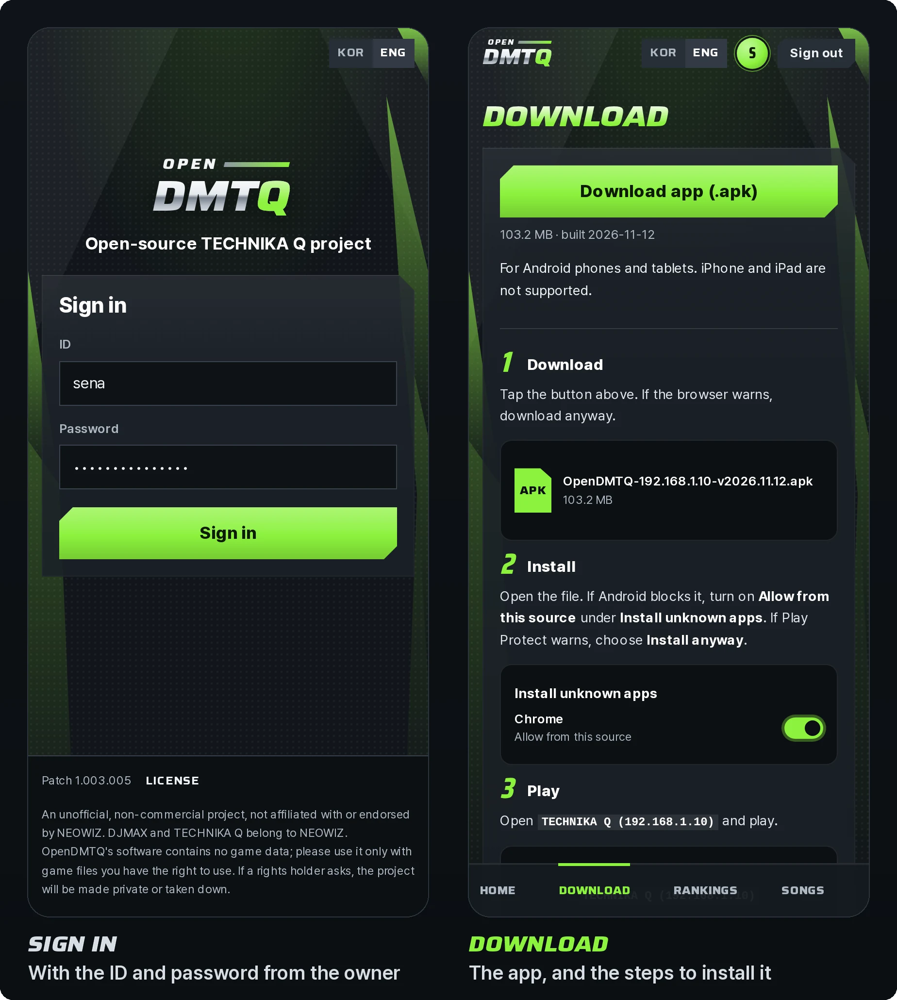

# Playing on a server

For players: the game on an Android phone or tablet, or on a Windows PC, from the site of the OpenDMTQ server you play
on. The server's owner runs it and makes your account.

## What you need

- **An account:** an ID and a password from the server's owner. Nobody makes their own: the owner makes each one on
  the admin pages, with a message to send that has the server's address, the ID and the password.
- **A phone, a tablet or a PC** the game runs on ([which devices](#which-devices)).
- **The server's network:** the same Wi-Fi as the server, or any internet connection when the server is reachable from
  outside. The server's download page says which.

## Which devices

| | Minimum | Recommended |
| :--- | :--- | :--- |
| **Phones** | Android 5.0 | Android 8 or newer to broadcast |
| **PCs** | The PC client: 64-bit Windows 10 or 11 on an x64 processor (Intel or AMD), a graphics card with Direct3D 11, 1 GB of free memory, 390 MB of disk | A touch screen, for several fingers at once |

- **Android phones and tablets** play, the newer ones without 32-bit support too (Pixel 7 and later, Galaxy S24 and
  later, Galaxy Tab S10 and later, Galaxy Z Fold6 and Flip6 and later, and others with a Snapdragon 8 Gen 3, Exynos
  2400, Dimensity 9300 or newer chip). The game has only 32-bit code, and the app the server builds carries OpenDMTQ's
  runtime, which translates it as it runs. When the download page says the app runs only on devices that can run
  32-bit apps, that app has no runtime yet: tell the server's owner.
- **iPhones and iPads** cannot play: the server hands out the game's Android app, and the iPhone app cannot be pointed
  at another server ([why](game-files.md#iphones)). The site opens on them, with the rankings and the broadcasts.
- **Windows PCs** play through the PC client ([below](#on-a-windows-pc)), and **Linux PCs** through the same client
  under Wine ([how](windows-player.md#on-linux-with-wine)).

## On an Android phone or tablet

  

1. Open the server's address in Chrome or Samsung Internet, or scan the server's QR code. Inside a messenger app
   (KakaoTalk, LINE and others) the page offers **Open in browser**: a download may fail there.
2. Sign in with your ID and password. The browser stays signed in for 30 days.
3. Tap **Download app (.apk)**. If the browser warns, download anyway.
4. Open the file. If Android blocks it, turn on **Allow from this source** under **Install unknown apps**; if Play
   Protect warns, choose **Install anyway**.
5. Start the game: the app is named **TECHNIKA Q** with the server's name in brackets. At its first start it asks for
   storage access, then downloads the game's data from the server, about 44 MB.

Songs download the first time you play them. The app is the game's own Android app with the server's address in it,
so nothing else on the phone changes: no DNS, proxy or certificate. The same site has the rankings, the songs, each
player's page and the broadcasts, in English and Korean (**KOR** / **ENG** at the top).

## On a Windows PC

The PC client plays the same app on Windows:

1. On the server's site, sign in and open **Download**. Under **On a computer (Windows)**, choose **Download the
   installer (.exe)**.
2. Run it and choose **Install**. It installs for your Windows user, without administrator rights, set up for the
   server. If Windows says it protected your PC: **More info**, then **Run anyway**.
3. The launcher signs in with your ID and password, downloads the game and asks about the picture and the sound once.
   Then **PLAY**.

The launcher keeps the game up to date. [The PC client](windows-player.md) has the rest: the launcher's pages, the
controls, the picture and the sound, what it keeps, and how it runs on Linux under Wine.

On the site, a small keyboard beside a score marks a song played with the PC's keys, and beside a total says how many
such scores it counts; the rankings are one for touch and keys.

## Updates and other devices

- **A new app:** the download page offers one, with the date it was built, when the server's owner changes the
  server's address or an update brings one. Install it over the app you have: your account stays. An app that installs
  beside the old one instead was signed with a new key: tell the server's owner
  ([restoring](troubleshooting.md#restoring)).
- **New songs** reach the game at its next start, which downloads what changed.
- **Other servers' apps**, and the original game, stay installed next to this one: each is an app of its own.
- **Another phone, or a PC:** each device is a player of its own on the server. The game's account transfer carries a
  player and its records over: on the device that has the player, **OPTION**, **CONNECT ACCOUNT** shows a code; on the
  other, **OPTION**, **RESTORE DATA** takes it.
- **Uninstalling the app** deletes the game's data on the phone; a new install downloads it again.

## Broadcasting

The server's owner can show a player's play live on the site. Once they turn your broadcast on, the game says so
between songs, **Broadcasting your play**, with where to watch it (LIVE on the server's site), and again when it is
turned off.

- A phone or a tablet broadcasts on Android 8 or newer, with the runtime the server adds to the app. An older one plays
  and watches as before.
- The game plays the same: the phone encodes and uploads on threads of its own, and drops video rather than hold the
  game up. Only the game's picture and sound go out.
- It uploads about 1 GB an hour at the Standard quality, from 0.5 to 3.6 GB by the quality the owner chose
  ([qualities](live.md#limits)). On a slow connection, or when the phone is warm, it lowers its frame rate and bitrate
  by itself, then the picture's height.
- LIVE on the site shows the players on air, about 10 seconds behind, and their past broadcasts.
- A PC broadcasts too: [broadcasting](windows-player.md#broadcasting).

## When something does not work

What a phone or a PC can check: [troubleshooting, for players](troubleshooting.md#for-players). The rest is the
server's: tell its owner what the screen said, on which device and when. The admin pages list each device's requests,
and on a PC the launcher's **Help** page opens the game's log.
