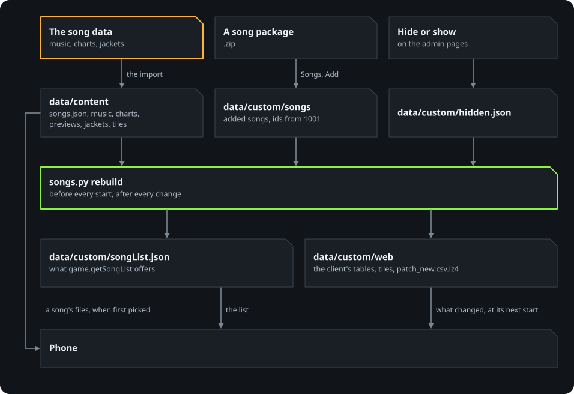

# Songs

OpenDMTQ comes without songs. A server gets them in two ways: imported from the owner's own copy of the game's
server files, or added one by one as song packages on the admin pages. With neither, the game starts with an empty
song list.

<p align="center">
  
</p>

## Importing the songs

The songs are in the same server files as the game data: a folder or an archive with the game's `patch/phone_new`
folder in it ([the forms it may come in](game-files.md#the-server-files)).

On Windows and on a host install, the admin pages import them: **Songs**, **Choose the folder**, then the folder or
the archive, with **Import the songs too** ticked. The setup looks for them in Downloads, on the Desktop and in
Documents first. An import replaces the songs imported before; songs added as packages stay, and files without the
songs' folder (`DMQ`) change none.

On the command line they are imported on their own:

```sh
./opendmtq import --songs <folder or archive>
./opendmtq import --songs --no-game-data <folder or archive>   # the songs only, the game data as it is
```

The same commands work with Docker Compose and on a host install; on Windows they are `OpenDMTQ.exe import --songs
<folder>` in a terminal. With Docker Compose, `./opendmtq setup` asks whether to import the songs when the server has
none yet (`--songs` and `--no-songs` answer for it). The import takes the music and videos (`DMQ/Songs`), the charts
(`DMQ/Patterns`), the jackets (`viewImg/eye`), the previews and the song list's tiles from the client's patch folder,
and the song list itself, into `data/content`. Nothing else of the server files is taken. Without a song list among
them, the import makes one from the game's own tables, for the songs whose music is there.

The server's song list then follows what came in: with Docker Compose `./opendmtq import` restarts a running server,
and a host install's server reads the new list at once. A phone with the app installed gets the new songs at its next start, with the
client's tables it downloads then.

Phones only see the songs the server has. The client's tables list every song of the game; at every start the
server rebuilds them (`data/custom/web`) with the rows of the imported and added songs only, and its patch manifest
without the files of the others. With every song of the tables imported and nothing added or hidden, nothing is
rebuilt and the server serves exactly the imported files.

## Hiding a song

On the admin pages, **Songs**, any song can be hidden and shown again. A hidden song leaves the game's song list and
the site; its scores stay.

## Adding a song

On the admin pages, **Songs**, **Add a song** takes a song package: a `.zip` with

```
song.json        description (below)
song.fpk         the music, in the game's .fpk format
jacket.png       the jacket image (the game's are 1024x768); its centre also becomes the song list's tile
patterns/...     one chart file per chart, in the game's pattern format
song.webm        optional: the background video
preview.opus     optional: the preview played on song select
```

```json
{
  "name": "mysong",
  "full_name": "My Song",
  "artist_name": "Someone",
  "genre": "Trance",
  "composed_by": "", "singer": "", "feat_by": "", "arranged_by": "", "visualized_by": "",
  "charts": [
    {"line": 5, "signature": 1, "difficulty": 4, "file": "patterns/4l_normal"},
    {"line": 5, "signature": 2, "difficulty": 7, "file": "patterns/4l_hard"},
    {"line": 5, "signature": 3, "difficulty": 10, "file": "patterns/4l_expert"}
  ]
}
```

- `name`: lowercase letters, digits and `_`; it names the jacket and preview files and must be unique.
- `line`: 3, 4 or 5, the game's 2, 3 and 4 LINE (the example's charts are 4 LINE). `signature`: 1 Normal, 2 Hard, 3 Expert (0 is Easy, which few songs have). `difficulty`: 1 to 15.
  One chart per line and signature.

The files must already be in the game's formats; converting music or charts from other games is outside OpenDMTQ.
Adding songs needs the game data: the song goes into the client's tables, which come from it.

### What happens

The song gets id 1001 and up, its charts 20001 and up. Ids are never handed out twice, even after a song is removed,
so old scores and phones' cached files never attach to a different song. OpenDMTQ then rebuilds, in `data/custom`:

- the server's song list (`songList.json`), which the game server reads on every request;
- the overlay the server prefers over the imported content: the song and chart files, the jacket, and the client's
  patch tables for every language (`song_song`, `song_songPattern`, `song_desc`, and the song's item in
  `product_item`, its product in `product_product` and that product in the music shop categories of
  `category_categoryproduct`), the song's tile image (`dlc/d3_e<song id>.unity3d`, about 30 KB), and the patch
  manifest (`patch_new.csv.lz4`) with their new sizes and checksums. Phones download the changed tables and tile
  images at their next start (about 700 KB), and the song's files when a player first picks it.

The product matters: the game looks up the product of every song it lists, through the music shop categories, and a
song without one makes its song list fail (a `NullReferenceException` in `PlaySongSlotView.ApplyDiscInfo`) and the
game close at the lobby. Added songs get the form of the game's free songs: product id 2000000 + song id, one game
point, in categories 3 and 103.

### The tile in the song list

The song list, the shop and the rankings draw a song from an image bundle; `viewImg/eye` is for the
song screen only. The client resolves the name in `product_item.img_url_1` without any list of what exists: the text
before the first `_` picks the bundle, `e33_uad` is `dlc/d3_e33.unity3d` in the phone's patch folder, opened with
`file://`, and the name then picks a sprite in the bundle's atlas. So an added song gets a bundle of its own,
`dlc/d3_e<song id>.unity3d`, with one sprite, `e<song id>_<name>` (`tools/opendmtq_tools/jacket_atlas.py`). Song ids
start above the game's atlas numbers (0 to 33) and are never reused.

The bundle is made from one of the imported songs' bundles, `d3_e33`, at rebuild time. Its shader, material and type
information stay; the sprite list and the texture are replaced. The tile is the centre of the jacket at 256x149, the
size of every tile of the game (those were framed by hand, so a jacket that needs other framing has to be cropped
before upload). The texture is uncompressed RGBA32, because the tools have no encoder for the game's ETC2, and is
256x256: 256 KB of memory while shown, the same as one of the game's atlases of six tiles. The imported bundles are
not changed. Without the imported songs there is no bundle to start from: the song then keeps the name `e0_<name>` and
plays as before with an empty tile, and `rebuild()` reports it in `tile_failures` (the admin Songs page shows it).

The imported rows stay byte-identical; only rows are appended. Removing an added song takes it out of the same files.

Backups (`./opendmtq backup`, the admin pages) include added songs and hidden flags, and a restore puts them back. The
imported songs are not in backups: import them again on a new machine.

### Tested

In the game (Technika Q 1.3.4 on a Galaxy S26 Ultra, a copy of one of the game's songs with its 2-LINE and 3-LINE
charts): the song appears in the song list marked FREE, downloads, opens its song screen with the jacket, and plays
with its chart and music; a package without `song.webm` plays on a black background. Removing the last added song
puts the imported tables back, and phones download them again at their next start.

The tile was tested on the Android 11 emulator, on the 32-bit game and through the arm32 runtime: three added songs
show their jackets beside the imported ones, a song added to an installed game arrives with the next start's download
(734 KB), and a later start downloads nothing again.
