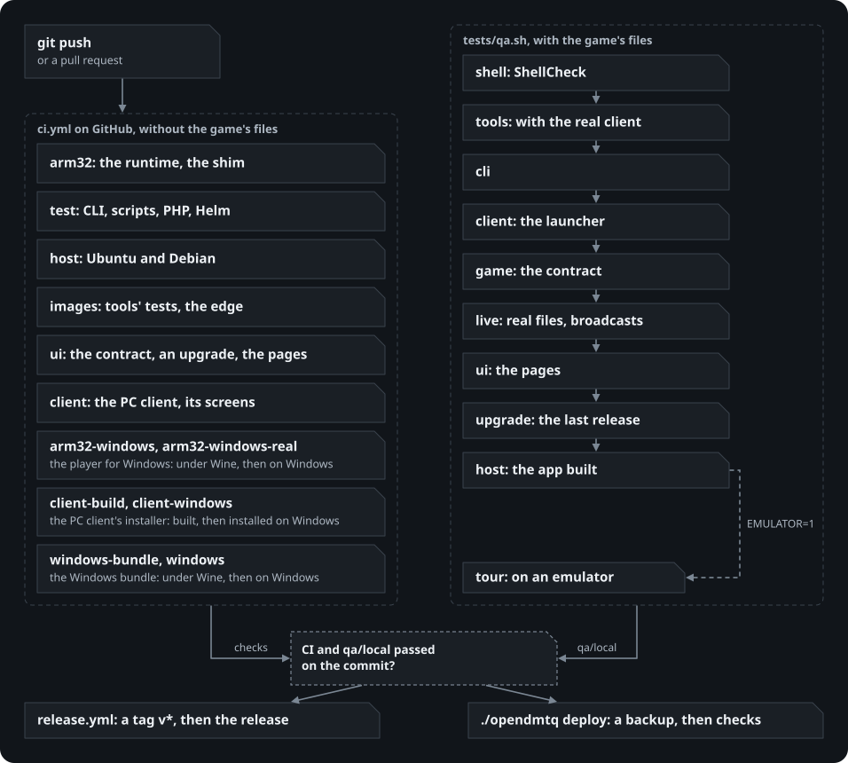

# Testing

Everything OpenDMTQ is tested with, where it runs, and what stands between a change and a live server. The cases themselves,
one table per area with what checks each, are in [test-cases.md](test-cases.md).

The game's files cannot go in this repository, and so not on GitHub's machines either. That splits the tests in two: what runs
in CI on every push, without them, and what runs on a machine that has them (`tests/qa.sh`). A release and a deploy ask for
both.

  

## What runs where

| Level | What | Command | Where | Game files |
|---|---|---|---|---|
| Unit | The admin pages, the patcher, song packages, certificates (`tools/tests`) | `docker run ... python3 -m unittest discover -s tests -t .` in the tools image | CI, `qa.sh` | no |
| Unit | The command line (`cli/tests`), on the oldest Python it supports too | `(cd cli && python3 -m unittest discover -s tests -t .)` | CI, `qa.sh` | no |
| Unit | The broadcast's transport stream writer | see `ci.yml` | CI | no |
| Scripts | ShellCheck on every script, at the version GitHub's runners have | see `ci.yml`, `shell_tests` in `tests/qa.sh` | CI, `qa.sh` | no |
| Build | The arm32 runtime and shim, both images, the Helm chart against Kubernetes' schemas, a start without game files | see `ci.yml` | CI | no |
| Contract | Every reply of the game server the client depends on, its quirks, a save under a held lock, and not one PHP warning | `tests/game/protocol.sh` (`protocol.py`, `lock.php`) | CI, `qa.sh` | no |
| Pages | All pages at five screen widths in both languages, empty and full, on air and under maintenance; the replay player and the owner's forms | `tests/ui/run.sh` | CI, `qa.sh` | no |
| Server | The real game files: every request the game makes, broadcasts, recordings, sign-ins | `tests/live/run.sh` (`BROWSER=1` adds a real video) | `qa.sh` | yes |
| Host install | The README's one command (`host/get.sh`, `host/install.sh`) on a clean system in a container, `./opendmtq setup`, then its setup in the browser (the one-time link, the files found and imported, an account, the app, another address and the restart), the contract, the pages, stop and start | `tests/host/run.sh` (`DISTRO=debian:12`; `APK=<file>` also builds the app) | CI (Ubuntu 24.04, Debian 12), `qa.sh` (with the app) | no (yes with `APK`) |
| Windows bundle | The bundle built from its pinned downloads, every program's DLLs found, then run: under Wine on Linux (a first start with no settings, then started as a double-click starts it, through the setup's sign-in, what it says of each file, import and restart, and with APK=<client> the phone app's build), and on Windows itself in a folder with a space; the import, the contract, the admin pages, nothing left running after its window | `host/windows/build.sh`, `tests/windows/wine.sh`, `tests/windows/run.ps1` | CI | no |
| Client | Every edit of the patcher finds its bytes, settings and screen objects in the real game clients, each in its own version | `tools/tests/test_real_client.py` (`OPENDMTQ_BASE_APK`; `CLIENTS=<folder>` for `qa.sh` adds the APKs in it) | `qa.sh` | yes |
| Sound | What leaves the phone comes out of the browser whole | `tests/live/sound/run.sh` | by hand, with a change to the sound path | yes |
| Closed network | [Without internet](closed-network.md), step by step, on a network with no way out: Docker Compose from a release's images, a host install from what is carried in, the chart. The Windows bundle has it too | `tests/closed/run.sh`, `CLOSED=1 tests/windows/wine.sh` | by hand, with a change to how a server gets its programs | stand-ins; a client for the app (`APK=`) |
| Game, closed | The real game on an emulator that reaches the server and nothing else: the tour, a song to its result, the shop, a server with no songs and the songs coming later | `tests/closed/game.sh <folder>` | by hand, with a change to how the app reaches the server | yes |
| Failover | The Kubernetes deployment losing its pods and a node | `tests/ha/failover.sh` | by hand, with a change to the chart | yes |
| Game | Install from nothing, first start, lobby, menu, options, shop, second start, on an emulator | `tests/game/tour.sh <folder>` (`EMULATOR=1 tests/qa.sh`) | by hand, with a change to the patcher | yes |
| Device | Real phones, by ear and by hand | the `hand` rows of [test-cases.md](test-cases.md) | before saying it works there | yes |

**The emulator on a busy machine.** The closed game test can stall at a song's loading screen when the computer is busy
with other work, with client 1.3.4 and 1.3.5 alike: the game's own audio output (FMOD, writing to an `AudioTrack`)
waits on the emulator's audio, and the game's threads wait on it. Measured on 11-07: 7 stalls in 17 song starts while
the machine also built, tested or ran a second copy of the game, none in 12 on an otherwise idle machine, and none in
OpenDMTQ's own code, which never waits there. The test then fails at "the song's score reaches the server": run it
again with nothing else running.

## Tests without the game's files

`tests/game/protocol.sh` and `tests/ui/run.sh` need nothing but Docker. They start the server by its **real start
script** on stand-in game files (`tests/ui/make_content.php`): made-up songs, plain coloured jackets, and a client data
folder with an empty manifest, which is all the server checks for. No game code or data is in them.

`tests/game/protocol.py` then goes through what the client sends, request by request, and checks each reply the client
reads and each quirk it depends on (an empty news list closes the game, for one). Each check names the client
behaviour it protects. A new method of the game server gets its checks there.

In `tests/ui/run.sh` a real browser then takes the server through a life, in stages (`tests/ui/audit.js`):

| Stage | State | Looks at |
|---|---|---|
| `self` | | One planted fault of each kind (`defects.html`): a checker that stopped seeing something must not pass as a page without faults |
| `empty` | Nothing on the server | Every page, at a phone's and a laptop's width, in both languages |
| `full` | Players, plays, recordings, an app | Every page, at 360, 744, 1024, 1280 and 1920, in both languages |
| `air` | Two players broadcasting | The video playing; the pages that change |
| `maint` | Maintenance on, by the owner's form, with a long message | Every page that shows the notice; then off again |
| `flows` | | What people do: language, sign-in, searches, the replay player on a laptop and a phone, the owner's forms |
| `down` | The game server stopped | The owner's pages keep their look and say what is wrong |

On each view `layout.js` measures what can be measured about a page: text cut off, past its box, on other text or under another
box; rows and columns out of line; anything past the screen; a box that scrolls sideways; an ordinary word split over two
lines; a sentence a column or grid box cuts into lines of their own; a placeholder wider than its box; too little contrast; a control still in the browser's own look; a class no stylesheet
mentions; something too small to press; a picture that did not load. A failed
request or a script error also counts. The findings, the list of results and screenshots end up in the report folder
(`_work/ui-report`), and in CI as the workflow's `ui-report` artifact.

A rule that fits a page on purpose goes on that page's element as `data-layout-ok`, with the reason in a comment, not in the checker.

## The gates

**CI** (`.github/workflows/ci.yml`) runs on every push to `main` and every pull request.

**The local gate** (`tests/qa.sh`) runs on the commit that is checked out, on a clean tree, and sends GitHub the commit status
`qa/local` when everything passed. `--no-status` runs it on a tree with changes, for a look. Its report, with each step's whole
output, is in `_work/qa/<commit>`; the newest five are kept.

**A release** (`.github/workflows/release.yml`, a tag `v*`) first checks that the tag, the chart and CHANGELOG.md name one
version (`.github/release_notes.py`), runs CI again on the tag's commit, asks for `qa/local`, and only then publishes the
images, the chart, the Windows bundle and the GitHub release, whose notes are that version's section of the changelog.
`gh workflow run release.yml` rehearses it on any commit: all the gates, with the chart's own version, and nothing
published.

**A deploy** (`./opendmtq deploy`) puts the commit that is checked out on this machine's server:

1. It refuses changes that are not committed: a deploy is of a commit. (`./opendmtq up` runs whatever is here.)
2. It asks GitHub whether CI and `qa/local` passed on that commit. `--no-gates` goes ahead anyway, and says so.
3. It asks the server whether anyone is in a song. `--now` goes ahead anyway.
4. A backup, then `up`, then the end-to-end check (`./opendmtq check`). When that fails it says the way back.

## Adding a test

- A new behaviour gets a row in [test-cases.md](test-cases.md) that points at what checks it, as `` `file#text` ``:
  `cli/tests/test_repo.py` fails when the file or the text is gone, and when a test file is in no row at all.
- A new page goes in the lists at the top of `tests/ui/audit.js`, in each state where it looks different.
- Something a person found on a page that the checker did not: first a planted case in `defects.html` and the check in
  `layout.js`, then the fix.

## Measurements

The charts here and in the README come from runs like these, on a Ryzen 9 9950X with the container limited to two cores
(`docker run --cpus 2`). The data is made up: 300 players, 1,500 charts, a million plays over a year, 200 MB of added songs,
two full request logs, and a home folder with 5,000 files and 600 folders.

- **The game's requests:** eight threads, each as a phone with its own account, send one kind of request for six seconds
  against the server image (signed as the client signs). The chart shows the median, the 95th percentile and the
  answers a second. A save is the client's two requests.
- **Before and after:** the same script through the pages' real paths in the test client, best of five (of two for the
  backup), on the code before and after the tuning, in the same container.

  

- **The phone and the runtime:** [arm32/README.md](../arm32/README.md) says how each was measured, on a Galaxy S26 Ultra and
  on the emulator.
- **Failover:** `tests/ha/failover.sh`, [kubernetes.md](kubernetes.md#measured).
