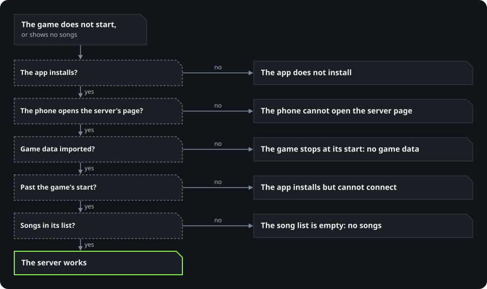

# Troubleshooting

With Docker Compose, start with `./opendmtq doctor`: it checks what the server needs and prints the fix for each
problem. A host install has no `doctor`: there `./opendmtq status` and `./opendmtq check` show what is running and
whether the game can reach the server.

**On Windows (the bundle),** the commands in this guide are `OpenDMTQ.exe <command>`, typed in a terminal in the
OpenDMTQ folder. To open one: in File Explorer, open the OpenDMTQ folder, type `cmd` in the address bar and press
Enter. Then type, for example, `OpenDMTQ.exe status`.

When the game does not start or shows no songs, this chart leads to the right section:

  

## The phone cannot open the server page

- Phone and server PC must be on the same network: the same Wi-Fi, or the PC wired to the same router. Guest Wi-Fi
  networks usually keep devices apart.
- **Windows marks a new Wi-Fi network as Public**, and then phones cannot connect. Set it to Private: Settings,
  Network & internet, the Wi-Fi network, Private.
- The Windows bundle: Windows Defender Firewall keeps phones out until Apache is allowed. If its question was answered
  No, allow it in Windows Security, Firewall and network protection, Allow an app through firewall, on private
  networks.
- Windows with WSL and Docker: `./opendmtq firewall`, then `./opendmtq doctor` then shows the rule.
- WSL in NAT mode (WSL then has a private address of its own, behind the PC) gives the server a `172.x` address that
  phones cannot reach. Set `networkingMode=mirrored` under `[wsl2]` in `%UserProfile%\.wslconfig`, run
  `wsl --shutdown`, then `./opendmtq setup`. With Docker Desktop, which publishes ports on Windows itself, you can
  instead pass the PC's LAN address, its address on your home network (`ipconfig` shows it):
  `./opendmtq setup --host 192.168.x.y`.
- `./opendmtq setup` warns when the firewall step fails (Windows PowerShell not reachable, the administrator prompt
  declined) and goes on; run `./opendmtq firewall` afterwards, or `cli/firewall.ps1 -Port <port>` (with `-Internet` when
  exposed) in an administrator PowerShell.
- Linux: Docker-published ports bypass ufw, so a ufw rule neither opens nor closes port 80. If the machine is
  reachable from outside your home network, set `BIND_ADDRESS` in `.env` to its LAN address. A host install's Apache
  is not Docker's: there the system's firewall applies as usual.
- The port already used by something else. With Docker Compose, `./opendmtq up` then fails to start the edge proxy,
  the small program that holds the server's public port. Stop the other program, or use another port, for example
  `./opendmtq host 192.168.1.10:8080` (the app is rebuilt for it). Not 8791, which the admin pages use on this PC
  (`ADMIN_PORT`). A host install and the Windows bundle pick a free port at their setup: 80, else 8080, else 8790,
  else 8792 to 8795. `./opendmtq host <address>:<port>` (`OpenDMTQ.exe host <address>:<port>`) changes it.
- `./opendmtq doctor` fails when the port in the address and `LISTEN_PORT` differ: phones would call one port while
  the server listens on the other. `./opendmtq host` sets both.

## The game stops at its start, or the song list is empty

- **No client data.** The game cannot start without the client's tables and the images of its screens, which it
  downloads from the server. The server reports itself unhealthy until they are imported (`./opendmtq doctor` says so,
  and so does `/opendmtq/health.php`). They are the client data, the `patch/phone_new` folder
  ([what you need](install.md#what-you-need)). On Windows and on a host install, import them on the admin pages:
  **Songs**, **Choose the folder**. With Docker Compose: `./opendmtq import <folder with your game files>`.
- **No songs.** With the client data and no songs, the game starts with an empty song list. Import them the same way
  with **Import the songs too** ticked, from the client data and the song data together, or the `DMQ` folder alone
  (with Docker Compose, `./opendmtq import --songs <folder>`), or add songs one by one on the admin pages
  ([songs.md](songs.md)). The app does not need to be rebuilt: an installed app gets the songs at its next start.

## The app installs but cannot connect

- **The PC's address changed**, after a router restart for example: the server keeps using the old one. Give it the
  new address with `./opendmtq host <new address>` (on Windows `OpenDMTQ.exe host <new address>`, then close and
  start `OpenDMTQ.exe` again), and install the new app on the phones over the old one. A DHCP reservation for the PC
  in the router's settings keeps its address from changing. `./opendmtq doctor` and `./opendmtq setup` notice a
  changed address, and `import` and `restore` say so without changing it.
- `./opendmtq check` (`OpenDMTQ.exe check`) walks the same path the app takes. If it passes and the phone still
  fails, the problem is between the phone and the server (see above).

## The app does not install

Android says "App not installed" for several reasons. Check them in this order.

- **The device cannot run 32-bit apps.** The game has only 32-bit ARM code, and newer phones cannot run it: Pixel 7
  and later, Galaxy S24 and later, Galaxy Tab S10 and later, Galaxy Z Fold6 and Flip6 and later, and other models with
  a Snapdragon 8 Gen 3, Exynos 2400, Dimensity 9300 or newer chip. The download completes and the install fails,
  unless the server added the arm32 runtime to the app.
  - The server adds it by itself when it builds the app: the setup says **The app runs on newer phones too**. With Docker
    Compose, `./opendmtq doctor` also names the runtime next to the APK.
  - When it could not, the setup says why, and with Docker Compose `./opendmtq doctor` too. `./opendmtq runtime`
    (`OpenDMTQ.exe runtime` on Windows) tries again and builds the app again. A server without internet takes it from a file:
    [Without internet](closed-network.md).
  - Without the runtime, phones that cannot run 32-bit apps cannot install the app, and live broadcasts need it too.
- **Out of storage, or a download that was cut off:** free some space and download again. Another app does not get in
  the way: each signing key gives an app a package of its own, so this server's earlier app, other servers' apps and
  the original game can stay installed next to it.
- **The link was opened inside a messenger** (KakaoTalk and similar): its browser may not hand the download to
  Android. Open the page in Chrome or Samsung Internet; in KakaoTalk the page shows a button for that.
- Play Protect may warn about an app it does not know; choose to install anyway.

To see which phone a player used, find their requests on the Logs page of the admin pages: browsers inside apps
(KakaoTalk, for example) send the model name, such as `SM-S948N`.

## A PC does not play

The PC client says why on its bottom line and on its **Help** page, with the player's log. [The PC client's
troubleshooting](windows-player.md#when-something-goes-wrong) covers a game that does not start, a refused sign-in,
Windows blocking the installer, black videos and broken sound. A PC reaches the server the same way a phone does, so
the sections above on reaching the server apply to it too.

## The game downloads data when it starts

On its first start after a fresh install (not an update) the game explains why it needs storage, Android asks, and it
then fetches its data from the server with a progress bar, about 44 MB with every song's preview, without asking again.
The data stays in `Android/data/<the app>/files`: later starts and updates over the app ask the server one question and
fetch nothing. It fetches again when songs were imported, added or removed on the server, and after the app was
uninstalled, which also takes the data with it.

## Setup cannot find the game files

`setup` looks in the current folder, `~/Downloads` and `~/Desktop` (under WSL, also every Windows user's Downloads and
Desktop), one folder down in each. It takes archives and apps whose names contain `dmtq`, `djmax` or `technika`,
unpacked folders of the client data and the song data, and any app next to those. Otherwise pass the folder, which is
then searched as a whole (an extracted copy of the client data and the song data included):
`./opendmtq setup --from /path/to/folder`.

The setup in the browser (the Windows bundle and a host install) looks in Downloads, on the Desktop and in Documents
(OneDrive's too), and one folder down in each. When it finds nothing, open the folder in the picker under the list:
the PC's drives and home folders are there, and **Import from this folder** takes everything of the game's in it. An
archive can be imported as it is, or unpacked first; one in parts needs every part in one folder.

Each file the setup lists says what it is, and `./opendmtq import --check <folder>` does the same on the command line.
The client data and the song data are found by what is in them: a folder with the game's `patch/phone_new` in it, under
any name, with or without a song list, or the songs' `DMQ` folder alone. The Android app may be the original or a copy
changed for another server; the iPhone app is not used, nor is an app OpenDMTQ built. [The game's files](game-files.md)
has every form the import takes.

## The setup's link does not sign in

The link the server opens works once, from the server PC, within an hour. Sign in with the user `admin` and the admin
password instead: the window shows it (on Linux and macOS, `setup` prints it), and it is `ADMIN_PASSWORD` in `.env`. The
status page then leads to the setup. From another computer, open `http://<server>/opendmtq/admin/setup` and sign in the
same way.

## Slow or failing under WSL

Clone the repository inside WSL (for example `~/openDMTQ`), not on the Windows drive (`/mnt/c`): SQLite is slow there,
and the owner of a file cannot be set. `setup` and `doctor` warn about it.

## The app build fails

`./opendmtq up` stops with the reason, and `./opendmtq doctor`, `./opendmtq status` and the Status page of the admin
pages show it until a build succeeds. `./opendmtq logs builder` has the whole output; on a host install and on Windows
it is in `data/state/logs/programs.log`. Players then read "The app could not be built. Tell the server's admin." when
there is no app for the address at all. When a rebuild fails (a new patcher, base APK, runtime bundle or signing key),
phones keep getting the earlier app. A base APK that does not match the expected client stops the build with the edit
that failed. If `data/apk/base` holds several different clients, see [several clients](game-files.md#several-clients).
To choose one, set `BASE_APK=<file name>` in `.env`, or with Docker Compose run `./opendmtq apk --base <file name>`,
which writes it there.

## The browser warns about the certificate, or HTTPS fails

With Docker Compose the server's port also answers HTTPS, for browsers (the game keeps to plain HTTP). Its certificate
comes from an authority the server makes for itself, so browsers warn on the first visit; a phone that installs
`http://<address>/ca.crt` does not ([internet.md](internet.md#https)). Every change of address makes a new authority,
so phones that installed the old one install the new one.

The edge proxy (`opendmtq-edge`, or `<name>-edge` with `COMPOSE_PROJECT_NAME` in `.env`) holds the port for both.
`./opendmtq doctor` checks it and its HTTPS; `./opendmtq logs edge` shows why it stopped or went to plain HTTP only.
With a certificate it cannot use (after a renewal that was cut off, say), the edge keeps the port open with plain HTTP,
so the game goes on working, and the next `./opendmtq up` makes a new certificate.

A host install and the Windows bundle have no HTTPS.

## A host install or the Windows bundle does not start

- `./opendmtq setup` names what is missing (Apache, PHP's module, Java, 7-Zip, the pinned tools): run
  `host/install.sh` again. On Windows, unpack the whole zip again. The commands other than `setup`, `start`, `stop`,
  `restart`, `status`, `run`, `import`, `apk`, `runtime`, `host`, `check` and `service` (`expose`, `firewall`, `deploy`,
  `doctor` and the rest) are for Docker Compose only.
- The logs are in `data/state/logs` (on Windows in the OpenDMTQ folder): `host.log` (the host program's own, in the
  background), `server.log` (Apache and PHP), `programs.log` (the database setup, the admin pages, the app builder).
- "the server already runs": a server of this folder is running; `./opendmtq stop` stops it. On Windows, it runs in
  another OpenDMTQ window: close that one.
- The system's own Apache service on port 80: `host/install.sh` turns it off when it installed Apache itself, and
  leaves one that was there before alone; the server then takes another port.
- "apache keeps stopping": usually another program holds the server's port, or an antivirus blocks Apache;
  `server.log` says which. Close that program, or move the server to another port: `./opendmtq host <address>:<port>`.
- "no answer from the server, still waiting": the first start can take a few minutes while an antivirus checks the new
  programs. Leave the window open: the setup opens in the browser once the server answers.

## Restoring

`./opendmtq restore <file>` (a name from `./opendmtq backups`, or the path of an archive copied to this machine)
checks the archive and that its database can be read and is a game database, saves the current state, stops the
server, puts the database and added songs back and starts it again. The signing key is restored only when this
install has none, or with `--with-key` (use that on a new machine so phones keep their app); the app is then rebuilt
with it, so phones install it over theirs. The `.env` in a backup is for reference and is not restored. On a host
install and on Windows, restore on the Backups page of the admin pages. It keeps this install's signing key; for a
backup from another PC, the page says how to put that PC's key in place.

If `./opendmtq doctor` says the signing key is missing, restore it from a backup with `--with-key`. Builds stop until
then: an app signed with a new key is a different app to a phone. It would install next to the old one instead of
updating it, and the old one would stop getting updates.
