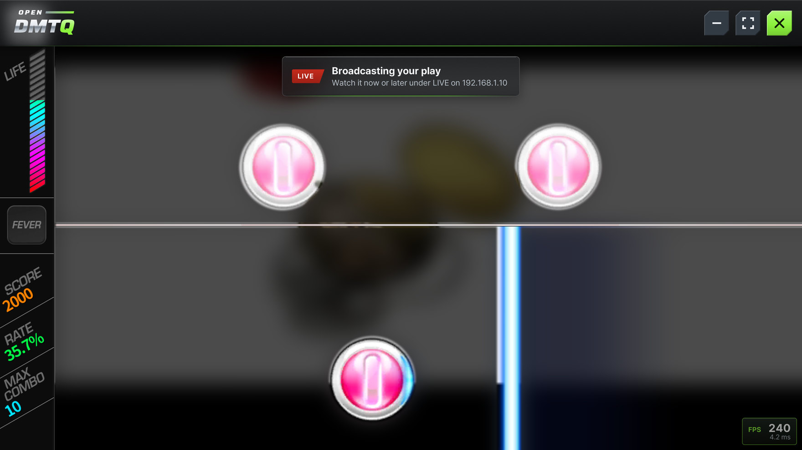
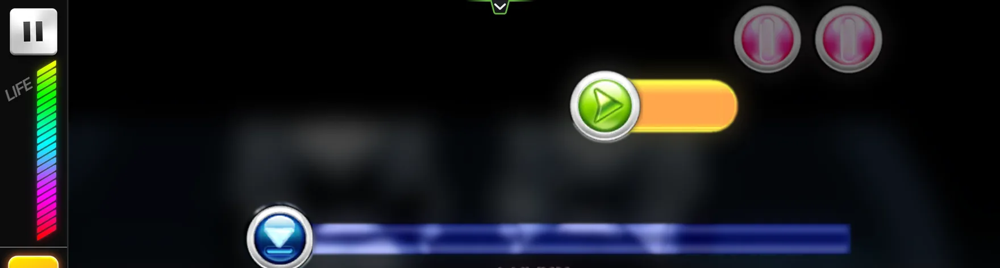
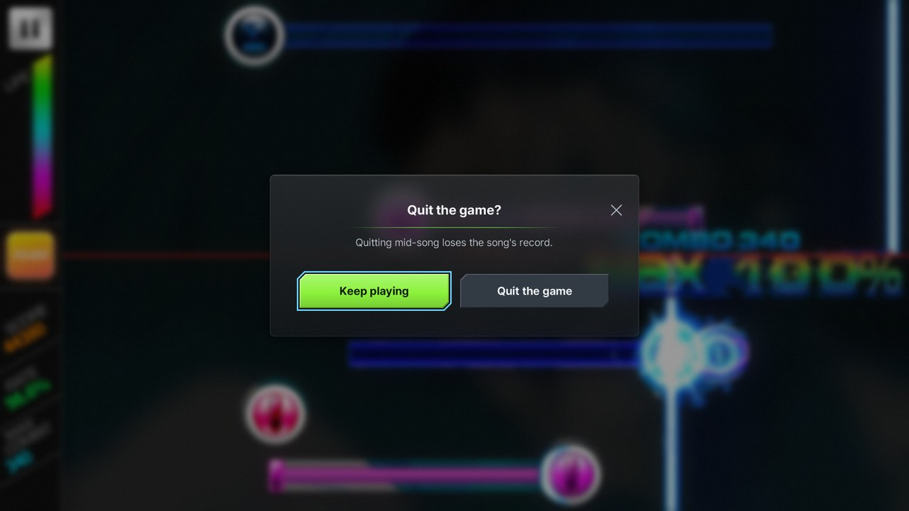
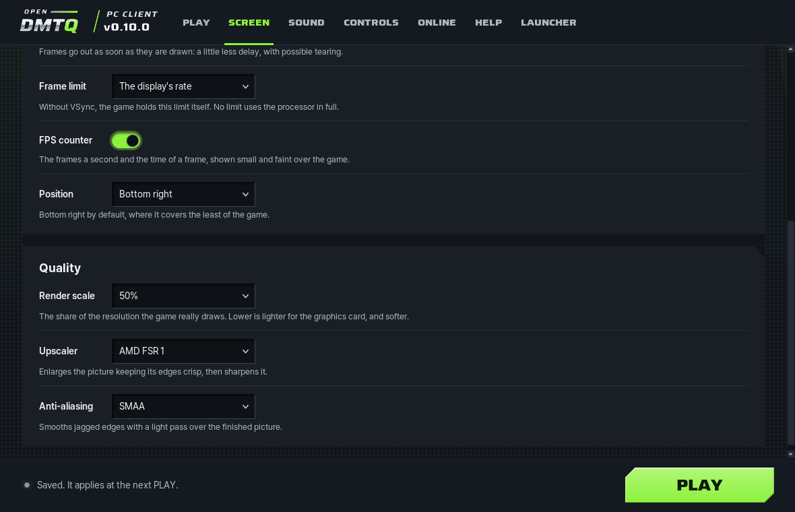

# The PC client

For players on a Windows PC, or on Linux under Wine ([below](#on-linux-with-wine)): the PC client is an installer and a
launcher that connects to the server, signs in, downloads the server's app (the same app its phones install) and keeps
it up to date, sets the picture and the sound up for the PC, and starts the game in the player for Windows. The game
then plays against the server as it does on a phone.

<p align="center">
  
</p>

## <a id="for-players"></a>Installing

1. On the server's site, sign in and open **Download**. Under **On a computer (Windows)**, choose **Download the
   installer (.exe)**. The file it gives, `OpenDMTQ-Setup-<address>.exe`, is set up for that server.
2. Run it and choose **Install**. It installs for your Windows user, with shortcuts on the desktop and in the Start
   menu and no administrator rights, and starts the launcher. If Windows says it protected your PC from an unknown
   app: **More info**, then **Run anyway**. The installer is not signed by a publisher Windows knows. Windows 11's
   Smart App Control, when it is on, blocks unsigned programs, this one among them, and has no **Run anyway**.
3. The launcher's first start walks through the server (already filled in), the sign-in with your site ID, the app's
   download, the picture and the sound, then **PLAY**.

The installer from the project's [releases](https://github.com/kanggu12/openDMTQ/releases/latest) (`OpenDMTQ-Setup.exe`)
is the same program without a server: its first start asks for the server's address. One launcher keeps several
servers, each with its own sign-in and app, and plays on the one chosen on the **Online** page.
`OpenDMTQ-Setup.exe --silent` installs or updates with no dialog and starts the launcher (`--no-start` leaves it
closed); while a game runs it installs nothing and ends with 3.

### On Linux, with Wine

The launcher and the player are Windows programs, and on Linux they run under Wine. The project's tests run them so for
every release, with Wine 11 from WineHQ's stable packages on Debian 12: the installer from the server's site, the first
start, the game to its menu with its bar, **Repair**, **Clear game data** and uninstalling, drawn by Mesa on the
processor and, under WSL, on a graphics card.

1. Install Wine from WineHQ's `winehq-stable` package, and GStreamer's decoders, which Wine plays the songs' videos and
   their sound with. On Debian or Ubuntu:

   ```sh
   sudo apt install gstreamer1.0-plugins-base gstreamer1.0-plugins-good gstreamer1.0-plugins-bad gstreamer1.0-libav
   ```

2. Download the installer from the server's site as above, and run it with Wine. The launcher opens as on Windows:

   ```sh
   wine ~/Downloads/OpenDMTQ-Setup-*.exe
   ```

Not tried yet: a Linux desktop's own graphics driver and sound, touch screens, and the Steam Deck.

## The launcher


| Page | What it has |
| :--- | :--- |
| **Play** | The server and the account, the checks before a start (the player, the server, the sign-in, the app), how to play, the last play, and **PLAY** |
| **Screen** | Full screen or a window, the window's size, VSync, the frame limit, the FPS counter and its position, the render scale and its upscaler, anti-aliasing |
| **Sound** | The volume, the device, **Shared** or **Exclusive**, the buffer |
| **Controls** | Keyboard play: on or off, and the keys of each lane of 2, 3 and 4 LINE; what the touch screen, the mouse and the keyboard do |
| **Online** | The servers, the sign-in, the app on this PC and a check for a newer one |
| **Help** | The checks, what to try when something does not work, the logs, and repairing, clearing, starting over and uninstalling |
| **Launcher** | The language, updates of the launcher, the first-start guide again |

**PLAY** asks the server for a newer app first and downloads it when there is one; when the server cannot be asked, the
game starts with the app this PC has. The checks ask the server too: one that does not answer is said on the **Play** and
**Help** pages and does not stop **PLAY**. The launcher updates itself from the project's releases: **Launcher**, **Check for
updates**. It also looks once at each start, in the background for 10 seconds at most: a newer version is said on the
**Launcher** page and in the line at the window's foot, each with **Update to** that version; nothing is installed by
itself, and without internet nothing is said. Without internet, the installer from the server's **Download** page
updates it instead, once the server has a newer one; the servers and the settings stay. While the game runs the launcher steps aside, and comes back when the
game ends.

**Controls** sets keyboard play. **Play with keys** turns it on or off (on at first). While it is on, a table shows the
lanes of 2, 3 and 4 LINE from the top, each with a box for its key and one for a second key: click a box (or Tab to it
and press Enter), then press the key. The key goes in by its place on the keyboard, and is named as the US layout's key
at that place (`Semicolon` for the key right of L), so another layout plays the same places; in grey beside the name,
what the PC's own layout prints there when it says more (`;`, or `Ö` on a German keyboard). A key that another lane of
the same LINE plays already, or one no lane takes (Enter, the arrows, the numpad, Shift), is refused in words under the
table, and the box waits for another. Esc keeps the key that was there, Delete takes away a key the lane has a second
of, and **Reset keys** puts back F J, D F J and D F J K. The game reads the keys at the next **PLAY**.

### The command line

`OpenDMTQ-cmd.exe`, in `%LOCALAPPDATA%\OpenDMTQ.Client\current`, does the same from the command line: `--status`
(exit 0 when PLAY can go; its last line is the launcher's version, and a newer one when there is), `--server URL`, `--sign-in ID` (the password from standard input), `--sign-out`, `--app`,
`--set NAME=VALUE`, `--audio-devices`, `--language en|ko|system`, `--guide`, `--skip-guide` (the guide's **Skip**: the
window opens on its pages), `--servers` (the servers it knows, as **Online** lists them), `--open-log player|launcher`, `--play`,
`--update`, `--forget URL`, `--reset`, `--repair`, `--clear-game-data` and `--uninstall [--delete-data]`, with `--yes`
to answer their questions (`--help` lists them all). While the launcher's window is open, the flags that change what
it keeps are refused. `--set` takes the settings of the **Screen**, **Sound** and **Controls** pages:

| Setting | Values (the default first) | On the page |
| :--- | :--- | :--- |
| `display` | `fullscreen`, `window` | Mode |
| `window` | `auto` (fitted to the display), `1280x720`, `1600x900`, `1920x1080`, `2560x1440`, `3840x2160`, or any `WIDTHxHEIGHT` from 480x270 at Windows' scale (720x405 at 150 %) that fits the main display with room for the window's title bar and the taskbar, as the page offers them | Window size |
| `vsync` | `on`, `off` | VSync |
| `fps` | `auto` (the display's rate), `30`, `60`, `120`, `144`, `165`, `180`, `240`, `360`, `unlimited` | Frame limit |
| `show_fps` | `off`, `on` (a corner's name, as `fps_position` takes it, is on in that corner) | FPS counter |
| `fps_position` | `bottom_right` (where it covers the least of the game), `top_left` (beside a song's pause button), `top_right`, `bottom_left`; kept while the counter is off | Position, while the counter is on |
| `render_scale` | `100`, `85`, `75`, `67`, `50` | Render scale |
| `upscaler` | `bilinear`, `fsr1`, `nis` | Upscaler, below 100 % |
| `anti_aliasing` | `off`, `cmaa2`, `smaa` | Anti-aliasing |
| `audio_device` | `default` (Windows' default output), or a device's id from `--audio-devices` | Device |
| `audio_mode` | `shared`, `exclusive` | Mode |
| `audio_buffer` | `normal`, `low`, `safe` | Buffer |
| `volume` | `100`, or any number from 0 to 100 | Volume |
| `keyboard` | `on`, `off` | [Keyboard play](#keyboard-play), on the **Controls** page |
| `keys_2line` | `"F J"`: two lanes from the top separated by spaces, each lane one key or two joined by `/` (`"F/D J/K"`), each key by the name of the key a US layout has at that place: `A` to `Z`, `0` to `9`, `Space`, `Semicolon`, `Quote`, `Comma`, `Period`, `Slash`, `LeftBracket`, `RightBracket`, `Backslash`, `Minus`, `Equals`, `Grave`; a key in two lanes is refused | 2 LINE's keys, on the **Controls** page |
| `keys_3line` | `"D F J"`, or three lanes in the same way | 3 LINE's keys |
| `keys_4line` | `"D F J K"`, or four lanes in the same way | 4 LINE's keys |
| `language` | `system` (Windows' display language), `en`, `ko`: the same as `--language` | Language, on the **Launcher** page; the game and what the player draws over it speak it too |

## In the game

| Input | What it does in the game |
| :--- | :--- |
| A touch screen | Fingers, as many at once as the screen takes, each with the time it saw it |
| The mouse's left button | One finger on the screen: tap, hold and drag |
| The mouse wheel | Scrolls what is under the pointer, as a finger's drag; with Shift, across |
| A pen | One finger |
| Esc | The phone's Back key: pauses a song, closes what is open |
| The lane keys, while a song is played | [Keyboard play](#keyboard-play): each lane of the song a key, F J in 2 LINE, D F J in 3 LINE and D F J K in 4 LINE from the top lane, each press where the game judges the lane's next note |
| The keyboard | Text where the game asks for it, the text it opens with taken as selected: the first key types over it, Backspace clears it, an arrow keeps it (Enter ends it, Esc cancels it); Hangul too |
| The touch keyboard | Comes up when a touch opens the game's text, and types into it |
| The pointer resting at the game's top edge, or on the handle at its top centre | The bar: minimise, full screen, and the X that quits after asking |
| Alt+F4 | Nothing: the bar's X quits |
| Alt alone, F10 | Nothing (no menu mode that would hold the next key) |

<p align="center">
  
</p>

- **The bar**: a PC has no phone's buttons around the game, so a bar of frosted glass comes down across the top of the
  game when the pointer rests a moment at the game's very top edge or on the handle, with its button up, or when a
  finger is drawn down from that edge on a touch screen, in either case only once the game has had no click, touch or
  held note for a second and a half: a click or a held note at the top of a song plays the song and never brings the
  bar, nor does a pointer on its way to the window's title bar. It also comes down by itself for 3 seconds when the
  game's picture first shows (not during its black start) and after each switch between a window and full screen, so
  that a player sees where it is. It slides down out of the game's top edge, its foot first, and back up into it, in
  about a fifth of a second each way and in step with the display's refreshes, never over the window's title bar; with
  Windows' animation effects switched off it comes and goes at once. It stays while the pointer is on it and goes up
  soon after the pointer leaves, so it never sits on the game's own controls at the top while they are used; a pointer
  that comes back while it goes up turns it back from where it is. On its left is the OpenDMTQ wordmark as the
  launcher's header draws it; on its right are three buttons in the launcher's own shape and depth (two corners cut,
  raised, sunk while held): **minimise** and **full screen** (or back to a window) as secondary buttons, quiet metal
  with a lighter plate under the pointer, and the **X** that quits as the main button, in the launcher's lime from the
  start so that it is seen at once. A button acts only when let go where it was pressed, as the bar stood when it was
  pressed: one pressed while the bar is still sliding down acts too. Minimise holds the game still, and the taskbar
  brings it back with the bar up (nothing of what was over the game comes back that is not wanted there then). The
  broadcast notice and an FPS counter in a top corner move down with the bar's foot and back up with it. It is tall
  enough to cover the game's own X at the top right of its song and music screens whole.
- **The handle**: the game's green line along its top edge at the centre, with a small tab of glass hanging from it in
  the lean of the game's own tabs and a chevron pointing down in the tab, says that the bar comes down from here; with
  the pointer on it the line and the chevron turn lime and the tab grows deeper. The pointer resting on it brings the
  bar down: on its line, on its tab, or beside the tab within the room the header leaves there (12 pixels either side
  of the centre in a 1280x720 game, down to the deeper tab's foot); the handle goes down with the bar's foot and fades,
  and comes back up with it. The handle and the place the pointer rests on are as large as the game's own header
  leaves room for at its top centre (the handle 26 by 19 pixels in a 1280x720 game; both in proportion to that header
  in a game of any other size or shape), so neither covers any of the game's words or buttons on any screen. It shows
  once the game's picture is up, and goes while the bar is down, while a notice or the question is up and while the
  game holds still.
- **Quitting**: the X asks first, in a glass card over the game dimmed and blurred behind it: **Keep playing** as the
  launcher's main button, or **Quit the game** as its secondary, red under the pointer; so a click by mistake does not
  end a song. Its buttons too act only when let go where they were pressed; Left, Right and Tab move the choice (marked
  with the launcher's cyan keyboard ring), Enter takes it and Esc keeps playing. The card keeps within three quarters
  of the game's width and nine tenths of its height. The taskbar's Close window asks the same; on a minimised game it
  first brings the window back and lets the game draw itself again, so that the question stands over the game. The game
  holds still while it asks, as a phone's game does when its owner leaves it and as it does minimised: a song stops
  where it was, with the game's own pause screen after.
- **The window**: the game has a title bar to move it by and a frame to size it by, dark as the launcher's header (on
  Windows 11 in its very colours; Windows 10 dark where it can), and no buttons of its own: it is minimised, put in
  full screen and quit from the bar. A double click on the title bar does nothing.
- **The pointer** over the game is a dart in the logo's look: a chrome left face and a lime right face with a dark rim.
  While the button is down it is all lime and a little smaller. It is sized for Windows' scale, as Windows' own is.
- **A touch screen** is the player's first input, as a phone's screen is the game's. Windows' own touch feedback stays
  off the game (no circles under the fingers, no square for a press and hold, no right click for it), and in full screen
  a finger that comes in from the screen's edge stays the game's instead of opening Windows' panels. Each touch reaches
  the game as Windows takes it in.

The pieces over the game, how large they are drawn and how their glass is made: [the overlay](#the-overlay).

<p align="center">
  
</p>

### <a id="keyboard-play"></a>Keyboard play

While a song is played, each of its lanes is a key: **F J** in 2 LINE, **D F J** in 3 LINE and **D F J K** in 4 LINE, from
the top lane down. A key plays its lane wherever the note is along it: the player puts the press at the place the game
judges the lane's next note, and the game judges it as it judges a finger, with its own timing, combo and score.

- **Taps and chain points:** a press each, as the note meets the judgment line.
- **Holds:** the key held down to the hold's end; let go early, the hold breaks, as when a finger lifts.
- **Drags:** the key held down; the press follows the drag's curve.
- **Repeat notes:** a press for each of their points.
- **The keys are places on the keyboard,** named after a US keyboard's keys: on another layout the same places play
  (AZERTY's, a Korean or a Japanese keyboard's). Each mode's keys are set on the launcher's **Controls** page, or with
  `--set` (`keys_3line`, above); a lane can have two keys, to alternate on quick notes (`S/D F J/K`).
- **Only while a song is played:** in the menus every key is the game's as before, and while the game asks for text (a
  new player's name) the keys type. Every lane key lets go when the window loses the keyboard or is minimised, when the
  song pauses (the game's pause button at its top left) and when the question before quitting comes; a key held
  through that plays again once it is let go and pressed again. Esc stays the Back key, and no other key does anything
  new.
- **The bar** waits while a lane key is down, as it does for a finger on the game.
- **A mark on the site:** a play that a lane key pressed is saved with a mark, which the server keeps with the play; its
  site shows a keyboard beside that play, so that keyboard plays and touch plays are told apart.
- **Off:** `keyboard=off` (the **Controls** page's switch) leaves every key the game's.

A player that does not find the game's input where it expects it (another version of the game) leaves keyboard play
off, says why in its log, and the game plays by touch as before.

## The picture



- **Full screen or a window.** Full screen is a borderless window over the whole display, at the display's own pixels
  whatever its scaling. A window opens at three quarters of the display's height at 16:9, or at the size chosen. The
  game fills the window while its shape is between 4:3 and 21:9; a window of another shape, such as a display turned
  upright, has black around the game. Moved to a display with other scaling, the game draws at the new size.
- **VSync on** (the default): each frame goes out on a refresh of the display the window is on, 60 Hz, 144 Hz, 240 Hz or
  another. A PC that is really behind, more than a quarter of its frames a refresh late through three checks of 2
  seconds in a row, takes every second refresh (120 frames a second on a 240 Hz display), then every third. It tries the
  faster rate again 5 seconds later, goes straight back when the try falls short, and waits twice as long before the
  next try, a minute at most. Some late frames, as the page before a song shows while the song loads (up to a tenth of
  them), and a pause of a tenth of a second or more, keep the display's rate.
- **The frame limit:** the display's rate (the default), a number, or none. With VSync on, a limit that is a whole
  fraction of the display's rate, or within 10 % above one, keeps every frame the same length (60 or 120 on a 240 Hz
  display); another limit is held by the clock, with each frame still on a refresh (144 on a 240 Hz display).
- **VSync off:** frames go out as soon as they are drawn, evenly at the limit, which may be above the display's rate, or
  as fast as the PC draws without one. A little less delay, and the picture may tear.
- **The FPS counter**, off by default, is a small glass box like the game's Q and MAX box, faint so that the game shows
  through it: FPS in the game's lime, the frames a second in white and the mean frame time under them, over the last
  second, twice a second. It sits at the bottom right, 8 pixels in at 720 lines, where it covers the least of the
  game's labels and buttons: only the end of the result's SELECT MUSIC and of the download list's DOWNLOAD, and the
  loading screen's version (the bottom left would cover the music list's grid button whole; the top is the bar's). In
  a song it sits over the play field's corner. **Position** moves it to another corner, kept while the counter is off.
  A top left set by a launcher before 0.9.3, which wrote it whether chosen or not, reads as the default; another corner
  set then stays. It counts the frames the player shows: a steady 60 reads 60, and only a whole second without a frame
  reads 0. It shows from the game's first frame and hides while the game holds still. Drawn apart from the game's
  picture, it costs the game nothing, and the broadcast does not show it.
- **The render scale** draws the game at a share of the window's pixels (100 % down to 50 %), stretched to fill it:
  lighter for the graphics card, and softer. The share keeps the window's shape exactly where its size has fine enough
  steps (1920x1080 is 120 steps of 16x9): 67 % of 1920x1080 is 1280x720, so the game lays itself out as it does at full
  size, its parts where they belong.
- **The upscaler**, below 100 %: how the smaller picture reaches the window's size. **Bilinear** (the default) is the
  plain stretch of the window's surface. **AMD FSR 1** (FidelityFX Super Resolution 1) enlarges it with its
  edge-adaptive filter (EASU) and sharpens the result (RCAS, at AMD's sample's 0.25 stops). **NVIDIA NIS** (Image
  Scaling) enlarges in one pass with its edge-adaptive filter, with no sharpening added: the SDK's default of 50 % drew
  rims around the game's text and lines. Both are spatial: they need only the
  finished picture. At 100 % no upscaler is used, and the row is not shown.
- **Anti-aliasing** smooths the jagged edges of the game's shapes. **CMAA 2** (Intel's Conservative Morphological
  Anti-Aliasing 2) smooths them over the finished picture and keeps text and thin lines sharp; it runs on compute shaders
  (OpenGL ES 3.1), and where the graphics card has none the player uses SMAA instead and says so in its log. **SMAA**
  (SMAA 1x, High preset) smooths them with three light passes over the finished picture. With an upscaler,
  anti-aliasing comes first, at the size the game draws at. MSAA, which 0.9 offered, is gone: it left the game's picture
  as it was, and a setting of `msaa2`, `msaa4` or `msaa8` reads as CMAA 2. Temporal methods (DLSS, FSR 2 and 3, TAA, DLAA) need what a closed game does not hand
  over (its motion vectors and depth), and frame generation adds delay: none of them is offered.

Measured on a 240 Hz display (4K, RTX 4090): 240 frames a second with VSync, none late in 480, in full screen at 100 %
and at 50 %; a limit of 120, 120.0 frames a second, none late; VSync off, 240.6 frames a second, 95 % of the frames
within 4.5 ms of their time; no limit, 733 to 965. How the passes draw: [the picture's passes](#the-pictures-passes).

## The sound

- **The device:** Windows' default output, which the game follows when Windows changes it mid-game, or one chosen.
- **Shared or Exclusive.** Shared plays alongside other programs' sound. Exclusive (WASAPI's exclusive mode) takes the
  device for the game alone and has the least delay, with buffers of the device's own period (3 ms on a device that
  has it); other programs are silent meanwhile, and the sound is shared when Windows does not allow it.
- **The buffer:** low (Windows' low-latency mode, where the device has a shorter period than its standard one), normal,
  or safe for a busy PC.
- **The volume** of the game, 0 to 100. Windows' own volume still applies.

## Broadcasting

While broadcasts are on for the server and its owner shows a player live, the player broadcasts from the PC as a phone
does, with Windows' own video and sound encoders, at the quality the owner chose ([live broadcasts](live.md#from-a-pc)). A glass card slides down at the top of the game
when a broadcast starts and ends, with a red LIVE tag like the game's own tags while it is on (once it is over, its
title says so alone), and says where it can be watched.

## What it needs, and what it keeps

- **What it needs:** 64-bit Windows 10 or 11 on an x64 PC (Intel or AMD), a graphics card with Direct3D 11 and about
  1 GB of free memory for the game, which takes 190 to 450 MB on the graphics card. About 390 MB of disk to start: the
  program about 125 MB with the package **Repair** takes its files from, each server's app about 110 MB, the app's
  libraries about 40 MB, and the game's data 111 MB after a first start and one song, more with each song it
  downloads. The installer itself is about 60 MB.
- **What a frame takes,** measured on a Ryzen 9 9950X with an RTX 4090 that stayed at its idle clock (225 to 590 MHz),
  at 240 frames a second from 1920x1080 to 3840x2160: 0.2 to 1.0 ms of the graphics card (the most at 3840x2160 with
  CMAA 2) and 1.5 to 3.4 ms of the game's main thread.
- **The videos** need Windows' Media Foundation. The N and KN editions of Windows come without it: there, install the
  Media Feature Pack, under Settings, Optional features (in Apps or in System, by the version of Windows). Without it
  the videos are black and silent, and the game goes on.
- **The language:** the launcher speaks Windows' display language, Korean or English, until one is chosen on the
  first-start guide's first step or the **Launcher** page, and the installer speaks the launcher's. The game and what
  the player draws over it (the bar, the question before quitting, the broadcast notice, its messages) speak the
  launcher's language once one is chosen, among the languages the game has, and Windows' display language until then;
  the country stays Windows'. The launcher hands it over in the settings file it writes before each start (`language=`).
- **What it keeps on the PC,** per Windows user:
  - the program, in `%LOCALAPPDATA%\OpenDMTQ.Client`;
  - the launcher's settings and logs, and each server's app, in `%LOCALAPPDATA%\OpenDMTQ\client`;
  - what the game keeps, in a folder named after the app's package in `%LOCALAPPDATA%\OpenDMTQ`: the app's libraries
    (`lib`), the game's settings and the songs it downloaded (`data`), and the player's log, `player.log`, which starts
    over past 8 MB and keeps the part before as `player.log.1`.

  Scores are kept on the server. The launcher keeps the server's sign-in cookie, never the password.
- **Repairing, clearing and removing,** on the launcher's **Help** page, each with the same flag of `OpenDMTQ-cmd.exe`:
  - **Repair** compares the program's files with the package it was installed from and puts back what is missing or
    changed (`--repair`). Running `OpenDMTQ-Setup.exe` again repairs too.
  - **Clear game data** deletes what the game keeps, all but the device id: the game downloads its data again at the
    next start, and the PC stays the same player (`--clear-game-data`).
  - **Start over** forgets the servers, the sign-ins, the apps and the settings, and opens the first-start guide; the
    game's data and the language stay (`--reset`). **Forget** on the **Online** page does that for one server (`--forget URL`).
  - **Uninstall** removes the program, its shortcuts and its entry in Windows' Apps (`--uninstall`). It asks whether
    the settings, sign-ins and game data stay for a later install or go too (`--uninstall --delete-data`). With them
    go the device id and the logs of the installs (the installer's in `%TEMP%`, Velopack's in `%LOCALAPPDATA%\velopack`),
    and a later install is a new player, unless the account transfer below brings this one back.
    Windows' Settings, Apps uninstalls too and keeps the data; it ends with the launcher's card, which says what went
    and what stayed.
- **The account:** a PC is a player of its own, apart from the same person's phone. The server gives each new device a
  new account, and the device id the PC goes by is kept in the game's folder: deleting that folder makes this PC a new
  player. The game's own account transfer carries a player to another device: on the device that has the player,
  **OPTION**, **CONNECT ACCOUNT** shows a code; on the other, **OPTION**, **RESTORE DATA** takes it, and that device
  then plays as the same player, with its records.

## When something goes wrong

- **The game does not start:** the launcher says why on its bottom line, with a link to the player's log (**Open the
  game log**); **Help** opens it too. The log is `player.log` in the game's folder in `%LOCALAPPDATA%\OpenDMTQ`; the launcher's own is in
  `%LOCALAPPDATA%\OpenDMTQ\client\logs`.
- **The launcher says the server runs an older OpenDMTQ:** the PC client needs a server of 0.8 or newer.
- **The player is missing or a file of the program is damaged:** **Help**, **Repair** puts the program's files back
  from the package it was installed from.
- **The installer says a game is going on:** finish it and close the game; installing replaces the player it plays in.
- **The sign-in is refused:** the ID and password are the site's. Too many wrong passwords make the server wait a while
  before the next try.
- **Windows blocks it with no Run anyway:** Smart App Control is on (step 2 above).
- **The videos are black and silent:** see the Media Feature Pack above.
- **It cannot reach the server:** the PC has to reach the server's address, as a phone does: on the same network, or
  over the internet when the server is set up for it
  ([the server's site does not open](troubleshooting.md#the-servers-site-does-not-open)).
- **The sound breaks up:** choose the **Safe** buffer on the **Sound** page, or **Shared** instead of **Exclusive**.

The rest is the server's: [what to tell its owner](play.md#when-something-does-not-work).

## How it works

The player runs the game's own 32-bit Android code, as the app does on phones that cannot run 32-bit apps: the
[arm32 runtime](../arm32/README.md) translates the game's ARM code (Dynarmic), and a small layer gives it Linux's system
calls on Windows. In place of Android's Java side, the player has its own stand-in for the classes the game calls. The
game draws with OpenGL ES, which ANGLE runs on Direct3D 11; on a computer with two GPUs (most gaming laptops) the
player asks NVIDIA's and AMD's drivers for the fast one, and its log names the GPU that draws the game at its first
frame. Its sound goes out through WASAPI, and its videos are
decoded by Media Foundation. Its requests to the server go out as a phone's do, asking for the server's answers
compressed, which makes its lists of songs and scores many times smaller on the way.

The launcher is Python with Tk, made into a Windows program with PyInstaller; Velopack installs it and updates it. The
launcher writes the player's settings into a file and starts the player with it (`--app` names the folder of the
server's app, `--settings` the file).

### The overlay

- **Its size**: every piece is drawn at the game's own scale, as the game's words and buttons are (its area's height
  over 720 lines: 1.5 at 1080 lines, 3 at 4K), whatever Windows' scale is, so a small window gets small pieces and a
  display at 150 % has them cover no more of the game than at 100 %. They are never drawn below half their 720-line
  size at Windows' scale, so the bar's buttons stay large enough to hit; the smallest game area, 480x270 at Windows'
  scale, leaves them room. The handle alone, which is never pressed, keeps the game's own scale in a window of any
  size and shape. The pointer keeps Windows' own size.
- **Nothing of it is in the game's way**: the notice, the FPS counter and the handle let every click through to the
  game, and no piece takes the keyboard from the game's window (each is a window that never takes the focus; a click on
  the bar or the question gives the keyboard back to the game).
- **The glass**: the bar, the question, the broadcast notice and the FPS counter are frosted glass over the game, as
  Windows' own acrylic is made: the game's picture behind each, blurred and a little more saturated, under a charcoal
  tint, with a faint light at its top, a light edge and a soft shadow; in the game's own shapes, with its small corners,
  its bevel (a line of light along the top, of shade along the foot) and its green line along the bar's and the
  notice's foot. Their words keep 4.5:1 against the light behind them: where the game is light under the words, the
  tint deepens there. With none of them up, the glass costs the game nothing. The words are set in Pretendard, titles
  and buttons bold, which the player carries in its `fonts` folder with the launcher's wide face. The wordmark is a
  picture for each of the overlay's scales from 1 to 4, drawn by the launcher's own code
  (`arm32/desktop/assets/make_wordmark.py`) and carried in the player's `images` folder: at those scales it is drawn
  pixel for pixel, between them the next larger is drawn down, and below 1 the first one is.

The bar, its handle, the question before quitting, the notice, the FPS counter and the pointer are drawn by the player
over the game's window, each a window of its own whose picture a thread of the overlay's makes on the CPU; the UI
thread, which stamps the game's keys and clicks, only hands the finished pictures to Windows. For their glass, the
render thread reads the rectangles of the frame behind them as it goes to the window (after the passes), at half and
then a quarter of their size (each pixel the mean of 4 by 4 of the frame's), into a pixel buffer that a later frame
copies out once the graphics card is done, so nothing waits for it. It reads at most 20 times a second while a piece is
up, and once while the game holds still; a piece waits a moment for its first read, and where none comes it is its plain
tint, nearly solid. With the stats on, a `stats: glass` line every 5 seconds says what that took the render thread a
frame, and a `stats: overlay` line what the pictures took their thread and the UI thread.

### The picture's passes

With an upscaler or anti-aliasing, the game draws into a framebuffer of the player's own, of the size it
draws at, which stands in for the window's own framebuffer in every call the game makes that names or reads it (binding,
reading, invalidating and the questions about it), and the window's surface keeps the window's size. At each swap the
player's passes draw that frame to the window, the game's GL state saved before and put back after. The broadcast takes
the picture after them: what players see. The log says once what is in use (`the game draws at 640x360, upscaled by AMD
FSR 1 to 1280x720`, `anti-aliasing: SMAA`), and what the passes took on the render thread over the first 600 frames.
With the player's stats on (`ARM32_STATS=1`), every 5 seconds a `stats: picture` line gives each pass's mean time a frame
on the render thread and on the graphics card (by `EXT_disjoint_timer_query`, which ANGLE has; with its timestamps the
game's own time on the graphics card too), the swap's whole cost, and how often the game made its context current. `PLAYER_OFFSCREEN=1` has the frames drawn offscreen with no pass at all (a plain copy), to
measure the redirection by itself.

### Keyboard play's presses

The game takes a touch screen's fingers once a frame, in its own input update, and judges the presses against its notes
in the same frame. [Keyboard play](#keyboard-play) takes that update's place in the game's table of methods: the game's
own update runs first, as always, then each lane key that is down gives the game one press, at the place the game will
judge the lane's next note (a repeat point at its group's first note, a drag along its curve), or where the judgment
line crosses the lane when no note is near. Three more of the game's methods say when a play starts and when its song
pauses or stops. The player first finds these methods and the fields it reads by their names and checks each against
the place it was written for; when one differs, keyboard play stays off and the log says which. With the stats on, a
`stats: keyboard play` line every 5 seconds gives what the presses took a frame beside the game's own input update: on
Windows 2 to 6 microseconds a frame on average and 10 to 19 at the 99th percentile, the game's own update 2 to 3; under
Wine 3 to 8 and 22 to 36. `PLAYER_TRACE_KEYS=1` logs each press and the note it aims at, and at a song's end how the
game judged its notes by type.

## For server owners

Nothing to do, unless the server has no internet: the site's **Download** page offers the installer to signed-in
players, set up for the server as it is handed out, and the launcher signs in with the site's accounts. Where the
server gets the installer, and what it needs without internet:
[the PC client's installer](admin.md#the-pc-clients-installer).
