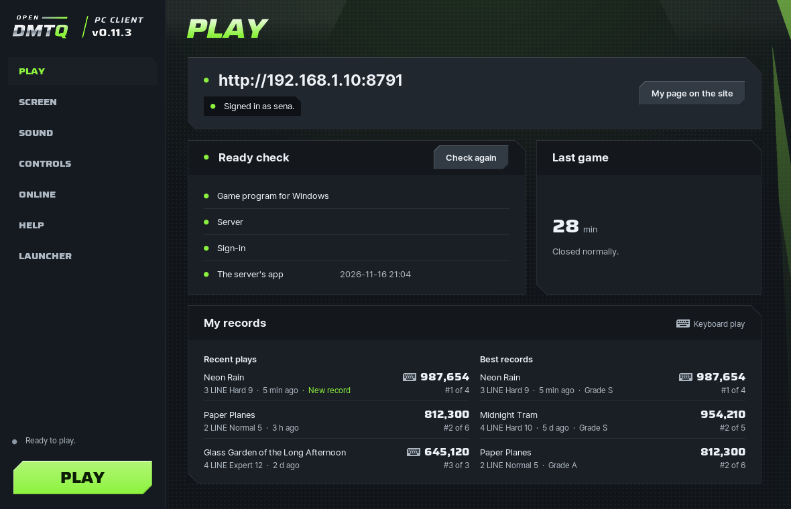
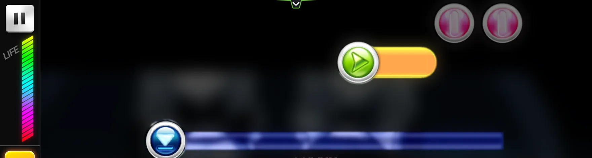
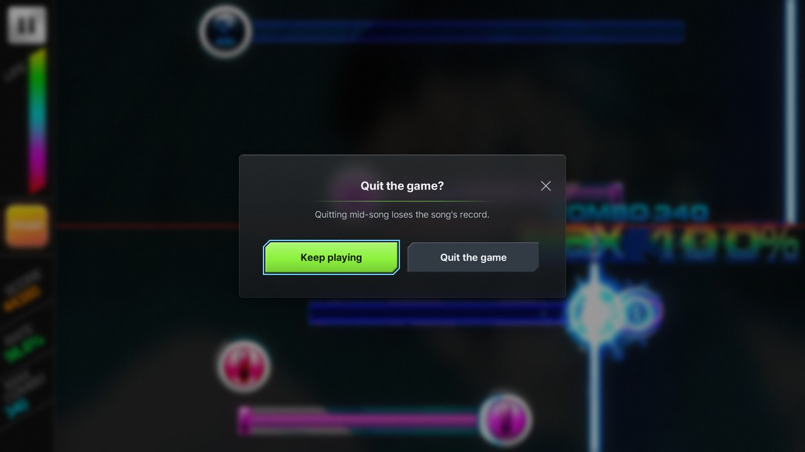

# The PC client

For players on a Windows PC, or on Linux under Wine ([below](#on-linux-with-wine)): the PC client is an installer and a
launcher that connects to the server, signs in, downloads the server's app (the same app its phones install) and keeps
it up to date, sets the picture and the sound up for the PC, and starts the game in the player for Windows. The game
then plays against the server as it does on a phone.

<p align="center">
  
</p>

## <a id="for-players"></a>Installing

1. On the server's site, sign in and open **Download**. Under **On a computer (Windows)**, choose **Download the
   installer (.exe)**. The file it gives, `opendmtq-pc-client-<version>-windows-x64-setup-<address>.exe`, is set up for
   that server.
2. Run it: its page says what goes where (the program in your user folder, shortcuts on the desktop and in the Start
   menu, no administrator rights, the server it plays on). Its window has no Windows title bar: its top moves it, and
   its own buttons at the top right minimise it and close it. Choose **Install**: the bar follows the files as they land,
   and the last page says what was done, with **Open OpenDMTQ**. If Windows says it protected your PC from an unknown
   app: **More info**, then **Run anyway**. The installer is not signed by a publisher Windows knows. Windows 11's
   Smart App Control, when it is on, blocks unsigned programs, this one among them, and has no **Run anyway**.
3. The launcher's first start walks through the server (already filled in), the sign-in with your site ID, the app's
   download, the picture and the sound, then the ready check, and **PLAY**. Each step asks its
   question at the top; while **Next** waits, a line under the step says for what.

The installer from the project's [releases](https://github.com/kanggu12/openDMTQ/releases/latest)
(`opendmtq-pc-client-<version>-windows-x64-setup.exe`) is the same program without a server: its first start asks for
the server's address. One launcher keeps several servers, each with its own sign-in and app, and plays on the one
chosen on the **Online** page.

Run again on a PC that has OpenDMTQ, either installer offers what to do with it: **Open OpenDMTQ**, **Repair** (every
file of the program put back as it came), **Update** when the installer is newer (or going back to its older version),
and **Uninstall**. While the game is open, repairing, updating and uninstalling wait for it to close and then go on.
With `--silent` it installs or updates with no window and starts the launcher (`--no-start` leaves it closed); while a
game runs it installs nothing and ends with 3.

### On Linux, with Wine

The launcher and the player are Windows programs, and on Linux they run under Wine. The project's tests run them so for
every release, with Wine 11 from WineHQ's stable packages on Debian 12: the installer from the server's site, the first
start, the game to its menu with its bar, **Repair**, **Clear game data** and uninstalling, drawn by Mesa on the
processor and, under WSL, on a graphics card.

1. Install Wine from WineHQ's `winehq-stable` package, and GStreamer's decoders, which Wine plays the songs' videos and
   their sound with. On Debian or Ubuntu:

   ```sh
   sudo apt install gstreamer1.0-plugins-base gstreamer1.0-plugins-good gstreamer1.0-plugins-bad gstreamer1.0-libav
   ```

2. Download the installer from the server's site as above, and run it with Wine. The launcher opens as on Windows:

   ```sh
   wine ~/Downloads/opendmtq-pc-client-*-windows-x64-setup-*.exe
   ```

Not tried yet: a Linux desktop's own graphics driver and sound, touch screens, and the Steam Deck.

## The launcher



| Page | What it has |
| :--- | :--- |
| **Play** | The server and the account with **My page on the site**, the checks before a start (the player, the server, the sign-in, the app), one that is not fine with a link to the page that sees to it (a server that does not answer, to its connection test), the last play, **My records** under them, and **PLAY** |
| **Screen** | Full screen or a window, the window's size, VSync, the frame limit, the FPS counter and its position, the render scale and its upscaler, anti-aliasing ([the picture](#the-picture)) |
| **Sound** | The master, music and effects volumes, the equaliser (a preset or three bands), the device, **Shared** or **Exclusive**, the buffer, and how the last game's sound went ([the sound](#the-sound)) |
| **Controls** | Keyboard play: on or off, and the keys of each lane of 2, 3 and 4 LINE ([keyboard play](#keyboard-play)); what the touch screen, the mouse and the keyboard do is under [in the game](#in-the-game) |
| **Online** | The servers, the [connection test](#testing-the-connection), the sign-in, the app on this PC and a check for a newer one |
| **Help** | The checks, the game's log and the launcher's, [a report](#a-report-for-whoever-helps) to send, and repairing, clearing the game's data, starting over and uninstalling |
| **Launcher** | The language, the launcher's [updates](#updates), the first-start guide again |

The pages are in a column down the window's left, under the wordmark and the launcher's version; the status line and
**PLAY** are at the column's foot, and the first-start guide shows its six steps down the same column with **Back** and
**Next** under them. A setting changed on a page changes its own row and the rows that follow from it, in place, and an
answer (a server connected, a sign-in, a download that ended) changes its own card: the page is never drawn again
whole. A drop-down opens the launcher's own list under its box (over it near the screen's foot), its chosen row marked,
a long list scrolling by the wheel, the keys or a finger. Pages move by the wheel, Page Up and Page Down, or a finger
dragged on them. The sign-in names the ID and the password over their fields, shows the password on **Show** (by the
keyboard too), says what is wrong under the field it is about, keeps the ID for the next time, and signs in on Enter.

### PLAY and your records

**PLAY** asks the server for a newer app first and downloads it when there is one; when the server cannot be asked, the
game starts with the app this PC has. The checks ask the server too: one that does not answer is said on the **Play**
and **Help** pages and does not stop **PLAY**. Every minute while it is on screen, the launcher asks the server again:
one that stops answering, a sign-in the server no longer takes, and a newer app are said as they come, each time they
do. While the game runs the launcher steps aside, and comes back when
the game ends.

Signed in, **My page on the site** on the **Play** page's server card opens your MY PAGE on the server's site in the
PC's browser, signed in already: the server makes a link for the launcher's sign-in that signs the browser in to the
same account once, within a minute. **My records**, under the page's columns, lists your three latest plays and three
best records from the server, each with the song, the chart, when, the score (with the keyboard's mark before it when a
keyboard played it) and the place on that chart (#2 of 5); it is asked for when the page shows and again after a game.
An account the server's owner has not linked to a game player says so instead, and signed out the card is not there.


### <a id="testing-the-connection"></a>Testing the connection

**Test connection**, at the top of the **Online** page's server card (and the **Play** page's Server row while the
server does not answer), follows the way from this PC to the server a step at a time, in a card that fills in as each
step ends, with what it found and how long it took, under a line that says how it went; **Copy** puts the whole result
on the clipboard:

| Step | What it looks at |
| :--- | :--- |
| Address | The address as the launcher reads it: its scheme, host and port |
| Name lookup | The host's name, and the addresses it leads to |
| Port | A connection to the port: taken, refused, no answer within 5 seconds, or no way from this PC to it |
| OpenDMTQ server | Its answer as an OpenDMTQ server: its name and version, and over HTTPS whether Windows or the server's own authority vouches for its certificate |
| Version | The server's version against the launcher's |
| Sign-in | Whether the server still takes the launcher's sign-in (asked with it, no password) |
| Game server | The game server's own answers: its patch, and the owner's maintenance notice as the game asks for it at its start; or what keeps it from serving the game (no client data, no database or one it cannot write, no address of its own) |
| Broadcasts | The broadcast state the player asks for between songs |
| Downloads | The app and the client data's list of files, by their headers alone: nothing is downloaded |
| Round trip | Five small asks: the time in the middle, the fastest and the slowest |


A step after one that did not get through says it was not tried. When nothing answers on the address's port, or
another program answers there (a web server that took the port, or one with a certificate this PC does not trust), the
test also asks the same host on 8791 and the ports a new server takes when that one is taken (to 8799), over HTTPS
with the server's own authority the launcher trusts for the old address: an OpenDMTQ server found there is named, with
**Use this address**, which plays on it from then on with the sign-in and that authority kept. A server updated to
0.11.0 moved from port 80 to 8791, and a launcher set up for port 80 finds it so. The test changes nothing else, and
its last result goes into the report. `OpenDMTQ-cmd.exe --test-server` runs the same test on the command line.

### <a id="a-report-for-whoever-helps"></a>A report for whoever helps

**Help**, **Save a report** puts one zip in the Downloads folder (`opendmtq-report-<date>-<time>.zip`) and shows it
selected in File Explorer: the launcher's logs, the end of the game's log, the settings, the displays, the sound
devices, Windows and the graphics cards, the launcher's and the player's versions, and the last connection test. Left
out of every file, each replaced by a word in angle brackets: the Windows user's name in paths, every site ID, every
server's address and name (also of servers the settings no longer know: one forgotten since, an address typed, the last
test of any address), the sign-in cookies, tokens and keys, this PC's player id and what was typed in the game. The
window says which of those it found; `about.txt` in the zip lists them with how often.

### Updates

The launcher updates itself and the player: **Launcher**, **Check for updates**. It also looks at each start, in the
background for 10 seconds at most, and again every six hours while it is open: a newer version is said on the
**Launcher** page and in the status line, each with **Update to** that version. Nothing is installed by itself, and
without an answer nothing is said. The installer from the server's **Download** page updates it too, once the server has
a newer one; the servers and the settings stay.

The launcher takes its updates from the server it plays on first. The server keeps the PC client's update of the version
it hands out, the same files as the project's release, at `/updates/` on its one port, and the launcher goes no further
than that version: a launcher stays matched to its server, on a network with no way out too. A server that keeps none
(one older than 0.11.0) lets the launcher take the project's releases on GitHub, up to the server's own version, and
with no server it takes GitHub's latest release. A server that does not answer sends it nowhere else. **Check for
updates** says where an update comes from.

An update goes in only when the release's checksums carry the OpenDMTQ project's signature, by the key built into the
launcher (`8ead95551a5d5d216dca12de20138465d4cfbcec48ec2b2611c9e49fc47b77d7`,
[a release's files](install.md#a-releases-files)):

- `releases.win.json`, the update feed, names the version and its packages. It must be the file the signed checksums
  sum, or the launcher says the update is not signed by the OpenDMTQ project and installs nothing.
- `opendmtq.client-<version>-delta.nupkg`, what changed since the release before, is what a launcher of that release
  downloads: checked against the signed checksums, then the launcher's own updater puts the new version together from
  it, and the launcher checks that what it made holds the files the release signed.
- `opendmtq.client-<version>-full.nupkg`, the whole update, is what every other launcher downloads, and one whose delta
  did not give the files signed (it says *The whole update is downloading* on the command line). It must be the file the
  signed checksums sum.
- `opendmtq-<version>-sha256sums.txt` and its signature `opendmtq-<version>-sha256sums.txt.sig` come right after the
  feed, before any package: without them no package of the release is downloaded.

Everything is downloaded into a folder of the launcher's own in Windows' temporary folder and checked there, before
anything goes into the program's folder: a package that is not the one the release signed is refused, said in words,
and the program stays as it was. The launcher's log says each step.

A launcher of 0.10.0 or older checks no signature: it takes the update its address gives, the project's releases on
GitHub, over HTTPS, checking only the hash the update feed gives. So it updates to 0.11.0 from GitHub as before, and
trusts GitHub's answer for what it puts in; from 0.11.0 on, every update a launcher takes is one the project signed,
whoever hands it out.

### The command line

`OpenDMTQ-cmd.exe`, in `%LOCALAPPDATA%\OpenDMTQ.Client\current`, does the same from the command line: `--status` (exit 0
when PLAY can go; under **Sound** the last game's sound as the Sound page says it; its last line is the launcher's
version, and a newer one when there is), `--test-server [ADDRESS]` (the connection test of the server PLAY plays on
or of ADDRESS, each step as it ends; exit 0 when every step passed, 1 when one failed), `--server URL`, `--sign-in ID`
(the password from standard input), `--sign-out`, `--app`, `--set NAME=VALUE`, `--audio-devices`,
`--language en|ko|system`, `--guide`, `--skip-guide` (the guide's **Skip**: the window opens on its pages), `--servers`
(the servers it knows, as **Online** lists them), `--open-log player|launcher`, `--report FILE` (Help's report, into
FILE, or into a folder under its own name), `--play`, `--update`, `--forget URL`, `--reset`, `--repair`,
`--clear-game-data` and `--uninstall [--delete-data]`, with `--yes` to answer their questions (`--help` lists them all,
in parts).

In a terminal it prints in the launcher's look: a title with the version, each part under its name, names and values in
columns, the ready check's marks and a download's bar in the launcher's colours; piped to a file or a script, the same
lines in plain words. Started with no flag by a double click, it opens the launcher's window and closes the console
Windows opened for it. While the launcher's window is open, the flags that change what it keeps are refused. `--set`
takes the settings of the **Screen**, **Sound** and **Controls** pages; every `--set` of a line is checked before any is
applied, so one the launcher does not take changes none of them:

| Setting | Values (the default first) | On the page |
| :--- | :--- | :--- |
| `display` | `fullscreen`, `window` | Mode |
| `window` | `auto` (fitted to the display), `1280x720`, `1600x900`, `1920x1080`, `2560x1440`, `3840x2160`, or any `WIDTHxHEIGHT` from 480x270 at Windows' scale (720x405 at 150 %) that fits the main display with room for the window's title bar and the taskbar, as the page offers them | Window size |
| `vsync` | `on`, `off` | VSync |
| `fps` | `auto` (the display's rate), `unlimited`, or any whole number from 30 to 1000; the page offers the rates up to the fastest connected display's (160, 165, 180 Hz and others) | Frame limit |
| `show_fps` | `off`, `on` (a corner's name, as `fps_position` takes it, is on in that corner) | FPS counter |
| `fps_position` | `bottom_right` (a song's play field's corner), `top_left` (beside a song's pause button), `top_right`, `bottom_left`: the corner in a song (in the menus at the right under the game's header); kept while the counter is off | Position, while the counter is on |
| `render_scale` | `100`, `85`, `75`, `67`, `50` | Render scale |
| `upscaler` | `fsr1`, `nis`, `bilinear` | Upscaler, below 100 % |
| `anti_aliasing` | `off`, `cmaa2`, `smaa` | Anti-aliasing |
| `audio_device` | `default` (Windows' default output), or a device's id from `--audio-devices` | Device |
| `audio_mode` | `shared`, `exclusive` | Mode |
| `audio_buffer` | `low`, `normal`, `safe` | Buffer |
| `volume` | `100`, or any number from 0 to 100 | Master |
| `music_volume` | `100`, or any number from 0 to 100, a share of the master | Music |
| `effects_volume` | `100`, or any number from 0 to 100, a share of the master | Effects |
| `eq` | `flat`, `bass`, `vocal`, `treble`, `custom`; a preset sets the three bands | Equaliser's preset |
| `eq_low`, `eq_mid`, `eq_high` | `0`, or any number from -12 to 12 (dB); one set alone makes the equaliser `custom` | Low, Mid, High |
| `keyboard` | `on`, `off` | [Keyboard play](#keyboard-play), on the **Controls** page |
| `keys_2line` | `"F J"`: two lanes from the top separated by spaces, each lane one key or two joined by `/` (`"F/D J/K"`), each key by the name of the key a US layout has at that place: `A` to `Z`, `0` to `9`, `Space`, `Semicolon`, `Quote`, `Comma`, `Period`, `Slash`, `LeftBracket`, `RightBracket`, `Backslash`, `Minus`, `Equals`, `Grave`; a key in two lanes is refused | 2 LINE's keys, on the **Controls** page |
| `keys_3line` | `"D F J"`, or three lanes in the same way | 3 LINE's keys |
| `keys_4line` | `"D F J K"`, or four lanes in the same way | 4 LINE's keys |
| `language` | `system` (Windows' display language), `en`, `ko`: the same as `--language` | Language, on the **Launcher** page; the game and what the player draws over it speak it too |

## In the game

| Input | What it does in the game |
| :--- | :--- |
| A touch screen | Fingers, as many at once as the screen takes, each with the time it saw it |
| The mouse's left button | One finger on the screen: tap, hold and drag |
| The mouse wheel | Scrolls what is under the pointer, as a finger's drag; with Shift, across |
| A pen | One finger |
| Esc | The phone's Back key: closes what is open; in a song it does nothing, and the game's pause button pauses |
| The lane keys, while a song is played | [Keyboard play](#keyboard-play): each lane of the song a key, F J in 2 LINE, D F J in 3 LINE and D F J K in 4 LINE from the top lane, each press where the game judges the lane's next note |
| The keyboard | Text where the game asks for it, the text it opens with taken as selected: the first key types over it, Backspace clears it, an arrow keeps it (Enter ends it, Esc cancels it); Hangul too |
| The touch keyboard | Comes up when a touch opens the game's text, and types into it |
| The pointer resting at the game's top edge, or on the handle at its top centre | The bar: Sound, minimise, full screen, and the X that quits after asking |
| A finger's or a pen's tap on the handle or long press on it or at the top edge; a press drawn down from there by a finger, a pen or the mouse | The bar, following the press as it is pulled and settling down or back up when let go |
| Alt+F4 | Nothing: the bar's X quits |
| Alt alone, F10 | Nothing (no menu mode that would hold the next key) |

<p align="center">
  
</p>

### The bar

A PC has no phone's buttons around the game, so a bar of frosted glass comes down across the top of the game:

- **How it comes:** when the pointer rests a moment at the game's very top edge, or on the handle with its button up;
  when a finger or a pen taps the handle, or holds still on it or at the top edge for half a second; or when a press of
  a finger, a pen or the mouse is drawn down from there. A press drawn down pulls the bar out with its foot at the press
  and, let go, the bar settles down when it is out at least half way or was flicked down, and goes back up otherwise.
  The press that brings the bar never reaches the game; a tap at the top edge beside the handle, a click of the mouse
  there or on the handle however long it is held, and a press that moves across or up are the game's after all, from
  where and when they came down.
- **In a song** none of this happens unless the game has had no click, touch or held note for a second and a half:
  every tap at the top of a song plays the song at once, and a pointer on its way to the window's title bar brings
  nothing.
- **By itself** it comes down for 3 seconds when the game's picture first shows (not during its black start) and after
  each switch between a window and full screen, so that a player sees where it is.
- **How it moves:** it slides down out of the game's top edge, its foot first, and back up into it, in about a fifth of
  a second each way and in step with the display's refreshes, never over the window's title bar; with Windows' animation
  effects switched off it comes and goes at once. It stays while the pointer is on it and goes up soon after the pointer
  leaves, so it never sits on the game's own controls at the top while they are used; a pointer that comes back while it
  goes up turns it back from where it is. In a song, the broadcast notice and an FPS counter at the top left move down
  with the bar's foot and back up with it; under the header of the game's menus, where they stand there, the bar never
  reaches them. It is tall enough to cover the game's own X at the top right of its song and music screens whole.
- **What is on it:** on its left the OpenDMTQ wordmark as the launcher's menu column draws it; on its right four buttons
  in the launcher's own shape and depth (two corners cut, raised, sunk while held): **Sound** (a speaker and the word),
  **minimise** and **full screen** (or back to a window) as secondary buttons, quiet metal with a lighter plate under
  the pointer, and the **X** that quits as the main button, in the launcher's lime from the start so that it is seen at
  once. A finger works every button as the mouse does. A button acts only when let go where it was pressed, as the bar
  stood when it was pressed: one pressed while the bar is still sliding down acts too. Minimise holds the game still,
  and the taskbar brings it back with the bar up.

**The handle** is the game's green line along its top edge at the centre, with a small tab of glass hanging from it in
the lean of the game's own tabs and a chevron pointing down in the tab: the bar comes down from here. With the pointer
on it the line and the chevron turn lime and the tab grows deeper. The pointer resting on it brings the bar down: on its
line, on its tab, or beside the tab within the room the header leaves there (12 pixels either side of the centre in a
1280x720 game, down to the deeper tab's foot); the handle goes down with the bar's foot and fades, and comes back up
with it. The handle and the place the pointer rests on are as large as the game's own header leaves room for at its top
centre (the handle 26 by 19 pixels in a 1280x720 game; both in proportion to that header in a game of any other size or
shape), so neither covers any of the game's words or buttons on any screen. It shows once the game's picture is up, and
goes while the bar is down, while the question or a notice in a song is up (in the menus a notice stands under the game's
header, well below it) and while the game holds still.

### The sound panel

<p align="center">
  
</p>

The bar's **Sound** button opens a card of glass under the bar at the game's right side: **Master**, **Music** and
**Effects** as sliders of 0 to 100 %, then the **Equaliser**'s presets (Flat, Bass, Vocal, Treble, Custom) and its three
bands, **Low** (120 Hz), **Mid** (1 kHz) and **High** (6 kHz), as sliders of -12 to +12 dB. A slider follows the mouse
or a finger from wherever its row is pressed, and every change is heard at once; moving a band makes the equaliser
Custom from the preset's bands. What it changes is written to the PC's settings when the slider is let go, only the
keys changed, so the launcher's **Sound** page shows it, and the next game keeps it. The bar stays down while the panel
is open; the Sound button again, a press on the game, minimising or the question close it. A broadcast notice shown
meanwhile stands beside it, and an FPS counter it would cover hides until it closes. The panel keeps within the game at
every window size and scale. [The sound](#the-sound) says what each control changes.

### Quitting, the window and the pointer

<p align="center">
  
</p>

- **Quitting**: the X asks first, in a glass card over the game dimmed and blurred behind it: **Keep playing** as the
  launcher's main button, or **Quit the game** as its secondary, red under the pointer; so a click by mistake does not
  end a song. Its buttons too act only when let go where they were pressed; Left, Right and Tab move the choice (marked
  with the launcher's cyan keyboard ring), Enter takes it and Esc keeps playing. Asked mid-song (a song's first frame
  to its end, its own pause screen too), a line under the question says that quitting mid-song loses the song's record;
  in the menus, a song's loading screen among them, it asks without that line (with keyboard play off, the player cannot
  tell a song from the menus, and it asks without it). The card keeps within three quarters of the game's width and nine
  tenths of its height. The taskbar's Close window asks the same; on a minimised game it
  first brings the window back and lets the game draw itself again, so that the question stands over the game. The game
  holds still while it asks, as a phone's game does when its owner leaves it and as it does minimised: a song stops
  where it was, with the game's own pause screen after.
- **The window**: the game has a title bar to move it by and a frame to size it by, dark as the launcher's menu column
  (on Windows 11 in its very colours; Windows 10 dark where it can), and no buttons of its own: it is minimised, put in
  full screen and quit from the bar. A double click on the title bar does nothing.
- **The pointer** over the game is a dart in the logo's look: a chrome left face and a lime right face with a dark rim.
  While the button is down it is all lime and a little smaller. It is sized for Windows' scale, as Windows' own is.
- **A touch screen** is the player's first input, as a phone's screen is the game's. Windows' own touch feedback stays
  off the game (no circles under the fingers, no square for a press and hold, no right click for it), and in full screen
  a finger that comes in from the screen's edge stays the game's instead of opening Windows' panels. Each touch reaches
  the game as Windows takes it in.

The pieces over the game, how large they are drawn and how their glass is made: [the overlay](#the-overlay).

### <a id="keyboard-play"></a>Keyboard play

While a song is played, each of its lanes is a key: **F J** in 2 LINE, **D F J** in 3 LINE and **D F J K** in 4 LINE,
from the top lane down. A key plays its lane wherever the note is along it: the player puts the press at the place the
game judges the lane's next note, and the game judges it as it judges a finger, with its own timing, combo and score.

- **Taps and chain points:** a press each, as the note meets the judgment line.
- **Holds:** the key held down to the hold's end; let go early, the hold breaks, as when a finger lifts.
- **Drags:** the key held down; the press follows the drag's curve.
- **Repeat notes:** a press for each of their points.
- **The keys are places on the keyboard,** named after a US keyboard's keys: on another layout the same places play
  (AZERTY's, a Korean or a Japanese keyboard's). A lane can have two keys, to alternate on quick notes (`S/D F J/K`).
- **Only while a song is played:** in the menus every key is the game's as before, and while the game asks for text (a
  new player's name) the keys type. Every lane key lets go when the window loses the keyboard or is minimised, when the
  song pauses (the game's pause button at its top left) and when the question before quitting comes; a key held
  through that plays again once it is let go and pressed again. Esc stays the Back key, and no other key does anything
  new.
- **The bar** waits while a lane key is down, as it does for a finger on the game.
- **A mark on the site:** a play that a lane key pressed is saved with a mark, which the server keeps with the play; its
  site shows a keyboard beside that play, so that keyboard plays and touch plays are told apart.
- **Off:** `keyboard=off` (the **Controls** page's switch) leaves every key the game's.

The launcher's **Controls** page sets it. **Play with keys** turns it on or off (on at first). While it is on, a table
shows the lanes of 2, 3 and 4 LINE from the top, each with a box for its key and one for a second key: click a box (or
Tab to it and press Enter), then press the key. The key goes in by its place on the keyboard, and is named as the US
layout's key at that place (`Semicolon` for the key right of L), so another layout plays the same places; in grey beside
the name, what the PC's own layout prints there when it says more (`;`, or `Ö` on a German keyboard). A key another
lane, or the same lane, already plays, or one no lane takes (Enter, the arrows, the numpad, Shift, Backspace), is
refused in words under the table, and the box waits for another. Esc keeps the key that was there, Delete removes one
of a lane's two keys, and **Reset keys** puts back F J, D F J and D F J K. A key held down counts once, and while a box
waits a Korean or Japanese input method is off, so that a letter goes in by its place. The game reads the keys at the
next **PLAY**; `--set` sets them too (`keys_3line`, above).

A player that does not find the game's input where it expects it (another version of the game) leaves keyboard play
off, says why in its log, and the game plays by touch as before.

## The picture


- **Full screen or a window.** Full screen is a borderless window over the whole display, at the display's own pixels
  whatever its scaling. A window opens at three quarters of the display's height at 16:9, or at the size chosen. The
  game fills the window while its shape is between 4:3 and 21:9; a window of another shape, such as a display turned
  upright, has black around the game. Moved to a display with other scaling, the game draws at the new size. A window
  resized, or switched to full screen and back, has the game lay its screens out again for the new shape, as a start
  at that size does (the game takes its surface's size only as it starts; the player tells it the new one).
- **VSync on** (the default): each frame goes out on a refresh of the display the window is on, 60 Hz, 144 Hz, 240 Hz or
  another. A PC that is really behind, more than a quarter of its frames a refresh late through three checks of 2
  seconds in a row, takes every second refresh (120 frames a second on a 240 Hz display), then every third. It tries the
  faster rate again 5 seconds later, goes straight back when the try falls short, and waits twice as long before the
  next try, a minute at most. Some late frames, as the page before a song shows while the song loads (up to a tenth of
  them), and a pause of a tenth of a second or more, keep the display's rate.
- **A panel with a dynamic refresh rate.** Windows 11 runs a laptop's or tablet's panel set to its dynamic refresh rate
  ("Dynamic" in its advanced display settings: 60 Hz, or 120, 160, 165, 180 Hz and so on) at 60 Hz for every program
  that does not ask for more. The player asks Windows for the panel's boost while its window is shown, sees the panel's
  real refreshes (DXGI's v-blank virtualization off), and follows the rate they come at, measured every two seconds
  while they come steadily, so the game runs at the panel's full rate rather than 60. A display whose rate Windows gives
  exactly keeps it however late a busy computer wakes for its refreshes.
- **The frame limit:** the display's rate (the default), a number, or none. The page offers every rate up to the
  highest any connected display runs at: each display's highest rate among its modes at its current size, never only
  the rate it is in now, which Windows says is 60 for a dynamic panel while the desktop is still. The line under the
  display's rows names the rate the main display runs a game at, and the others'. The launcher's log says each
  display's rate now, its highest and whether its rate is dynamic, at each start. With VSync on, a limit that is a whole
  fraction of the display's rate, or within 10 % above one, keeps every frame the same length (60 or 120 on a 240 Hz
  display); another limit is held by the clock, with each frame still on a refresh (144 on a 240 Hz display).
- **VSync off:** frames go out as soon as they are drawn, evenly at the limit, which may be above the display's rate, or
  as fast as the PC draws without one. A little less delay, and the picture may tear.
- **The FPS counter**, off by default, is a small card of the overlay's glass, as the notice is: the frames a second as
  a figure in the launcher's wide face, FPS after them, and the mean frame time under them with ms after it, over the
  last second, twice a second. The two numbers stand right-aligned in one column and their units in the next, so that
  only digits change as they do. The figure is lime while the frames keep the display's rate (a frame for every refresh,
  give or take two in a hundred: from 235 at 240 Hz, from 59 at 60 Hz) and white below it or where the display's rate is
  not known; it turns lime once the frames have kept that rate for three seconds, and white again once they have fallen
  short of it for three seconds or at once when they drop clearly below it (by more than one in twenty), so that a rate
  at the edge keeps one colour. The rest is grey. In a song it stands in its corner, 8 pixels in at 720 lines, clear of
  the song's own controls: at the bottom right by default, over the play field's corner. **Position** moves it to
  another corner, kept while the counter is off: at the top left and the bottom left it stands 8 pixels right of the
  pause button and the column under it, at the top right under the row of the Q and MAX the song's pause screen shows
  there. In the menus every corner holds something of the game's own on one screen or another (the player's name and
  level, the music list's tabs and grid button, a song's title and score, SELECT MUSIC, DOWNLOAD), so there it stands at
  the right under the game's header, whatever its corner: the one place where none of the menu screens has a button or a
  word, measured on each of them at 16:9, 16:10 and 4:3. In a window wider than 16:9 (the music list shows its next page
  there) or so small that the counter, at its least size, would not fit that room, it waits in the menus and shows in
  each song. With keyboard play off the player cannot tell a song from the menus, and the counter stands at the right
  under the game's header throughout. The game stretches its screens to the window's shape (at 21:9 its buttons are
  wider than tall, at 4:3 narrower), and the counter keeps to its buttons' narrower side: in a window narrower than 16:9
  it is a little smaller, so that it covers no more of them there than at 16:9. Its units and frame time are never set
  smaller than 10 pixels, so that in the smallest windows (a 960x540 window, or 640x360 at 150 %) its card is a little
  larger than its share. A top left set by a launcher before 0.9.3, which wrote it whether chosen or not, reads as the
  default; another corner set then stays. It counts the frames the player shows: a steady 60 reads 60, and only a whole
  second without a frame reads 0. It shows from the game's first frame and hides while the game holds still. Drawn apart
  from the game's picture, it costs the game nothing, and the broadcast does not show it.
- **The render scale** draws the game at a share of the window's pixels (100 % down to 50 %), stretched to fill it:
  lighter for the graphics card, and softer. The share keeps the window's shape exactly where its size has fine enough
  steps (1920x1080 is 120 steps of 16x9): 67 % of 1920x1080 is 1280x720, so the game lays itself out as it does at full
  size, its parts where they belong.
- **The upscaler**, below 100 %: how the smaller picture reaches the window's size. **AMD FSR 1** (FidelityFX Super
  Resolution 1, the default) enlarges it with its edge-adaptive filter (EASU) and sharpens the result (RCAS, at AMD's
  sample's 0.25 stops). **NVIDIA NIS** (Image Scaling) enlarges in one pass with its edge-adaptive filter, with no
  sharpening added: the SDK's default of 50 % drew rims around the game's text and lines. Both are spatial: they need
  only the finished picture. **Bilinear** is the plain stretch of the window's surface. At 100 % no upscaler is used,
  and the row is not shown. Measured against 100 % on the game's words in a 1280x720 window: bilinear keeps 0.93 of
  their sharpness at 85 %, 0.90 at 75 %, 0.81 at 50 %; FSR 1 and NIS keep them as sharp (1.02 to 1.07), NIS a little
  nearer to 100 % at 85 and 75 %, FSR 1 as near at 67 % and nearer at 50 %, where a slow graphics card needs it most.
  Each costs under 0.1 ms of an RTX 4090 a frame. A launcher before 0.11 kept Bilinear without being asked: it reads
  as FSR 1 unless Bilinear was chosen.
- **Anti-aliasing** smooths the jagged edges of the game's shapes. **CMAA 2** (Intel's Conservative Morphological
  Anti-Aliasing 2) smooths them over the finished picture and keeps text and thin lines sharp; it runs on compute
  shaders (OpenGL ES 3.1), and where the graphics card has none the player uses SMAA instead and says so in its log.
  **SMAA** (SMAA 1x, Ultra preset) smooths them with three light passes over the finished picture. The game's pictures
  are filtered images, soft at their own edges already, so either changes little: measured on the same frames of its
  music list, the frame as the game drew it against the frame shown, CMAA 2 changes a fifth to a third of the strong
  edges (1 to 5 % of the pixels), its words within 2 % of their sharpness, and SMAA 9 % of the pixels, three tenths of
  the edges, its words 5 % softer; the difference shows on the diagonal edges of the game's frames, arrows and cards. On
  an RTX 4090 at 1280x720 CMAA 2 takes 0.1 ms of the graphics card a frame in the menus (0.3 to 1.5 ms over a song's
  video), SMAA under 0.1 ms. Off is the default: the game's picture as it drew it, at no cost. With an upscaler,
  anti-aliasing comes first, at the size the game draws at. MSAA, which 0.9 offered, is gone: it left the game's picture
  as it was, and a setting of `msaa2`, `msaa4` or `msaa8` reads as CMAA 2. Temporal methods (DLSS, FSR 2 and 3, TAA,
  DLAA) need what a closed game does not hand over (its motion vectors and depth), and frame generation adds delay: none
  of them is offered.

Measured on a 240 Hz display (4K, RTX 4090): 240 frames a second with VSync, none late in 480, in full screen at 100 %
and at 50 %; a limit of 120, 120.0 frames a second, none late; VSync off, 240.6 frames a second, 95 % of the frames
within 4.5 ms of their time; no limit, 733 to 965. How the passes draw: [the picture's passes](#the-pictures-passes).

## The sound


The launcher's **Sound** page and the game's [sound panel](#the-sound-panel) set the same settings: a change in either
is the other's next time it looks.

- **Master**, the volume of the game, 0 to 100. Windows' own volume still applies.
- **Music** and **Effects**, each a share of the master, 0 to 100: the music is a song's background, the game's menu
  music and a song's preview; the effects are the sounds of the notes the player plays, and the menus' and the
  judgement's sounds. In a song the player tells them apart by its tracks: each of a song's tracks plays either in the
  background or under the player's notes, and its volume takes the music's or the effects' share. Outside songs the
  game's streamed sounds are its music and the rest its effects.
- **The equaliser** on the game's whole sound: Flat (no filter), Bass (+6 dB at the low end), Vocal (+4 dB in the
  middle, -2 at the low end, +1 at the top), Treble (+6 dB at the top), or Custom, its three bands as chosen: a low
  shelf at 120 Hz, a peak at 1 kHz an octave and a half wide and a high shelf at 6 kHz, each -12 to +12 dB. A raised
  band takes the same off the whole first, so the sound never clips where it was full; it costs about a microsecond of
  the mixer's 5 ms periods.
- **The device:** Windows' default output, which the game follows when Windows changes it mid-game, or one chosen.
- **Shared or Exclusive.** Shared plays alongside other programs' sound. Exclusive (WASAPI's exclusive mode) takes the
  device for the game alone and has the least delay, with buffers of the device's own period (3 ms on a device that
  has it); other programs are silent meanwhile, and the sound is shared when Windows does not allow it.
- **The buffer:** low, the default (Windows' low-latency mode at the shortest period the device has; a device without
  one gets the shortest shared buffer Windows gives it, 22 ms on the device measured, as normal's), normal (20 ms) or
  safe (50 ms). Measured through whole songs on Windows with a 192 kHz device while the PC was busy with other work,
  the time from the game's sound to the device's output, by the device's own clock:

  | Mode | Low | Normal | Safe |
  | :--- | :--- | :--- | :--- |
  | Shared | 29 to 36 ms (a 7 ms period) | 37 to 43 ms (10 ms) | 73 to 78 ms (10 ms, 50 ms buffered) |
  | Exclusive | 10 ms (a 3 ms period) | 31 ms (10 ms) | 61 ms (20 ms) |

  Two whole songs each, with no gap in any of them, neither the device running dry nor the game's sound falling
  behind. Before that, the game's OpenAL mixes 20 ms at a time into a buffer of 20 ms, which adds 20 to 40 ms. Where
  the notes and their sounds do not meet, the game's own calibration in its options moves one against the other; the
  player adds no offset of its own.
- **Last game's sound**, under the output's choices: how the last game's sound went as the player measured it, how it
  had the device (shared, shared at Windows' shortest period, or exclusive), the device's period, the time from the
  game's sound to the device's output, and the gaps (the device running dry, or the game's own sound falling behind),
  with a lime light when there were none and a yellow ring when there were. The player writes it beside the settings file
  (`last-game-sound.txt`) every five seconds and when the game ends; `--status` prints the same line.

The game mixes its sound at 44.1 kHz, as on every phone. On a phone the game's OpenAL opens its OpenSL ES device, which
mixes at that rate. A PC has no OpenSL ES, and the game's other device would mix at 22.05 kHz, cutting everything above
11 kHz: the player asks it for 44.1 kHz instead. Measured on a song under Wine: from 11 to 17 kHz within 2 dB of the
song's own sample against its 1 to 4 kHz, where 0.10.0's was about 35 dB down.

## Broadcasting

While broadcasts are on for the server and its owner shows a player live, the player broadcasts from the PC as a phone
does, with Windows' own video and sound encoders, at the quality the owner chose ([live broadcasts](live.md#from-a-pc)).
A glass card slides down every time the broadcast's switches change, the player's own or the server's: on air, off air
(with where to watch the replay, or that there is none when nothing of it was recorded), switched on while the server's
broadcasts are off and the like, as the server words it, each once. In the menus it stands under the game's header,
where it lies on none of the header's buttons and words, as the game's own windows stand clear of it; in a song at the
top, centred over the play field, clear of the pause button and of the Q and MAX of the song's pause screen. The player asks the server every 5 seconds, so a switch flipped in the admin pages shows within that, or when the
song ends for one flipped during a song: the server keeps its notices until then. On air it wears a red LIVE tag like
the game's own tags; once over, its title says so alone, and it says where the broadcast can be watched. When the server
stops answering while the PC broadcasts (three asks in a row, 15 seconds), the card says the broadcast has stopped, and
when the server answers again on air, that it is back. The owner's maintenance notice comes the same way, between
songs, when it begins, at each new message and when it ends. A ban the owner makes comes within the same 5 seconds, in a
song too: "You cannot play on this server" with the owner's reason and the ban's end, which stays over the game for as
long as the ban lasts, under the game's own error at its next request (RETRY tries again, CLOSE ends the game), and goes
when the ban is over, the card then saying that the game can be played again (RETRY goes on).

## What it needs, and what it keeps

- **What it needs:** 64-bit Windows 10 or 11 on an x64 PC (Intel or AMD), a graphics card with Direct3D 11 and about
  1 GB of free memory for the game, which takes 190 to 450 MB on the graphics card. About 390 MB of disk to start: the
  program about 125 MB with the package **Repair** takes its files from, each server's app about 110 MB, the app's
  libraries about 40 MB, and the game's data 111 MB after a first start and one song, more with each song it
  downloads. The installer itself is about 60 MB.
- **What a frame takes,** measured on a Ryzen 9 9950X with an RTX 4090 that stayed at its idle clock (225 to 590 MHz),
  at 240 frames a second from 1920x1080 to 3840x2160: 0.2 to 1.0 ms of the graphics card (the most at 3840x2160 with
  CMAA 2) and 1.5 to 3.4 ms of the game's main thread.
- **The videos** need Windows' Media Foundation. The N and KN editions of Windows come without it: there, install the
  Media Feature Pack, under Settings, Optional features (in Apps or in System, by the version of Windows). Without it
  the videos are black and silent, and the game goes on.
- **The language:** the launcher speaks Windows' display language, Korean or English, until one is chosen on the
  first-start guide's first step or the **Launcher** page, and the installer speaks the launcher's. The game and what
  the player draws over it (the bar, the sound panel, the question before quitting, the broadcast notice, its messages)
  speak the launcher's language once one is chosen, among the languages the game has, and Windows' display language
  until then; the country stays Windows'. The launcher hands it over in the settings file it writes before each start
  (`language=`).
- **What it keeps on the PC,** per Windows user:
  - the program, in `%LOCALAPPDATA%\OpenDMTQ.Client`;
  - the launcher's settings and logs, and each server's app, in `%LOCALAPPDATA%\OpenDMTQ\client`;
  - what the game keeps, in a folder named after the app's package in `%LOCALAPPDATA%\OpenDMTQ`: the app's libraries
    (`lib`), the game's settings and the songs it downloaded (`data`), and the player's log, `player.log`, which starts
    over past 8 MB and keeps the part before as `player.log.1`.

  Scores are kept on the server. The launcher keeps the server's sign-in cookie, never the password.
- **Repairing, clearing and removing,** on the launcher's **Help** page, each with the same flag of `OpenDMTQ-cmd.exe`:
  - **Repair** compares the program's files with the package it was installed from and puts back what is missing or
    changed (`--repair`). Running the installer again and choosing **Repair** installs every file again.
  - **Clear game data** deletes what the game keeps, all but the device id: the game downloads its data again at the
    next start, and the PC stays the same player (`--clear-game-data`).
  - **Start over** forgets the servers, the sign-ins, the apps and the settings, and opens the first-start guide; the
    game's data and the language stay (`--reset`). **Forget** on the **Online** page does that for one server
    (`--forget URL`).
  - **Uninstall** removes the program, its shortcuts and its entry in Windows' Apps (`--uninstall`). It asks whether the
    settings, sign-ins and game data stay for a later install or go too (`--uninstall --delete-data`). With them go the
    device id and the logs of the installs (the installer's in `%TEMP%`, Velopack's in `%LOCALAPPDATA%\velopack`), and a
    later install is a new player, unless the account transfer below brings this one back. The installer uninstalls
    too, and so does **Uninstall** in Windows' Settings, Apps (and Control Panel's Programs): both open the installer's
    own uninstall, which asks whether the data stays, says each size, shows the work as it goes and ends on what went
    and what stayed; with **Delete everything** nothing of OpenDMTQ's is left on the PC. A tool that uninstalls quietly
    (the entry's quiet command) shows nothing and keeps the data.
- **The account:** a PC is a player of its own, apart from the same person's phone. The server gives each new device a
  new account, and the device id the PC goes by is kept in the game's folder: deleting that folder makes this PC a new
  player. The game's own account transfer carries a player to another device: on the device that has the player,
  **OPTION**, **CONNECT ACCOUNT** shows a code; on the other, **OPTION**, **RESTORE DATA** takes it, and that device
  then plays as the same player, with its records.

## When something goes wrong

- **The game does not start:** the launcher says why on its bottom line, with a link to the player's log (**Open the
  game log**); **Help** opens it too. The log is `player.log` in the game's folder in `%LOCALAPPDATA%\OpenDMTQ`; the
  launcher's own is in `%LOCALAPPDATA%\OpenDMTQ\client\logs`.
- **It cannot reach the server:** the PC has to reach the server's address, as a phone does: on the same network, or
  over the internet when the server is set up for it
  ([the server's site does not open](troubleshooting.md#the-servers-site-does-not-open)). The
  [connection test](#testing-the-connection) says where the way to it stops, and finds a server that moved to 8791.
- **The launcher says the server runs an older OpenDMTQ:** the PC client needs a server of 0.8 or newer.
- **The sign-in is refused:** the ID and password are the site's. Too many wrong passwords make the server wait a while
  before the next try. A banned player's account is refused with the reason and the ban's end, as the server's owner
  set them, and an account the owner disabled on the Accounts page is told so, as the site's sign-in says it.
- **An update is refused:** the launcher installs only a release the OpenDMTQ project signed, and says so when one is
  not; the program stays as it was. The installer from the server's site installs the server's own version.
- **The player is missing or a file of the program is damaged:** **Help**, **Repair** puts the program's files back
  from the package it was installed from.
- **The installer says the game is open:** finish it and close the game; installing replaces the player it plays in.
- **The launcher stopped with an error:** its window says what happened and where its log is; **Open the log folder**
  opens the folder.
- **Windows blocks it with no Run anyway:** Smart App Control is on ([installing](#for-players), step 2).
- **The videos are black and silent:** see the Media Feature Pack above.
- **The sound breaks up:** the **Sound** page's **Last game's sound** says whether the last game had gaps; choose the **Normal**
  or **Safe** buffer there, or **Shared** instead of **Exclusive**.
- **Someone helps with a problem:** **Help**, **Save a report** gives them the logs and this PC's details in one zip
  ([a report](#a-report-for-whoever-helps)).

The rest is the server's: [what to tell its owner](play.md#when-something-does-not-work).

## How it works

The player runs the game's own 32-bit Android code, as the app does on phones that cannot run 32-bit apps: the
[arm32 runtime](../arm32/README.md) translates the game's ARM code (Dynarmic), and a small layer gives it Linux's system
calls on Windows. In place of Android's Java side, the player has its own stand-in for the classes the game calls. The
game draws with OpenGL ES, which ANGLE runs on Direct3D 11; on a computer with two GPUs (most gaming laptops) the
player asks NVIDIA's and AMD's drivers for the fast one, and its log names the GPU that draws the game at its first
frame. Its sound goes out through WASAPI, and its videos are decoded by Media Foundation. Its requests to the server go
out as a phone's do, asking for the server's answers compressed, which makes its lists of songs and scores many times
smaller on the way.

The launcher is Python with Tk, made into a Windows program with PyInstaller; Velopack installs it and updates it. The
launcher writes the player's settings into a file and starts the player with it (`--app` names the folder of the
server's app, `--settings` the file); the player writes the sound panel's changes back into the same file.

### The overlay

- **Its size**: every piece is drawn at the game's own scale, as the game's words and buttons are (its area's height
  over 720 lines: 1.5 at 1080 lines, 3 at 4K), whatever Windows' scale is, so a small window gets small pieces and a
  display at 150 % has them cover no more of the game than at 100 %. They are never drawn below half their 720-line
  size at Windows' scale, so the bar's buttons stay large enough to hit; the smallest game area, 480x270 at Windows'
  scale, leaves them room. The game stretches its screens to its area's shape, across by its width over 1280 and down
  by its height over 720: the bar keeps the height's scale, as tall as the game's top row it covers; the handle and the
  FPS counter, which are never pressed and sit on the game's own corners, keep the narrower of the two, the handle in a
  window of any size and shape, the counter never below the others' floor. The pointer keeps Windows' own size.
- **Nothing of it is in the game's way**: the notice, the FPS counter and the handle let every click through to the
  game, and no piece takes the keyboard from the game's window (each is a window that never takes the focus; a click on
  the bar, the sound panel or the question gives the keyboard back to the game).
- **The glass**: the bar, the sound panel, the question, the broadcast notice and the FPS counter are frosted glass over
  the game, as Windows' own acrylic is made: the game's picture behind each, blurred and a little more saturated, under
  a charcoal tint, with a faint light at its top, a light edge and a soft shadow; in the game's own shapes, with its
  small corners, its bevel (a line of light along the top, of shade along the foot) and its green line along the bar's
  and the notice's foot. Their words keep 4.5:1 against the light behind them: where the game is light under the words,
  the tint deepens there. With none of them up, the glass costs the game nothing. The words are set in Pretendard,
  titles and buttons bold, and the FPS counter's figure in the launcher's wide face, both of which the player carries in
  its `fonts` folder. The wordmark is a picture for each of the overlay's scales from 1 to 4, drawn by the launcher's
  own code (`arm32/desktop/assets/make_wordmark.py`) and carried in the player's `images` folder: at those scales it is
  drawn pixel for pixel, between them the next larger is drawn down, and below 1 the first one is.

The bar, its handle, the sound panel, the question before quitting, the notice, the FPS counter and the pointer are
drawn by the player over the game's window, each a window of its own whose picture a thread of the overlay's makes on
the CPU; the UI thread, which stamps the game's keys and clicks, only hands the finished pictures to Windows. For their
glass, the render thread reads the rectangles of the frame behind them as it goes to the window (after the passes), at
half and then a quarter of their size (each pixel the mean of 4 by 4 of the frame's), into a pixel buffer that a later
frame copies out once the graphics card is done, so nothing waits for it. It reads at most 20 times a second while a
piece is up, and once while the game holds still; a piece waits a moment for its first read, and where none comes it is
its plain tint, nearly solid. With the stats on, a `stats: glass` line every 5 seconds says what that took the render
thread a frame, and a `stats: overlay` line what the pictures took their thread and the UI thread.

### The picture's passes

With an upscaler or anti-aliasing, the game draws into a framebuffer of the player's own, of the size it draws at, which
stands in for the window's own framebuffer in every call the game makes that names or reads it (binding, reading,
invalidating and the questions about it), and the window's surface keeps the window's size. At each swap the player's
passes draw that frame to the window, the game's GL state saved before and put back after. The broadcast takes the
picture after them: what players see. The log says once what is in use (`the game draws at 640x360, upscaled by AMD FSR
1 to 1280x720`, `anti-aliasing: SMAA`), and what the passes took on the render thread over the first 600 frames. With
the player's stats on (`ARM32_STATS=1`), every 5 seconds a `stats: picture` line gives each pass's mean time a frame on
the render thread and on the graphics card (by `EXT_disjoint_timer_query`, which ANGLE has; with its timestamps the
game's own time on the graphics card too), the swap's whole cost, and how often the game made its context current.
`PLAYER_OFFSCREEN=1` has the frames drawn offscreen with no pass at all (a plain copy), to measure the redirection by
itself.

### Keyboard play's presses

The game takes a touch screen's fingers once a frame, in its own input update, and judges the presses against its notes
in the same frame. [Keyboard play](#keyboard-play) takes that update's place in the game's table of methods: the game's
own update runs first, as always, then each lane key that is down gives the game one press, at the place the game will
judge the lane's next note (a repeat point at its group's first note, a drag along its curve), or where the judgment
line crosses the lane when no note is near. Three more of the game's methods say when a play starts and when its song
pauses or stops. The player first finds these methods and the fields it reads by their names and checks each against
the place it was written for; when one differs, keyboard play stays off and the log says which. With the stats on, a
`stats: keyboard play` line every 5 seconds gives what the presses took a frame beside the game's own input update: on
Windows 2 to 6 microseconds a frame on average and 10 to 19 at the 99th percentile, the game's own update 2 to 3; under
Wine 3 to 8 and 22 to 36. `PLAYER_TRACE_KEYS=1` logs each press and the note it aims at, and at a song's end how the
game judged its notes by type.

## For server owners

Nothing to do, unless the server has no internet: the site's **Download** page offers the installer to signed-in
players, set up for the server as it is handed out, and the launcher signs in with the site's accounts. The server hands
the launchers their updates too, of the installer's version ([updates](#updates)). Where the server gets the installer
and the updates, and what it needs without internet: [the PC client's installer](admin.md#the-pc-clients-installer).

To play on the server PC itself, nothing needs downloading: the admin pages' **App** page and the setup's last step,
opened on that PC, have **Play on this PC**, which installs the PC client set up for the server and opens it with the
owner's ID filled in, or opens it when it is installed ([Play on this PC](admin.md#play-on-this-pc)).
