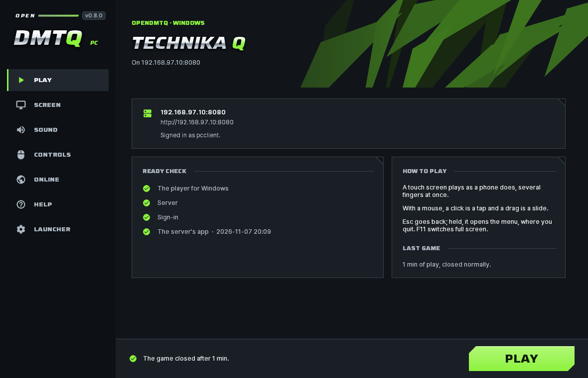

# The PC client

People can play on a Windows PC as well as on a phone or a tablet. On a PC the game runs in the player for Windows, and
the PC client sits between the player and the person: an installer, and a launcher that connects to the server, signs
in, downloads the server's app (the same app its phones install) and keeps it up to date, sets the picture and the
sound up for the PC, and starts the game. The game then plays against the server as it does on a phone.

## For players

1. On the server's site, sign in and open **Download**. Under **On a computer (Windows)**, choose **Download the
   installer for Windows**. The file it gives, `OpenDMTQ-Setup-<address>.exe`, is set up for that server.
2. Run it and choose **Install**. It installs for your Windows user, with a desktop shortcut and no administrator
   rights, and starts the launcher. If Windows says it protected your PC from an unknown app: **More info**, then **Run
   anyway**. The installer is not signed by a publisher Windows knows. Windows 11's Smart App Control, when it is on,
   blocks unsigned programs, this one among them, and has no **Run anyway**.
3. The launcher's first start walks through the server (already filled in), the sign-in with your site ID, the app's
   download, the picture and the sound, then **PLAY**.

The installer from the project's [releases](https://github.com/kanggu12/openDMTQ/releases/latest) (`OpenDMTQ-Setup.exe`)
is the same program without a server: its first start asks for the server's address. One launcher keeps several
servers, each with its own sign-in and app, and plays on the one chosen on the **Online** page.

### The launcher

| Page | What it has |
| :--- | :--- |
| **Play** | The server and the account, the checks before a start (the player, the server, the sign-in, the app), how to play, the last play, and **PLAY** |
| **Screen** | Full screen or a window, the window's size, VSync, the frame limit, the render scale |
| **Sound** | The volume, the device, shared or the device alone, the buffer |
| **Controls** | What the touch screen, the mouse and the keyboard do |
| **Online** | The servers, the sign-in, the app on this PC and a check for a newer one |
| **Help** | What to try when something does not work, and the logs |
| **Launcher** | The language, updates of the launcher, the first-start guide again |

**PLAY** asks the server for a newer app first and downloads it when there is one; when the server cannot be asked, the
game starts with the app this PC has. The launcher updates itself from the project's releases: **Launcher**, **Check for
updates**. While the game runs the launcher steps aside, and comes back when the game ends.

`OpenDMTQ-cmd.exe`, next to the launcher in its folder, does the same from the command line, each step a flag
(`OpenDMTQ-cmd.exe --help`): connect, sign in and out, download, the settings, the sound devices, **PLAY**, updates.

### In the game

| Input | What it does in the game |
| :--- | :--- |
| A touch screen | Fingers, as many at once as the screen takes, each with the time it saw it |
| The mouse's left button | One finger on the screen: tap, hold and drag |
| The mouse wheel | Scrolls what is under the pointer, as a finger's drag; with Shift, across |
| A pen | One finger |
| Esc | The phone's Back key: pauses a song, closes what is open. Held, the menu |
| The keyboard | Text where the game asks for it (Enter ends it, Esc cancels it), Hangul too |
| The touch keyboard | Comes up when a touch opens the game's text, and types into it |
| F11, or Alt+Enter | Full screen, and back |

- **The menu** comes up from the round button at the top right; from Esc held; from a finger drawn down from the top
  edge of the game; and from Alt+F4 or the window's close button. The button shows while the mouse moves in the top
  quarter of the game with its button up, so it stays out of the way of a song played with the mouse. The menu has
  **Back to the game**, full screen or a window, and **Quit the game**, the one way the game ends. The game holds still
  while the menu is open, as a phone's game does when its owner leaves it: a song stops where it was, with the game's
  own pause screen on return. The arrow keys and Enter choose in it, and Esc closes it. Minimised, the game holds still
  behind the menu the same way, and the menu is there when the game comes back.
- **The pointer** over the game is a dart in the logo's look: a chrome left face and a lime right face with a dark rim.
  While the button is down it is all lime and a little smaller. It is sized for the display's scaling.
- **A touch screen** is the player's first input, as a phone's screen is the game's. Windows' own touch feedback stays
  off the game (no circles under the fingers, no square for a press and hold, no right click for it), and in full screen
  a finger that comes in from the screen's edge stays the game's instead of opening Windows' panels. Each touch reaches
  the game as Windows takes it in.

### The picture

- **Full screen or a window.** Full screen is a borderless window over the whole display, at the display's own pixels
  whatever its scaling. A window opens at three quarters of the display's height at 16:9, or at the size chosen. The
  game fills the window while its shape is between 4:3 and 21:9; a window of another shape, such as a display turned
  upright, has black around the game. Moved to a display with other scaling, the game draws at the new size.
- **VSync on** (the default): each frame goes out on a refresh of the display the window is on, 60 Hz, 144 Hz, 240 Hz or
  another. A PC that does not keep up takes every second refresh (120 frames a second on a 240 Hz display), then every
  third, and tries the faster rate again after a while.
- **The frame limit:** the display's rate (the default), a number, or none. With VSync on, a limit that is a whole
  fraction of the display's rate, or within 10 % above one, keeps every frame the same length (60 or 120 on a 240 Hz
  display); another limit is held by the clock, with each frame still on a refresh (144 on a 240 Hz display).
- **VSync off:** frames go out as soon as they are drawn, evenly at the limit, which may be above the display's rate, or
  as fast as the PC draws without one. A little less delay, and the picture may tear.
- **The render scale** draws the game at a share of the window's pixels (100 % down to 50 %), stretched to fill it:
  lighter for the graphics card, and softer.

Measured on a 240 Hz display (4K, RTX 4090): 240 frames a second with VSync, none late in 480, in full screen at 100 %
and at 50 %; a limit of 120, 120.0 frames a second, none late; VSync off, 240.6 frames a second, 95 % of the frames
within 4.5 ms of their time; no limit, 733 to 965.

### The sound

- **The device:** Windows' default output, which the game follows when Windows changes it mid-game, or one chosen.
- **Shared or the device alone.** Shared plays alongside other programs' sound. The device alone (WASAPI's exclusive
  mode) has the least delay, with buffers of the device's own period (3 ms on a device that has it); other programs are
  silent meanwhile, and the sound is shared when Windows does not allow it.
- **The buffer:** low (Windows' low-latency mode, where the device has a shorter period than its standard one), normal,
  or safe for a busy PC.
- **The volume** of the game, 0 to 100. Windows' own volume still applies.

### Broadcasting

While broadcasts are on for the server and its owner shows a player live, the player broadcasts from the PC as a phone
does, with Windows' own video and sound encoders, at the quality the owner chose ([live broadcasts](live.md#from-a-pc)). A card at the top of the game
says when a broadcast starts and ends, and where it can be watched.

### What it needs, and what it keeps

- **What it needs:** 64-bit Windows 10 or 11 on an x64 PC (Intel or AMD), and a graphics card with Direct3D 11. About
  350 MB of disk to start: the program about 85 MB, each server's app about 110 MB, the app's libraries about 40 MB, and
  the game's data 111 MB after a first start and one song, more with each song it downloads. The installer itself is
  about 60 MB.
- **The videos** need Windows' Media Foundation. The N and KN editions of Windows come without it: there, install the
  Media Feature Pack, under Settings, Optional features (in Apps or in System, by the version of Windows). Without it
  the videos are black and silent, and the game goes on.
- **The language** is Windows' display language: Korean or English for the installer, the launcher and the menu over
  the game (the launcher's can be changed on its **Launcher** page), and the game's among those it has.
- **What it keeps on the PC,** per Windows user:
  - the program, in `%LOCALAPPDATA%\OpenDMTQ.Client`;
  - the launcher's settings and logs, and each server's app, in `%LOCALAPPDATA%\OpenDMTQ\client`;
  - what the game keeps, in a folder named after the app's package in `%LOCALAPPDATA%\OpenDMTQ`: the app's libraries
    (`lib`), the game's settings and the songs it downloaded (`data`), and the player's log, `player.log`, which starts
    over past 8 MB and keeps the part before as `player.log.1`.

  Scores are kept on the server. The launcher keeps the server's sign-in cookie, never the password. Uninstalling
  (Windows' Settings, Apps) removes the program; the other two folders stay for a later install.
- **The account:** a PC is a player of its own, apart from the same person's phone. The server gives each new device a
  new account, and the device id the PC goes by is kept in the game's folder: deleting that folder makes this PC a new
  player. The game's own account transfer carries a player to another device: on the device that has the player,
  **OPTION**, **CONNECT ACCOUNT** shows a code; on the other, **OPTION**, **RESTORE DATA** takes it, and that device
  then plays as the same player, with its records.

## For server owners

Nothing to do, unless the server has no internet (below). The site's Download page offers the installer to signed-in
players, with the server's address and name added to its end as it is handed out: the installer reads them and sets the
launcher up for the server. The file is the same for every server, so the server builds nothing for it. The admin
pages' **App** page offers the same installer, and the launcher downloads the app the site offers phones, signed in with
the player's site account (`client.php` answers it). The `OpenDMTQ.exe` of the server's Windows bundle, which runs the
server, and the PC client's `OpenDMTQ.exe`, the launcher, are two different programs.

Where the server gets the installer, the first that has one:

- **Beside the server's code:** a release's tools image and the Windows bundle bring it.
- **`data/apk`:** put there by hand, for a server without internet, or fetched there before.
- **The latest release:** fetched into `data/apk` when there is none, as Docker Compose from the source and a host
  install on Linux or macOS do.

A copy in `data/apk` gives way to the latest release's once it is a week old, and stays when that fetch fails. After a
fetch that failed, the builder waits a day before it tries again: a server without internet does not wait for an answer
at every start. Without internet, put the release's `OpenDMTQ-Setup.exe` and `OpenDMTQ-Setup.exe.version` in `data/apk`
([without internet](closed-network.md)). Without an installer the site shows no Windows button, and everything else
works as before.

The launcher signs in with the site's accounts, made on the admin pages' **Accounts** page, with the same limit on wrong
passwords as the site. A server reached over HTTPS hands out installers that use it, with the port named (HTTPS answers
on the game's port). Where the server has its own certificate authority (Docker Compose makes one), the installer
carries it, and the launcher trusts it for that server alone, beside Windows' own authorities.

## How it works

The player runs the game's own 32-bit Android code, as the app does on phones that cannot run 32-bit apps: the
[arm32 runtime](../arm32/README.md) translates the game's ARM code (Dynarmic), and a small layer gives it Linux's system
calls on Windows. In place of Android's Java side, the player has its own stand-in for the classes the game calls. The
game draws with OpenGL ES, which ANGLE runs on Direct3D 11; its sound goes out through WASAPI, and its videos are
decoded by Media Foundation. The menu, the notice and the pointer are drawn by the player over the game's window.

The launcher is Python with Tk, made into a Windows program with PyInstaller; Velopack installs it and updates it. The
launcher writes the player's settings into a file and starts the player with it (`--app` names the folder of the
server's app, `--settings` the file).

## When something goes wrong

- **The game does not start:** the launcher says why on its **Play** page, with a button to the player's log. The log
  is `player.log` in the game's folder in `%LOCALAPPDATA%\OpenDMTQ`; the launcher's own is in
  `%LOCALAPPDATA%\OpenDMTQ\client\logs`.
- **The installer says a game is going on:** finish it and close the game; installing replaces the player it plays in.
- **The sign-in is refused:** the ID and password are the site's. Too many wrong passwords make the server wait a while
  before the next try.
- **Windows blocks it with no Run anyway:** Smart App Control is on (step 2 above).
- **The videos are black and silent:** see the Media Feature Pack above.
- **It cannot reach the server:** the PC has to reach the server's address, as a phone does: on the same network, or
  over the internet when the server is set up for it ([playing from outside your home](internet.md)).
- **The sound breaks up:** choose a safer buffer on the **Sound** page, or shared instead of the device alone.
